# LifeKeel Architecture

> **Document status:** implementation-aligned architecture snapshot, reviewed
> against the repository on 17 October 2026.
>
> **Status legend:** **Implemented** means an exercised code path exists in this
> repository. **Bounded** means the capability exists with an intentional scope
> or feature gate. **Planned** means vision only and must not be inferred from a
> diagram as shipped behavior.

## Product intent and non-negotiable boundaries

> LifeKeel is the autonomous digital twin for your family. Keel understands a
> family's life, protection, assets, and preferences; anticipates what may be
> needed; and acts only within explicit trust and regulatory boundaries.

LifeKeel is not a chatbot with memory. It is a living, tenant-isolated family
model connected to deterministic intelligence, bounded language models, human
review, and narrowly controlled actions.

The product rests on three pillars:

- **Crisis resilience:** cash-flow runway, protection gaps, emergency readiness,
  life-event playbooks, continuity, and estate preparedness.
- **Life-stage twins:** household and per-member views covering adult financial
  identity, protection, retirement, youth education, and literacy.
- **Proactive intelligence:** continuous detector evaluation, readiness changes,
  scenario watchlists, nudges, reminders, and a family heartbeat.

Two rules constrain every layer:

1. **No irreversible financial, legal, medical, or similarly consequential
   action without explicit human approval.** Confidence never replaces consent.
2. **LifeKeel remains informational, not a regulated product adviser or
   arranger.** It describes records and gaps; it does not recommend products,
   providers, switching, investment transactions, or payment initiation.

`CLAUDE.md` is authoritative for these rules. `SECURITY.md` records removed
legacy surfaces and known security gaps. The LLM architecture and open-model
research is in
[`docs/reviews/llm-system-one-and-open-model-strategy-2026-10.md`](docs/reviews/llm-system-one-and-open-model-strategy-2026-10.md).

---

## 1. System context

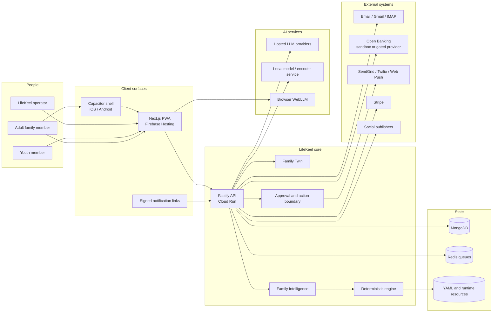

### What is implemented

- `apps/web`: statically exported Next.js application served by Firebase
  Hosting. It contains family, assistant, readiness, inbox, event, cash-flow,
  asset, legacy, vault, connector, settings, growth, and operator surfaces.
- `apps/api`: Fastify application that owns authorization, the Family Twin,
  detector orchestration, ingestion, notifications, background jobs, and all
  external side effects.
- `apps/mobile`: Capacitor shell loading the production PWA, outside the root
  Turbo graph. It adds native push, camera capture, and optional biometric
  launch gating; it is not a separate product or backend.
- MongoDB is the durable application store. Redis backs webhook and asynchronous
  work queues. Runtime YAML and evaluation files are load-bearing resources.

---

## 2. Product model: vision and current reality

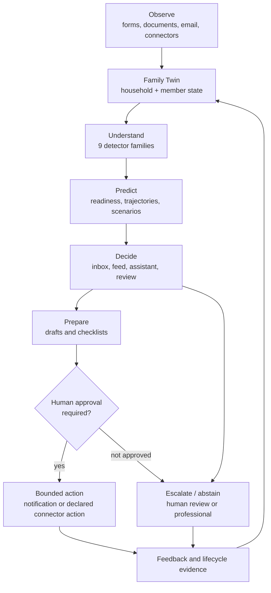

| Layer | Implemented scope | Deliberate boundary / next gap |
|---|---|---|
| **Family Twin** | Household roster and roles; member invites; financial profile; policy-level protection; cash-flow ledger; assets register; family context; member twin/readiness; youth-redacted twin; vault; legacy register and relationship graph | Health data remains deferred; explicit per-field decision rights and richer preferences are not yet a mature domain |
| **Family Intelligence** | Nine YAML detector families; readiness score/history; per-member readiness; deterministic scenario and timeline math; feed/heartbeat; scenario watchlist; estate and legacy checks; stale-profile sweeps | Live transaction behavior is limited by provider integrations; models never own financial calculations |
| **Keel HQ and member agents** | Ask Keel; inbox; deterministic member personas/nudges; persisted daily member-agent reconciliation; youth literacy curriculum; life-event playbooks; prepare-only drafts | This is a bounded workflow system, not an open-ended autonomous multi-agent runtime |
| **Action layer** | Exact action preview; human-approved email/WhatsApp/CRM/log actions; receipts and audit; opt-in scheduled reminders; auto-execution restricted to trusted `log_only` scopes | No money movement, claims filing, product switching, legal filing, medical action, or autonomous document release |
| **Action Network** | Email/Gmail/IMAP; read-only account-info connector interface, sandbox flow, and gated TrueLayer-compatible path; delivery providers; Stripe; social publishing for operator-reviewed marketing | Open Banking OAuth and scheduled production sync depend on AISP onboarding; insurer, hospital, employer, and airline partner APIs are not general integrations |

### Family and member shape

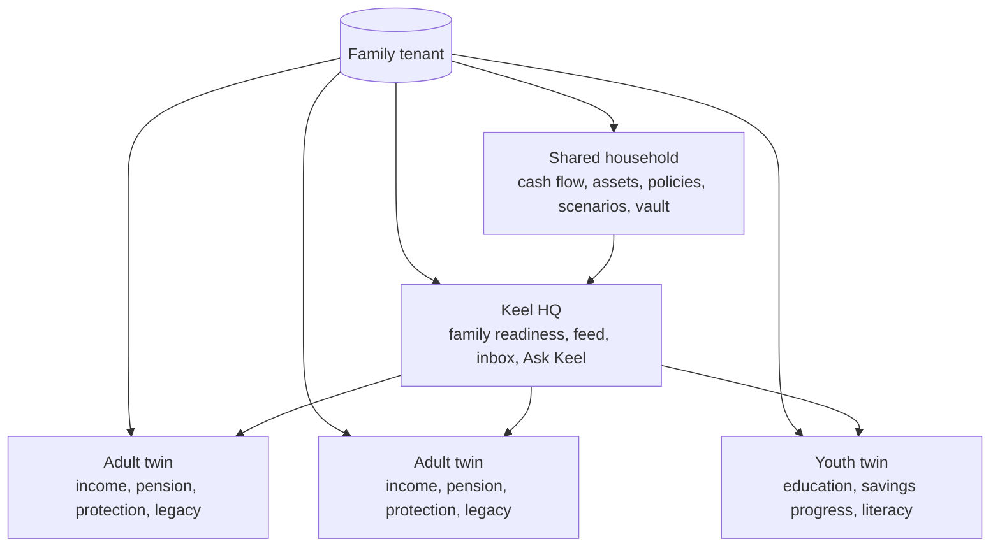

A “member agent” is currently a deterministic, persisted nudge/read-model loop,
not a separately hosted LLM agent. `jobs/member-agent-loop.ts` reconciles member
nudges daily; member-specific pages and Ask Keel scopes consume the same Family
Twin with role-aware redaction.

---

## 3. Repository and dependency architecture

```mermaid
flowchart TB
  Web[apps/web]
  Mobile[apps/mobile\noutside Turbo]
  API[apps/api]

  Engine[@lifekeel/engine]
  Pipeline[@lifekeel/pipeline]
  Workflows[@lifekeel/workflows]
  MongoAdapter[@lifekeel/mongodb-adapter]
  Platform[@lifekeel/platform]
  Runtime[@lifekeel/runtime]
  Specs[@lifekeel/specifications]
  Eslint[@lifekeel/eslint-config]

  Web -->|HTTP only| API
  Mobile -->|loads PWA| Web
  API --> Engine
  API --> Pipeline
  API --> Workflows
  API --> MongoAdapter
  API --> Platform
  API --> Runtime
  API --> Specs
  Pipeline --> Engine
  Pipeline --> Platform
  Workflows --> Platform
  Engine --> Platform
  Platform --> Runtime
  MongoAdapter --> Runtime
  MongoAdapter --> Specs
  Runtime --> Specs
  Eslint -.development.-> API
  Eslint -.development.-> Engine
```

### Package responsibilities

| Package | Responsibility | Does not own |
|---|---|---|
| `@lifekeel/engine` | YAML detector loading/evaluation, evidence, scoring, calibration, temporal patterns, detector eval support | HTTP, authentication, external actions |
| `@lifekeel/platform` | Auth, tenant primitives, money, telemetry, LLM routing/guards/cache/budgets, encryption, shared infrastructure | Product routes and detector content |
| `@lifekeel/pipeline` | Connector loading, event normalization, SHA-256 deduplication, connector sync orchestration | Provider credentials or user-facing routes |
| `@lifekeel/workflows` | Connector OAuth/credential plumbing, schema registry, bounded connector action execution | The removed generic `WorkflowEngine`/`WorkflowLoader` automation runtime |
| `@lifekeel/specifications` | Portable outcome specifications and provider/domain contracts | Persistence and execution |
| `@lifekeel/runtime` | Replaceable ports and reference adapters for outcome lifecycle | Mongo-specific implementation |
| `@lifekeel/mongodb-adapter` | MongoDB implementations of runtime/outcome-lifecycle ports | Business rules |
| `@lifekeel/eslint-config` | Shared Node/base lint configuration | Runtime code |

### Load-bearing runtime resources

These are read at boot or request time and must ship with the API image:

- `detectors/family/*.yaml`: nine current detector families.
- `detector-evals/`: golden detector fixtures and promotion evidence.
- `connectors/`: connector contracts, including open-banking and email shapes.
- `definitions/`, `verticals/`, `category-table.yaml`: engine metadata.
- Life-event playbook definitions consumed by the API renderer.
- `scripts/fetch-yfinance.py` remains a runtime resource from the extracted
  platform but is not evidence of a user-facing trading product.

The repository intentionally removed the generic legacy workflow automation
engine and 25 legacy workflow YAMLs. Do not infer their existence from the
`@lifekeel/workflows` package name.

---

## 4. API composition

The Fastify server is a modular monolith. This is deliberate: tenant checks,
audit, detector state, and action receipts remain in one deployable transaction
boundary while shared algorithms live in packages.

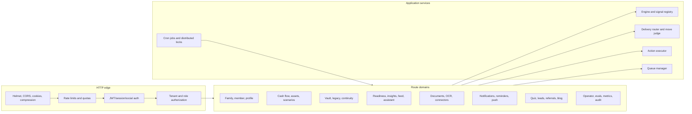

### Domain map

- **Identity and access:** `auth-users.ts`, `auth-social.ts`, `account.ts`, MFA,
  sessions, email verification, role and family permission helpers.
- **Family Twin:** `family-group.ts`, `family-join.ts`,
  `family-financial-profile.ts`, `member-twin.ts`, `family-cashflow.ts`,
  `family-assets.ts`, `family-legacy.ts`.
- **Intelligence:** `family-readiness.ts`, `insights.ts`, `family-inbox.ts`,
  `family-feed.ts`, `family-scenarios.ts`, `assistant.ts`, detector evals.
- **Crisis and continuity:** `life-events.ts`, playbook renderer, checklist
  reminders, continuity checks, vault reminders.
- **Ingestion:** `documents.ts`, `ocr/*`, `family-connectors.ts`,
  `connector-credentials.ts`, email scan, account-info sync.
- **Actions and delivery:** action preview/executor, delivery router, local/cloud
  move judge, reminders, push, signed links, receipts.
- **Commercial and growth:** billing, readiness quiz, leads, referrals, share,
  blog, case studies, lifecycle and marketing routes.
- **Operations:** operator console, tenant health, runbooks, audit log, metrics,
  evaluation and queue controls.

---

## 5. Family Twin and data ownership

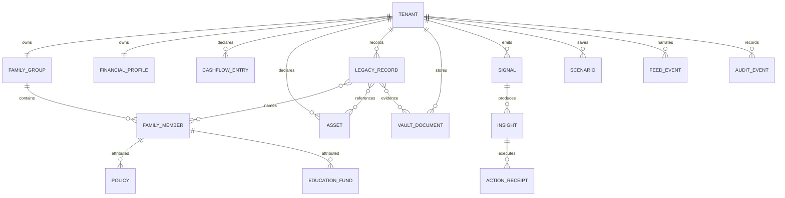

### Source-of-truth rules

- Profile, cash-flow, asset, legacy, policy, and member records are explicit
  tenant-owned state.
- Extracted document fields are **candidates** until a person applies them.
- External accounts are read-only synchronized records, not payment authority.
- Scenarios save inputs and recompute from current profile state on read.
- Readiness is deterministic and explainable from component inputs and insights.
- The readiness feed is a read model of state changes, not a second source of
  truth.
- Legacy verification labels distinguish document-linked evidence, user
  declarations, family understanding, and unverified claims; LifeKeel does not
  determine legal validity or ownership.

### Persistence and isolation

MongoDB collections carry `tenant_id`; reusable repositories enforce tenant
scope and route-level tests exercise cross-tenant isolation. Sensitive settings,
connector tokens, and server-side vault content use authenticated encryption.
Audit records capture security- and action-relevant events.

The vault supports two layers:

1. server-side AES-256-GCM encryption for all stored content;
2. optional browser-side PBKDF2 + AES-256-GCM sealing under a family-held
   passphrase, leaving metadata visible and providing no recovery.

---

## 6. Observe: ingestion and connector flows

### Document and email ingestion

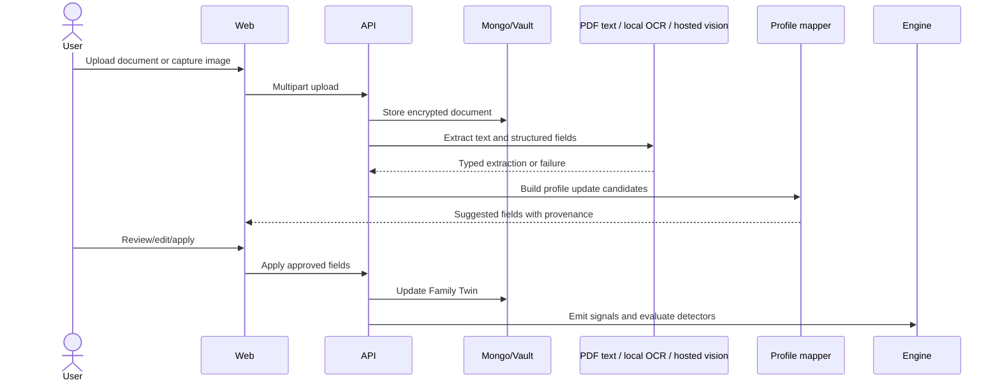

Email scanning follows the same extraction path for allow-listed attachments.
It can run directly or fan out through Redis-backed queue workers. Failed OCR is
retried by a scheduled job. Untrusted email/document content is data, never
authority to select tools or approve actions.

### Connector pipeline

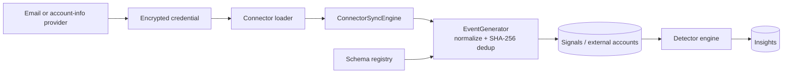

The account-info path is permanently read-only. A sandbox provider makes the
pipeline testable; a real provider path is feature-gated until compliant OAuth
consent and partnership configuration exist.

---

## 7. Understand and Predict: deterministic intelligence

Nine detector families currently live in `detectors/family/`:

1. protection gap;
2. emergency-fund adequacy;
3. emergency trajectory;
4. retirement gap;
5. education shortfall;
6. education pacing;
7. debt health;
8. policy review;
9. estate readiness.

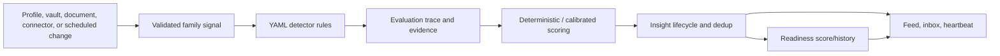

### Evaluation principles

- YAML detectors are the source of truth for declared family signals.
- The engine uses constrained expressions, schemas, evidence chains, and
  lifecycle state; arbitrary generated code is not evaluated.
- Golden datasets under `detector-evals/` measure detector behavior before
  promotion.
- Feature-hash, novelty, calibration, conformal escalation, and optional LLM
  scoring can enrich ranking or review, but they do not replace trust, consent,
  or deterministic financial math.
- Stale-profile, member-agent, scenario-watchlist, heartbeat, and policy-renewal
  jobs make intelligence proactive even when no user is logged in.

### Scenarios

Scenario calculation is pure code. It supports a horizon plus ordered regime
changes, cumulative income/expense deltas, fund balance over time, runway, and
fund-depletion month. The LLM may narrate computed results but never calculates
them. Saved scenarios recompute against current profile inputs and can emit feed
changes through the watchlist job.

---

## 8. Decide and communicate: AI architecture

LifeKeel uses models as bounded components, not as the system of record.

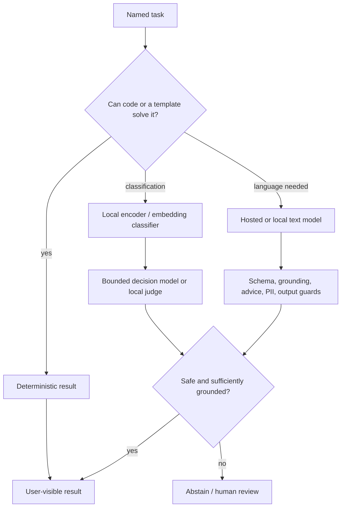

### Implemented AI paths

- Provider-neutral router: Anthropic, OpenAI/Azure, Groq, Ollama/local.
- Tier/model configuration and per-tenant overrides.
- Structured-output helper with Zod validation and guard hooks.
- Exact-match, tenant-scoped response cache.
- Local CPU embedding provider for intent classification.
- Local Ollama-compatible judge/classifier/OCR path with cloud-run IAM option.
- Optional local family-text generation with deterministic output guard.
- Browser WebLLM for opt-in crisis drafts with cloud fallback.
- Prompt version registry, A/B assignment, spans, cost/budget, and circuit-breaker
  primitives.
- Honest assistant fallback (`isLive: false`) rather than pretending generated
  content succeeded.

### Current architecture debt

The primitives are ahead of their end-to-end wiring. Before claiming a complete
AI control plane, the platform must make these mandatory on every relevant call:

- usage recording and atomic budget enforcement;
- hosted-call deadlines and the existing circuit breaker;
- the same family-facing output guard on cloud and local paths;
- task IDs, pinned model allow-lists, and complete prompt/model provenance;
- correctness labels distinct from user approval/acceptance.

Until then, the deterministic engine and human gates remain the authoritative
safety boundary. See the LLM strategy review linked at the top for the adoption
programme.

---

## 9. Act and Escalate: trust tiers

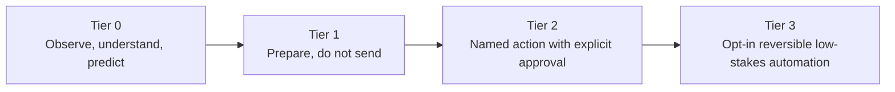

| Tier | Rule | Implemented examples |
|---|---|---|
| **0** | No external side effect | Detectors, readiness, twins, scenarios, Ask Keel, assets, legacy, youth literacy |
| **1** | Draft or checklist; user sends/submits | Insight outreach drafts, life-event preparation drafts, on-device crisis drafting |
| **2** | One narrow action after exact human approval | Detector-declared email/WhatsApp/CRM actions through preview and `ActionExecutor` |
| **3** | Opt-in, reversible, low-stakes automation only | Scheduled renewal reminders and trusted-scope `log_only` auto-execution |

### Action path

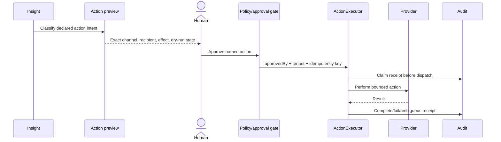

The in-app action preview and execution share classification logic. A repository
tripwire test allow-lists `ActionExecutor` callers and requires `approvedBy`.
Signed notification links exist, but the architecture review identifies their
weaker actor identity and preview as remediation work; they must not be treated
as stronger consent than authenticated in-app review.

Autonomy cannot expand by changing a model threshold. Any new action type needs
a trust-tier decision, policy implementation, preview, approval semantics,
idempotency, receipt, audit, and incident story.

---

## 10. Delivery, queues, and scheduled operation

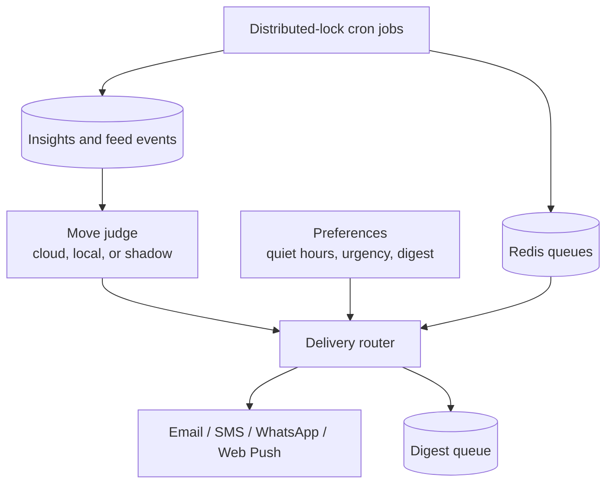

Background operation includes:

- connector polling and connector-health alerts;
- inbox scanning and queued fan-out;
- OCR retry;
- insight SLA/escalation and stale-profile evaluation;
- member-agent reconciliation;
- continuity checks;
- policy-renewal reminders;
- readiness heartbeat and scenario watchlist;
- metrics rollups, retention, billing, lifecycle, and reviewed marketing jobs.

Every cron task runs through a Mongo-backed named lock because Cloud Run can
start multiple API replicas. Queues provide asynchronous fan-out; they are not a
second source of truth. Delivery honors preferences, urgency, quiet hours,
digests, deduplication, and channel fallback.

---

## 11. Security, privacy, and tenancy

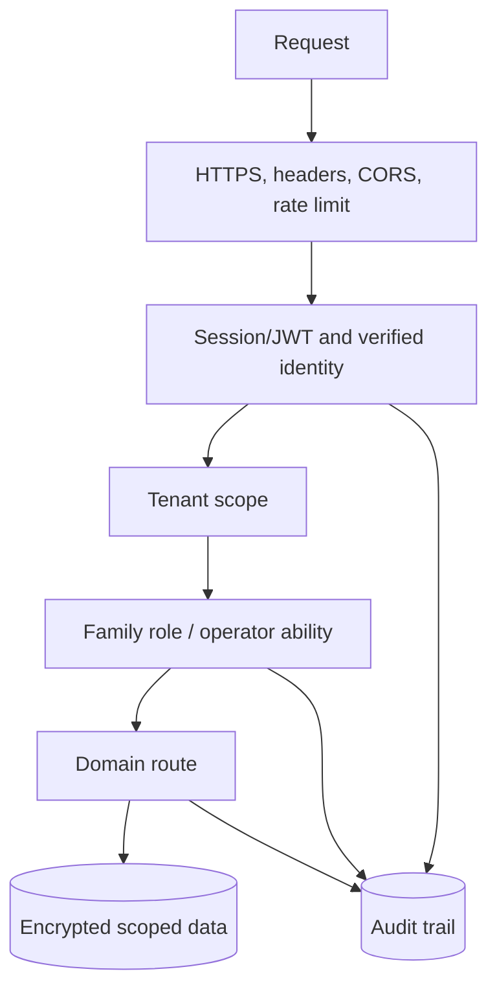

### Enforced principles

- Authentication precedes tenant and role authorization.
- Family organizer/adult/youth boundaries are enforced server-side; child-mode
  redaction is not solely a UI concern.
- Operator capabilities use separate authorization and audit paths.
- Tenant IDs are part of durable records, cache keys, queue payloads, and tests.
- Credentials and sensitive settings are encrypted at rest.
- Generated content is never permission or authorization input.
- External effects require policy gates and receipts.
- Rate limits protect authentication and model-backed routes.
- Audit, metrics, health/readiness endpoints, and runbooks support operations.

### Sensitive-domain boundary

Health records remain intentionally unimplemented because they are
special-category data and the current product value does not justify the risk.
Adding health data requires a named product requirement, data-protection impact
assessment, lawful-purpose/retention design, role model, incident plan, and
provider review before schema work begins.

---

## 12. Deployment and operations

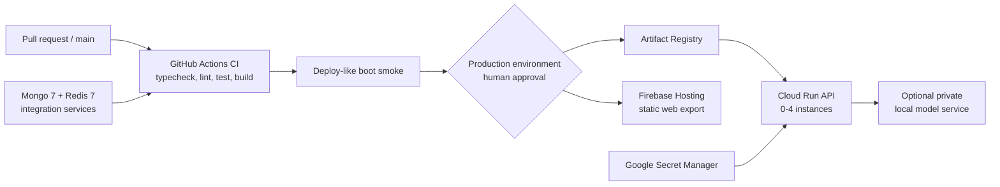

- CI runs root `pnpm typecheck`, `lint`, `test`, and `build`, with MongoDB and
  Redis service containers, plus an API boot smoke test.
- Web and API deploys are manual `workflow_dispatch` flows gated by successful
  CI and the protected `production` GitHub environment.
- The API image is stored in Artifact Registry and deployed to Cloud Run with
  scale-to-zero, bounded instances, secrets from Secret Manager, and a readiness
  smoke test.
- The web app is statically exported and deployed to Firebase Hosting. It can
  call Cloud Run directly or use a same-origin `/api` hosting rewrite.
- The optional local judge/model service has its own deployment workflow and is
  not required for the safe deterministic fallback path.
- Production deployment is intentionally not an automatic side effect of merge.

### Observability

- Structured application logging via shared logger primitives.
- Prometheus-compatible metrics route for HTTP, queues, model paths, guards,
  cache, and operational health where wired.
- OpenTelemetry initialization in the API.
- Append-only audit records for identity, sensitive reads, decisions, and
  actions.
- Operator tenant-health, configuration, audit, queue, support, billing, and
  runbook surfaces.

Known observability debt is documented rather than hidden: LLM cost, circuit
breaker, and guard primitives are not yet mandatory across every provider path.

---

## 13. Build, test, and release architecture

This is a pnpm workspace orchestrated by Turbo.

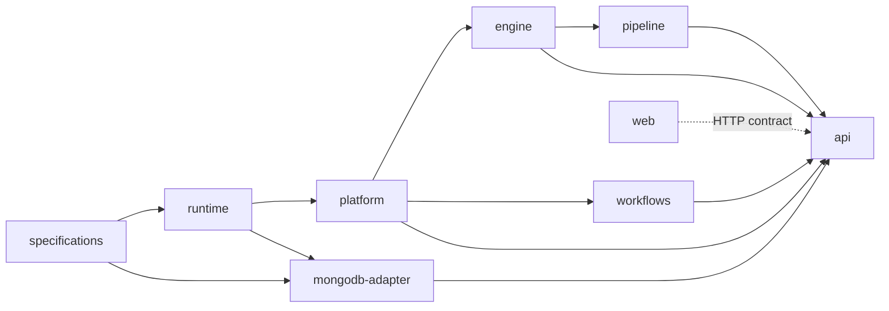

`turbo.json` builds dependencies first. Test and typecheck tasks depend on both
package and dependency builds because packages may self-import their published
workspace name. Do not run dependent package checks against missing `dist/`
outputs and conclude the source is broken; root Turbo commands are the canonical
verification path.

The mobile shell is intentionally excluded from the root graph and has separate
Capacitor commands.

---

## 14. Current capability inventory

### Implemented

- Household and per-member digital-twin records, invitations, and role-aware
  views.
- Financial profile, policies, manual cash flow, assets, context, and legacy
  register.
- Nine detector families with lifecycle, evidence, evals, and readiness
  integration.
- Composite and member readiness, score history, readiness feed, and heartbeat.
- Deterministic single- and multi-step scenarios plus watchlist changes.
- Ask Keel and scenario narration grounded in current family state.
- Life-event playbooks, checklist persistence, reminders, and vault awareness.
- Daily persisted member nudges, youth-facing redacted twin, and literacy
  curriculum.
- Document upload, PDF/OCR extraction, email attachment ingestion, and reviewed
  profile application.
- Server-encrypted vault plus optional client-side sealed documents.
- Continuity checks that notify named adults without releasing documents.
- Read-only account-info connector plumbing with sandbox and gated real-provider
  support.
- Human-approved actions, receipts, delivery channels, automation settings, and
  narrowly bounded Tier 3 jobs.
- Growth, billing, support, operator, metrics, audit, and deployment surfaces.

### Bounded or partner-dependent

- Open Banking production OAuth and scheduled account synchronization.
- Local/open model inference: optional, task-specific, and guarded by fallback.
- Social publishing: operator/marketing scope, not family autonomous action.
- Native mobile distribution: shell exists; generated platform projects and
  store release processes are external build concerns.

### Not implemented by design

- Payment initiation or money movement.
- Personal investment/insurance product recommendations or switching flows.
- Autonomous claims, legal filings, medical actions, or purchases.
- Autonomous emergency release of vault documents.
- General insurer, hospital, airline, employer, or government action APIs.
- Stored medical/health records.
- A free-running multi-agent system with arbitrary tools.

---

## 15. Roadmap principles

The roadmap is capability sequencing, not a promise of dates:

1. **Make the AI control plane enforceable:** task registry, pinned models,
   complete usage/cost recording, deadlines, breakers, global output guards,
   and task-level evals.
2. **Deepen existing family signals before adding sensitive domains:** improve
   data freshness, time-based detectors, account-info ingestion, and evidence.
3. **Mature consent and decision rights:** authenticated exact-effect review,
   member-specific permissions, and clearer adult/organizer boundaries.
4. **Strengthen Action Network read paths:** compliant partner onboarding and
   read-only data first; never use this as a path into payment initiation.
5. **Improve crisis and continuity value:** adaptive deterministic playbooks,
   richer professional handoffs, and rehearsals without autonomous legal
   release.
6. **Evaluate specialized models only behind evidence:** shadow bounded decision
   models and small open models; self-host only after a measured quality and
   fully loaded cost crossover.
7. **Treat health as a separate governance decision:** no opportunistic schema
   expansion into special-category data.

For product history and detailed acceptance criteria, see `docs/prd/`. For the
market and implementation audits that informed this snapshot, see
`docs/reviews/`.
