# LifeKeel Architecture

> **Document status:** implementation-aligned architecture snapshot, reviewed
> against the repository on 17 October 2026.
>
> **Status legend:** **Implemented** means an exercised code path exists in this
> repository. **Bounded** means the capability exists with an intentional scope
> or feature gate. **Planned** means vision only and must not be inferred from a
> diagram as shipped behavior.

## Product intent and non-negotiable boundaries

> LifeKeel is the autonomous digital twin for your family. Keel understands a
> family's life, protection, assets, and preferences; anticipates what may be
> needed; and acts only within explicit trust and regulatory boundaries.

LifeKeel is not a chatbot with memory. It is a living, tenant-isolated family
model connected to deterministic intelligence, bounded language models, human
review, and narrowly controlled actions.

The product rests on three pillars:

- **Crisis resilience:** cash-flow runway, protection gaps, emergency readiness,
  life-event playbooks, continuity, and estate preparedness.
- **Life-stage twins:** household and per-member views covering adult financial
  identity, protection, retirement, youth education, and literacy.
- **Proactive intelligence:** continuous detector evaluation, readiness changes,
  scenario watchlists, nudges, reminders, and a family heartbeat.

Three rules constrain every layer:

1. **No irreversible financial, legal, medical, or similarly consequential
   action without explicit human approval.** Confidence never replaces consent.
2. **LifeKeel remains informational, not a regulated product adviser or
   arranger.** It describes records and gaps; it does not recommend products,
   providers, switching, investment transactions, or payment initiation.
3. **Family personal content must not be training data for shared/foundation
   models.** Hosted AI processing must use task-minimized context, approved
   processor terms, explicit retention/deletion rules, and tenant-isolated
   derived artifacts.

`CLAUDE.md` is authoritative for these rules. `SECURITY.md` records removed
legacy surfaces and known security gaps. The LLM architecture and open-model
research is in
[`docs/reviews/llm-system-one-and-open-model-strategy-2026-10.md`](docs/reviews/llm-system-one-and-open-model-strategy-2026-10.md).
An adversarial multi-expert critique of this document lives in
[`docs/reviews/architecture-critical-review-2026-10.md`](docs/reviews/architecture-critical-review-2026-10.md),
and a cost/efficiency optimization review in
[`docs/reviews/architecture-optimization-review-2026-10.md`](docs/reviews/architecture-optimization-review-2026-10.md);
their findings are folded into the gap register in §16.

### How to read this document

This document follows a C4-style zoom from context to containers, components,
dynamic flows, deployment, and quality attributes. Different readers can take
short paths:

| Reader | Start here |
|---|---|
| Product or executive | Product boundaries → §2 reality → §14 control plane → §15 quality scorecard → §17 evolution plan |
| New engineer | §1 system context → §3 repository → §4 API → §5 data ownership |
| Security/privacy reviewer | §5 data → §8 AI → §9 actions → §11 security → §15.5 threat boundaries |
| SRE/platform engineer | §10 jobs/queues → §12 deployment → §15.3–15.4 scale/reliability → §15.9 operations |
| Feature author | §2 product model → §7 detectors → §8 AI → §9 trust tiers → §13 verification |

Diagrams describe logical responsibility unless explicitly labeled deployment.
An arrow means a permitted dependency or data flow, not necessarily a separate
network service.

### Executive architecture assessment

| Quality | Current maturity | Strongest evidence | Most important gap |
|---|---|---|---|
| Product safety | Good foundations | Deterministic authority, trust tiers, action preview/receipts | Children's-data posture, disclosure/sensitivity classification, marketing copy compliance guard |
| Modularity | Good | Workspace packages, domain route modules, replaceable model/connector interfaces | `server.ts` is the composition root and operational responsibilities are coupled |
| Scalability | Early production | Stateless HTTP replicas, pooled Mongo, Redis queues, locks | API, scheduler, and workers scale together; no capacity model or load tests |
| Reliability | Good foundations | Health probes, retries, DLQ, leases, graceful fallback | No published SLOs, recovery objectives, backup/restore evidence, or multi-region plan |
| Security/privacy | Good foundations | Server-side authorization, tenant scoping, vault encryption, audit, youth redaction | Provider no-training/retention terms and AI-derived erasure are not yet enforced end to end |
| AI governance | Strong design / partial wiring | Deterministic-first cascade, evals, shadow mode, guards | Cost, breakers, deadlines, processor terms, provenance, and task policy are not mandatory end to end |
| Operability | Moderate | Metrics, operator console, runbooks, readiness endpoint | Metrics are process-local and some advertised controls are inert until wired |
| Delivery maturity | Moderate | CI, smoke tests, human-gated deploys, immutable image tags | Migration/rollback/DR workflow and progressive traffic rollout are incomplete |
| Efficiency | Good design | Scale-to-zero, local encoder, cache, deterministic-first processing | Unit economics and cost-per-correct-result are not yet trustworthy end to end |

**Architectural stance:** retain the modular monolith while it preserves domain
clarity and low operational cost. Extract a deployable component only when its
security boundary, scaling profile, failure mode, or release cadence is
materially different and measured—not because microservices are assumed to be
more mature.

---

## 1. System context

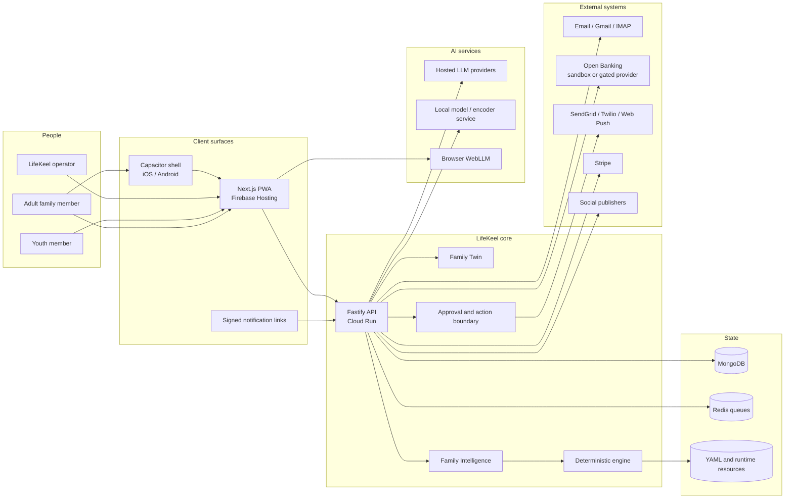

### What is implemented

- `apps/web`: statically exported Next.js application served by Firebase
  Hosting. It contains family, assistant, readiness, inbox, event, cash-flow,
  asset, legacy, vault, connector, settings, growth, and operator surfaces.
- `apps/api`: Fastify application that owns authorization, the Family Twin,
  detector orchestration, ingestion, notifications, background jobs, and all
  external side effects.
- `apps/mobile`: Capacitor shell loading the production PWA, outside the root
  Turbo graph. It adds native push, camera capture, and optional biometric
  launch gating; it is not a separate product or backend.
- MongoDB is the durable application store. Redis backs webhook and asynchronous
  work queues. Runtime YAML and evaluation files are load-bearing resources.

---

## 2. Product model: vision and current reality

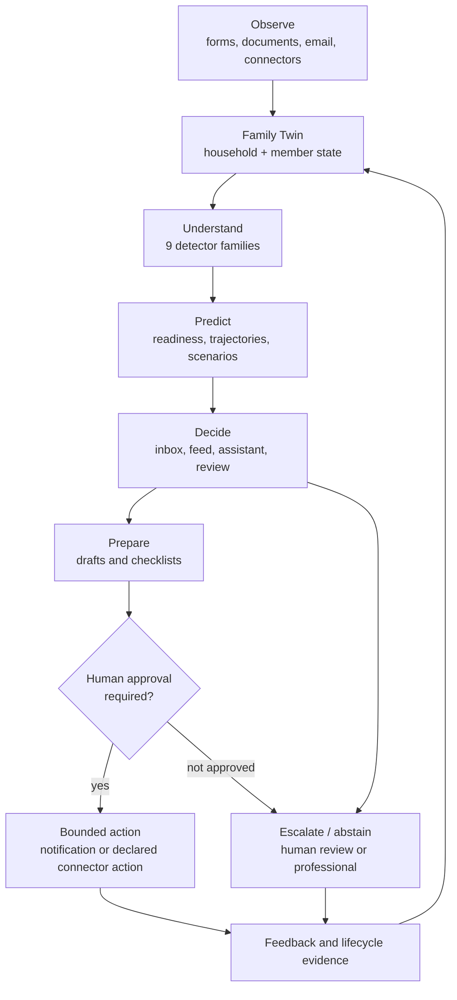

| Layer | Implemented scope | Deliberate boundary / next gap |
|---|---|---|
| **Family Twin** | Household roster and roles; member invites; financial profile; policy-level protection; cash-flow ledger; assets register; family context; member twin/readiness; youth-redacted twin; vault; legacy register and relationship graph | Health data remains deferred; explicit per-field decision rights and richer preferences are not yet a mature domain |
| **Family Intelligence** | Nine YAML detector families; readiness score/history; per-member readiness; deterministic scenario and timeline math; feed/heartbeat; scenario watchlist; estate and legacy checks; stale-profile sweeps | Live transaction behavior is limited by provider integrations; models never own financial calculations |
| **Keel HQ and member agents** | Ask Keel; inbox; deterministic member personas/nudges; persisted daily member-agent reconciliation; youth literacy curriculum; life-event playbooks; prepare-only drafts | This is a bounded workflow system, not an open-ended autonomous multi-agent runtime |
| **Action layer** | Exact action preview; human-approved email/WhatsApp/CRM/log actions; receipts and audit; opt-in scheduled reminders; auto-execution restricted to trusted `log_only` scopes | No money movement, claims filing, product switching, legal filing, medical action, or autonomous document release |
| **Action Network** | Email/Gmail/IMAP; read-only account-info connector interface, sandbox flow, and gated TrueLayer-compatible path; delivery providers; Stripe; social publishing for operator-reviewed marketing | Open Banking OAuth and scheduled production sync depend on AISP onboarding; insurer, hospital, employer, and airline partner APIs are not general integrations |

### Family and member shape

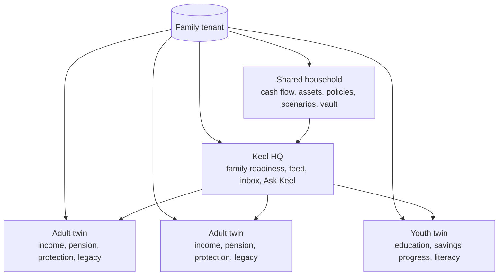

A “member agent” is currently a deterministic, persisted nudge/read-model loop,
not a separately hosted LLM agent. `jobs/member-agent-loop.ts` reconciles member
nudges daily; member-specific pages and Ask Keel scopes consume the same Family
Twin with role-aware redaction.

---

## 3. Repository and dependency architecture

```mermaid
flowchart TB
  Web[apps/web]
  Mobile[apps/mobile\noutside Turbo]
  API[apps/api]

  Engine[@lifekeel/engine]
  Pipeline[@lifekeel/pipeline]
  Workflows[@lifekeel/workflows]
  MongoAdapter[@lifekeel/mongodb-adapter]
  Platform[@lifekeel/platform]
  Runtime[@lifekeel/runtime]
  Specs[@lifekeel/specifications]
  Eslint[@lifekeel/eslint-config]

  Web -->|HTTP only| API
  Mobile -->|loads PWA| Web
  API --> Engine
  API --> Pipeline
  API --> Workflows
  API --> MongoAdapter
  API --> Platform
  API --> Runtime
  API --> Specs
  Pipeline --> Engine
  Pipeline --> Platform
  Workflows --> Platform
  Engine --> Platform
  Platform --> Runtime
  MongoAdapter --> Runtime
  MongoAdapter --> Specs
  Runtime --> Specs
  Eslint -.development.-> API
  Eslint -.development.-> Engine
```

### Package responsibilities

| Package | Responsibility | Does not own |
|---|---|---|
| `@lifekeel/engine` | YAML detector loading/evaluation, evidence, scoring, calibration, temporal patterns, detector eval support | HTTP, authentication, external actions |
| `@lifekeel/platform` | Auth, tenant primitives, money, telemetry, LLM routing/guards/cache/budgets, encryption, shared infrastructure | Product routes and detector content |
| `@lifekeel/pipeline` | Connector loading, event normalization, SHA-256 deduplication, connector sync orchestration | Provider credentials or user-facing routes |
| `@lifekeel/workflows` | Connector OAuth/credential plumbing, schema registry, bounded connector action execution | The removed generic `WorkflowEngine`/`WorkflowLoader` automation runtime |
| `@lifekeel/specifications` | Portable outcome specifications and provider/domain contracts | Persistence and execution |
| `@lifekeel/runtime` | Replaceable ports and reference adapters for outcome lifecycle | Mongo-specific implementation |
| `@lifekeel/mongodb-adapter` | MongoDB implementations of runtime/outcome-lifecycle ports | Business rules |
| `@lifekeel/eslint-config` | Shared Node/base lint configuration | Runtime code |

### Load-bearing runtime resources

These are read at boot or request time and must ship with the API image:

- `detectors/family/*.yaml`: nine current detector families.
- `detector-evals/`: golden detector fixtures and promotion evidence.
- `connectors/`: connector contracts, including open-banking and email shapes.
- `definitions/`, `verticals/`, `category-table.yaml`: engine metadata.
- Life-event playbook definitions consumed by the API renderer.
The repository intentionally removed the generic legacy workflow automation
engine and 25 legacy workflow YAMLs. Do not infer their existence from the
`@lifekeel/workflows` package name.

---

## 4. API composition

The Fastify server is a modular monolith. This is deliberate: tenant checks,
audit, detector state, and action receipts remain in one deployable transaction
boundary while shared algorithms live in packages.

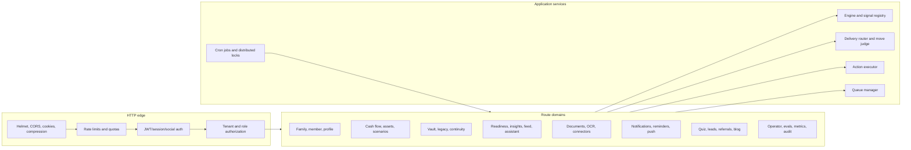

### Domain map

- **Identity and access:** `auth-users.ts`, `auth-social.ts`, `account.ts`, MFA,
  sessions, email verification, role and family permission helpers.
- **Family Twin:** `family-group.ts`, `family-join.ts`,
  `family-financial-profile.ts`, `member-twin.ts`, `family-cashflow.ts`,
  `family-assets.ts`, `family-legacy.ts`.
- **Intelligence:** `family-readiness.ts`, `insights.ts`, `family-inbox.ts`,
  `family-feed.ts`, `family-scenarios.ts`, `assistant.ts`, detector evals.
- **Crisis and continuity:** `life-events.ts`, playbook renderer, checklist
  reminders, continuity checks, vault reminders.
- **Ingestion:** `documents.ts`, `ocr/*`, `family-connectors.ts`,
  `connector-credentials.ts`, email scan, account-info sync.
- **Actions and delivery:** action preview/executor, delivery router, local/cloud
  move judge, reminders, push, signed links, receipts.
- **Commercial and growth:** billing, readiness quiz, leads, referrals, share,
  blog, case studies, lifecycle and marketing routes.
- **Operations:** operator console, tenant health, runbooks, audit log, metrics,
  evaluation and queue controls.

---

## 5. Family Twin and data ownership

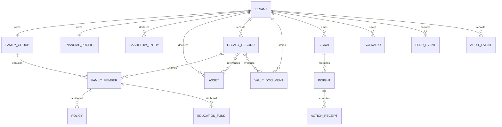

### Source-of-truth rules

- Profile, cash-flow, asset, legacy, policy, and member records are explicit
  tenant-owned state.
- Extracted document fields are **candidates** until a person applies them.
- External accounts are read-only synchronized records, not payment authority.
- Scenarios save inputs and recompute from current profile state on read.
- Readiness is deterministic and explainable from component inputs and insights.
- The readiness feed is a read model of state changes, not a second source of
  truth.
- Legacy verification labels distinguish document-linked evidence, user
  declarations, family understanding, and unverified claims; LifeKeel does not
  determine legal validity or ownership.

### Persistence and isolation

MongoDB collections carry `tenant_id`; reusable repositories enforce tenant
scope and route-level tests exercise cross-tenant isolation. Sensitive settings,
connector tokens, and server-side vault content use authenticated encryption.
Audit records capture security- and action-relevant events.

The vault supports two layers:

1. server-side AES-256-GCM encryption for all stored content;
2. optional browser-side PBKDF2 + AES-256-GCM sealing under a family-held
   passphrase, leaving metadata visible and providing no recovery.

---

## 6. Observe: ingestion and connector flows

### Document and email ingestion

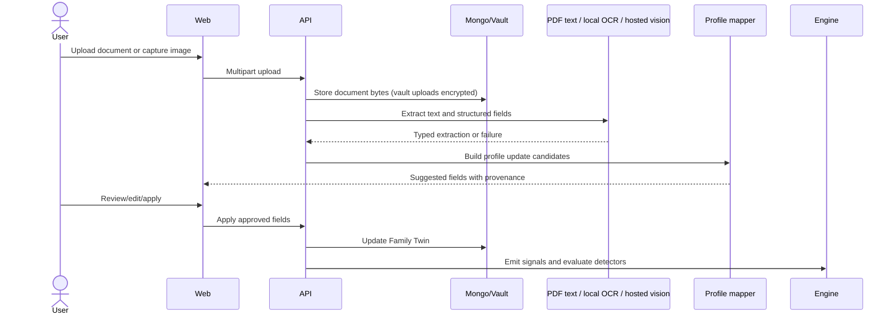

Email scanning follows the same extraction path for allow-listed attachments.
It can run directly or fan out through Redis-backed queue workers. Failed OCR is
retried by a scheduled job. Untrusted email/document content is data, never
authority to select tools or approve actions.

### Connector pipeline

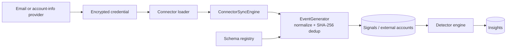

The account-info path is permanently read-only. A sandbox provider makes the
pipeline testable; a real provider path is feature-gated until compliant OAuth
consent and partnership configuration exist.

---

## 7. Understand and Predict: deterministic intelligence

Nine detector families currently live in `detectors/family/`:

1. protection gap;
2. emergency-fund adequacy;
3. emergency trajectory;
4. retirement gap;
5. education shortfall;
6. education pacing;
7. debt health;
8. policy review;
9. estate readiness.


### Evaluation principles

- YAML detectors are the source of truth for declared family signals.
- The engine uses constrained expressions, schemas, evidence chains, and
  lifecycle state; arbitrary generated code is not evaluated.
- Golden datasets under `detector-evals/` measure detector behavior before
  promotion.
- Feature-hash, novelty, calibration, conformal escalation, and optional LLM
  scoring can enrich ranking or review, but they do not replace trust, consent,
  or deterministic financial math.
- Stale-profile, member-agent, scenario-watchlist, heartbeat, and policy-renewal
  jobs make intelligence proactive even when no user is logged in.

### Scenarios

Scenario calculation is pure code. It supports a horizon plus ordered regime
changes, cumulative income/expense deltas, fund balance over time, runway, and
fund-depletion month. The LLM may narrate computed results but never calculates
them. Saved scenarios recompute against current profile inputs and can emit feed
changes through the watchlist job.

---

## 8. Decide and communicate: modern AI architecture

LifeKeel uses models as bounded components, not as the system of record. Four
internal review passes—AI systems, safety/privacy, evaluation/MLOps, and AI
FinOps/SRE—concluded the core design is correct. The priority is to make
existing controls mandatory and measurable, not to add a general agent
framework.

### 8.1 Authority and computation cascade

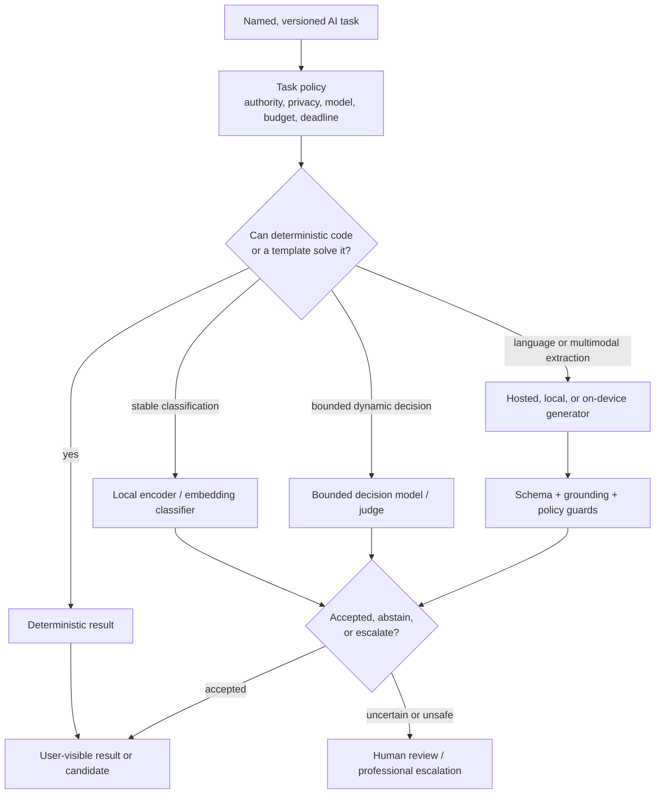

The cascade follows five rules:

1. deterministic code is cheaper, safer, and authoritative where the task is
   expressible exactly;
2. small encoders/classifiers serve stable, bounded labels;
3. typed decision models serve dynamic bounded choices with calibrated
   distributions;
4. generators produce language or extraction candidates, never permissions or
   financial truth;
5. uncertainty, policy failure, or insufficient evidence causes abstention,
   fallback, or human review.

### 8.2 Implemented AI capabilities

| Capability | Implementation state | Current use |
|---|---|---|
| Provider abstraction | Implemented | Anthropic, OpenAI/Azure, Groq, Ollama through `LlmFn` |
| Reasoning tiers and tenant overrides | Implemented, task-gated | Fast/balanced/powerful selection bounded by each task's `allowed_models` |
| Typed local decisions | Implemented | Ollama JSON-schema constrained output + Zod validation |
| Structured cloud output | Implemented primitive | Prompted JSON, parse/retry, Zod, guard hooks |
| Local embeddings | Implemented | CPU `bge-small-en-v1.5` intent-classifier tier |
| Encoder shadow/gate | Implemented | GLiNER-style email relevance pre-classifier |
| Local judge/classifier/OCR | Implemented and optional | Guarded CPU Ollama service with IAM and measured capacity |
| On-device generation | Implemented and bounded | Opt-in WebLLM crisis drafts with cloud fallback |
| Exact response cache | Implemented, partially adopted | Tenant/task/system/prompt/model hash; scorer path |
| Prompt version registry | Implemented primitive, limited adoption | Candidate/A-B/production/retired lifecycle and spans |
| Model output guards | Implemented | Advice/provider/ungrounded-number checks + symmetric input/output guards on cloud, local and vision paths via the task gateway |
| Budget and cost ledger | Implemented | Per-tenant limits checked pre-call; every provider (incl. Azure/Ollama) records usage to CostLedger per task/tenant; atomic reservation still debt (§8.15) |
| Circuit breaker | Implemented | Per-task key (`task:<id>`) wraps every governed provider call |
| Shadow evaluation | Implemented | Local move-judge comparison and dangerous-permissive outcome |
| Calibration/selective prediction | Implemented | Platt/isotonic metrics and conformal escalation in engine |
| Detector and local-model evals | Implemented | Golden detector suites and bounded local-model gate |
| Honest degraded mode | Implemented | `isLive: false`, rule-only scoring, human-review fallback |

### 8.3 Mandatory AI task gateway

Every production `LlmFn`, `DecisionFn` and vision call passes through one
LifeKeel-owned gateway (`apps/api/src/ai/task-gateway.ts`, policies in
`definitions/ai-tasks.yaml` — implemented per §8.15). It remains an in-process
module until another language or independent deployment genuinely needs the
same policy.

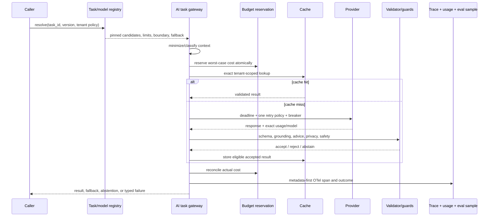

The gateway order is deliberate:

- **context policy before spend** prevents prohibited data from leaving its
  boundary;
- **atomic reservation before call** prevents concurrent budget overshoot;
- **one retry layer** prevents breaker + SDK + queue retry multiplication;
- **absolute task deadline** bounds retries and queue wait;
- **breaker per provider/model/task class** fails fast during incidents;
- **guard after every provider** eliminates cloud/local safety asymmetry;
- **usage and trace in `finally`** records failures as well as successes.

Do not introduce a hosted AI gateway/proxy yet. Revisit LiteLLM-, Kong-, or
cloud-gateway-class tooling only if non-TypeScript services need the same
control plane, central provider contracting demands it, or maintaining protocol
adapters becomes materially expensive. Another proxy is another sensitive-data
processor and failure boundary.

### 8.4 Task-policy registry

The task registry is the central modern-AI contract:

```ts
interface AiTaskPolicy {
  task_id: string
  version: string
  owner: string
  purpose: string
  risk: 'internal' | 'user_visible' | 'workflow_affecting' | 'external_effect'
  authority: 'language_only' | 'candidate_for_review' | 'bounded_decision'
  data_boundary: 'device_only' | 'lifekeel_infra' | 'approved_hosted_provider'
  input_schema: string
  output_schema: string
  processor_terms_ref: string
  provider_retention_class:
    | 'none'
    | 'service_transient'
    | 'zero_data_retention'
    | 'limited_abuse_log'
  model_training_use: 'prohibited'
  deletion_propagation: string[]
  allowed_models: string[]
  primary_model: string
  fallback_models: string[]
  preferred_execution:
    | 'deterministic'
    | 'local_encoder'
    | 'local_cpu'
    | 'on_device'
    | 'hosted_sync'
    | 'hosted_batch'
    | 'self_hosted_accelerated'
  deadline_ms: number
  max_attempts: number
  max_input_tokens: number
  max_output_tokens: number
  target_cost_per_accepted_result_usd: number
  budget_class: string
  cache_policy: string
  guard_policy: string
  eval_suite: string
  promotion_gate: string
  abstention: 'fallback' | 'human_review' | 'reject'
}
```

Initial tasks:

- `assistant.answer.v1`
- `assistant.scenario_narration.v1`
- `document.classify.v1`
- `document.extract.v1`
- `document.profile_candidate.v1`
- `email.policy_relevance.v1`
- `email.policy_summary.v1`
- `insight.score_enrichment.v1`
- `insight.delivery_judge.v1`
- `draft.outreach.v1`
- `draft.crisis_on_device.v1`
- `support.reply_draft.v1`
- `marketing.social_draft.v1`

Keyword reasoning-tier estimation remains only a development fallback/hint. A
production task selects from exact allow-listed model versions that passed its
eval suite.

### 8.5 Model and artifact registry

A lightweight reviewed registry is needed now; a full MLOps product is not.
Each hosted or local model record should include:

- immutable model/deployment ID and provider;
- task approvals and effective dates;
- modalities, context/output limits, structured-output, prompt-cache and
  batch support;
- measured latency/throughput, memory/accelerator footprint, deployment mode;
- data residency, retention/training terms, DPA/subprocessor reference,
  abuse-monitoring and deletion behavior;
- input/output/cache/reasoning price and effective date;
- model card, known limitations, safety results, owner and rollback model;
- retirement/deprecation date;
- for local artifacts: source, license, weight digest, quantization lineage,
  runtime/container digest, SBOM/AI-BOM, evaluation hash and signature.

Unknown models fail closed in production. Mutable aliases and Ollama tags are
allowed in evaluation only; production local artifacts are digest-pinned.
CycloneDX ML-BOM or an equivalent signed manifest can represent provenance.
MLflow Model Registry becomes useful only if LifeKeel starts training or
fine-tuning multiple artifacts; until then, versioned YAML/Mongo metadata plus
OCI artifacts is simpler.

### 8.6 Structured generation and multimodal extraction

- Zod remains the application schema source.
- Prefer provider-native constrained outputs—JSON Schema response format,
  forced tool/schema result, or local constrained decoding—over “return JSON”
  prompt text. Parse and validate again regardless.
- Generation retries receive validation errors, not raw secrets or unrelated
  context.
- Document extraction follows a confidence-aware cascade:

```text
native PDF text / parser
  -> typed field extraction
  -> page/image rendering for scanned PDFs
  -> cost-effective vision model
  -> stronger model only for low-confidence fields
  -> field-level source/page provenance
  -> human review before Twin mutation
```

Scanned-PDF rendering is a known missing capability. Specialized document-AI
services or a local multimodal model are evaluated only against category-level
field precision/recall and fully loaded cost. Generic visual benchmarks are not
a promotion gate.

### 8.7 Context engineering, retrieval, and memory

LifeKeel should practice context engineering rather than indiscriminate long
context:

1. authorize tenant, requester, member, purpose, and document eligibility;
2. query structured Twin facts exactly;
3. retrieve only minimal unstructured passages if required;
4. label every span by provenance and trust (`confirmed`, `user_declared`,
   `extracted_unconfirmed`, `external_untrusted`);
5. delimit untrusted member/email/document text as data, never instructions;
6. order stable instructions before variable context for provider prompt-cache
   efficiency;
7. require generated claims to map to supplied evidence or deterministic facts;
8. discard context after the task unless a named retention purpose exists.

Broad “chat with the whole vault” RAG remains prohibited. If passage retrieval
becomes a product requirement, authorize/filter candidate documents **before**
ranking. Start with MongoDB Atlas Vector Search or another store colocated with
existing permissions to avoid a new source of truth. A separate vector database
is justified only by measured retrieval/scale requirements.

AI “memory” is not hidden model memory. Durable family facts live in the Twin;
conversation summaries, if added, are explicit, editable, tenant/member-scoped,
retained under policy, and never trusted over source records. Context compaction
is relevant only for genuinely long conversations and must preserve provenance
and safety instructions.

### 8.8 Personal data, model training, and provider retention

The product boundary must be stated plainly:

- **LifeKeel must not use family personal content to train or fine-tune a
  shared foundation model.** The feature-hash eval exception below is P0 debt,
  not an approved boundary.
- A hosted model call is **processing**, not training. It may still transmit
  task-minimized content to a processor, so routing, provider terms,
  retention, residency, deletion, and telemetry controls remain mandatory.
- Internal scoring may learn from bounded, per-tenant feature/outcome
  signals to rank that household's future insights. This is not foundation
  model training, does not send raw family text to an external model, and
  must still be covered by deletion and transparency controls.
- The cross-tenant `FederatedLearningService` implementation exists in
  `packages/engine` but is **not instantiated by the API**. Reintroducing
  cross-tenant learning requires explicit opt-in, a DPIA/threat review,
  minimum-cohort enforcement, privacy accounting, deletion/retraining
  evidence, and user-facing disclosure.
- One related gap exists today: the weekly `feature_hash_eval` job loads
  approved/dismissed insights across tenants, trains a temporary in-memory
  detector-level scorer, and stores aggregate metrics. It does not persist or
  deploy that scorer, but it is still cross-tenant production-data processing
  and must become synthetic/redacted, per-tenant, or explicitly governed
  aggregate evaluation before stronger privacy claims are made.
- A second dormant path exists: `FeatureHashScorer` and `TenantLevelScorer`
  can warm-start from `federated_global_models.latest` if such an artifact
  exists, even though no service currently writes it. Deployment should delete
  or quarantine stale artifacts, or gate the read behind an explicit governed
  federated-learning setting, before claiming no cross-tenant model influence.

#### AI data inventory

| Flow | Data crossing the boundary | Current boundary | Required production posture |
|---|---|---|---|
| Ask Keel / scenarios | Financial profile, family roster labels, insights, unreviewed document metadata, recent life events, adult-only legacy summary | Tenant-scoped reads; hosted fast model when configured; local fallback for optional text path | Task policy + approved processor, exact field allow-list, symmetric input/output guards, no raw telemetry |
| Email classification | Sender, subject, date, bounded body snippet | Delimited as untrusted external content; structured output; hosted/local path | Connector consent, provider/no-training evidence, bounded retention, deletion propagation |
| Document/OCR extraction | Uploaded document image/text and extracted fields | Hosted vision when configured or local model path; vault documents bypass OCR | Prefer local, regional enterprise, or zero-retention processing for high-sensitivity documents; show processor before upload where relevant |
| Support drafting | Account name/status/plan and bounded case metadata | Intentionally narrower than family financial data | Support task policy must not silently widen to household records |
| Per-tenant scoring | Feature names/values, approval/dismissal outcomes, hashed buckets | Internal model state; no aggregation service is wired, but stale `federated_global_models` can warm-start scorers | Hashing is pseudonymization, not anonymity; quarantine/gate global artifacts and include tenant model artifacts in retention/export/delete review |
| Detector-level offline eval | `feature_snapshot` feature records plus approved/dismissed outcome across tenants | Temporary in-memory scorer and aggregate report; scheduled weekly | Currently cross-tenant production-data processing; redesign to per-tenant, synthetic/redacted, or governed aggregate evaluation |
| Cache/spans/evals | Model response, tenant/task/model IDs, token/latency/cost metadata | Tenant-keyed exact cache with TTL; prompt/completion telemetry off by default | Raw prompt/output off by default; sensitive tasks no-cache/short-TTL; all tenant-derived artifacts included in erasure |
| Logs/traces | Debug content only if explicitly enabled; otherwise metadata | OpenTelemetry spans + application logs | Disable provider content logging, enforce redaction, sample production evals only after minimization |

#### Hosted-processor decision matrix

Provider terms change; the registry must record the exact DPA/product terms,
region, model, endpoint class, retention mode, and review date at adoption.
The following is the decision pattern, not a substitute for revalidation:

| Processing option | Training/use posture to require | Retention evidence to require | Preferred use |
|---|---|---|---|
| Azure OpenAI / AI Foundry | Contract terms state prompts/completions are not used to improve models and are not available to OpenAI | Abuse-monitoring status, managed/customer storage configuration, regional deployment evidence | Preferred hosted path for sensitive family data when residency and DPA fit |
| Anthropic commercial API | Customer content not used to train models by default | Default retention/deletion terms; explicit zero-retention coverage for covered endpoints/models | Complex reasoning or fallback after terms and residency review |
| OpenAI commercial API | Customer content not used to train by default | Up-to-30-day service/abuse logging unless approved zero-retention/modified monitoring applies; `store:false`/stateless use where supported | Hosted tasks whose endpoint/model is covered by the recorded retention mode |
| Groq | Require product-tier terms confirming no customer-content training | Inference/log retention, zero-retention request status, and US residency fit | Low-latency, lower-sensitivity tasks after regional review |
| Ollama / self-hosted | LifeKeel-controlled inference; no third-party model-training call | Digest-pinned model artifact, serving logs, region, access and deletion controls | Highest-sensitivity or reduced-subprocessor tasks when hardware/eval economics fit |
| On-device | No server copy of prompts for local inference | OS/model update provenance, local logs, user-controlled reset | Wake-word-style intent, drafting, and privacy-sensitive UX |

Production rules:

1. Never send family content through consumer/free AI products, personal API
   keys, shared chat interfaces, or unapproved SDK endpoints.
2. Every hosted task records its processor, DPA/terms reference, region,
   subprocessor list, retention mode, model-training prohibition, and
   deletion semantics before it can run.
3. Prefer zero-data-retention, modified abuse monitoring, regional
   enterprise processing, or local/on-device execution for document, youth,
   estate/vault-adjacent, and special-category-adjacent content.
4. Do not use provider-side file stores, vector stores, stateful assistants,
   memory, batch/fine-tuning, or human feedback APIs for family content
   unless a separate review approves their boundary and deletion semantics.
5. Do not treat hashing as anonymization. Hashed identifiers, feature tokens,
   and embeddings remain personal data where they can be linked or inferred.
6. Evaluation fixtures must be synthetic, redacted, or explicitly consented;
   production prompt/output sampling requires minimization, retention, and
   access review.
7. Account erasure must propagate to LLM cache, spans/guard events,
   task-level memory, tenant scorer/model versions, eval captures, queues,
   and provider-side retained records within the processor's committed SLA.
8. User-facing wording should distinguish processing from training:
   "We do not use your personal/family content to train general-purpose or
   third-party foundation models. Where a hosted AI processor is enabled, it
   processes the minimum needed for the requested feature under commercial
   no-training terms; limited service or safety logs may be retained under the
   published processor terms."

### 8.9 Agent, tool, MCP, and A2A boundary

LifeKeel should use world-class **bounded workflow patterns**, not a
free-running agent framework. The current declared intents, deterministic
orchestration, exact preview, policy gate, receipts, and honest fallback are
safer than an agent loop that lets a model choose permissions or tools.

#### Production pattern catalogue

| Pattern | LifeKeel application | Decision |
|---|---|---|
| Prompt chain | Observe → detector → draft → deterministic guard → human/result | Use now for bounded workflows |
| Routing | Keyword/encoder/intent cascade chooses a narrower task/model | Use now; route by task policy, not prompt keywords |
| Parallelization | Independent document pages, email batches, eval cases, provider checks | Use bounded workers/fan-out with join and deadline; not independent agents |
| Orchestrator-workers | Deterministic domain orchestrator owns workers and result synthesis | Use code/YAML as orchestrator; model output is work item input, never orchestration authority |
| Evaluator-optimizer | Draft quality, prompt candidates, detector/model promotion, adversarial CI | Use offline or shadow mode; never let the optimizer mutate production policy |
| Human interrupt/checkpoint | Exact preview, approval, rejection, resume, receipt | Use now; add durable checkpointing only when waits/recovery outgrow queues |
| Dynamic agent loop | Model chooses next tool and controls its own process | Do not use for family external effects |
| Durable agent/workflow | Multi-day approvals, retries, timers, resumable extraction pipelines | Evaluate when Redis/cron cannot express the lifecycle |
| MCP | Standardized read-only tools for internal operator/eval use, then possibly external read APIs | Defer; requires dedicated security review |
| A2A | Communication between independently operated agent services | Defer until a real cross-service/cross-vendor ecosystem exists |

This is deliberately the same distinction as modern agent guidance: workflows
are predefined code paths; agents dynamically direct their own tools. LifeKeel's
trust model requires workflows for consequential behavior.

#### Reuse-before-build tooling position

Do not hand-roll another agent runtime. Reuse LifeKeel's thin contracts
(`AiTaskPolicy`, `LlmFn`, `DecisionFn`, typed `ActionIntent`, Zod schemas,
receipts) and adopt mature tools only at the layer where they remove real work:

| Tool/tool class | Fit for LifeKeel | Decision and trigger |
|---|---|---|
| Vercel AI SDK (`ai`) | TypeScript provider calls, streaming, structured output, typed tools | **Candidate implementation library** if it replaces provider plumbing without bypassing task policy/privacy; do not use its agent loop for external effects |
| `@ai-sdk/workflow` / `WorkflowAgent` | Durable, resumable TypeScript agent workflows with approval boundaries | Evaluate only for a proven multi-step resumable AI workflow; requires deployment/data-boundary review |
| Temporal | Durable execution, timers, retries, human waits, recovery, provider reconciliation | Best future fit for non-LLM-specific workflow durability; trigger when long-running action/review/document pipelines outgrow Redis/cron |
| LangGraph JS | Stateful graphs, checkpointing, human-in-loop interrupts, mixed deterministic/model nodes | Defer; evaluate if dynamic workflow state becomes real and Temporal is not sufficient |
| OpenAI Agents SDK | Reference-quality tool approvals, guardrails, tracing, handoffs | Do not standardize on a provider-specific runtime; reuse its approval/tracing patterns in LifeKeel contracts |
| LangChain agents, CrewAI, AutoGen, generic multi-agent frameworks | Open-ended planning/tool selection | Avoid; they hide prompts/tool behavior and add autonomy LifeKeel does not need |
| Inngest / Trigger.dev | Managed TypeScript background workflows and retries | Defer; useful if durable workflow need is proven and a managed sensitive-data processor is acceptable |
| MCP servers/clients | Interoperable read-only tools/resources | Defer; use only for internal operator/eval tooling or a future external read API |
| A2A / Google ADK | Independent agent-service interoperability | Defer; LifeKeel has one bounded orchestration domain, not a multi-vendor agent ecosystem |

If MCP is ever introduced, require OAuth 2.1, audience-bound tokens, no token
passthrough, exact scopes, per-client consent, redirect/SSRF protection,
short-lived credentials, server allow-list, signed tool manifests, schema-bound
arguments/results, rate/cost limits, sandboxing, and full audit. Tool metadata and
results are untrusted supply-chain input. No MCP tool can bypass LifeKeel's
normal resource authorization or action approval.

### 8.10 Evaluation and MLOps lifecycle


#### Implemented foundations

- nine detector golden suites with precision/recall/F1 and regression gates;
- detector baseline reports;
- prompt candidate/A-B/production/retired lifecycle;
- tenant-hash prompt canary;
- Platt/isotonic calibration, ECE/MCE/Brier;
- conformal escalation/selective prediction;
- local judge shadow comparison, including dangerous-permissive disagreements;
- weekly temporal feature-hash evaluation;
- action/relevance feedback signals.

#### Missing evaluation architecture

- ~~A unified `eval_runs` registry~~ — shipped (B13): `apps/api/src/eval/eval-runs.ts`
  records kind, subject, dataset hash, code SHA, metrics, verdict, approver for
  detector, task, red-team, model, encoder and judge runs; detector gate verdicts
  and the red-team suite write into it.
- Dataset IDs, hashes, lineage, sensitivity, cohort tags, holdout status, and
  annotation rubric — partially shipped (hash + cases recorded); cohort/holdout
  and rubric fields remain open.
- Task-level goldens for assistant, OCR, email, drafts, scenario narration,
  support, and marketing.
- Formal human labels separating correctness, groundedness, usefulness,
  acceptance, policy violation, and execution success.
- Human agreement/adjudication once more than one reviewer exists.
- ~~Adversarial CI~~ — shipped (B13): `red-team/guard-fixtures.yaml` covers
  direct/indirect injection, jailbreaks, PII leakage and secret exfiltration
  against the real guards and governed gateway; encoded, multilingual and
  unicode-lookalike attacks are pinned as documented `known_gap` misses, not
  claimed coverage. Remaining: advice-elicitation and cross-tenant/member
  access fixtures, context/memory-poisoning cases, provider-runner suites
  (promptfoo/garak class) when volume warrants.
- Sampled production trace grading aligned with human labels.
- Input, score, outcome, calibration, safety, cost, and latency drift trends.
- Automated candidate retirement/rollback when post-promotion gates regress.

A unified record should link:

```text
task version + prompt hash + context-builder version + model artifact
+ dataset hash + guard version + code/image SHA + metrics + approver
```

Tool categories, adopted only when volume warrants them:

- **Now:** in-repo YAML/TypeScript task and model registries; existing Vitest and
  detector-eval patterns; a `red-team/` fixture suite.
- **Near-term option:** promptfoo-, garak-, or PyRIT-class adversarial runners in
  CI; metadata/results remain in LifeKeel-controlled storage.
- **At higher eval volume:** self-hostable Langfuse/OpenInference-class tracing,
  or MLflow for experiments/model registry; Argilla/Label Studio for formal
  annotation.
- **Avoid for now:** full online feature store, RLHF platform, autonomous prompt
  optimizer, or a hosted observability service receiving raw family prompts.

### 8.11 AI safety and security control stack

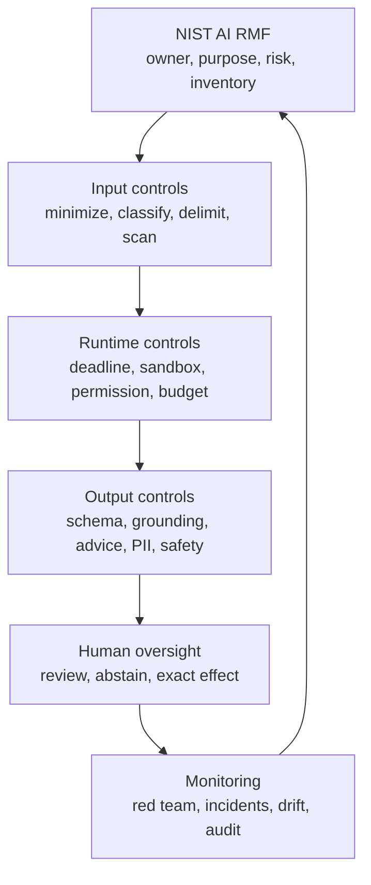

Defense in depth includes:

- deterministic policy before and after model calls;
- an approved subprocessor/model registry with no-training terms, DPA,
  region, retention, and deletion evidence checked before routing;
- data classification and field-level minimization, not field-name-only PII
  regexes;
- provenance labels and typed untrusted-content boundaries;
- dedicated injection/safety classifier only as another signal, never proof;
- output grounding and regulated-advice checks on every provider path;
- permission checks outside the model;
- no secrets, raw credentials, arbitrary tool schemas, or provider-side
  memory/file stores in context;
- action preview, authenticated approval, idempotency, and audit;
- erasure/retention propagation across model cache, spans, guard events,
  eval captures, tenant scorer artifacts, queues, and provider records;
- model/container provenance and signed artifacts;
- kill switches by task/provider/model;
- AI incident runbooks and fixture capture.

The threat model covers OWASP LLM and Agentic risks: prompt/goal hijack, sensitive
information disclosure, supply-chain poisoning, improper output handling,
excessive agency/tool misuse, identity abuse, memory/context poisoning,
insecure inter-agent communication, cascading failures, human-trust
exploitation, misinformation, and unbounded consumption.

A crisis assistant also needs an explicit safety behavior for self-harm,
immediate medical danger, abuse, and threats: surface emergency/professional
resources and avoid pretending to diagnose or provide medical instructions.
This is separate from the financial-advice guard.

### 8.12 AI reliability, observability, and FinOps

#### Initial call budgets

| Class | Deadline/attempt posture | Admission/fallback |
|---|---|---|
| Interactive answer/draft | task p99 target ≤15 s; per-attempt budget around 8 s; at most 2 attempts | reserve interactive capacity; evaluated fallback or honest unavailable |
| Background decision/extraction | 60–120 s according to task; at most 2 attempts | bounded queue; retry/DLQ; never consume interactive reserve |
| On-device generation | device-specific load/generation timeout | transparent cloud fallback if allowed; otherwise honest failure |
| External decision verifier | shorter than parent task deadline | abstain to human if unavailable |

Exact values require measured baselines. The architectural rule is one absolute
caller deadline and one retry policy, not nested SDK, breaker, route, and queue
retry loops.

#### Token and context optimization

Token optimization starts before provider selection:

1. Deterministic code must return the answer without model tokens wherever the
   result is expressible exactly.
2. Local encoders/classifiers handle stable labels so ambiguous cases alone pay
   for a larger model.
3. Every task policy defines `max_input_tokens` and `max_output_tokens`. The
   gateway estimates/rejects over-budget context before the call, rather than
   relying on truncation inside prompt strings.
4. Context builders emit an explicit field allow-list with provenance. Full
   documents, inboxes, histories, vault payloads, connector dumps, and raw
   credentials are prohibited.
5. Stable instructions precede variable context and use the same serialization
   for prompt caching. Prompt-cache reuse remains tenant/task scoped and is
   enabled only where provider terms allow it.
6. Retrieval uses the smallest sufficient evidence set: typed fields before
   summaries, summaries before passages, page/region evidence before whole
   documents.
7. Compression is deterministic or schema-bound, preserves source IDs and
   provenance, and never makes an unreviewed summary the source of truth.
8. Output contracts use terse structured results. A model receives validation
   errors—not duplicated secrets or unrelated context—when a retry is required.
9. Alerts fire on p95 input/output token growth, maximum-output truncation,
   cache regression, guard rejection, and cost per accepted result—not only on
   monthly spend.

Initial policy targets; calibrate against task evals rather than treating these
as universal constants:

| Task class | Context strategy | Suggested output ceiling | Optimization intent |
|---|---|---:|---|
| Ask Keel | Permission-filtered profile summary, relevant insights/doc metadata/recent events | 600–800 | Answer from current Twin state; no raw document/history dump |
| Scenario narration | Deterministic inputs, calculated values, and warnings only | 300–500 | Model narrates exact numbers; it does not calculate |
| Email triage | Existing bounded sender/subject/date/≤4k-char snippet | 200 structured | Encoder/prefilter first; hosted call only when needed |
| Document extraction | Page/chunk and requested field schema | 800 structured | Native text/local extraction first; image model only for low-confidence needs |
| Support drafting | Account/status/plan and bounded case metadata | 400 | No household financial context by default |
| Insight/support rewrite | Deterministic insight, evidence IDs, and style constraints | 300 | Preserve facts and advice boundaries |
| Marketing draft | Operator brief, approved claims, style profile | 1,200 | Background/batch eligible; never a family-data task |
| Local/on-device draft | Minimum member/device context | Model-specific | Privacy-first; cloud fallback only when permitted |

#### Infrastructure selection

Choose the cheapest execution boundary that clears the task's privacy, quality,
latency, reliability, and deletion requirements:

| Execution option | Choose when | Avoid when | Operating rule |
|---|---|---|---|
| Deterministic code/YAML | Truth is exact, auditable, or safety-critical | Language variability is required | Zero token cost; first choice |
| Local encoder/embedding | Stable bounded classification, similarity, dedup, routing | Rare/open-ended labels | Prefer this before hosted generation |
| Local CPU/Ollama | High privacy, low volume, bounded output, tolerant latency | Interactive p95 or sustained concurrency cannot be met | Bound queue and concurrency; no GPU by default |
| On-device | Privacy-sensitive drafting or offline UX | Exact financial truth or guaranteed quality is required | Opt-in, provenance clear, controlled fallback |
| Hosted synchronous API | Elastic/low-to-medium volume, best quality per call, complex language | Provider terms/region do not fit, or cost crossover is proven | Deadline, cache, breaker, budget reservation, metadata trace |
| Hosted batch API | Large non-interactive backlog and 24-hour latency is acceptable | Interactive, deletion-sensitive, or unreviewed retention path | Separate task policy and provider retention evidence |
| Dedicated GPU/self-hosted serving | Stable high-volume task with quality parity, privacy/latency need, and sustained utilization | Bursty volume, weak eval, or “open weights are free” reasoning | vLLM/SGLang/TGI-class service behind existing ports; queue-depth/TTFT/KV-cache autoscaling |

Hosted-to-self-host crossover is a measured decision, not a monthly-token
heuristic. Approve dedicated infrastructure only when either privacy/latency
requires it, or projected hosted spend exceeds the fully loaded self-hosted
alternative by a deliberate safety margin—initially **1.3× for two consecutive
months**. Fully loaded cost must include accelerator instance/commitment, idle
capacity, storage, egress, observability, patching, model upgrades, evals,
on-call, redundancy, and fallback. Scale-to-zero GPU is acceptable only where
cold-start latency fits the task; otherwise use on-demand/persistent capacity.

#### Required telemetry

Adopt OpenTelemetry GenAI semantic conventions for metadata:

- task ID/version and operation;
- provider and exact request/response model;
- input, cached-input, reasoning, and output token counts where available;
- time to first token and total latency where relevant;
- retry count, breaker state, queue wait, cache result, fallback chain;
- prompt/context/guard hashes, not raw content by default;
- budget reservation, actual cost, and price-table version;
- schema/guard/abstention outcome;
- trace link to user-visible result, review, receipt, and audit.

Prompt, completion, tool argument, document, or family content capture is off by
default. Any diagnostic sampling is encrypted, redacted, access-controlled,
short-lived, purpose-limited, and audited. Tenant IDs belong in controlled
traces/logs, not unbounded Prometheus labels.

#### Bulkheads and fairness

- Separate interactive and background concurrency pools; shed background first.
- Add per-tenant in-flight and token/cost quotas.
- Bound local-model queue wait as well as inference time.
- Use priority/fair queues for crisis, interactive, normal, bulk marketing, and
  maintenance work.
- Keep breakers process-local only as a first step; use shared fleet state only
  when replica behavior demonstrates the need.
- Maintain a tested secondary provider per critical task, not a universal blind
  provider failover.

#### Cost and batching

- Reserve worst-case task cost atomically and reconcile exact usage.
- Unknown model/price combinations fail closed or alert; never silently inherit
  another model's price.
- Use provider prompt caching for stable prefixes after privacy-term review.
- Use provider batch APIs for non-interactive tasks when call volume and 24-hour
  latency tolerance justify the operational path—member reconciliation,
  marketing drafts, email backlogs, and OCR retries are candidates.
- Keep exact tenant-scoped response caching. Semantic caching of family data is
  not planned.
- Measure cost per correct accepted result, including guard rejection, fallback,
  retry, infrastructure, and human review.

#### Self-hosting gate

Self-host only a stable task when:

- its eval/safety gate matches or beats the hosted incumbent;
- sustained utilization supports the hardware;
- privacy or latency creates material value;
- fully loaded compute, idle, storage, egress, patching, on-call, and upgrade cost
  is below hosted alternatives;
- scale, rollback, capacity, and fallback are tested.

If a GPU path is justified, vLLM/SGLang/TGI-class serving behind the existing
ports and queue-depth/time-to-first-token autoscaling are appropriate. Do not
operate a standing large model because its weights are open.

### 8.13 AI governance and promotion gates

Use NIST AI RMF as the lifecycle:

- **Govern:** task/model inventory, owner, policy, legal/privacy boundary,
  provider terms, AI-BOM, approval authority.
- **Map:** users, data, context, plausible harm, error asymmetry, fallback and
  affected family members.
- **Measure:** task goldens, human labels, calibration, red team, subgroup,
  latency, cost, safety and drift.
- **Manage:** shadow/canary, budget/kill switch, incident runbook, rollback,
  retirement and communication.

Promotion gates:

| Gate | Minimum evidence |
|---|---|
| Inventory | task policy, owner, schema, authority, data boundary, exact model |
| Offline | contract + goldens + advice/privacy/safety + adversarial fixtures |
| Calibration | held-out reliability/Brier/ECE and explicit gray zone for bounded decisions |
| Shadow | no user effect; disagreement direction, latency and cost measured |
| Canary | explicit cohort/control, end date, kill switch and rollback thresholds |
| Production | metadata trace, budget, guard, fallback, feedback and incident owner |
| External effect | authenticated exact preview, deterministic policy, receipt, idempotency and reconciliation |

Fine-tuning or distillation is not a normal next step. Before any family-derived
training, require lawful purpose/consent, dataset provenance, isolation,
retention/deletion/unlearning analysis, holdout integrity, safety eval, shadow
parity, artifact registry, and rollback. Prefer reviewed synthetic/public data
and task-specific small models after the task and label rubric are stable.

### 8.14 Tooling decision record

| Tool category | Current decision | Trigger to reconsider |
|---|---|---|
| In-process AI gateway | **Adopt now** | Mandatory enforcement work |
| External AI gateway/proxy | **Defer** | Multiple runtimes or central protocol/provider operations |
| Task/model registry | **Adopt now, lightweight** | Already required for safe routing |
| Unified eval-run registry | **Adopt now, lightweight** | Existing eval artifacts are fragmented |
| Adversarial CI runner | **Evaluate now** | Red-team suite implementation |
| Self-hosted AI observability | **Evaluate after metadata instrumentation** | Trace volume exceeds in-house usability |
| TypeScript AI SDK (`ai`) | **Candidate leaf library** | It removes provider/streaming/structured-output plumbing without bypassing policy |
| Durable workflow engine (Temporal) | **Defer, preferred future candidate** | Long-running approvals, timers, retries, and recovery outgrow Redis/cron |
| Managed workflow runner (Inngest/Trigger.dev) | **Defer** | Same durable-workflow trigger plus accepted external processing boundary |
| Stateful agent runtime (LangGraph/`WorkflowAgent`) | **Defer** | A real dynamic resumable agent workflow exists and deterministic orchestration is insufficient |
| Provider-specific agent SDK | **Reference, do not standardize** | Reuse approval/guardrail/tracing patterns; avoid lock-in |
| Vector database | **Do not add** | Permissioned passage-Q&A proves need beyond Mongo search |
| Semantic response cache | **Do not add** | Unlikely to clear privacy/correctness value gate |
| MCP/A2A | **Do not add to family action path** | Read-only internal/external ecosystem requirement |
| Generic agent framework | **Do not add** | No bounded workflow requires open-ended planning |
| MLflow/model registry platform | **Defer** | Multiple trained artifacts and experiments |
| Annotation platform | **Defer** | Multi-reviewer volume makes spreadsheets/operator queue inadequate |
| Provider batch APIs | **Trigger + privacy review** | Non-interactive calls materially affect spend and provider retention/deletion terms are approved |
| GPU serving | **Trigger-based only** | Stable high-volume task clears full crossover |

### 8.15 AI task gateway — enforced and remaining debt

Since intent 01 (PRD-142 implementation), every model call in `apps/api` runs
through the AI task gateway (`apps/api/src/ai/task-gateway.ts` →
`packages/platform/src/task-gateway.ts`), which resolves a task policy from
`definitions/ai-tasks.yaml` and enforces it at call time:

- **unknown task_id fails closed** outside dev mode — production cannot reach
  a provider without a registered policy;
- model allowlist enforced per call (callers pass `tier:*` handles resolved
  to the provider's configured model; anything outside `allowed_models` is a
  `TaskPolicyError`);
- input token ceilings enforced before provider contact; per-task deadline;
- per-task circuit breaker (`task:<task_id>`) fails fast during provider
  incidents — one transport retry layer inside the router, no nested retries;
- symmetric input/output guards on cloud, local (`DecisionFn`) and vision
  paths — the local path previously skipped guards entirely;
- usage reported by every provider (including Azure and Ollama, which
  previously recorded nothing) and attributed to `(task_id, tenant_id)` via
  `llmCallContext` into the CostLedger;
- per-tenant budget check before provider execution;
- cloud vision extraction (previously a raw OpenAI SDK call outside the
  router) runs through `governedVision`;
- a `device_only` task has no server-side path by construction.

The `ai-task-gateway` fitness test is the tripwire: only allow-listed factory
files may construct raw model clients, every `taskLlm/taskDecide/taskVision`
literal must resolve in the registry, and `localDecisionFromEnv` may only be
called inside a `taskDecide` wrapper.

Remaining debt:

1. **Atomic budget reservation/reconciliation** — the gateway runs the
   pre-call budget check but does not yet reserve tokens against the ledger
   and reconcile after actual usage; a burst of concurrent calls can still
   overshoot the cap.
2. **Processor terms/review-date enforcement** — `processor_terms_ref`,
   `provider_retention_class` and review dates are recorded in the registry
   and required at parse time, but expiry does not yet block the call;
   subprocessor review stays a human/legal process until then.
3. **Eval suites** — task-level eval and adversarial suites with
   synthetic/redacted or consented fixtures remain to be built.
4. **Correctness labels** — correctness labels are still entangled with
   acceptance/engagement.
5. **AI artifact inventory** — the erasure catalogue covers tenant artifacts
   (intent 04); provider-side retention verification and incident-handling
   propagation remain procedural.

The deterministic engine and authenticated human gates remain the
authoritative safety boundary for anything beyond language.

### 8.16 Primary AI architecture references

- [NIST AI RMF](https://www.nist.gov/itl/ai-risk-management-framework) and
  [Generative AI Profile](https://www.nist.gov/publications/artificial-intelligence-risk-management-framework-generative-artificial-intelligence)
- [NIST Secure Software Development Practices for Generative AI](https://csrc.nist.gov/pubs/sp/800/218/a/final)
- [OWASP LLM/GenAI Security](https://genai.owasp.org/llm-top-10/) and
  [Agentic AI risks](https://genai.owasp.org/initiatives/agentic-security-initiative/)
- [OpenTelemetry GenAI semantic conventions](https://opentelemetry.io/docs/specs/semconv/gen-ai/)
- [OpenAI API data privacy](https://developers.openai.com/api/docs/guides/your-data)
  and
  [data controls](https://developers.openai.com/api/docs/guides/data-controls)
- [Anthropic data usage, monitoring, and retention](https://privacy.claude.com/en/articles/7996866-how-long-do-you-store-personal-data)
- [Microsoft Azure OpenAI data, privacy, and security](https://learn.microsoft.com/en-us/azure/ai-foundry/responsible-ai/openai/data-privacy)
  and
  [abuse monitoring](https://learn.microsoft.com/en-us/azure/ai-foundry/openai/concepts/abuse-monitoring)
- [Groq data privacy FAQ](https://groq.com/privacy-faq/)
- [ICO AI and data protection](https://ico.org.uk/for-organisations/uk-gdpr-guidance-and-resources/artificial-intelligence/)
- [Anthropic: building effective agents](https://www.anthropic.com/engineering/building-effective-agents)
  and
  [context engineering](https://www.anthropic.com/engineering/effective-context-engineering-for-ai-agents)
- [OpenAI evaluation best practices](https://developers.openai.com/api/docs/guides/evaluation-best-practices)
  and
  [Agents SDK guardrails/approvals](https://developers.openai.com/api/docs/guides/agents/guardrails-approvals)
- [Vercel AI SDK agents and WorkflowAgent](https://ai-sdk.dev/docs/agents/overview)
- [LangGraph overview](https://docs.langchain.com/oss/javascript/langgraph/overview)
  and
  [human-in-the-loop interrupts](https://docs.langchain.com/oss/javascript/langgraph/interrupts)
- [Temporal Durable AI](https://docs.temporal.io/ai) and
  [TypeScript OpenAI Agents integration](https://docs.temporal.io/develop/typescript/integrations/openai-agents)
- [A2A protocol specification](https://github.com/google/A2A/blob/main/docs/specification.md)
- [MCP authorization and security](https://modelcontextprotocol.io/docs/tutorials/security/security_best_practices)
- [FinOps for AI](https://www.finops.org/framework/technology-categories/ai/)
  and [FOCUS for AI](https://focus.finops.org/technology-categories/focus-for-ai/)
- [Google Cloud AI/ML reliability](https://docs.cloud.google.com/architecture/framework/perspectives/ai-ml/reliability)
- [CycloneDX ML-BOM](https://cyclonedx.org/capabilities/mlbom/) and
  [SLSA provenance](https://slsa.dev/)

See the dedicated LLM/open-model strategy review linked at the top for market
pricing, Jev/System One, Muse/open-weight analysis, and the phased procurement
position.

---

## 9. Act and Escalate: trust tiers

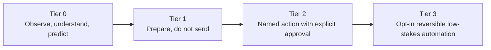

| Tier | Rule | Implemented examples |
|---|---|---|
| **0** | No external side effect | Detectors, readiness, twins, scenarios, Ask Keel, assets, legacy, youth literacy |
| **1** | Draft or checklist; user sends/submits | Insight outreach drafts, life-event preparation drafts, on-device crisis drafting |
| **2** | One narrow action after exact human approval | Detector-declared email/WhatsApp/CRM actions through preview and `ActionExecutor` |
| **3** | Opt-in, reversible, low-stakes automation only | Scheduled renewal reminders and trusted-scope `log_only` auto-execution |

### Action path

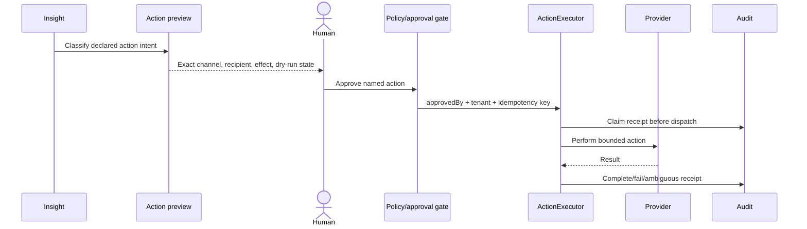

The in-app action preview and execution share classification logic. A repository
tripwire test allow-lists `ActionExecutor` callers and requires `approvedBy`.
Signed notification links exist, but the architecture review identifies their
weaker actor identity and preview as remediation work; they must not be treated
as stronger consent than authenticated in-app review.

Autonomy cannot expand by changing a model threshold. Any new action type needs
a trust-tier decision, policy implementation, preview, approval semantics,
idempotency, receipt, audit, and incident story.

---

## 10. Delivery, queues, and scheduled operation

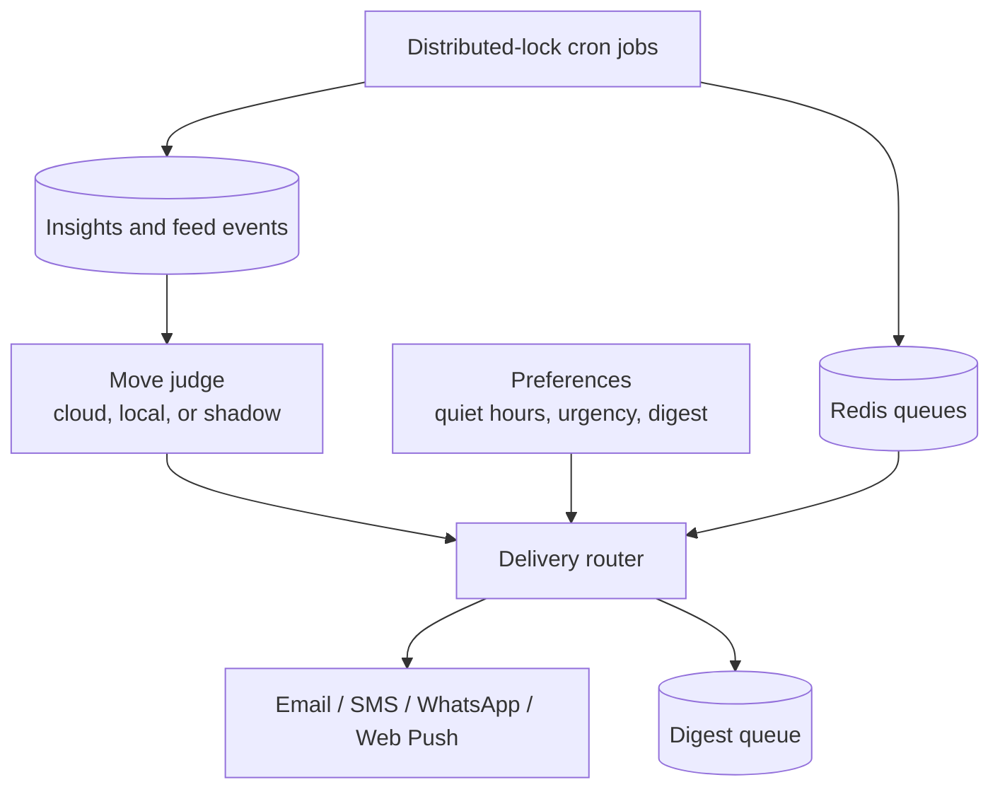

Background operation includes:

- connector polling and connector-health alerts;
- inbox scanning and queued fan-out;
- OCR retry;
- insight SLA/escalation and stale-profile evaluation;
- member-agent reconciliation;
- continuity checks;
- policy-renewal reminders;
- readiness heartbeat and scenario watchlist;
- metrics rollups, retention, billing, lifecycle, and reviewed marketing jobs.

Every cron task runs through a Mongo-backed named lock because Cloud Run can
start multiple API replicas. Queues provide asynchronous fan-out; they are not a
second source of truth. Delivery honors preferences, urgency, quiet hours,
digests, deduplication, and channel fallback.

---

## 11. Security, privacy, and tenancy

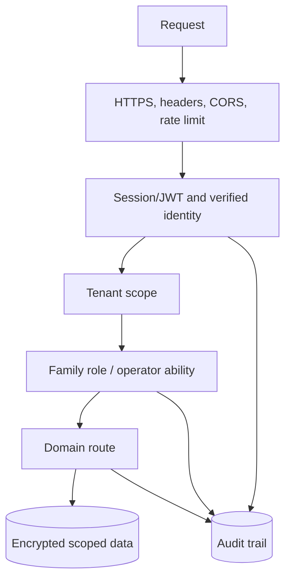

### Enforced principles

- Authentication precedes tenant and role authorization.
- Family organizer/adult/youth boundaries are enforced server-side; child-mode
  redaction is not solely a UI concern.
- Operator capabilities use separate authorization and audit paths.
- Tenant IDs are part of durable records, cache keys, queue payloads, and tests.
- Credentials and sensitive settings are encrypted at rest.
- Generated content is never permission or authorization input.
- External effects require policy gates and receipts.
- Rate limits protect authentication and model-backed routes.
- Audit, metrics, health/readiness endpoints, and runbooks support operations.

### AI data-use boundary

Family personal content is **not used to train or fine-tune shared foundation
models**. The implementation already separates several important boundaries:

- Family/tenant authorization happens before assistant context assembly.
- Ask Keel loads only the fields needed for an answer; support AI loads a
  narrower account context rather than the full financial profile.
- Email/document content is treated as untrusted data, bounded to task fields,
  and routed to a configured hosted model or a local/self-hosted path.
- Vault documents are encrypted before GridFS, excluded from ordinary document
  routes and OCR, and can be additionally sealed in the browser so the service
  cannot read the plaintext.
- The exact-match LLM cache is tenant/task/input keyed with TTL; semantic
  response caching remains prohibited for sensitive household content.
- Prompt/completion telemetry is off by default; model tracing should carry
  task/model/cost/result metadata, not raw family text.
- Per-tenant online scorers may learn from bounded hashed feature/outcome
  signals. This is pseudonymous derived state, not foundation-model training;
  hashes and embeddings still require deletion and access controls.
- The cross-tenant federated-learning package exists but is not instantiated.
  No service currently writes a new shared model, but scorers can warm-start
  from a stale `federated_global_models` artifact and the scheduled
  detector-level eval trains a temporary scorer across tenant outcomes. Both
  must be gated or redesigned before claiming no cross-tenant model influence.

What is not yet proven by code is the contractual and operational edge:
hosted calls do not yet require a provider-policy object containing
no-training terms, DPA/SCCs, subprocessors, region, retention mode, deletion
SLA, and abuse-monitoring status. The account-erasure list also does not yet
cover every tenant-derived AI artifact (for example LLM cache/spans, guard
events, scorer/model versions, and evaluation captures). Those are P0/P1
control-plane gaps, not optional wording in the privacy policy.

### Sensitive-domain boundary

Health records remain intentionally unimplemented because they are
special-category data and the current product value does not justify the risk.
Adding health data requires a named product requirement, data-protection impact
assessment, lawful-purpose/retention design, role model, incident plan, and
provider review before schema work begins. Deferring health *schemas* does not
prevent incidental special-category content arriving through user uploads and
email; an upload classification/acceptable-use position is required so the
deferral is real rather than a labeling choice.

Children's-data posture is recorded in
`docs/privacy/childrens-data-posture.md` (intent 09): a minor is a roster
member with `role === 'child'` or a `date_of_birth` under 18; marketing and
lifecycle paths exclude them server-side regardless of consent flags; the
only permitted youth-facing AI task is `assistant.youth_answer.v1`
(`lifekeel_infra_required` — fails closed rather than reaching a hosted
provider, `provider_retention_class: none`, quarter-size input budget);
the age-out workflow is defined. Outstanding: the counsel-led minors' DPIA,
lawful-basis mapping, lead-capture age attestation, and auth-time age
gating.

---

## 12. Deployment and operations

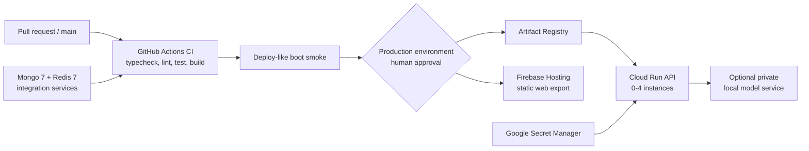

- CI runs root `pnpm typecheck`, `lint`, `test`, and `build`, with MongoDB and
  Redis service containers, plus an API boot smoke test.
- Web and API deploys are manual `workflow_dispatch` flows gated by successful
  CI and the protected `production` GitHub environment.
- The API image is stored in Artifact Registry and deployed to Cloud Run with
  scale-to-zero, bounded instances, secrets from Secret Manager, and a readiness
  smoke test.
- The web app is statically exported and deployed to Firebase Hosting. It can
  call Cloud Run directly or use a same-origin `/api` hosting rewrite.
- The optional local judge/model service has its own deployment workflow and is
  not required for the safe deterministic fallback path.
- Production deployment is intentionally not an automatic side effect of merge.

### Observability

- Structured application logging via shared logger primitives.
- Prometheus-compatible metrics route for HTTP, queues, model paths, guards,
  cache, and operational health where wired.
- OpenTelemetry initialization in the API.
- Append-only audit records for identity, sensitive reads, decisions, and
  actions.
- Operator tenant-health, configuration, audit, queue, support, billing, and
  runbook surfaces.

Known observability debt is documented rather than hidden: LLM cost, circuit
breaker, and guard primitives are not yet mandatory across every provider path.

---

## 13. Build, test, and release architecture

This is a pnpm workspace orchestrated by Turbo.

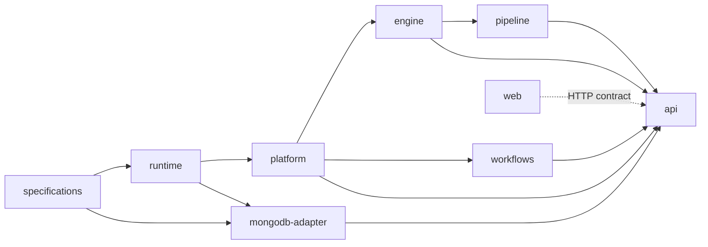

`turbo.json` builds dependencies first. Test and typecheck tasks depend on both
package and dependency builds because packages may self-import their published
workspace name. Do not run dependent package checks against missing `dist/`
outputs and conclude the source is broken; root Turbo commands are the canonical
verification path.

The mobile shell is intentionally excluded from the root graph and has separate
Capacitor commands.

---

## 14. Operator, marketing, growth, and commercial control plane

The product plane serves families. The control plane operates LifeKeel itself:
platform access, tenant support, content, acquisition, billing, delivery health,
and supervised automation. It shares the modular API and MongoDB deployment
today, but it is a distinct privilege and data boundary.

### 14.1 Control-plane context

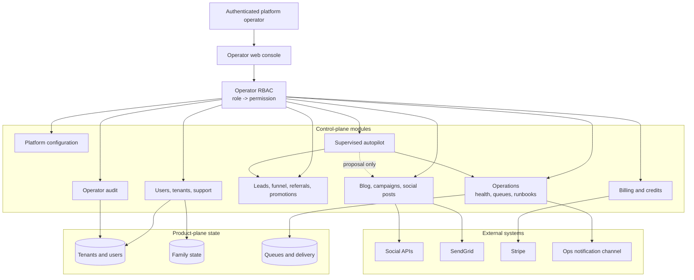

### 14.2 Operator identity and authorization

Operator authorization is independent of family roles. A signed-in, non-demo
user must resolve to an active `platform_operators` record before an operator
route grants a permission.

| Role | Intended responsibility |
|---|---|
| `support` | Read users/tenants/operations/audit and manage support cases |
| `marketing_operator` | Marketing content plus lead and promotion visibility |
| `finance_operator` | Billing, promotions, tenant/lead visibility |
| `operations` | Operational health, queues, marketing visibility, support read |
| `platform_admin` | Broad platform management except operator administration |
| `super_admin` | All permissions, including operator administration |

The backend maps roles to explicit permissions such as `users.manage`,
`marketing.manage`, `billing.manage`, and `operations.manage`; client navigation
hiding is convenience only. `PLATFORM_OPERATOR_USER_IDS` is a break-glass path:
it grants bootstrap `super_admin` only while no active database-managed super
administrator exists, explicit suspension overrides it, and
`PLATFORM_OPERATOR_BOOTSTRAP_UNTIL` (ISO timestamp) retires it — after the
deadline the env path is dead even with zero DB super_admins, so a forgotten
break-glass cannot outlive the incident that needed it.

Two controls sit on top of the role check (see `operator/dual-control.ts`):

- **Step-up (recent auth).** Routes marked `stepUp: true` — every destructive
  or bulk mutation — require a session minted within
  `OPERATOR_STEP_UP_WINDOW_SEC` (default 15 minutes). A stolen long-lived token
  alone cannot suspend a tenant, erase a user, or fire a campaign; the operator
  re-authenticates and retries. Stale sessions keep read access.
- **Dual control (four-eyes).** The highest-blast-radius actions — user
  erasure, credit adjustment, bulk campaign send, operator create/role grants,
  whole-tenant suspension — need a *second* operator holding the same
  permission to confirm via `POST /operator/dual-approvals/:id/confirm`.
  Approvals are hash-bound to the exact action, target and payload (approving
  "grant £10" cannot be spent on "grant £10,000"), expire after 30 minutes,
  can never be self-confirmed, and are consumed atomically so they execute
  once. The requester executes by retrying the action — a confirmed approval
  matching the retry's payload hash is auto-spent.

#### Implemented operator capabilities

| Domain | Read capabilities | Mutating capabilities and gates |
|---|---|---|
| Overview | Platform counts, activity, funnel and health summaries | None |
| Users | Search/detail, security and tenant context, export | Suspend/reactivate, password reset, session revoke, unlock, MFA disable, erase; permission + typed reason + audit |
| Tenants | Search/detail, plan/status/health | Suspend/reactivate; permission + reason + audit |
| Operators | List roles/status | Create, change roles, suspend/reactivate; `operators.manage` |
| Leads | Search/detail, attribution, stage, notes | Stage/owner/notes updates and suppression |
| Funnel/referrals | Acquisition and conversion rollups, referral rewards | Primarily read/attribution paths |
| Promotions | Codes and redemptions | Create, deactivate/reactivate; finance permissions |
| Content | Blog and marketing queues | Draft/edit/publish/unpublish/approve/reject with marketing permission |
| Campaigns | List, audience preview, delivery stats | Human-authored one-shot send with reason and 2,000-recipient ceiling |
| Billing | Plans, status, Stripe linkage, credits, webhook and churn views | Bounded manual credit adjustment with ledger and audit; Stripe remains subscription authority |
| Support | Cases, family/plan context and message history | Reply, LLM-assisted draft, resolve/reopen; draft is never auto-sent |
| Operations | Mongo/Redis, pipeline counts, reminders, connectors, queues, alerts, runbooks | Allow-listed DLQ requeue and alert handling |
| Configuration | Runtime platform controls and history | Permissioned updates with history/audit |
| Autopilot | Rules, actions, proposals and ledger | Rule enable/configure; approve/reject proposals with proposal-specific permission |
| Audit | Operator activity search/export views | Append via server-side audit helpers only |

### 14.3 Supervised operator autopilot

Operator autopilot is separate from family insight automation. Its registry is
code-defined; every rule defaults off and has a cooldown, maximum blast radius,
and database-enforced dedup key.

```mermaid
stateDiagram-v2
  [*] --> Disabled
  Disabled --> Enabled: operator enables rule
  Enabled --> Candidate: scheduled sweep finds target
  Candidate --> Executed: Tier 0/1 reversible action
  Candidate --> Proposed: mutation requires review
  Proposed --> Approved: authorized operator + reason
  Proposed --> Rejected: authorized operator + reason
  Approved --> Executed: server-side proposal handler
  Executed --> [*]
  Rejected --> [*]
  Candidate --> Failed: bounded action fails
```

Implemented rule families include clearing expired login lock residue, one-time
DLQ requeue, one-time failed-reminder retry, stale-lead alerts, repeated social
channel authentication alerts, and other bounded operational/content proposals.
The `autopilot_actions` ledger records target, rule, reason, status, result,
resolver, and proposal payload.

`NEVER_AUTONOMOUS` rejects configuration attempts for destructive, financial,
operator-management, user-erasure, credit-adjustment, and external-publishing
families. Tier-2-shaped proposals can be created, but execution requires a human
whose current roles satisfy the proposal's own permission—not merely access to
the operations screen.

### 14.4 Marketing and content engine

The marketing engine has three related but distinct paths:

1. **Editorial content:** operator-managed blog/guides/case-study content and
   detector-driven content assets.
2. **Social publishing:** per-tenant draft, review, scheduling, dispatch, and
   engagement tracking across configured channels.
3. **Email growth:** automatic consent-gated lifecycle sequences and explicit
   operator-fired segment campaigns.

#### Social lifecycle

```mermaid
stateDiagram-v2
  [*] --> Draft
  Draft --> Draft: operator edit
  Draft --> Approved: human approval
  Draft --> Rejected: human rejection
  Approved --> Publishing: due-time atomic claim
  Publishing --> Published: provider accepted or dry run
  Publishing --> PublishFailed: provider/configuration failure
  PublishFailed --> Publishing: human retry/approve
  Rejected --> [*]
  Published --> [*]
```

- Posts carry tenant, channel, integration label, content, optional media and
  schedule, creator, approval/publish metadata, campaign/UTM attribution,
  generation source, provider ID/URL, and engagement.
- Scheduled posts are held internally; a minute sweep atomically claims
  `approved -> publishing` before dispatch.
- A global `marketing_paused` control leaves due posts approved rather than
  converting an intentional pause into a failure.
- Dry-run mode exercises state transitions without calling a channel.
- Publish failures retain bounded error text and can be retried.
- Hourly engagement polling currently depends on channel support; unsupported
  channels remain unknown rather than receiving invented zero metrics.
- Daily AI/template generation is opt-in and always creates a draft for human
  review. It never directly publishes generated content.

#### Social provider adapters

The LifeKeel-owned `SocialPublisher` interface exposes integration discovery and
post creation. Current adapters cover:

- X API v2;
- LinkedIn Posts API;
- Bluesky AT Protocol;
- Mastodon status API;
- Threads two-step container/publish;
- Facebook Pages through connector action execution;
- Instagram Business two-step image container/publish.

Credentials can be platform environment credentials or encrypted tenant
connections/OAuth connector credentials. `DbSocialPublisher` resolves a tenant
connection before falling back to configured platform credentials. This mixed
ownership model must remain visible in the UI and audit: a post must identify
which account and credential scope will publish it.

### 14.5 Lifecycle email and campaign engine

```mermaid
flowchart LR
  Signals[Lead/user/billing state]
  Consent{Eligible and consented?}
  Pause{Marketing paused?}
  Ledger[(lifecycle_sends\nunique claim)]
  Render[Template or operator copy]
  Send[SendGrid]
  Webhook[Delivery/open/click/bounce webhook]
  Growth[(Growth events and funnel)]

  Signals --> Consent
  Consent -->|no| Stop[Stop / suppress]
  Consent -->|yes| Pause
  Pause -->|yes| Stop
  Pause -->|no| Ledger
  Ledger --> Render --> Send --> Webhook --> Growth
```

Automatic lifecycle sequences are timing-driven and ledger-deduplicated:

- consenting lead nurture: welcome, day-3 education, day-7 final note;
- activation: signed-up family without a financial profile;
- upgrade: engaged free tenant outside an active trial;
- trial ending and recently expired;
- churn winback after downgrade while still on free.

Lead marketing requires `consent.marketing` and no suppression. Marketing mail
for signed-up users respects `email_opt_out`; each eligible campaign message
carries a signed unsubscribe path. The SendGrid webhook joins delivery, open,
click, bounce, and spam events to the exact ledger key.

Segment campaigns are not autonomous: an operator writes plain-text copy,
previews a fresh audience, and explicitly sends. Filters cover users/leads,
plans, trial state, profile completion, lead stage, attribution source, and age.
Recipient sends are claimed before dispatch to prevent racing duplicate sends,
and one campaign is one-shot. Firing a campaign writes a durable `pending`
claim per recipient and a payload-by-reference job on the `campaign-send`
queue — the request returns `targeted` immediately, workers settle rows at
bounded concurrency, and the operator can pause/resume mid-flight; a
campaign reaches `sent` only when no `pending` claims remain.

### 14.6 Growth, attribution, and commercial capabilities

```mermaid
flowchart LR
  Traffic[Public content / social / referrals]
  Quiz[Readiness quiz]
  Lead[Lead capture + consent]
  Signup[Account signup]
  Activation[Family/profile activation]
  Trial[Trial / free credits]
  Upgrade[Stripe subscription]
  Retain[Heartbeat, lifecycle, product value]

  Traffic --> Quiz --> Lead --> Signup --> Activation --> Trial --> Upgrade --> Retain
```

Implemented supporting capabilities include:

- public readiness quiz and lead capture;
- UTM/first-touch attribution and growth events;
- referral codes, attributed signups, and bounded rewards;
- share links;
- lead stages, ownership, notes, suppression, and unsubscribe;
- promotions, redemption history, and operator controls;
- Stripe checkout/webhooks, trial and subscription lifecycle;
- outcome-credit ledger and bounded operator adjustments;
- hourly/daily metric rollups for operator dashboards;
- weekly operator digest and operations alerts.

Marketing and billing are supporting control-plane capabilities. They do not
change detector truth, family readiness, consent, or trust-tier policy.

### 14.7 Operator and marketing safety gaps

| Priority | Gap | Risk | Target control |
|---|---|---|---|
| ~~**P0**~~ resolved | ~~Marketing per-channel earned trust can auto-publish while operator autopilot declares public publishing never autonomous~~ — intent 03 chose "default human approval for every public post": the auto-trust path is deleted and fitness-tested | ~~Two automation systems encode conflicting policy for an effectively irreversible public action~~ | ~~One authoritative policy~~ — shipped: human approval for every public post; tripwire prevents regression |
| ~~**P0**~~ resolved | ~~Lifecycle `sendEmail` returns successfully when `SENDGRID_API_KEY` is absent~~ — claims now start `pending` and settle to `sent`/`skipped`/`failed` only from the provider outcome; an unconfigured sweep or campaign claims nothing | ~~A preclaimed ledger row could appear sent although no provider call occurred~~ | ~~Ledger terminal state reflects provider acceptance~~ — shipped: `claimSend`/`settleSend` in `lifecycle-emails.ts`, bounded retry via `attempts`, webhook engagement still joins on `lk` |
| ~~**P1**~~ resolved | ~~Campaign delivery loops through up to 2,000 recipients in one request/process~~ — `queueCampaignSend` writes a durable `pending` claim + payload-by-reference job per recipient on the `campaign-send` queue; workers settle one row each at bounded concurrency | ~~Timeout, partial completion, provider throttling, poor retry/reconciliation~~ | ~~Recipient jobs + bounded workers~~ — shipped: per-recipient ledger claims are the durable state, `pauseCampaign`/`resumeCampaign` flip `sending`/`paused` and re-enqueue pending keys, campaign completes to `sent` when no pending claims remain. Provider-side rate limiting beyond bounded concurrency remains tuning, not a control gap |
| ~~**P1**~~ resolved | ~~Campaign recipient claim is written with status `sent` before provider success~~ — same `claimSend`/`settleSend` path as lifecycle | ~~Observability briefly or permanently overstates successful send~~ | ~~`pending -> sent/failed/skipped` from the provider outcome~~ — shipped: claims start `pending`, workers settle from `sendEmail`'s result, redelivered jobs no-op on non-pending rows |
| ~~**P1**~~ resolved | ~~Social adapters use direct `fetch` without a shared timeout/breaker/retry policy~~ — `apps/api/src/provider-gateway.ts` (`providerFetch`) gives every channel call a deadline (`AbortSignal.timeout`, 15s default), a bounded retry budget with backoff+jitter (network, 429, 5xx only — never 4xx), a per-channel-account circuit breaker (5 consecutive failures → 60s open → half-open probe), and normalized `ProviderError` kinds | ~~Hung providers consume worker/API capacity; retries vary by channel~~ | ~~Provider gateway~~ — shipped; the X/Facebook OAuth path keeps `ConnectorActionExecutor`'s own timeout (token refresh is interleaved there) |
| ~~**P1**~~ resolved | ~~Environment-global and tenant-owned social credentials share a fallback path~~ — `integration_id` now binds dispatch: `<channel>:connection` resolves tenant stores only (missing cred → `channel_not_configured`, never the platform account), `<channel>:env` env only, and a mismatched channel segment refuses outright. The dispatch carries `idempotencyKey: post.id` — Mastodon gets `Idempotency-Key`, Bluesky a deterministic `rkey`; non-honouring providers never retry a timed-out write. Every publish records `published_via` (integration id, source, account) on the post doc and in the approve audit | ~~Account ownership can be misunderstood; wrong account has public blast radius~~ | ~~Explicit publisher in preview/post/audit~~ — shipped; `listIntegrations` exposes `account`, legacy bare ids keep tenant-first order but record the resolved publisher |
| ~~**P1**~~ resolved | ~~High-impact operator operations generally require one privileged actor~~ — `requireOperator(..., { stepUp: true })` demands a session minted inside `OPERATOR_STEP_UP_WINDOW_SEC` (default 15 min) on all 33 destructive/bulk routes, and the six highest-blast-radius actions (erase, credit adjust, campaign send, operator create/roles, tenant suspend) additionally require dual control: `checkDualApproval` writes a pending approval hash-bound to action+target+payload, a *different* operator holding the same permission confirms via `/operator/dual-approvals/:id/confirm`, and the confirmed approval is spent exactly once (auto-spent on the requester's identical retry or via `confirmation_id`) | ~~Compromised operator can erase/export users, adjust credits, or fire a large campaign~~ | ~~Step-up/recent-auth + four-eyes~~ — shipped. Affected-owner notification on operator actions remains open |
| **P1** | Break-glass bootstrap is environment based; expiry now enforced | Emergency access may outlive the incident or be weakly reviewed | Partially shipped: `PLATFORM_OPERATOR_BOOTSTRAP_UNTIL` makes the env break-glass dead after a deadline even with zero DB super_admins; every bootstrap resolution and every expired-window denial is warn-logged. Remaining: rotation ceremony + tested recovery drill |
| **P1** | Operator and product audit use separate collections | Forensics require stitching multiple collections and actors | Partially shipped: `/operator/audit?source=all` unions `operator_audit_log` and product `audit_log` in one feed (product rows match on `resource_id` or `tenant_id`), and destructive mutations record `before_hash`/`after_hash` state evidence. Remaining: unified correlation IDs + immutable export |
| **P1** | Marketing copy enforcement relies heavily on operator responsibility and generation prompts | Advice-like or misleading public copy can escape | Deterministic advice/content guard on create/edit/approve/publish, preview of tracked links, sampled compliance review |
| **P2** | Growth metrics depend on application events and partial provider engagement | Attribution can be incomplete or biased toward supported channels | Data-quality states, source freshness, reconciliation, funnel definitions and metric contracts |
| **P2** | Operator routes remain in the public API deployment | Privileged control-plane attack surface shares family-facing edge | Separate hostname/audience, stronger identity-aware proxy, network policy, and eventually separate operator deployment if justified |

### 14.8 Target control-plane architecture

```mermaid
flowchart TB
  IdP[Workforce identity\nstep-up MFA / device policy]
  Gateway[Operator gateway\nseparate audience and rate policy]
  Console[Operator console]
  ControlAPI[Control-plane API modules]
  Approval[Bulk/destructive approval workflow]
  Scheduler[Control scheduler]
  Queue[(Durable control queue)]
  Workers[Campaign/social/lifecycle workers]
  Audit[(Immutable audit export)]
  ProductAPI[Product API]
  Providers[Stripe / SendGrid / social APIs]

  IdP --> Gateway --> Console --> ControlAPI
  ControlAPI --> Approval
  Approval --> Queue
  Scheduler --> Queue
  Queue --> Workers --> Providers
  ControlAPI --> ProductAPI
  ControlAPI --> Audit
  Approval --> Audit
  Workers --> Audit
```

This target does not require a separate repository. First establish a distinct
operator authentication audience, step-up policy, bulk-action workflow, durable
jobs, and immutable audit. Split deployment only when its threat model, release
cadence, or scaling profile warrants the operational cost.

---

## 15. World-class quality-attribute review

“World class” here means explicit invariants, measurable objectives, controlled
failure modes, and an architecture that can evolve without accidental coupling.
It does not mean maximizing service count or infrastructure complexity.

### 15.1 Layer-by-layer pattern catalogue

The following catalogue is the canonical answer to “which pattern belongs at
which layer?” A future pattern is not automatically approved: it is adopted only
when its trigger is present and its trust, data, cost, and failure semantics are
reviewed.

```mermaid
flowchart TB
  Experience[Experience layer\nweb, mobile, operator]
  Edge[API and identity edge]
  Application[Application orchestration]
  Twin[Family Twin domains]
  Intelligence[Deterministic intelligence]
  AI[AI assistance]
  Decision[Decision and human review]
  Action[Action and provider network]
  Async[Delivery and asynchronous execution]
  Data[Data and derived views]
  Platform[Platform, security and operations]

  Experience --> Edge --> Application
  Application --> Twin
  Twin --> Intelligence
  Intelligence --> AI
  Intelligence --> Decision
  AI --> Decision --> Action
  Application --> Async
  Action --> Async
  Twin --> Data
  Intelligence --> Data
  Async --> Data
  Platform -.governs.-> Edge
  Platform -.governs.-> Application
  Platform -.governs.-> AI
  Platform -.governs.-> Action
  Platform -.governs.-> Data
```

#### Layer 1 — Experience and channels

**Implemented patterns**

- **Backend-for-frontend by contract:** the Next.js PWA calls the Fastify API;
  it does not import backend domain packages.
- **Progressive enhancement:** the Capacitor shell upgrades push, camera, and
  biometrics while loading the same PWA.
- **Region-aware shell:** the shell starts on the canonical app host and
  `NativeRegionGate` redirects to the user's region host (`.co.uk` / `.si`);
  region is held in native Preferences (see `apps/mobile/README.md`).
- **Server-side redaction:** youth payloads remove sensitive amounts before they
  reach browser code.
- **Honest degradation:** model failures render explicit fallback/unavailable
  states rather than simulated success.
- **Exact-effect preview:** consequential actions show server-classified effects
  before approval in the authenticated app.

**Missing future patterns and triggers**

- **Design-system contract and accessibility regression suite** when surface
  count and contributors make visual/interaction drift costly.
- **Offline command queue with conflict policy** only when product requirements
  need writes during disconnection; current service-worker caching must not be
  mistaken for offline transactional support.
- **Remote configuration with typed exposure** when experiments need controlled
  rollout; flags require owner, audience, expiry, default, and analytics.
- **Client telemetry privacy budget** before adding richer behavior analytics;
  financial/vault content must never enter replay tooling by default.

**Avoid:** client-side authorization, hiding rather than redacting, duplicate
business calculations, silent optimistic writes, and a separate mobile domain
implementation.

#### Layer 2 — API edge, identity, and access

**Implemented patterns**

- **Middleware pipeline:** security headers, CORS, cookies, rate limits, auth,
  tenant context, role/ability checks, schema parsing, and consistent errors.
- **RBAC plus resource scope:** family roles, product abilities, and separate
  operator role/permission maps.
- **Public-route allow-list:** unauthenticated surfaces are named rather than
  default-open.
- **Break-glass bootstrap:** constrained recovery path for the first/currently
  absent super administrator.

**Missing future patterns and triggers**

- **Policy Enforcement Point / Policy Decision Point split** when role, member,
  field, purpose, and delegated-access rules exceed maintainable route checks.
- **Step-up authentication and recent-auth claims** before high-impact operator,
  vault, export, erase, billing, or bulk communication actions.
- **Separate workforce/operator audience and gateway** when operator exposure or
  compliance requirements justify an independent identity boundary.
- **Adaptive abuse controls** when public quiz, auth, share, webhook, or model
  traffic shows coordinated abuse beyond static limits.

**Avoid:** accepting tenant IDs from request bodies as authority, broad admin
bypass, prefix-based public-route mistakes, and network-location trust.

#### Layer 3 — Application orchestration

**Implemented patterns**

- **Modular monolith:** one transactional deployment boundary with domain route
  modules and shared packages.
- **Composition root:** `server.ts` constructs adapters, routes, jobs, and
  external providers.
- **Command/query separation by convention:** write routes mutate authority;
  feed, readiness, operator rollups, and histories are read models.
- **Idempotent orchestration:** unique claims and lifecycle states guard repeated
  commands.

**Missing future patterns and triggers**

- **Domain module contract** for routes, indexes, jobs, health, and dependencies
  as the composition root becomes too large.
- **Command bus/task registry** when cross-cutting authorization, audit,
  idempotency, and traces are duplicated across many commands.
- **Transactional outbox** when a database mutation and asynchronous event must
  never diverge.
- **Process-manager/saga** only for genuinely long-running multi-step workflows
  with compensations; not for simple CRUD or one provider call.
- **Durable execution engine** such as Temporal or an equivalent workflow
  primitive when multi-day approvals, timers, retries, and recovery outgrow
  Redis/cron; choose workflow durability before an agent framework.

**Avoid:** generic workflow engines without product need, hidden service
locators, environment reads throughout domain code, and distributed
transactions as a default.

#### Layer 4 — Family Twin domain

**Implemented patterns**

- **Aggregate ownership:** family, member, profile, policy, cash-flow, asset,
  vault, and legacy records have explicit authoritative collections and routes.
- **Provenance-aware state:** extracted fields remain suggestions until reviewed;
  legacy claims carry verification labels.
- **Role-specific read models:** family, member, youth, continuity, and legacy
  views derive from shared authority with server-side filtering.
- **Minor-unit money and deterministic schemas:** financial values avoid
  floating-point authority.

**Missing future patterns and triggers**

- **Temporal/bitemporal history** for facts where “known at” versus “effective
  at” matters, once corrections and historical scenarios require it.
- **Field/purpose-level consent and ABAC** before delegated adults,
  professionals, executors, or health-related data can be modeled safely.
- **Data-product contracts** for new domains: owner, schema, provenance,
  retention, visibility, quality, and deletion.
- **Household merge/split workflow** before supporting divorce, blended-family
  restructuring, or duplicate-tenant consolidation.

**Avoid:** one untyped family JSON blob, silent OCR writes, inferred legal facts,
using a vector store as the source of truth, and premature health schemas.

#### Layer 5 — Observe and ingestion

**Implemented patterns**

- **Ports and adapters / anti-corruption layer:** provider payloads normalize to
  LifeKeel events and account records.
- **Schema registry and validation:** signal and connector contracts are checked
  before detector use.
- **Content-addressed deduplication:** SHA-256 identities prevent repeated input
  from multiplying downstream work.
- **Human validation boundary:** profile candidates are reviewed before applying.
- **Retry/quarantine paths:** failed OCR and queue jobs remain visible.

**Missing future patterns and triggers**

- **Canonical event envelope:** event ID, tenant, schema version, producer,
  occurred/observed times, causation, correlation, trace, consent, and
  provenance.
- **Quarantine workbench** when malformed/conflicting connector data needs
  operator repair rather than repeated retries.
- **Replayable raw-ingest store** only when provider reconciliation and parser
  upgrades justify retaining encrypted source payloads under a defined policy.
- **Data-quality contracts and freshness SLOs** as account-information and other
  live feeds become product-critical.

**Avoid:** provider schemas leaking into the Twin, unbounded attachment intake,
trusting document instructions, indefinite raw-data retention, and direct
connector writes to derived views.

#### Layer 6 — Understand and predict

**Implemented patterns**

- **Rules engine / specification pattern:** versioned YAML detectors express
  bounded declarative logic.
- **Strategy pattern for scoring:** deterministic, feature-hash, calibrated, and
  optional model-assisted scorers can be composed.
- **Evidence chain:** insights retain reasons and traces rather than opaque
  conclusions.
- **Golden-master evaluation:** detector fixtures and promotion gates make evals
  part of deployment.
- **CQRS-style projections:** readiness, history, feed, and watchlists derive
  from authoritative inputs.

**Missing future patterns and triggers**

- **Detector registry metadata:** owner, domain, risk, signal versions,
  dependencies, effective dates, eval coverage, and deprecation.
- **Incremental dependency graph** when full re-evaluation becomes costly;
  reevaluate only rules affected by changed facts.
- **Versioned read-model rebuilds** when projections need deterministic replay or
  correction after logic changes.
- **Champion/challenger promotion** for every learned scorer, with subgroup,
  drift, and rollback evidence.

**Avoid:** LLM-authored financial truth, rules with side effects, confidence as
consent, generic benchmarks as release gates, and self-training from approvals
without label review.

#### Layer 7 — AI assistance and knowledge retrieval

**Implemented patterns**

- **Model gateway / strategy:** provider-neutral routing and local/hosted seams.
- **Structured output:** schemas, retries, guards, and safe fallback.
- **Cascade:** deterministic → encoder → bounded decision → generator → human.
- **Shadow mode:** candidates are compared without changing production.
- **Exact tenant cache:** sensitive results are not semantically shared across
  families.
- **Local/on-device option:** narrow privacy-sensitive tasks can remain inside a
  controlled boundary.

**Missing future patterns and triggers**

- **Task-policy registry:** task ID, authority, data boundary, allowed pinned
  models, token/deadline/budget limits, fallback, eval, and owner.
- **Permission-filtered evidence retrieval:** authorize eligible records before
  ranking; cite source/page and label untrusted text.
- **Atomic cost reservation and reconciliation** before concurrent calls can
  exceed a tenant/platform budget.
- **Unified model observability:** exact model, prompt/context hashes, cache,
  retries, guard, fallback, cost, and outcome.
- **Typed tool contract registry** if model-adjacent capabilities expand: name,
  purpose, read/write effect, tenant scope, schemas, approval policy, cost,
  timeout, idempotency, and audit.
- **Durable resumable workflow** for proven long-running document/action/review
  pipelines; evaluate Temporal, Vercel `WorkflowAgent`, or LangGraph only at
  that trigger—not as a way to introduce autonomy.
- **AI bill of materials and model supply-chain controls** for hosted and local
  artifacts.

**Avoid:** one model for all tasks, prompt-keyword routing as primary policy,
broad vault RAG, prompt-as-security-boundary, silent model aliases, and
fine-tuning on raw family data without deletion design.

#### Layer 8 — Decide, review, and escalate

**Implemented patterns**

- **Human-in-the-loop:** held insights, review queues, draft editing, action
  previews, and operator proposal approval.
- **Reject option / abstention:** uncertain or failed judgments route to review
  or safe fallback.
- **Maker action with audit reason:** operator mutations require permissions and
  commonly a typed reason.
- **Evidence-state UX:** deterministic sources and missing data can be surfaced
  instead of false certainty.

**Missing future patterns and triggers**

- **Maker-checker/four-eyes workflow** for destructive, bulk, public, financial,
  or especially sensitive control-plane actions.
- **Case-management pattern** for ambiguity that spans teams, evidence, SLA,
  assignment, and resolution.
- **Review-quality telemetry:** edit diff, reason, time, reversal, secondary
  sample, and reviewer disagreement/fatigue.
- **Policy-as-code decision records** for why an action is allowed, denied, or
  escalated.

**Avoid:** bearer-token approval for high-impact actions, binary approve/reject
when more information is needed, approval as factual truth, and review queues
without ownership/SLA.

#### Layer 9 — Act and external providers

**Implemented patterns**

- **Command pattern:** typed action intents describe bounded effects.
- **Policy gate and exact preview:** classification is shared by preview and
  execution.
- **Claim-before-dispatch idempotency:** one caller wins a durable action claim.
- **Ambiguous outcome state:** unknown provider result is reconciled rather than
  blindly retried.
- **Adapter pattern:** SendGrid, Twilio, CRM, Stripe, and social APIs sit behind
  bounded dispatch code.

**Missing future patterns and triggers**

- **Provider capability contract:** supports idempotency, status lookup,
  cancellation, compensation, rate headers, webhook reconciliation, and sandbox.
- **Outbox/inbox pattern** where state change and dispatch intent must be atomic.
- **Reconciliation workers** for every provider capable of ambiguous acceptance.
- **Compensation/saga** only where an effect is reversible and a real multi-step
  transaction exists.
- **Two-person or time-delayed approval** for future high-blast-radius actions;
  financial/legal/medical irreversible actions remain prohibited.

**Avoid:** blind retries, model-selected permissions, provider-specific logic in
domain rules, “exactly once” claims, and global automation toggles for unrelated
action classes.

#### Layer 10 — Delivery and asynchronous execution

**Implemented patterns**

- **Competing consumers:** Redis-backed workers with bounded concurrency.
- **At-least-once delivery:** processing lists, retries, delayed queue, DLQ, and
  idempotent handlers.
- **Lease pattern:** renewable Mongo cron locks prevent duplicate scheduled
  sweeps across replicas.
- **Router pattern:** preferences, quiet hours, urgency, digest, dedup, and
  channel fallback.

**Missing future patterns and triggers**

- **Visibility timeout/heartbeat:** reclaim only jobs whose worker lease expired.
- **Bulkhead and priority queues:** crisis/interactive, standard, bulk marketing,
  and maintenance capacity cannot starve one another.
- **Per-tenant fair scheduling and admission control** when noisy-neighbor
  effects appear.
- **Durable workflow timer/scheduler** if delayed processes outgrow cron plus
  polling.
- **Poison-message quarantine and replay tooling** with redacted operator views.

**Avoid:** volatile inline fallback for durable production work, unlimited
retries, startup recovery of live jobs, high-cardinality sensitive queue labels,
and background work sharing all interactive capacity.

#### Layer 11 — Data and persistence

**Implemented patterns**

- **Repository/adapter seams:** tenant-scoped helpers and runtime Mongo adapters.
- **Document atomicity and unique constraints:** invariants are enforced where
  possible by Mongo.
- **TTL retention:** bounded login, cache, shadow, and expiring operational data.
- **Derived projections:** read models avoid mutating authority.
- **Migration pattern:** ordered idempotent migrations and index setup exist.

**Missing future patterns and triggers**

- **Migration ledger and expand/contract discipline** for rolling revisions.
- **Data catalogue:** owner, tenant key, schema, sensitivity, retention, backup,
  deletion, index, and rebuild source.
- **Point-in-time recovery plus tested restore** against per-class RPO/RTO.
- **Tamper-evident/WORM audit export** for consequential evidence.
- **Bridge/silo tenancy option** only for tenants/data whose compliance or noisy
  neighbor profile warrants isolation.

**Avoid:** swallowed critical index errors, unversioned schemas, offset-only
pagination at large scale, audit in the same mutable trust domain only, and
backups never restored.

#### Layer 12 — Operator, marketing, and commercial control plane

**Implemented patterns**

- **Separate RBAC map:** workforce roles and permissions are independent of
  family membership.
- **Supervised automation:** code registry, default-off rules, blast radius,
  cooldown, dedup ledger, and proposals.
- **Editorial workflow:** draft/approve/schedule/publish/fail/retry states.
- **Consent ledger:** nurture/campaign eligibility, suppression, unsubscribe,
  and provider engagement events.
- **Ledger pattern:** credits, lifecycle sends, promotions, referrals, billing,
  and audit preserve business events.

**Missing future patterns and triggers**

- **Separate workforce identity/gateway and step-up policy.**
- ~~**Bulk command workflow:** campaign run, per-recipient jobs, pause/cancel,
  progress, and reconciliation~~ — shipped (B11): durable per-recipient
  claims on `campaign-send`, pause/resume routes, live settled/targeted
  progress. Remaining: cancel (pause + tombstone) and cross-provider rate
  budgets.
- **Unified external-publication policy** across marketing trust and operator
  `NEVER_AUTONOMOUS` rules.
- **Immutable correlated operator audit** with before/after hashes and tickets.
- **Metric contracts and attribution quality states** for incomplete external
  provider data.

**Avoid:** single-actor destructive/bulk actions, synchronous mail loops,
implicit credential fallback, “sent” before provider acceptance, and generated
public content bypassing review.

#### Layer 13 — Platform, security, and operations

**Implemented patterns**

- **Twelve-factor configuration and managed secrets.**
- **Health/readiness separation, graceful shutdown, and scale-to-zero.**
- **Metrics/logs/traces/audit plus operator runbooks.**
- **CI quality gate and human-gated production deploy.**
- **Manual rollback guidance and immutable image tags.**

**Missing future patterns and triggers**

- **SLO/error-budget operating model and capacity testing.**
- **Progressive delivery:** canary traffic, automated SLI rollback, and
  migration-aware promotion.
- **Cell/bulkhead architecture** when tenant or workload blast radius warrants
  isolation.
- **Multi-region recovery** only when approved RTO cannot be met by restore.
- **Policy-as-code infrastructure, egress, workload identity, SBOM/provenance,
  key rotation, and continuous recovery evidence.**

**Avoid:** dashboards without ownership, alerts without runbooks, secrets as
long-lived shared credentials, microservices without independent boundaries,
and multi-region complexity without an RTO.

### 15.2 Architectural principles

1. **Deterministic authority, probabilistic assistance.** Models may extract,
   rank, classify, or phrase; code owns money, permissions, trust, consent, and
   irreversible decisions.
2. **Tenant context is mandatory, never optional metadata.** Identity-derived
   tenant scope must enter at the edge and propagate through repositories,
   caches, queues, metrics, and provider calls.
3. **One writer per invariant.** A domain aggregate has one authoritative write
   path; feeds, readiness, search, and dashboards are derived views.
4. **At-least-once delivery plus idempotency.** The system does not claim
   exactly-once messaging. Every retried handler and external effect requires an
   idempotency key and observable terminal state.
5. **Fail safe by task.** Read paths may degrade; writes and external effects
   fail closed when authorization, audit, idempotency, or policy state is
   uncertain.
6. **Context minimization.** Send only fields required for the requester, member,
   and task—to both internal components and model providers.
7. **Ports before products.** Connectors, model providers, channels, stores, and
   clocks sit behind LifeKeel-owned interfaces; vendor payloads stop at adapters.
8. **Configuration is versioned behavior.** Detector YAML, prompts, schemas,
   model mappings, feature flags, and runbooks need owners, validation, rollout,
   and rollback.
9. **Measure before extracting.** Split a component only to isolate a measured
   scaling, security, availability, or organizational boundary.
10. **Recovery is a feature.** Backups, restore drills, reconciliation, and
    incident fixtures are part of the architecture, not operational folklore.

### 15.3 Scalability

#### Current state

- Cloud Run provides stateless HTTP replication and scale-to-zero.
- MongoDB uses a bounded per-process connection pool.
- Redis queues support concurrent workers, retries, delayed work, processing
  lists, and dead-letter inspection.
- Mongo leases prevent scheduled work from executing concurrently across API
  replicas.
- Detector logic is in-process and efficient for the current domain/volume.
- Expensive classification paths use local embeddings, disagreement gates,
  caches, and optional asynchronous fan-out.

#### Gaps and risks

- The API container also owns cron schedulers and queue consumers. Raising API
  replica count also raises scheduler/worker count, connection pools, and model
  concurrency even when only HTTP capacity is needed.
- Process-local in-memory state, metrics, caches, and inline queue fallbacks are
  not shared across replicas.
- The Redis processing-list recovery runs at subscriber startup and lacks a
  per-job visibility lease/heartbeat. A new replica can treat another live
  worker's long-running job as stranded; handlers must remain idempotent until
  the queue is replaced or lease-aware.
- Inline queue fallback is useful for development but is volatile: a process
  crash loses buffered/retrying jobs, and it cannot provide durable
  cross-replica semantics.
- There is no repository-owned load-test profile, tenant fairness policy,
  admission controller, or documented capacity envelope for HTTP, Mongo,
  queues, OCR, and LLM calls.

#### Target evolution

```mermaid
flowchart LR
  Edge[Firebase / Cloud Run edge]
  API[API service\nHTTP only]
  Mongo[(MongoDB)]
  Redis[(Durable queue)]
  Worker[Worker service\nqueue consumers]
  Scheduler[Scheduler service\njob enqueuer]
  Model[Optional model service]

  Edge --> API
  API --> Mongo
  API --> Redis
  Scheduler --> Redis
  Worker --> Redis
  Worker --> Mongo
  Worker --> Model
  API --> Model
```

This is a **deployment split**, not an immediate codebase or microservice split.
The same packages and domain modules can produce separate API, worker, and
scheduler entry points. Extract when one of these triggers is met:

- HTTP p95 or availability is affected by background work;
- worker concurrency must scale independently;
- background connections exhaust Mongo/Redis/provider quotas;
- a task needs a different CPU/memory/GPU profile;
- a failure or deploy of background work must not restart the API;
- a stronger network or identity boundary is required.

Production queue mode should become durable-required. If Redis is unavailable,
interactive requests either execute an explicitly safe inline operation or
return/defer honestly; durable jobs must not silently enter volatile memory.
For larger scale, prefer a managed queue or Redis Streams/consumer groups with
visibility leases, claim-after-timeout, deduplication, and per-tenant fairness.

### 15.4 Reliability and resilience

#### Implemented strengths

- `/health/live` distinguishes process liveness from `/health/ready` dependency
  readiness.
- MongoDB readiness is required; Redis status is exposed independently so
  deterministic HTTP reads can remain available.
- Graceful shutdown closes queue consumers, model state, and database
  connections.
- Cron locks have unique names, expiring leases, renewal, owner-checked release,
  and an abort signal when a lease is lost.
- Queue handlers retry and dead-letter; operators can inspect and requeue.
- Actions use claim-before-dispatch and mark stale claims ambiguous rather than
  blindly repeating an unknown external side effect.
- Assistant, judge, scorer, and connector paths have explicit degraded modes.

#### Reliability gaps

- No approved service-level indicators/objectives or error-budget policy exist.
- No documented Mongo/Redis backup provider, retention schedule, restore drill,
  Recovery Point Objective (RPO), or Recovery Time Objective (RTO) exists in the
  repository.
- Deployment is single-region. The data tier's zone/region topology is not
  documented, so the application cannot claim regional disaster tolerance.
- Retry policy is not centrally budgeted; retries across HTTP clients, queues,
  model providers, and users can multiply load during incidents.
- Some audit writes are fire-and-forget and explicitly allowed to fail without
  blocking the underlying action.
- Provider reconciliation is task-specific; ambiguous SendGrid/Twilio/CRM
  outcomes require stronger operational workflows as action volume grows.
- Readiness verifies connectivity but does not prove all critical indexes,
  migrations, encryption keys, queues, or downstream provider contracts are
  usable.

#### Initial SLO proposal

These are starting objectives to validate with real traffic, not contractual
SLAs:

| Journey | SLI | Initial objective | Safe degradation |
|---|---|---:|---|
| Authenticated deterministic API | non-5xx responses excluding client errors | 99.9% over 28 days | Return cached/current state; block writes if authority unavailable |
| Interactive deterministic reads | request duration | 95% < 500 ms, 99% < 2 s | Omit optional enrichment |
| Ask Keel / drafting | valid answer or explicit fallback before deadline | 99.5% < task deadline | Deterministic/template fallback or honest unavailable state |
| Insight delivery | accepted insight reaches allowed channel or digest | 99% within 15 min | Queue/digest; never bypass preferences |
| Background evaluation | eligible tenant sweep completes | 99% within 24 h | Retry/DLQ and operator alert |
| External actions | duplicate unintended dispatch | 0 | Mark ambiguous and reconcile; never blind retry |
| Tenant/privacy isolation | cross-tenant or unauthorized-member disclosure | 0 | Disable affected path and incident response |
| Regulated-boundary safety | product/provider recommendation escaping guards | 0 known escapes | Block output and escalate |

Error budgets apply to availability and latency. Security, privacy, consent, and
irreversible-action violations are incident thresholds, not consumable budgets.

#### Required recovery work

1. Declare RPO/RTO per data class: profile, vault, receipts, audit, queues,
   derived feed, and analytics.
2. Automate encrypted backups and point-in-time recovery where supported.
3. Run and record restore drills into an isolated environment.
4. Define rebuild procedures for derived views and queue reconciliation.
5. Test region/provider outage, Mongo primary change, Redis loss, key loss,
   partial deploy, and model-provider failure.
6. Publish an incident severity model, owners, communication path, and
   post-incident fixture process.

### 15.5 Security and privacy

#### Trust boundaries

```mermaid
flowchart LR
  Browser[Untrusted browser/device]
  Edge[Public API edge]
  Auth[Identity and session boundary]
  Tenant[Tenant/role policy boundary]
  Domain[Domain services]
  Data[(Pooled tenant data)]
  Providers[External processors/providers]
  Operator[Privileged operator boundary]

  Browser --> Edge --> Auth --> Tenant --> Domain --> Data
  Domain --> Providers
  Operator --> Auth
  Auth --> Tenant
```

- The network is never the source of trust; each request needs authenticated
  identity, current tenant membership, and resource/action authorization.
- Browser state, signed-link fields, connector payloads, documents, emails, and
  model output are untrusted input.
- Operator access is a separate privilege boundary, not a super-tenant shortcut.
- External providers receive only task-minimized data under approved processing
  and retention terms.

#### Implemented strengths

- Security headers, CORS policy, cookie/JWT authentication, route rate limits,
  MFA, email verification, and social auth.
- Server-side family-role checks and youth redaction.
- Tenant-scoped collection wrapper and cross-tenant tests.
- Encryption for connector credentials, settings, vault content, and optional
  client-sealed vault bytes.
- Claim-based action idempotency and explicit approval identities.
- Append-only application audit interface with seven-year TTL.
- Account export/delete and bounded retention workers.
- Tenant-keyed exact-match LLM cache with TTL, output-guard primitives, and
  optional local/on-device model paths.
- Secret Manager injection in production and production environment validation.
- Human deployment approval and CI security workflows.

#### Security gaps

- Pooled Mongo tenancy still depends on application filters. Raw collection
  access remains for schedulers, pre-auth token flows, and legacy code; every
  exception needs inventory, ownership, and tests.
- Application “append-only” audit is not storage-enforced or tamper-evident. A
  database administrator or compromised application identity can alter records.
- A single settings-encryption key is required, but versioned envelope keys,
  rotation, re-encryption, revocation, and recovery procedures are not explicit.
- Signed action links are bearer capabilities. Approval currently has weaker
  identity and exact-effect review than authenticated in-app approval.
- `/metrics` and several operational/public routes are unauthenticated by
  design; exposure and label cardinality must be reviewed at the ingress layer.
- The API surface is large. Object- and function-level authorization need
  continuous inventory against OWASP API risks, especially ID-bearing routes.
- No documented WAF/bot policy, DDoS budget, dependency egress allow-list, or
  runtime container/security posture is visible in this document set.
- AI and document ingestion add indirect prompt-injection and unsafe-consumption
  risk; prompt text cannot be the security boundary.
- Hosted AI calls do not yet prove processor terms at routing time: no-training
  commitments, region, retention/deletion SLA, subprocessor inventory, and
  abuse-monitoring status are not part of the task policy.
- Account erasure does not yet visibly cover every AI-derived tenant artifact,
  including model cache/spans/guard events, scorer/model versions, eval
  captures, and provider-side retained records.
- Provider debug logging can expose generated text, and cached model responses
  are TTL-bound but not explicitly protected as a separate sensitive data class.

#### Target controls

- Central authorization service/functions with deny-by-default resource checks;
  route contract tests for every ID-bearing endpoint and role.
- Repository access policy: domain repositories require tenant context;
  cross-tenant jobs use explicitly named administrative repositories.
- Tamper-evident audit chaining or export to an immutable/WORM sink, with
  delivery monitoring; consequential actions should fail or enter a safe pending
  state if mandatory audit cannot be persisted.
- Versioned envelope encryption (`key_id` per ciphertext), documented rotation,
  dual-read/single-write migration, and emergency revocation.
- Authenticated signed-link continuation for approval; low-risk dismiss/snooze
  can retain constrained bearer semantics if threat-modeled.
- Egress allow-list and per-provider credentials/identities with least privilege.
- Threat models for Family Twin, vault, ingestion, AI, actions, operator console,
  and mobile; review on every new data class or external effect.
- Dependency/model SBOM, pinned model artifacts, container scanning, and
  provenance verification.
- AI processor registry enforcing approved endpoints/models, no-training and
  DPA terms, region/subprocessors, retention/deletion modes, and review dates
  before every hosted call.
- Data catalogue and erasure propagation for all AI artifacts, with tests that
  raw prompts, documents, emails, credentials, and generated content do not
  appear in logs, traces, metrics, eval fixtures, or unapproved providers.

### 15.6 Data architecture and consistency

#### Current consistency model

LifeKeel primarily uses Mongo document atomicity, unique indexes, idempotency
keys, and reconciliation rather than broad multi-document transactions. This is
a valid model for a modular monolith if invariants are explicit.

| Data | Authority | Consistency expectation |
|---|---|---|
| Family/profile/member state | Domain collection | immediate per-document consistency |
| Signals and insights | Engine persistence path | at-least-once input, hash/lifecycle dedup |
| Readiness/feed/history | Derived read models | eventual, rebuildable where possible |
| Queue jobs | Redis | at-least-once; handler idempotency required |
| External action receipt | Mongo unique claim | claim before dispatch; ambiguous state reconciled |
| Audit | Mongo append convention | eventually written for many actions; not yet tamper-evident |
| Vault bytes | encrypted Mongo-backed storage path | durable source; metadata separately queryable |

#### Gaps

- Collection/index creation is distributed between startup helpers, route
  modules, and a long migration file. Startup often catches index errors, which
  favors availability but can hide schema drift.
- The deploy workflow does not visibly run migrations as a versioned,
  backward-compatible gate before traffic promotion.
- `migration_version` is environment-reported rather than proven against a
  migration ledger in readiness.
- There is no explicit schema-compatibility policy for rolling deployments,
  expansion/contraction migrations, or rollback after a write-format change.
- Retention/deletion behavior is spread across TTL indexes and workers; a single
  data-class inventory and account-erasure propagation map is missing.
- Derived-data rebuild ownership and checksums are not fully documented.

#### Target data discipline

1. One migration ledger with immutable IDs, checksums, applied timestamps, and
   release association.
2. Expand/migrate/contract changes compatible with old and new revisions during
   Cloud Run traffic overlap.
3. Deployment gate: backup/restore confidence → migrate/verify → deploy canary →
   smoke/SLIs → promote traffic.
4. Index-as-code verification that fails readiness or CI for critical missing or
   conflicting indexes rather than swallowing every error.
5. Data catalogue per collection: owner, tenant key, schema/version, sensitivity,
   retention, backup tier, deletion behavior, indexes, and rebuild source.
6. Transaction or outbox only where a real cross-document invariant demands it.
   Do not add distributed transactions by default.
7. Event envelopes with stable event ID, tenant ID, schema version, causation,
   correlation, producer, timestamp, and trace context.

### 15.7 Modularity and pluggability

#### Existing extension seams

| Extension | Current seam | Promotion requirement |
|---|---|---|
| Detector | YAML definition + signal schema + eval dataset | schema validation, advice check, golden eval, human merge |
| Connector | contract/schema registry + loader + normalizer | credential model, tenant scope, dedup, replay, health and consent UX |
| Account-info provider | `AccountInfoProvider` | read-only contract, auth health, sandbox/eval, compliance gate |
| Delivery channel | delivery channel/router abstraction | preference semantics, idempotency, receipts, fallback and test provider |
| LLM provider | platform router | pinned allow-list, task eval, privacy terms, deadlines, breaker, cost |
| Decision/local model | `DecisionFn` / local service | calibration, shadow comparison, gray-zone behavior |
| Runtime persistence | runtime ports + Mongo adapter | contract tests and migration strategy |
| Action type | typed action intent + executor | trust tier, preview, policy, approval, idempotency, reconciliation |

#### Modularity gaps

- Some provider construction and environment resolution occurs in the API
  composition root rather than a typed dependency-injection boundary.
- Domain routes can import database collections and cross-domain helpers
  directly; package boundaries do not by themselves enforce domain ownership.
- `@lifekeel/workflows` naming and its README can imply broader automation than
  the current package description; documentation must remain aligned after
  refactors.
- Connector scheduling, normalization, detector invocation, persistence, and
  delivery are composable but still orchestrated centrally in `server.ts`.
- Feature flags and environment variables are numerous and not represented by a
  single typed capability registry with owner, default, scope, and expiry.

#### Target module contract

Each domain module should expose a small composition interface:

```ts
interface DomainModule {
  name: string
  registerRoutes(app: FastifyInstance, deps: DomainDependencies): Promise<void>
  ensureIndexes(db: Db): Promise<void>
  registerJobs?(scheduler: Scheduler, deps: DomainDependencies): void
  health?(): Promise<HealthCheck>
}
```

This is an architectural target, not a requirement to mechanically wrap every
file. Dependencies should be passed as ports: clock, ID generator, tenant-aware
repository, queue, audit sink, delivery, model task gateway, and external
provider. Domain code must not read arbitrary environment variables.

A plugin is accepted only if it defines:

- capability and version;
- input/output schemas;
- tenant/data classification;
- retry/idempotency behavior;
- health and observability;
- configuration and secret requirements;
- test/sandbox adapter;
- migration and rollback;
- owner and deprecation policy.

Avoid runtime loading of arbitrary third-party code. “Pluggable” means reviewed,
typed adapters behind stable contracts, not an unrestricted plugin marketplace.

### 15.8 Performance and cost efficiency

#### Strengths

- Static web hosting and scale-to-zero API minimize idle cost.
- Deterministic rules avoid model calls for core product logic.
- Exact caching, local embeddings, optional local inference, batchable jobs, and
  small-model routing provide cost-control seams.
- Mongo indexes cover major tenant/time access paths.
- Scenario/readiness calculations remain pure and testable.

#### Gaps and target measures

- Establish route and job load profiles using synthetic tenants of realistic
  size; include hot tenants and large vault/profile/insight histories.
- Set query budgets and inspect slow-query/index telemetry by route.
- Bound all list endpoints with stable cursor pagination; avoid offset scans at
  scale where collections grow quickly.
- Apply request/body/document/token limits at the edge and task layer.
- Separate interactive and background concurrency budgets for Mongo, providers,
  and models.
- Record complete cost per task and tenant before enforcing budgets.
- Optimize **cost per correct accepted result**, including retries, guard blocks,
  fallback, and human review—not provider token price alone.
- Define self-hosting crossover using sustained utilization and fully loaded
  operations cost.

#### Unit economics and storage-cost discipline

Cost efficiency means cost per correct accepted outcome per active family,
not minimizing single line items. The optimization review
(`docs/reviews/architecture-optimization-review-2026-10.md`) recommends:

1. **Unit economics:** attribute AI, delivery, OCR, and storage cost to
   tenant × task × provider; derive cost per active family per month and
   gross margin per plan. Extend the existing document-tiering instinct
   (free upload, paid extraction) into a `plan_cost_budget` per tier.
2. **Blob storage boundary:** vault and document bytes currently live in
   Mongo GridFS. Migrate to object storage with Mongo pointer metadata when
   aggregate blob volume crosses a stated threshold; encrypted blobs and
   lifecycle tiering are materially cheaper and shrink backups.
3. **Cold data out of hot storage:** export seven-year audit history and
   old projections to WORM object storage—cheaper and tamper-evident.
4. **Backup tiering:** PITR for authority data only; rebuildable derived
   state (feed, projections, rollups, LLM cache) carries no backup scope.
5. **Change-driven evaluation:** writes mark affected detectors dirty and
   sweeps visit only dirty tenants; fixed cadence stays a fallback.
6. **Payload-by-reference queues:** jobs carry IDs/locators, never content,
   with a max-payload budget in the publisher contract.
7. **Off-peak batch windows:** email fan-out, OCR retries, engagement
   polling, and rollups run in bounded off-peak windows to protect
   interactive p95 cheaply.
8. **Cost-aware delivery routing:** within user preferences prefer push →
   email → SMS → WhatsApp; paid channels serve urgency or explicit choice.
9. **Unified external-spend ledger:** one per-tenant/plan budget covering
   AI tokens, paid messages, and paid OCR, enforced at the same gateway.
10. **Observability volume controls:** head-based trace sampling with
    always-on errors/actions/AI, production INFO logging, and a written
    label-cardinality budget.

Where not to save: symmetric guards, evaluation CI, audit/receipts,
authority-data backups, secondary transactional email, and approval
strengthening.

### 15.9 Operability and observability

A world-class request/action trace should answer:

- who initiated it and for which tenant/member;
- which route/task/version handled it;
- which data and prompt/context versions were used;
- which queue/job and causation chain it followed;
- which model/provider/connector/channel was called;
- latency, retries, cache, cost, guard, and fallback outcomes;
- whether a human reviewed it;
- which durable record, receipt, and audit event resulted.

Use W3C trace context through HTTP, queues, jobs, model calls, and provider
adapters. Adopt OpenTelemetry naming where practical. Avoid tenant IDs and
sensitive content as high-cardinality Prometheus labels; detailed tenant data
belongs in access-controlled logs/traces.

Required operational dashboards:

1. user journeys and SLO/error-budget burn;
2. API saturation and dependency latency;
3. queue age/depth/processing/DLQ and retry storms;
4. cron lease acquisition, duration, abort, and missed cadence;
5. detector volume, latency, rule hit rate, and evaluation regression;
6. delivery success, preference suppression, fallback, and age;
7. LLM task cost/latency/cache/guard/fallback/model version;
8. security events, authorization denials, signed-link use, and audit failures;
9. per-tenant fairness and noisy-neighbor indicators;
10. backup age, restore result, migration state, and key-rotation state.

Alert on symptoms and error-budget burn rather than every internal error. Every
page needs a runbook, owner, severity, and safe mitigation.

---

## 16. Prioritized architecture gap register

| Priority | Gap | Why it matters | Exit criterion |
|---|---|---|---|
| **P0** | Cloud/local family-facing output guards are inconsistent | Mitigated: `governedLlm` applies the same input/output guard wrapper to every generation path in the task registry (cloud and local), enforced per task in `packages/platform/src/task-gateway.ts` and tripwired by `ai-task-gateway.test.ts` | Done — one task-level guard wrapper proven across every user-visible generation path |
| **P0** | LLM usage ledger, token/context budgets, and circuit breakers are not mandatory | Mitigated: `definitions/ai-tasks.yaml` policies are enforced per call by the gateway — task registration, model allowlists, input ceilings, deadlines, breaker, guard symmetry and usage attribution; unregistered tasks fail closed. Remaining: budget reservation is check-then-call, not atomic; task eval suites are not yet wired | Atomic per-tenant budget reservation; task eval suites (Stage B13) |
| **P0** | Signed-link approval has weaker identity/preview | Mitigated: `POST /a/:token` approve now requires an authenticated session for the token's own tenant — the bearer link alone can no longer dispatch external effects; receipts record the real user as `approved_by` with `approved_via: 'signed_link'`; `GET /a/:token` renders the same classified effect preview as `action-preview` so the reviewed screen cannot drift from what dispatches | Done — approval requires authenticated exact-effect review with named actor |
| **P0** | Public auto-publish policy conflicts with operator `NEVER_AUTONOMOUS` policy | Mitigated: the conflict is removed by deleting the weaker system — the `auto-trust` auto-publish path in `marketing-posts.ts` is gone; every post publishes only via the human approve route (or the sweep acting on a human-approved schedule), and a `trust-tier-gate` fitness test asserts no auto-approval can return while `NEVER_AUTONOMOUS` names `marketing.publish`/`social.post`. Earned trust still increments on approve as display-only earned confidence | Done — one reviewed policy governs all publishing paths; generated content remains review-only |
| **P0** | Lifecycle send ledger can record success when SendGrid is unconfigured | Mitigated: ledger rows claim `pending` and settle to `sent`/`skipped`/`failed` only from the real provider outcome; `sendEmail` returns an explicit `SendOutcome` instead of a bare void; an absent `SENDGRID_API_KEY` makes the sweep claim nothing and `sendCampaign` throw before claims; `skipped`/`failed` rows retry up to 3 attempts; the SendGrid event webhook still reconciles engagement on the `lk` custom arg | Done — pending/sent/failed/skipped tied to provider acceptance; durable per-recipient campaign jobs shipped with B11 |
| **P0** | Backup/restore and RPO/RTO are undocumented | Mitigated: per-class RPO/RTO in `docs/runbooks/backup-restore.md`; `scripts/ops/backup.sh`/`restore.sh`/`restore-drill.ts` shipped and the first executable drill passed (stale restore resurrected 7 docs, tombstone preserved, replay re-wiped all). Remaining: managed PITR still not configured; drill cadence is quarterly-and-manual, not scheduled | Managed PITR (or scheduled encrypted exports) for authority data; recurring scheduled drill with recorded wall-time |
| **P0** | Production queue silently falls back to volatile inline mode | Mitigated: `QUEUE_MODE=required` is the default outside dev/airgap — a Redis outage makes durable publishes throw `QueueUnavailableError` rather than silently buffering in memory; only `allowInline` jobs (currently the re-runnable email-scan fan-out) degrade inline. `:processing` entries carry a visibility lease; the periodic sweeper reclaims only expired/missing leases, so a replica can't steal a live worker's job. Remaining: hand-rolled queue still lacks BullMQ-grade primitives (payload-by-reference, fair scheduling) | Managed queue adoption (BullMQ or equivalent) if the lease layer grows toward reimplementing it; per-tenant fairness/priority bulkheads (P2) |
| **P0** | Migration state is not an explicit deployment gate | Mitigated: `runMigrations` returns the failed set; boot throws outside dev mode; `/health/ready` — the only endpoint the deploy canary calls — reports `migration_pending` (full ledger-vs-code set comparison, not just head) and missing critical indexes, so a failed migration can no longer take traffic | Pre-deploy migration step in the pipeline as belt-and-braces; expand/migrate/contract rolling-schema discipline (Stage B15) |
| **P0** | Hosted AI processor terms are not enforced by routing | Partially mitigated: `definitions/ai-tasks.yaml` records `processor_terms_ref`, `provider_retention_class` and `data_boundary` per task, and `lifekeel_infra_required` tasks (youth) fail closed rather than fall back to a hosted provider. Remaining: terms are per-task documentation, not a provider-level deny gate — a task naming an unreviewed provider with plausible terms text would still pass | Provider registry with recorded no-training terms, region, retention/deletion mode, subprocessor review and approved endpoints; task registry denies providers absent from it |
| **P0** | Erasure inventory is incomplete — and not only AI-derived | Mitigated: `apps/api/src/erasure.ts` wipes ~90 tenant-keyed collections (family-authored data plus AI artifacts) with `CUSTOM_DELETES` filters for the non-`tenant_id`-keyed collections (`growth_events`, `referrals`, `lifecycle_sends`); the daily `erasure-replay` cron re-wipes whatever a stale restore resurrects; a fitness test requires every tenant-bearing collection to be classified. Remaining: provider-retained records (SendGrid/Twilio/Stripe copies) are outside the wipe; a raw `mongorestore --drop` bypassing `restore.sh` is operator discipline, not a technical control | Data catalogue deletion coverage is code-enforced today; remaining exit items are provider-retained records and per-tenant DEK crypto-shredding (Stage B4) |
| **P0** | Stale federated artifact governance and eval data basis unresolved | Mitigated: eval is now per-tenant (training data never pooled) and scorer warm-start is gated behind `allowFederatedWarmStart` (default off, all production paths off). Remaining: `federated_global_models.latest` artifacts still exist unquarantined, and no governed opt-in path (privacy review, cohort floors, disclosure) exists that could ever set the flag | Delete/quarantine the stale artifact; a federated round may only run behind the governed opt-in controls CLAUDE.md rule 3 requires |
| **P0** | Children's-data regulatory posture is undefined | Mitigated: `docs/privacy/childrens-data-posture.md` records the engineering posture — organizer-mediated consent, per-feature profiling positions, server-side marketing exclusion for minors (`excludeMinorUsers` across lifecycle + campaign paths, tested incl. the 18th-birthday boundary), the strict `assistant.youth_answer.v1` task (`lifekeel_infra_required`, `retention: none`), and a defined age-out workflow. Remaining: the counsel-led minors' DPIA and lawful-basis mapping; lead-capture age attestation; auth-time age gating | Documented minors' DPIA and consent/profiling/marketing/AI posture implemented and tested before stronger youth claims |
| **P0** | Backup/erasure contradiction | Mitigated: tombstone replay chosen and implemented — `restore.sh` preserves tombstoned `tenant_id`s across a `--drop` restore and the daily `erasure-replay` cron re-wipes whatever a stale backup resurrects; exercised in `scripts/ops/restore-drill.ts`. Per-tenant envelope keys (B4) add crypto-shredding: `tenant_keys` DEKs are wiped on erasure so surviving backup ciphertexts are unrecoverable. Residual hole: a manual raw `mongorestore --drop` bypassing restore.sh is operator discipline, not a technical control | Shipped — tombstone replay plus per-tenant DEK crypto-shredding; pre-shred backups bounded by retention |
| **P1** | API, scheduler, and worker scale together | Mitigated: `SERVICE_ROLE` splits the same image — `api` runs zero background work (every `cron.schedule` and queue consumer sits inside the `runBackgroundWork` gate, fitness-tested), `jobs` runs background work only, `all` (default) preserves today's single-process shape. `queueManager.connect()` stays role-agnostic since API routes publish. Remaining: ops must provision the `lifekeel-jobs` Cloud Run service (internal ingress, `SERVICE_ROLE=jobs`, min-instances 1) and set `SERVICE_ROLE=api` on the public service — deploy workflow wiring not yet added | Separate Cloud Run deployments per role; no public service runs crons/consumers |
| **P1** | No DPIA/records-of-processing/lawful-basis register for the live product | DPIA triggers (systematic monitoring, novel technology, children's data) apply to what already ships, not only future features | DPIA, RoPA, and lawful-basis mapping per data class in the data catalogue |
| **P1** | Member lifecycle transitions are unmodeled | Youth→adult, departure, death, and household split change consent, visibility, and twin ownership for a decades-long product | Named member-status lifecycle driving data, permission, and notification transitions |
| **P1** | Incidental special-category data policy absent | Users will upload medical-adjacent documents; Art. 9 applies to data held, not named schemas | Upload classification or acceptable-use position with enforced processing posture |
| **P1** | Open Banking consent lifecycle unmodeled | Re-confirmation (90-day UK) and revocation propagation are upstream constraints on connector design | Consent grant/refresh/revoke lifecycle in connector credential and data design before go-live |
| **P1** | Connector credential custody under-specified | Mailbox/provider credentials are crown-jewel secrets; token type, scopes, rotation, revocation, and compromise blast radius are undocumented | Credential-custody section per provider: OAuth vs password, scope justification, revocation, compromise runbook |
| **P1** | Trust tiers classify side-effects, not disclosure | A Tier-0 insight shown to the wrong member is still a breach; confidentiality is enforced per-route, not as a named classification | Disclosure/sensitivity classification parallel to action tiers, enforced server-side |
| **P1** | No architecture conformance machinery | A 3,000-line self-assessed document drifts silently; "implemented" claims are unverified | ADRs for contested decisions, dependency/domain architecture tests, periodic claim-verification pass |
| **P1** | Transactional email has no warm fallback | SendGrid outage silently disables the proactive-protection promise | Evaluated secondary transactional provider with tested failover |
| **P1** | No per-tenant unit economics / COGS model | Mitigated: `GET /operator/unit-economics` reports all-service spend (spend_events ∪ llm_usage), active families, cost per active family and top-20 tenants; plan caps (`plan_spend_budget`) deny `batch`-class AI tasks at the gateway once a tenant's monthly all-service spend crosses its tier cap — interactive tasks are never hard-stopped on platform cost. Messaging rows are list-price estimates until billed reconciliation (P2) | Recurring margin review off the unit-economics surface; billed-vs-estimated reconciliation |
| **P1** | No cost attribution rollup | Mitigated: `spend_events` records per-message channel spend (Twilio SMS/WhatsApp, SendGrid) tenant-attributed; `platformUnitEconomics` unions it with `llm_usage` for tenant × service × provider economics, surfaced at `/operator/unit-economics` | Same rollup, plus Stripe subscription revenue per tenant for gross margin |
| **P1** | Pooled tenant isolation relies on dispersed filters | One missed filter is a severe data incident | Repository policy, raw-access inventory, automated route/resource authorization tests |
| **P1** | Audit is not tamper-evident and many writes are best effort | Forensic evidence may be absent or alterable | Mandatory action audit + immutable export/hash chain + monitored delivery |
| ~~**P1**~~ mitigated | ~~Encryption key lifecycle is versioned but operationally incomplete~~ — per-tenant DEKs landed (B4): `crypto/envelope.ts` wraps a per-tenant AES-256-GCM key under the KEK (`tenant_keys` collection), ciphertexts self-describe `dek:{key_id}:…`, `decryptEnveloped` reads both eras for lazy migration, `cryptoShredTenantKeys`/`rotateTenantDek` exist, erasure wipes `tenant_keys` (crypto-shredding), and a fitness tripwire blocks new global-key writes | ~~`v{n}:` ciphertext format and `ENCRYPTION_KEY_V{n}` resolution exist, but there are no per-tenant DEKs, no rotation/re-encryption runbook, no compromise recovery path~~ | ~~Per-tenant envelope keys, rotation runbook~~ — shipped; remaining: KEK compromise recovery drill, eager re-encryption sweep (today migration is lazy), crypto-shredding is not backup-retroactive (pre-shred backups still hold DEKs — bounded by backup retention) |
| **P1** | No approved SLO/error-budget and capacity model | Reliability priorities remain subjective | Journey SLIs, dashboards, burn alerts, quarterly capacity test |
| **P1** | Queue visibility/recovery is not lease-aware | Active long jobs can be mistaken for stranded work | Visibility timeout/heartbeat or managed queue semantics with concurrency test |
| **P1** | Domain ownership is not mechanically enforced | Modular monolith can decay into cross-import coupling | Dependency rules and domain repository interfaces in CI |
| **P1** | AI task/model registry enforced at the gateway | `definitions/ai-tasks.yaml` policies gate every production call — unknown tasks fail closed, model allowlists/ceilings/deadlines/breaker/guards enforced per task (§8.15) | Remaining: atomic budget reservation, processor-terms review-date blocking, task eval suites |
| ~~**P1**~~ mitigated | ~~AI evaluation artifacts are fragmented, adversarial coverage is missing~~ — `eval_runs` is the unified lineage (kind, subject, dataset hash, code SHA, metrics, verdict, approver); detector gate verdicts record into it, and `red-team/guard-fixtures.yaml` runs against the real guards + governed gateway in CI every build, with known misses pinned as `known_gap` rather than silently uncovered | ~~Prompt/model changes can regress injection, privacy, grounding, advice behavior, or privacy posture invisibly~~ | ~~Eval-run lineage plus red-team CI~~ — shipped: `eval/eval-runs.ts`, `__tests__/red-team.test.ts`. Remaining: task goldens for assistant/OCR/email, formal human-label schema, sampled production trace grading, promptfoo/garak-class runners when volume warrants; one detector eval still mixes tenant production data |
| ~~**P1**~~ mitigated | ~~Local model/artifact supply chain is tag-based~~ — `ai-bom.yaml` is the machine-readable manifest: every model pins an immutable artifact (`qwen2.5:7b` OCI manifest digest verified post-pull in the image build; `Xenova/bge-small-en-v1.5` and `fastino/GLiNER2.5-Decide` HF commit SHAs passed as `revision` at load time), and both serving base images are digest-pinned. Cards in `docs/models/` record licence, purpose, data boundary, eval evidence and update path; an architecture tripwire keeps code/Dockerfile pins equal to the BOM | ~~Mutable weights, licenses, quantization and serving images are not reproducible~~ | ~~Digest-pinned artifacts, model cards, AI-BOM~~ — shipped. Remaining: weight/blob digests beyond the manifest, sigstore signatures when Ollama/HF support is practical, and eval-hash stamping per artifact |
| **P1** | No unified event/task envelope and trace propagation | Failures are hard to reconstruct across jobs/providers | Correlation/causation/trace/task/model/guard versions on all asynchronous and AI paths |
| ~~**P1**~~ mitigated | ~~AI telemetry is incomplete and some tenant IDs are Prometheus labels~~ — `tenant_id` is gone from every `labelNames` declaration (unbounded cardinality + roster leak); a fitness tripwire in `architecture-claims.test.ts` rejects its return. Tenants now live only in controlled logs/traces | ~~Cost/quality incidents are hard to correlate while label cardinality can grow unbounded~~ | ~~Tenants in controlled logs/traces, bounded aggregate metrics~~ — shipped. Remaining: metadata-first OTel GenAI traces for per-tenant cost/quality correlation |
| **P2** | Single-region deployment | Region failure can exceed acceptable recovery time | Decision tied to measured SLO/RTO; tested warm/cold recovery or multi-region plan |
| **P2** | No per-tenant admission/fairness controls | One tenant can consume shared provider/worker capacity | Tenant quotas, fair queues, concurrency and cost limits |
| **P2** | Feature/config lifecycle is fragmented | Stale flags and environment drift accumulate | Typed capability registry with owner, expiry, audit, and environment validation |
| **P2** | Performance testing is not a release artifact | Scale limits are unknown until production | Repeatable load/soak/failure suite and baseline report |
| **P2** | Timezone semantics absent | Quiet hours, daily nudges, heartbeat windows, renewal reminders, and digests compute on server time while families live in timezones | Tenant/member timezone field in data model and scheduling contract |
| **P2** | Single-currency assumption | No FX authority or currency model despite assets register and expat use cases; detector math assumes one currency | Stated currency policy: explicit single-currency scope or documented conversion authority |
| **P2** | Cold-start budget unmeasured | Scale-to-zero plus embedding/model init can breach the interactive SLO on first request | Measured cold-start budget; min-instances or deferred init if exceeded |
| **P2** | No user-visible operator-access transparency | A trust product cannot show families who viewed their data | User-facing access history for operator reads of tenant data |
| **P2** | No vendor exit/portability table | Mongo, Redis, SendGrid, Twilio, Stripe, Firebase, Cloud Run lock-in is unpriced | One-page exit-cost table per critical vendor; ports kept honest |
| **P2** | Estimated-vs-billed token reconciliation absent | Cross-provider tokenizer differences can systematically under-estimate and leak budget | Reconcile estimated vs billed usage per model; alert on drift |
| **P2** | No domain ownership/CODEOWNERS map | Gap register rows and domains lack named owners | Owner per domain, data class, and register row |
| **P2** | Vault/document blobs stored in Mongo GridFS | Hot database storage costs an order of magnitude more per GB than object storage and inflates backups | Object-storage blob tier with Mongo pointer metadata when volume crosses a stated threshold |
| **P2** | Cold data lives in hot storage | Seven-year audit and old projections grow the most expensive tier | WORM object export for audit/history; cheaper and tamper-evident |
| **P2** | Fixed-cadence sweeps re-evaluate unchanged tenants | Most sweep work processes unchanged inputs at scale | Change-driven invalidation; sweep as fallback only |
| **P2** | Queue payloads are not disciplined to references | Serialized content in Redis grows memory and DLQ blast radius | Payload-by-reference contract with max-payload budget |
| **P2** | No off-peak batch windows for non-urgent jobs | Background work competes with interactive load at the most expensive times | Bounded off-peak windows for email fan-out, OCR retry, engagement, rollups |
| **P2** | Channel routing ignores per-message cost | Paid channels (SMS/WhatsApp) can be chosen where free push/email would do | Cost tier in delivery decision record; paid channels for urgency/choice only |
| **P2** | No unified external-spend ledger | Mitigated: `spend_events` + `llm_usage` unioned at read; per-message spend recorded in the delivery funnel, digest, lifecycle and campaign sends (platform-paid only — tenant-owned connector credentials are the family's own bill, not ours); plan caps enforced in the composed budget guard inside the task gateway | OCR spend still rides the token ledger; Stripe/billed reconciliation open |
| **P2** | No observability volume policy | Unsampled traces/logs and label growth become a self-inflicted bill | Sampling policy, production log policy, label-cardinality budget |

P0 means the current safety/recovery claim is incomplete without it. P1 is
required before material scale or higher-stakes actions. P2 is driven by growth
and measured service objectives.

---

## 17. Evolution plan and decision gates

### Stage 1 — enforce the architecture already designed

- Complete the mandatory AI task gateway, task/model registries, approved
  processor terms, atomic cost reservation, symmetric guards, and
  metadata-first tracing.
- Add unified eval-run lineage, synthetic/redacted task goldens, adversarial
  CI, and digest-pinned local model artifacts before further model expansion.
- Inventory all AI-derived tenant data and test retention/export/erasure
  propagation, including provider-side retention.
- Make durable queue and migration behavior explicit by environment.
- Strengthen signed approvals, audit delivery, and encryption rotation.
- Define SLOs, recovery objectives, data inventory, and ownership.
- Add architecture tests for package/domain dependencies and raw DB access.

### Stage 2 — isolate operational profiles

- Create separate API, worker, and scheduler entry points using shared domain
  modules.
- Give each deployment independent concurrency, scaling, service account,
  secrets, readiness, and SLO.
- Introduce trace propagation and lease-aware queue semantics.
- Add canary traffic and automated SLI rollback gates.

### Stage 3 — scale tenancy and providers

- Add tenant fairness and workload partitions where measured.
- Maintain evaluated secondary providers for critical external dependencies.
- Build read-model/rebuild tooling for feed, search, and analytics.
- Choose pooled, bridge, or silo storage per data sensitivity and tenant tier;
  do not force one tenancy model across every domain.

### Stage 4 — extract only proven boundaries

A component may become an independent service when it has:

- a stable versioned contract;
- independent scale/reliability/security requirements;
- no cross-service transaction requirement or a deliberate saga/outbox design;
- independent observability, on-call ownership, deployment, and rollback;
- a measured benefit exceeding network and operational complexity.

Likely candidates, if volume demands them, are document/OCR processing, delivery,
and model inference. The Family Twin, deterministic rules, consent, and action
policy should remain close until their invariants can be preserved across a
split.

### Architecture decision checklist

Before adopting a database, model, provider, queue, service, or framework:

1. Which user journey and measurable problem does it solve?
2. What invariant and trust tier does it touch?
3. What data classification crosses the boundary, and what processing,
   training, retention, residency, subprocessor, and deletion terms apply?
4. What is the failure and degraded mode?
5. What are idempotency, retry, timeout, and reconciliation semantics?
6. How is tenant isolation enforced and tested?
7. How is it observed, costed, backed up, migrated, and rolled back?
8. What contract prevents vendor leakage into domain logic?
9. What triggers retirement or extraction?
10. Is the simplest current architecture sufficient?

### Reference frameworks

This target is informed by, but does not blindly copy:

- [C4 model](https://c4model.com/) for context/container/component/dynamic views;
- [Google Cloud Well-Architected Framework](https://docs.cloud.google.com/architecture/framework)
  for secure, reliable, efficient, operationally excellent systems;
- [Google SRE SLO guidance](https://sre.google/workbook/implementing-slos/)
  for user-journey objectives and error budgets;
- [AWS SaaS Lens](https://docs.aws.amazon.com/wellarchitected/latest/saas-lens/saas-lens.html)
  for pooled/silo/bridge tenancy and tenant-aware operations;
- [OWASP API Security](https://owasp.org/www-project-api-security/) for object,
  function, resource, and business-flow authorization risks;
- [NIST Zero Trust Architecture](https://csrc.nist.gov/pubs/sp/800/207/final)
  for resource-centric authentication and authorization;
- NIST AI RMF and OWASP GenAI guidance linked from the LLM strategy review.

---

## 18. Current capability inventory

### Implemented

- Household and per-member digital-twin records, invitations, and role-aware
  views.
- Financial profile, policies, manual cash flow, assets, context, and legacy
  register.
- Nine detector families with lifecycle, evidence, evals, and readiness
  integration.
- Composite and member readiness, score history, readiness feed, and heartbeat.
- Deterministic single- and multi-step scenarios plus watchlist changes.
- Ask Keel and scenario narration grounded in current family state.
- Life-event playbooks, checklist persistence, reminders, and vault awareness.
- Daily persisted member nudges, youth-facing redacted twin, and literacy
  curriculum.
- Document upload, PDF/OCR extraction, email attachment ingestion, and reviewed
  profile application.
- Server-encrypted vault plus optional client-side sealed documents.
- Account export/delete, bounded retention, tenant-keyed exact LLM caching,
  output-guard primitives, and optional local/on-device inference paths.
- Per-tenant scorer/model state derived from bounded feature/outcome signals;
  no federated-training service is scheduled, though stale global warm-start
  artifacts and cross-tenant eval processing remain P0 privacy gaps.
- Continuity checks that notify named adults without releasing documents.
- Read-only account-info connector plumbing with sandbox and gated real-provider
  support.
- Human-approved actions, receipts, delivery channels, automation settings, and
  narrowly bounded Tier 3 jobs.
- Role/permission-based operator console for users, tenants, security, leads,
  funnel, referrals, promotions, content, billing, support, operations,
  configuration, autopilot, audit, queues, and runbooks.
- Consent/suppression-gated lifecycle sequences, human-fired segment campaigns,
  social draft/schedule/publish, provider engagement, and growth attribution.
- Stripe billing, credit ledger, promotions, lifecycle recovery, metrics, audit,
  and human-gated deployment surfaces.

### Bounded or partner-dependent

- Open Banking production OAuth and scheduled account synchronization.
- Local/open model inference: optional, task-specific, and guarded by fallback.
- Social publishing is operator/marketing scope, not a family-agent action;
  generated drafts require review, while existing earned-trust auto-publish is a
  documented policy conflict that must not expand until resolved.
- Native mobile distribution: shell exists; generated platform projects and
  store release processes are external build concerns.

### Not implemented by design

- Payment initiation or money movement.
- Personal investment/insurance product recommendations or switching flows.
- Autonomous claims, legal filings, medical actions, or purchases.
- Autonomous emergency release of vault documents.
- General insurer, hospital, airline, employer, or government action APIs.
- Stored medical/health records.
- Training or fine-tuning deployed shared/foundation models on raw family
  content.
- Scheduled cross-tenant federated-learning rounds or a governed shared-model
  deployment path.
- A free-running multi-agent system with arbitrary tools.

---

## 19. Roadmap principles

The roadmap is capability sequencing, not a promise of dates:

1. **Make the AI control plane enforceable:** task registry, approved
   processor/no-training terms, pinned models, complete usage/cost recording,
   deadlines, breakers, global output guards, deletion propagation, and
   task-level evals.
2. **Deepen existing family signals before adding sensitive domains:** improve
   data freshness, time-based detectors, account-info ingestion, and evidence.
3. **Mature consent and decision rights:** authenticated exact-effect review,
   member-specific permissions, and clearer adult/organizer boundaries.
4. **Strengthen Action Network read paths:** compliant partner onboarding and
   read-only data first; never use this as a path into payment initiation.
5. **Improve crisis and continuity value:** adaptive deterministic playbooks,
   richer professional handoffs, and rehearsals without autonomous legal
   release.
6. **Evaluate specialized models only behind evidence:** shadow bounded decision
   models and small open models; self-host only after a measured quality and
   fully loaded cost crossover.
7. **Harden the operator and growth control plane:** unify public-publish policy,
   add step-up/four-eyes gates for destructive and bulk actions, move campaigns
   to durable workers, normalize provider reliability, and make audit delivery
   tamper-evident.
8. **Treat health as a separate governance decision:** no opportunistic schema
   expansion into special-category data.

For product history and detailed acceptance criteria, see `docs/prd/`. For the
market and implementation audits that informed this snapshot, see
`docs/reviews/`.
