# Cloudflare Integration Plan: Turnstile, R2, and Email OTP

Status: implemented in code (all phases' code paths, behind flags); infrastructure, secrets, deploys, drills and sign-offs are in [docs/runbooks/cloudflare-integration.md](docs/runbooks/cloudflare-integration.md). See §14 for what shipped and what did not. Owner: platform. Trust tier: Tier 0 (no autonomous action, nothing here executes on a family's behalf). Advice rule: not affected (no insight or detector copy changes).

This plan adds three things to the existing stack (Next.js on Firebase Hosting, Fastify on Cloud Run, MongoDB, Redis, SendGrid):

1. **Cloudflare Turnstile** on every human-initiated public endpoint.
2. **Cloudflare R2** as the object store for uploaded documents, replacing MongoDB GridFS, with a quarantine, scan, promote pipeline.
3. **Email OTP** as a required step after signup and after password login, before the user reaches the dashboard, with resend and an OTP email template.

Contents: [1 Scope and decisions](#1-scope-and-decisions) · [2 Current state](#2-current-state-what-this-changes) · [3 HLD](#3-high-level-design) · [4 Public API inventory and flowcharts](#4-public-apis-inventory-and-flowcharts) · [5 Turnstile LLD](#5-turnstile-lld) · [6 OTP LLD](#6-email-otp-lld) · [7 R2 and document pipeline LLD](#7-r2-and-document-pipeline-lld) · [8 Security](#8-security-owasp-mapping) · [9 Performance](#9-performance) · [10 Privacy and rules](#10-privacy-and-repo-rules) · [11 Rollout](#11-rollout-and-testing) · [12 Decisions and open items](#12-decisions-log-and-open-items) · [13 Review findings and resolution](#13-review-findings-and-resolution)

---

## 1. Scope and decisions

| # | Decision | Why |
|---|----------|-----|
| D1 | Turnstile token travels in the `cf-turnstile-token` request header, not the body | Existing Zod/body schemas stay unchanged; one `preHandler` covers every route |
| D2 | Turnstile fails closed in production; `TURNSTILE_MODE=off\|monitor\|enforce` (default `enforce` outside dev) | Same posture as the AI gateway: downgrade is explicit and logged at boot |
| D3 | Browser uploads **directly to R2** with a presigned PUT into a private **quarantine** bucket; nothing is readable until scanned | Removes the 50 MB body through Cloud Run (HTTP/1 request limit is 32 MiB), cuts API memory and egress |
| D4 | Notify-based completion: the client calls `POST /documents/:id/complete`; no Cloudflare Worker or Queue. Durable dispatch is a database outbox (the document row), with Redis only as a wake-up (§7.5) | No Cloudflare compute. A **new scan-worker deployment is required** (§7.11); this plan no longer claims zero new infrastructure |
| D5 | ClamAV (existing `CLAMD_HOST`, `apps/api/src/extraction/scan.ts`) remains the scan engine | Cloudflare WAF Content Scanning is an Enterprise add-on, not available by default. Do not claim R2 scans files |
| D6 | Allowed formats: `.pdf`, `.docx`, `.jpg`/`.jpeg`, `.png`, `.webp`, `.gif`, `.heic`, `.heif`. Every image is re-encoded to **WebP at its original pixel dimensions** (no downscale) before it reaches the clean bucket | Keeps today's image coverage (iPhone HEIC works), strips EXIF and polyglot payloads, one stored image format. Decided |
| D7 | Email OTP is 6 digits, 10 minute TTL, 5 attempts, HMAC-hashed at rest | Standard; see §6 |
| D8 | Users with TOTP enabled skip email OTP at login (TOTP is their second factor). Email OTP is still required at signup for everyone, and at login for users without TOTP | Decided. Avoids stacking two second factors |
| D11 | The OTP pending token is signed with a **separate derived key** and carries a stable `chain_id`; it can never verify as a session token (§6.1) | The shared `auth.verify` drops unknown claims (`packages/platform/src/auth.ts:61`), so a claim-only marker is not a safe boundary |
| D12 | Send budgets, attempts, consumption, quotas and deletion fences are **atomic conditional database operations**, never check-then-write | Concurrent requests and multi-instance Cloud Run |
| D9 | SendGrid stays the mail provider; OTP email uses the existing `renderEmail` layout | No second provider |
| D10 | Estate Vault does **not** use the direct-to-R2 path. It stays server-mediated: the API validates, encrypts with the tenant envelope key, and stores ciphertext in a separate `lifekeel-vault` bucket; downloads are decrypted by the API (§7.10) | Client sealing is optional, and all vault files get tenant envelope encryption today (`vault.ts:159`, `:263`). R2 encryption at rest is not a substitute |

Out of scope: putting the API behind Cloudflare's proxy/WAF (noted in §9.3 because it changes client-IP handling), and any change to detectors or insight copy.

---

## 2. Current state (what this changes)

Grounded in the code as of this branch.

| Area | Today | File |
|------|-------|------|
| Signup | Creates user, issues session immediately, sends a verification **link** (24 h) | `apps/api/src/routes/auth-users.ts:267`, `apps/api/src/auth-email.ts:30` |
| Login | Password check, optional TOTP (`mfa_pending` token), then session token and `lifekeel_session` cookie | `auth-users.ts:485`, `apps/api/src/auth/session-cookie.ts:28` |
| Public route allow-list | `startsWith` list in the `onRequest` hook | `apps/api/src/server.ts:1627` |
| Bot defence | Per-route `@fastify/rate-limit` (Redis-backed) only. No CAPTCHA | `server.ts:1569`, `auth-users.ts:271` |
| Upload | `POST /documents/upload` buffers the whole file (50 MB) in API memory, MIME allow-list, magic-byte check, optional ClamAV, then GridFS | `apps/api/src/routes/documents.ts:259`, `extraction/file-signature.ts`, `extraction/scan.ts` |
| Allowed types | JPEG, PNG, WebP, GIF, HEIC, HEIF, PDF | `documents.ts:100` |
| Scan | ClamAV over INSTREAM when `CLAMD_HOST` is set; `MALWARE_SCAN_REQUIRED` defaults true outside dev, so unscanned files are stored but never parsed | `extraction/scan.ts` |
| Email | SendGrid, templates via `renderEmail` | `auth-email.ts`, `apps/api/src/email/layout.ts` |

Implications carried into the design:

- The `mfa_pending` pattern (short-lived JWT, rejected by middleware everywhere except the verify route, `server.ts:1743`) is the model for the OTP pending token, with one change: OTP uses a separate signing key instead of a claim on the session key (§6.1).
- The existing scan semantics (`clean`, `infected`, `error`, `not_performed`; `mayParse`) are kept unchanged. The new pipeline only changes **where** the bytes live and **when** the scan runs.
- `ALLOWED_MIME_TYPES` is also imported by `vault.ts`. Changing it affects the vault; §7.2 keeps the vault list separate.

---

## 3. High-level design

### 3.1 Component view

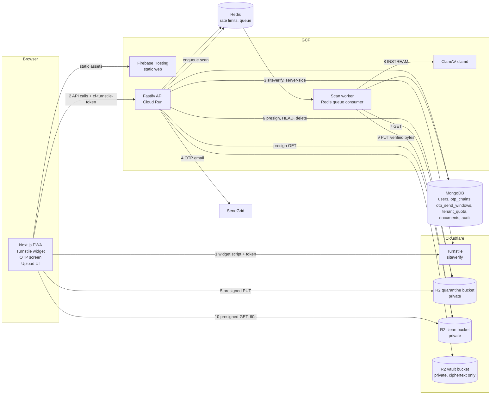

### 3.2 Trust boundaries

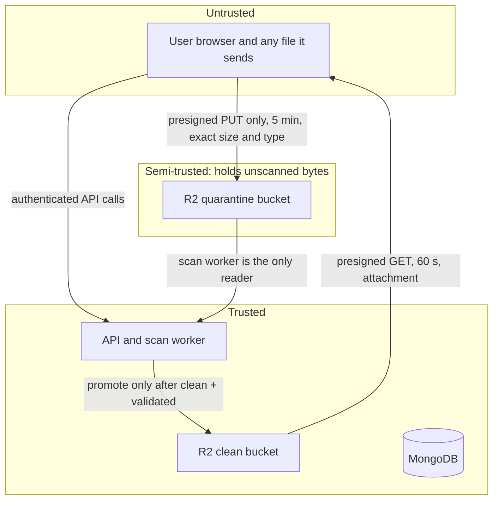

Rules that follow from this:

- Nothing outside the scan worker reads the quarantine bucket. Nothing outside the scan worker writes the clean bucket.
- The browser never receives a URL for the clean bucket until the document record says `scan: clean` and the caller passes the tenant and role check.
- Credentials are separate per bucket (§7.6), so a leaked API-presign credential cannot write to the clean bucket.

### 3.3 End-to-end user journey

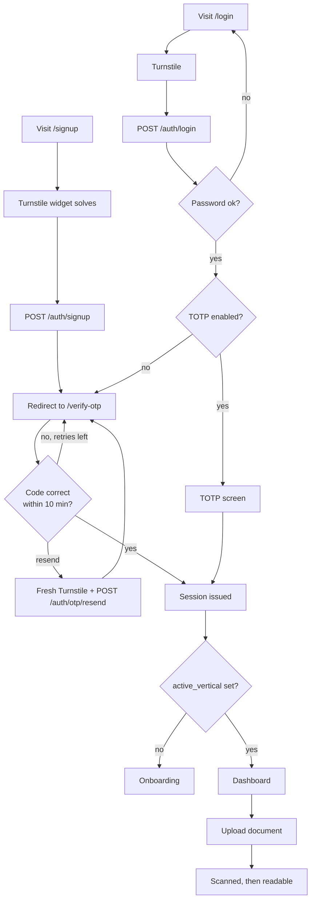

---

## 4. Public APIs: inventory and flowcharts

"Public" means reachable without a session: the `open` list in `server.ts:1627` plus the new OTP routes. Each group gets a protection profile; the flowcharts follow.

### 4.1 Inventory and protection profile

| Group | Routes | Turnstile | Other gate |
|-------|--------|:---------:|-----------|
| A. Health and ops | `GET /health`, `/engine/health`, `/status`, `/metrics`, `/documentation*` | No | `/metrics` is open with no auth today (`routes/metrics.ts:510`) and **will be gated** with a bearer scrape token (§8.4). `/documentation*` is registered only in dev or with `ENABLE_API_DOCS=true` (`server.ts:1550`); add a boot guard (§8.4) |
| B. Account creation and recovery | `POST /auth/signup`, `/auth/login`, `/auth/request-password-reset`, `/auth/resend-verification` | **Yes** | Rate limit (existing), login throttle (existing) |
| C. Token consumption | `POST /auth/reset-password`, `/auth/verify-email`, `/auth/mfa/verify`, `/auth/logout` | `reset-password`: Yes. Others: No | Single-use hashed token or pending JWT already gates them |
| D. New OTP routes | `POST /auth/otp/verify`, `POST /auth/otp/resend` | `verify`: No. `resend`: **Yes** | Pending JWT, attempts cap, cooldown (§6) |
| E. Social and SSO | `GET /auth/google/*`, `/auth/github/*`, `/auth/sso/*`, `POST .../exchange` | No (provider is the challenge) | OAuth `state`, PKCE where supported |
| F. Dev and demo | `/auth/token`, `/auth/demo-token` | n/a | Return 403 outside dev/test unless `ALLOW_DEMO_TOKENS` is set (`server.ts:1904`, `:1937`). Add a boot guard so that flag cannot be set in production (§8.4) |
| G. Marketing and lead capture | `POST /leads`, `POST /growth/events`, `GET /blog/posts*`, `/entitlements/plans`, `/trust` | `POST /leads`: **Yes**. `/growth/events`: No (volume), rate limit only. Reads: No | Rate limit, schema caps |
| G2. One-click opt-outs | `GET /leads/unsubscribe`, `GET /users/unsubscribe` (state change on GET, existing and deliberate: idempotent marketing opt-out, reversible, no external side effects, `List-Unsubscribe` target); `GET`+`POST /heartbeat/unsubscribe` (GET shows a confirm form, POST acts) | No | HMAC-signed token. Do not extend GET-acts to anything with side effects |
| H. Signed-link landings | `GET /a/:token` (confirmation page only; **POST approve needs an authenticated session of the same tenant**, dismiss keeps bearer semantics; `routes/insights.ts:1065-1090`), `GET /why/:token` (read-only evidence page), `GET /verify/:token` (read-only) | No | Signature and expiry on the token. A GET never changes state here; mail scanners and link previews issue GETs |
| I. Machine callers | `/webhooks/*`, `/inbound/*`, `/billing/webhook`, `/insights/cleanup-stale-all`, connector OAuth callbacks | No (never) | Provider signature or shared secret. Turnstile would break these |
| J. Family invites | `/family/join*`, `/family/invite/*` | Join submit: **Yes** | Invite token |

Any new public mutation added later must be classified into one of these rows in the PR.

### 4.2 Flowchart: Turnstile gate (shared by every "Yes" row)

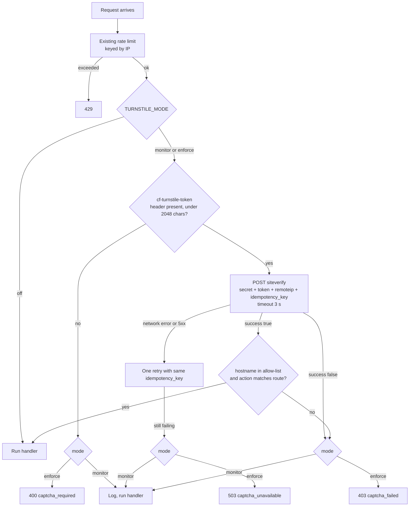

### 4.3 Flowchart: signup (B)

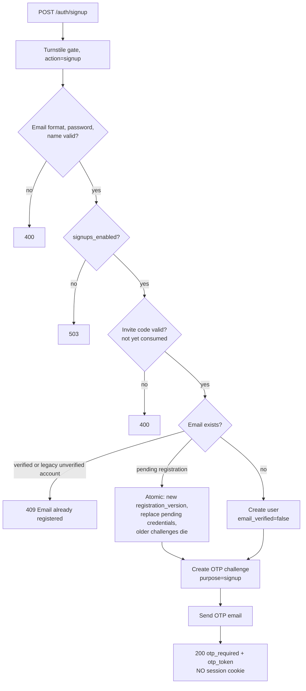

### 4.4 Flowchart: login (B, C)

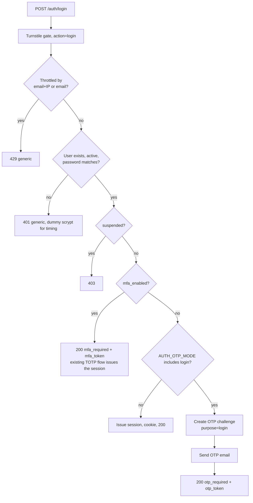

### 4.5 Flowchart: OTP verify and resend (D)

```mermaid
flowchart TD
  subgraph Verify[POST /auth/otp/verify]
    V0[Pending token verifies with the<br/>separate OTP key, purpose matches?] -- no --> V1[401]
    V0 -- yes --> V2[ATOMIC: findOneAndUpdate on chain<br/>filter chain_id, user_id, purpose,<br/>consumed_at null, code_expires_at in future,<br/>attempts under 5<br/>update attempts +1, return doc]
    V2 -- no match --> V3[400 otp_expired or 429 otp_locked]
    V2 -- match --> V7{HMAC equals stored hash?<br/>timingSafeEqual}
    V7 -- no --> V8[400 otp_invalid, attempts_left]
    V7 -- yes --> V9[ATOMIC: updateOne consumed_at null<br/>AND code_version equals the one compared]
    V9 -- modified 0 --> V3
    V9 -- modified 1 --> V10{purpose}
    V10 -- signup --> V11[ATOMIC: activate user where<br/>registration_status pending AND<br/>registration_version equals chain version]
    V11 -- modified 0 --> V14[409 otp_superseded]
    V11 -- modified 1 --> V11b[Consume invite code]
    V10 -- login --> V12[Record login event]
    V11b --> V15
    V12 --> V15{Liveness recheck:<br/>user active, not suspended or removed,<br/>tenant active, not revoked since chain start}
    V15 -- no --> V16[401 generic]
    V15 -- yes --> V13[Issue session + cookie<br/>200 token + user]
  end

  subgraph Resend[POST /auth/otp/resend]
    R0[Turnstile gate, action=otp_resend] --> R1[Pending token valid and<br/>chain not expired and not consumed?]
    R1 -- no --> R2[401 or 400 otp_expired]
    R1 -- yes --> R3[reserveSend: atomic cooldown,<br/>hourly and daily budget per user]
    R3 -- over budget --> R6[429 otp_cooldown or otp_send_limit]
    R3 -- ok --> R7[ATOMIC: same chain, new code_hash,<br/>code_version +1, attempts 0,<br/>code_expires_at +10 min, chain_expires_at unchanged]
    R7 --> R8[Send OTP email]
    R8 --> R9[200 delivery sent, failed or unknown<br/>same otp_token stays valid]
  end
```

### 4.6 Flowchart: password reset and verification links (B, C)

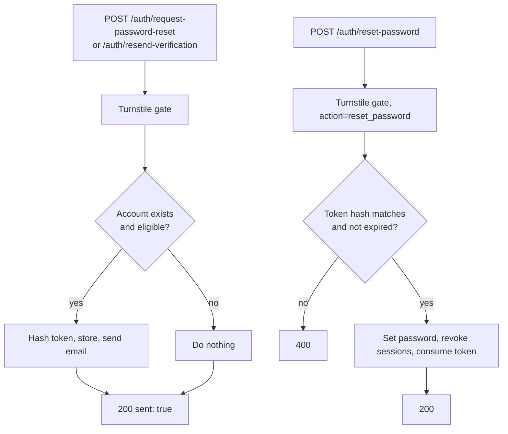

Both branches return the same body and similar latency (enumeration defence, existing behaviour at `auth-users.ts:703`).

### 4.7 Flowcharts: lead capture and join (G, J); opt-outs (G2); signed approval links (H)

These were one flowchart in the first draft that applied an action on GET after validating a signature. That contradicts the existing approval safety gate (mail scanners, chat previews and prefetch all issue GETs), so they are now three separate flows.

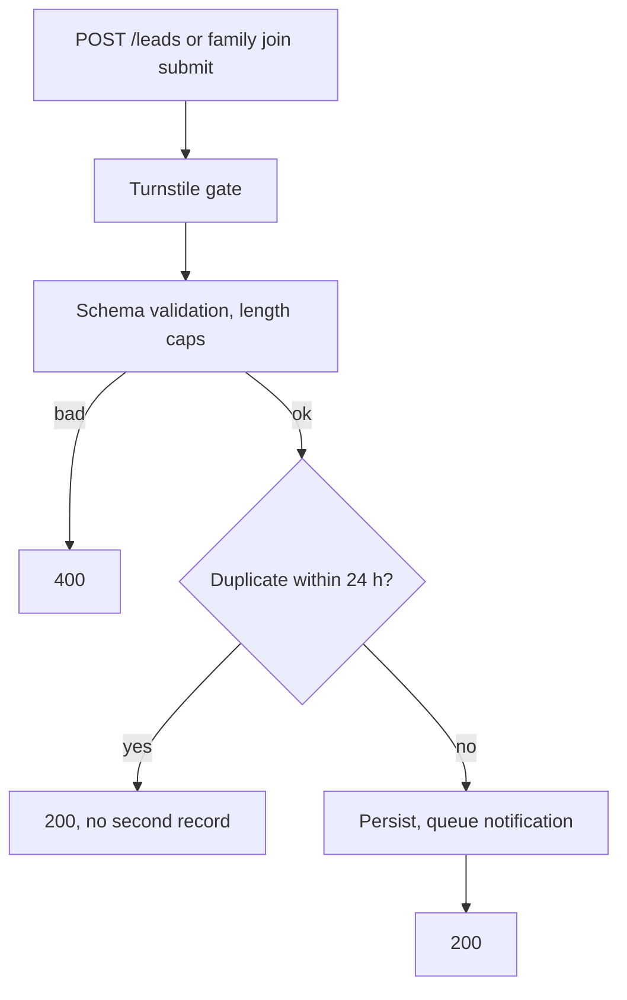

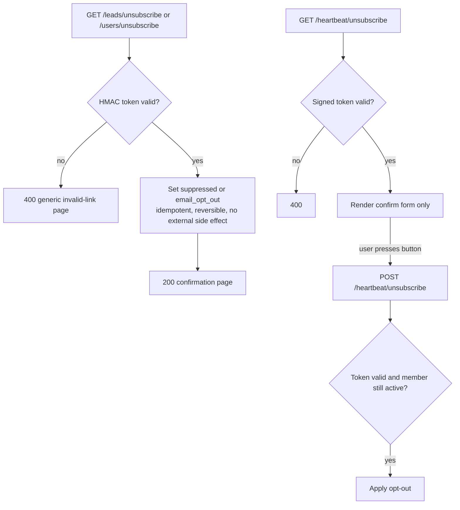

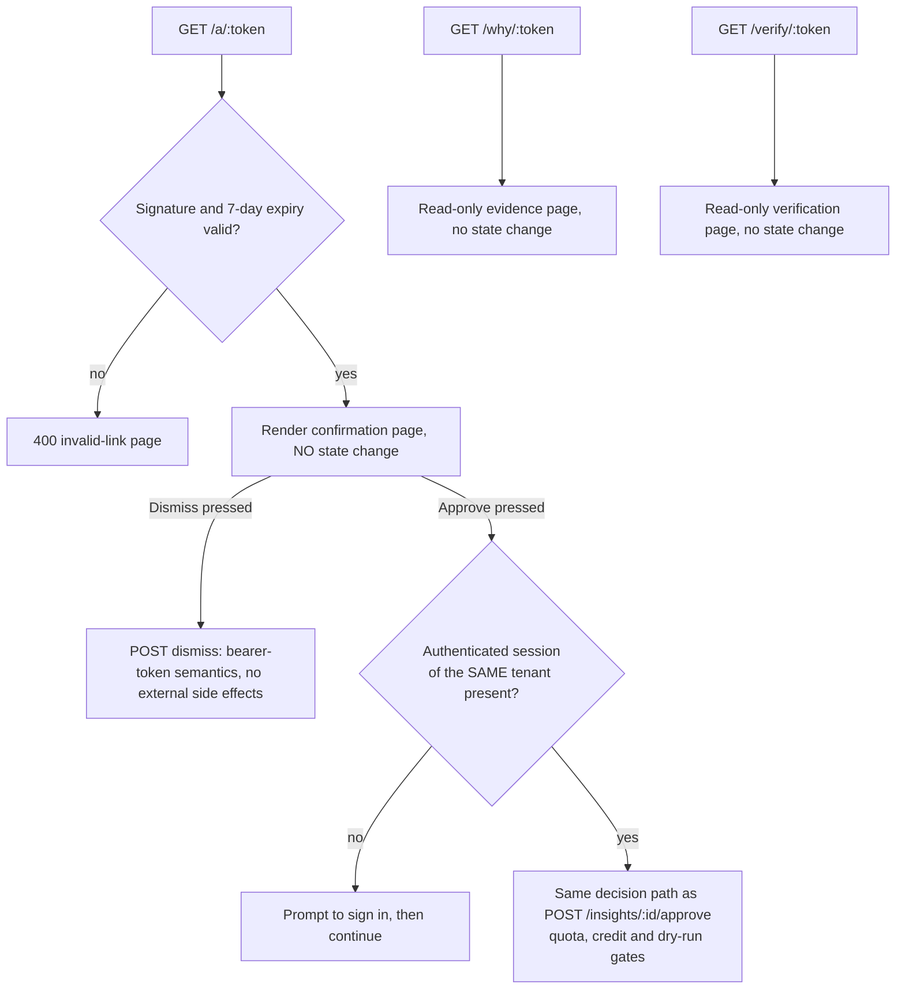

Rules: no new GET route may change state except the existing one-click marketing opt-outs; approval stays an authenticated POST. The OTP routes never use GET.

### 4.8 Flowchart: machine callers and health (A, I)

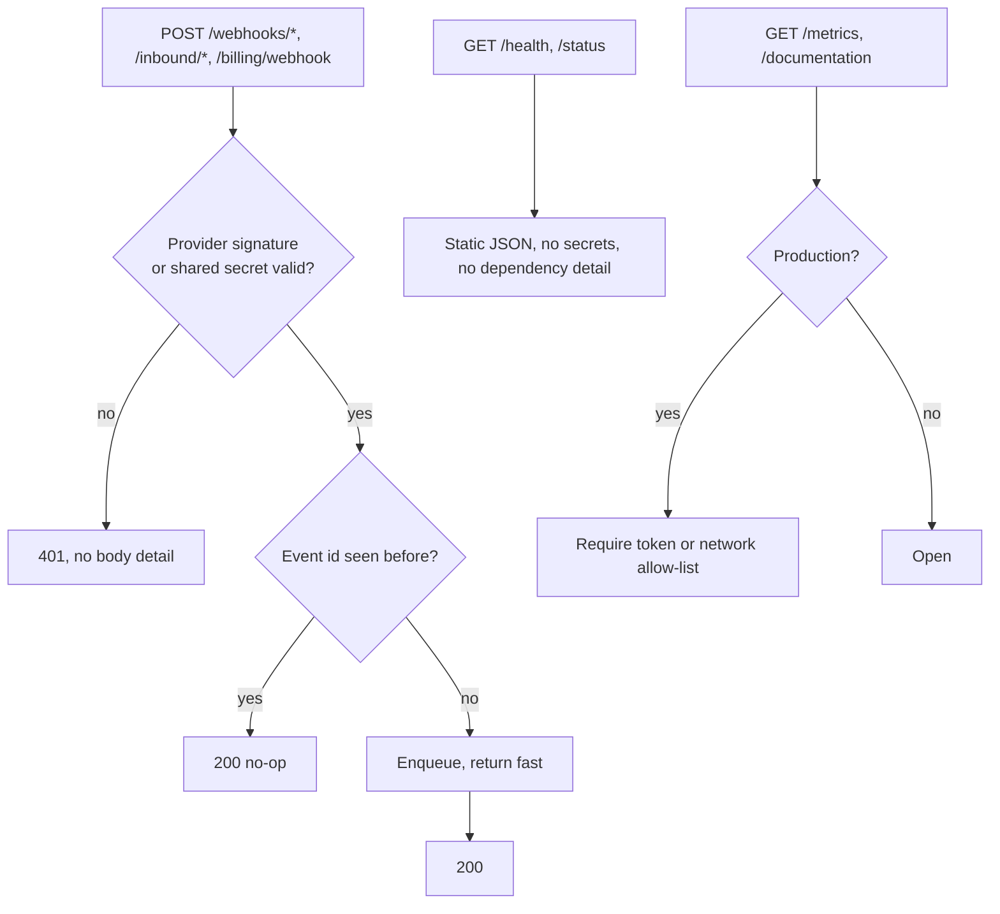

### 4.9 Flowchart: authenticated document upload after login

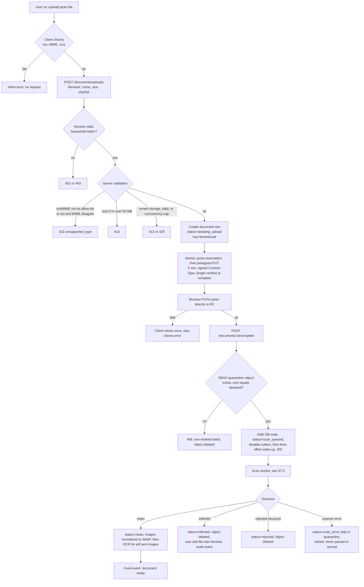

---

## 5. Turnstile LLD

### 5.1 Widget (web)

- Component `apps/web/src/components/security/Turnstile.tsx`. Loads `https://challenges.cloudflare.com/turnstile/v0/api.js?render=explicit` once, only on pages that need it (`/signup`, `/login`, `/reset-password`, `/verify-otp` resend, lead and join forms). Not in the root layout.
- Props: `action` (string, matches the server's expected action), `onToken(token)`, `onExpire()`. Use `appearance: 'interaction-only'` for login so legitimate users usually see nothing.
- The token is single use and expires after 300 s. After every submit (success or failure) call `turnstile.reset(widgetId)`. For a resend, a fresh token is required each time.
- Send as header: `cf-turnstile-token: <token>` from the API client in `apps/web/src/lib/api.ts`.
- Site key via `NEXT_PUBLIC_TURNSTILE_SITE_KEY` (public by design). The web app is a static export, so this is baked in at build time.
- Accessibility: the widget iframe is keyboard reachable; show a text status ("Checking you're human...") with `aria-live="polite"`; the submit button stays disabled until a token exists.

### 5.2 Server verification

New file `apps/api/src/security/turnstile.ts`:

```ts
export type TurnstileAction =
  | 'signup' | 'login' | 'otp_resend' | 'password_reset_request'
  | 'reset_password' | 'resend_verification' | 'lead' | 'family_join'

export function requireTurnstile(action: TurnstileAction): preHandlerAsyncHookHandler
```

Behaviour of the returned `preHandler`:

1. Read `TURNSTILE_MODE`. `off` returns immediately.
2. Read header `cf-turnstile-token`; reject if absent or longer than 2048 characters.
3. `POST https://challenges.cloudflare.com/turnstile/v0/siteverify` as `application/x-www-form-urlencoded` (or JSON) with `secret`, `response`, `remoteip` (the client IP resolved by Fastify's `trustProxy`), and `idempotency_key` (a UUID reused on the single retry). Timeout 3 s via `AbortSignal.timeout`.
4. Require `success === true`, `hostname` in `TURNSTILE_ALLOWED_HOSTNAMES`, and `action` equal to the route's action. A token minted for the login form must not unlock signup.
5. On failure return the error shape the API already uses: `{ error: 'captcha_failed' }` (403), `captcha_required` (400), `captcha_unavailable` (503). Log `error-codes` (never the token).
6. Count outcomes in the existing metrics module (`turnstile_verify_total{action,result}`) so the `monitor` phase produces data.

Wiring (one line per route, alongside the existing `config.rateLimit`):

```ts
app.post('/auth/signup',
  { config: { rateLimit: { max: 10, timeWindow: '1 minute' } }, preHandler: requireTurnstile('signup') },
  handler)
```

Order matters: rate limit first (cheap, rejects floods before spending a network call), Turnstile second, business logic last.

### 5.3 Configuration

| Variable | Where | Notes |
|----------|-------|-------|
| `TURNSTILE_SECRET_KEY` | API (Secret Manager) | Never in the repo or web bundle |
| `NEXT_PUBLIC_TURNSTILE_SITE_KEY` | web build | Public |
| `TURNSTILE_MODE` | API | `off` (dev default), `monitor`, `enforce` (non-dev default) |
| `TURNSTILE_ALLOWED_HOSTNAMES` | API | Comma list, e.g. the Firebase Hosting domains |

Cloudflare publishes dummy keys for tests: site key `1x00000000000000000000AA` with secret `1x0000000000000000000000000000000AA` always passes; site `2x00000000000000000000AB` with secret `2x0000000000000000000000000000000AA` always fails. Use these in CI and Playwright, never real keys. A dummy token against a real secret fails, and vice versa.

### 5.4 Sequence: Turnstile verification (LLD)

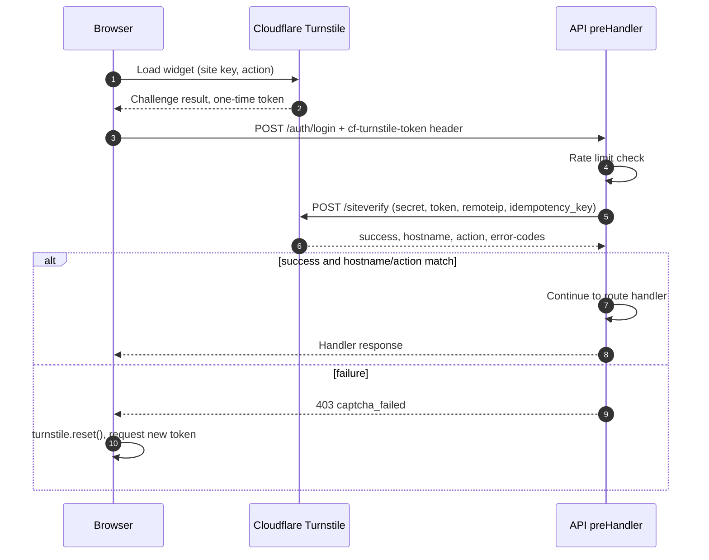

---

## 6. Email OTP LLD

### 6.1 Rules

| Property | Value |
|----------|-------|
| Code | 6 digits, `crypto.randomInt(0, 1_000_000)` zero-padded |
| Storage | `HMAC-SHA256(OTP_PEPPER, chain_id + ':' + code_version + ':' + code)`, never the code |
| Chain | One **chain** per authentication attempt, identified by a stable `chain_id`. A resend issues a new code **inside the same chain** (`code_version + 1`); it does not create a new challenge or a new token |
| Code TTL | 10 minutes per code |
| Chain TTL | 30 minutes absolute from first issuance (`chain_expires_at`). Resend never extends it. After that the user restarts login or signup, which spends send budget again |
| Attempts | 5 per code version; reset to 0 when a new code is issued. Total guesses are therefore bounded by the send budget (at most 5 sends per hour, so at most 25 guesses per hour per user) |
| Send budget | Account-wide per `user_id`, covering **every** issuance path (signup, re-signup, login, resend, restart). Atomic (§6.2.2) |
| Single use | Atomic conditional update (§6.3.1) |
| Pending token | JWT `{ sub, chain_id, purpose }`, `aud: 'lifekeel:otp-pending'`, `exp = chain_expires_at`. Signed with a **separate key** derived from the JWT secret (`HKDF-SHA256(secret, info='lifekeel/otp-pending/v1')`), so `auth.verify` fails its signature check. It cannot be accepted as a session on protected routes, on opportunistically authenticated open routes (`server.ts:1680-1725`), or as a cookie. `signOtpPending`/`verifyOtpPending` live in `apps/api/src/auth/otp-token.ts`. Returned in the response body only |
| Logging | Never log the code or the pending token; log `chain_id`, `purpose`, outcome |
| Email tracking | Disable SendGrid click and open tracking on OTP mail |

Why a separate key and not a claim: `packages/platform/src/auth.ts:61` builds `AuthContext` from `sub`, `tenant_id`, `roles`, `demo`, `mfa_pending` and `iat` only. Any other claim (`otp_pending`, `cid`, `purpose`) is silently dropped, so a pending token signed with the session key would verify as a session with empty roles. The existing `mfa_pending` pattern works only because `AuthContext` was extended for it. As defence in depth, `AuthContext` is not extended for OTP; the key separation is the boundary, and tests (§11.2) prove it.

**What this protects and what it does not.** The code proves that, at that moment, the person at the keyboard can read mail sent to that address. The pending token is an ordinary bearer credential: anyone who holds it and the code can complete the step. It is **not** bound to a browser, and it is **not phishing-resistant**: a real-time phishing proxy can relay the password, the pending token and the emailed code. Email OTP gives mailbox-ownership verification and a second step against password-only attacks (credential stuffing). NIST SP 800-63B does not accept email as an out-of-band authenticator, so this must not be described as strong or phishing-resistant MFA. TOTP has the same relay weakness. Phishing-resistant authentication would be passkeys (WebAuthn); that is out of scope here and noted in §12.

### 6.2 Data model

#### 6.2.1 `otp_chains`

```ts
interface OtpChain {
  chain_id: string                    // uuid, unique index, stable across resends
  user_id: string
  tenant_id: string
  purpose: 'signup' | 'login'
  registration_version: string | null // signup only: the immutable pending-registration version this chain may activate
  code_hash: string                   // hex HMAC
  code_version: number                // starts at 1, +1 per resend
  attempts: number                    // for the current code_version
  code_expires_at: Date               // +10 min from the last send
  chain_expires_at: Date              // +30 min from first issuance, never extended
  created_at: Date
  last_sent_at: Date
  consumed_at: Date | null
  delivery: 'sent' | 'failed' | 'unknown'
  purge_at: Date                      // TTL index target: chain_expires_at + 1 hour
}
```

Indexes: `{ chain_id: 1 }` unique; `{ user_id: 1, purpose: 1, created_at: -1 }`; `{ purge_at: 1 }` TTL with `expireAfterSeconds: 0`. The chain collection is only the **challenge** record. It is not used for rate limiting, because it expires.

#### 6.2.2 `otp_send_windows` (budgets, retained longer than the longest window)

```ts
// _id examples:  "<user_id>:h:2026102310"   "<user_id>:d:20261023"   "<user_id>:cool"
interface OtpSendWindow { _id: string; count?: number; next_send_at?: Date; expires_at: Date }
```

`reserveSend(userId)` runs these three conditional upserts in order and aborts at the first refusal:

```ts
// cooldown (60 s): matches only when the previous allowance has passed
await w.updateOne({ _id: `${u}:cool`, next_send_at: { $lte: now } },
                  { $set: { next_send_at: addSeconds(now, 60), expires_at: addHours(now, 25) } },
                  { upsert: true })            // E11000 on an existing, not-yet-expired doc => cooldown
// hourly (5) and daily (10): count is checked inside the filter, so the check and the increment are one operation
await w.updateOne({ _id: `${u}:h:${hourKey}`, count: { $lt: 5 } },
                  { $inc: { count: 1 }, $setOnInsert: { expires_at: addHours(hourEnd, 25) } }, { upsert: true })
await w.updateOne({ _id: `${u}:d:${dayKey}`, count: { $lt: 10 } },
                  { $inc: { count: 1 }, $setOnInsert: { expires_at: addHours(dayEnd, 25) } }, { upsert: true })
```

A duplicate-key error on the upsert means the limit is reached. There is no count-then-insert, so concurrent requests cannot exceed a limit. `expires_at` is at least 24 hours past the end of each window (TTL index on `expires_at`), so the budget outlives the 10-minute challenge, and restarting signup or login cannot reset it. Windows are clock-aligned fixed windows, so a burst across a boundary can reach about twice the nominal limit; the per-IP route rate limits and Turnstile cover that. A counter spent by an earlier step stays spent if a later step refuses (fails closed).

#### 6.2.3 User fields (signup)

`registration_status: 'pending' | 'active'` (absent on legacy users), `registration_version: string` (uuid, replaced on every re-signup), `registration_created_at: Date`. New code creates users with `pending`; verification sets `active` and unsets the version.

New code: `apps/api/src/auth/otp.ts` (generate, hash, `reserveSend`, `issueChain`, `resendInChain`, `verifyChain`), `apps/api/src/auth/otp-token.ts`, and `apps/api/src/routes/auth-otp.ts`. Add `'/auth/otp/'` to the `open` list in `server.ts:1627`; the routes authenticate the pending token themselves.

### 6.3 API contracts and algorithms

`POST /auth/signup` and `POST /auth/login` (changed responses when `AUTH_OTP_MODE` applies):

```json
{ "otp_required": true, "otp_token": "<jwt>", "email_hint": "j***@example.com",
  "delivery": "sent", "code_expires_at": "2026-10-23T10:10:00Z",
  "chain_expires_at": "2026-10-23T10:30:00Z", "resend_available_at": "2026-10-23T10:01:00Z" }
```

No `Set-Cookie`, no `token`. `delivery` is `sent`, `failed` or `unknown` (§6.8): the response is **200 with a usable token in all three cases**, so the user can always reach the resend control.

`POST /auth/otp/verify`, body `{ "otp_token": "...", "code": "123456" }`

- 200: `{ token, user }` plus the session cookie (same shape as today's login success, so the `active_vertical` redirect is untouched).
- 400 `otp_invalid` with `attempts_left`; 400 `otp_expired`; 409 `otp_superseded` (signup chain replaced by a newer registration); 429 `otp_locked`; 401 invalid `otp_token` or failed liveness check.

`POST /auth/otp/resend`, body `{ "otp_token": "..." }`, header `cf-turnstile-token`

- 200: `{ delivery, code_expires_at, chain_expires_at, resend_available_at }`. **No new token**: the same `otp_token` stays valid until `chain_expires_at`.
- 429 `otp_cooldown` (with `retry_after_s`) or `otp_send_limit`; 400 `otp_expired` when the chain has expired (client restarts at login or signup); 403 `captcha_failed`.

#### 6.3.1 Verify, as three conditional operations

1. **Claim an attempt and read the hash, atomically.** `findOneAndUpdate({ chain_id, user_id: tok.sub, purpose: tok.purpose, consumed_at: null, code_expires_at: { $gt: now }, chain_expires_at: { $gt: now }, attempts: { $lt: 5 } }, { $inc: { attempts: 1 } }, { returnDocument: 'after' })`. No match means expired, consumed, wrong user/purpose, or locked. Every concurrent guess spends one attempt, so ten parallel requests cannot evaluate more than five guesses.
2. **Compare** `HMAC(...)` with the returned `code_hash` using `timingSafeEqual`.
3. **Consume** with `updateOne({ chain_id, consumed_at: null, code_version: doc.code_version }, { $set: { consumed_at: now } })`. Only one of two concurrent correct submissions can win; a resend that landed between steps 1 and 3 changes `code_version` and makes this fail.
4. **Signup only:** activate with `updateOne({ id: user_id, registration_status: 'pending', registration_version: chain.registration_version }, { $set: { email_verified: true, registration_status: 'active' }, $unset: { registration_version: '' } })`. Modified 0 means a newer registration replaced this one: return 409 `otp_superseded`, issue nothing. Then consume the invite code atomically (a refusal returns `409 invite_unavailable` and leaves the account pending).
5. **Liveness recheck before issuing the session** (same checks the open-route hook performs at `server.ts:1686-1722`, factored into one shared function): user exists, not `suspended`, `erased` or `removed`; tenant `active` or `trial`; `sessions_revoked_at` earlier than `chain.created_at` (a password change or revoke after the chain began invalidates it). Then `auth.sign`, `setSessionCookie`, `recordLoginEvent`.

Ordering means a failure at any step issues no session. Steps 3 and 4 are separate writes (no multi-document transaction is assumed, and the replica-set requirement is not relied on); the failure window between them can only reject a valid user, never admit an invalid one.

#### 6.3.2 Signup and re-signup

```ts
// pending registrations only; verified and legacy unverified accounts fall through to 409 as today
users.findOneAndUpdate(
  { email, registration_status: 'pending', email_verified: false },
  { $set: { password_hash, name, registration_version: newVersion, registration_created_at: now } })
```

The replacement and the version change are one atomic write. Every older signup chain carries the old `registration_version`, so step 4 above fails for it: a concurrent re-signup can never make an earlier verification activate the newer password. Legacy accounts (unverified rows created before this change, no `registration_status`) are never overwritten: they may hold sessions and data. They continue to receive the 409.

### 6.4 Sequence: signup with OTP

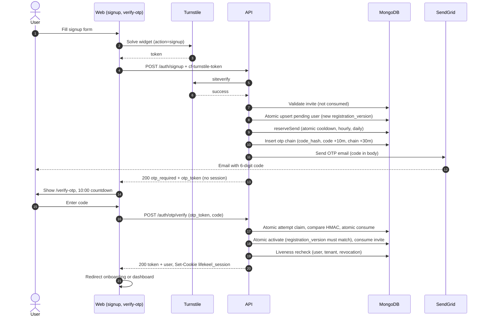

### 6.5 Sequence: login with OTP (TOTP users use the existing TOTP flow instead)

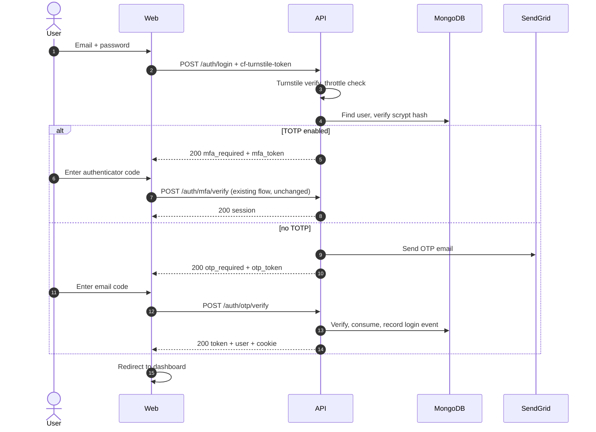

### 6.6 Sequence: resend OTP

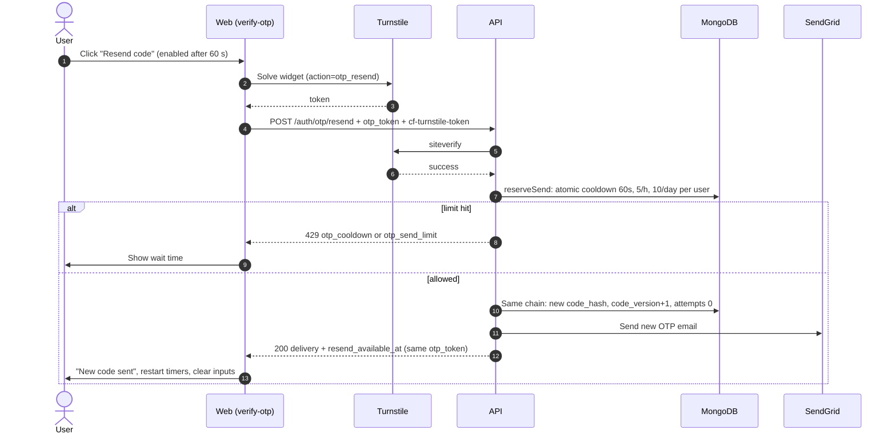

### 6.7 OTP screen (web)

New page `apps/web/src/app/verify-otp/page.tsx` plus `layout.tsx`, using `AuthShell` like `verify-email/page.tsx`.

- Six single-character inputs with `inputMode="numeric"`, `autoComplete="one-time-code"` (iOS and Android autofill from the email or SMS keyboard suggestion), `pattern="[0-9]*"`. Auto-advance, backspace moves back, paste of six digits fills all boxes, auto-submit when complete.
- States: `idle`, `verifying`, `error` (shows attempts left), `locked` (offers "Start over" back to login), `code_expired` (code over 10 minutes but chain alive: offers resend), `chain_expired` (30 minutes passed: "Start over"), `delivery_failed` (resend enabled immediately), `delivery_unknown` (resend after the cooldown), `superseded` (a newer signup replaced this one: "Start over"), `success`.
- Countdown "Code expires in 09:41" (driven by `code_expires_at`; the same token keeps working across resends) and a resend button that is disabled with "Resend in 42 s" until `resend_available_at`. A resend runs the Turnstile widget first.
- "Wrong email? Go back" returns to signup. The pending token is kept in `sessionStorage` (cleared on success and on tab close) and sent in the request body.
- Accessibility: one visually hidden label for the group, `aria-live="assertive"` error region, focus moves to the first empty box after an error, and no reliance on color alone.
- If there is no pending token in storage, redirect to `/login`.
- On success, reuse the existing post-login redirect (`active_vertical` null goes to onboarding, otherwise dashboard).

### 6.8 OTP email template

Added to `apps/api/src/auth-email.ts` next to `sendEmailVerificationEmail`, using `renderEmail` from `apps/api/src/email/layout.ts` (no CTA button; the code is the content).

Subject: `Your LifeKeel code: 482 913` for login, `Confirm your email: 482 913` for signup. Putting the code in the subject lets phone notification previews and password managers see it; it is the standard tradeoff for OTP mail and the code expires in 10 minutes.

Plain-text part:

```text
Hi {firstName},

Your LifeKeel {signup: "confirmation" | login: "sign-in"} code is:

    {482 913}

It expires in 10 minutes. Enter it on the LifeKeel page you just used.

LifeKeel will never ask you for this code by phone, chat or email.
If you didn't try to {create an account | sign in}, ignore this message. Your account is safe, and no one can sign in without this code. If you keep getting these, change your password.
```

HTML part (rendered by `renderEmail`; styled by the existing brand tokens `EMAIL_COLORS`, `EMAIL_FONTS`):

```ts
export async function sendOtpEmail(
  to: string,
  name: string,
  code: string,
  purpose: 'signup' | 'login',
): Promise<void> {
  const firstName = name.split(' ')[0] || 'there'
  const spaced = `${code.slice(0, 3)} ${code.slice(3)}`
  const action = purpose === 'signup' ? 'confirm your email address' : 'sign in'
  await sgMail.send({
    to,
    from: { email: getFromEmail(), name: 'LifeKeel' },
    subject: purpose === 'signup' ? `Confirm your email: ${spaced}` : `Your LifeKeel code: ${spaced}`,
    text, // plain-text body above
    trackingSettings: { clickTracking: { enable: false }, openTracking: { enable: false } },
    html: renderEmail({
      preheader: `Your code is ${spaced}. It expires in 10 minutes.`,
      eyebrow: purpose === 'signup' ? 'Confirm your email' : 'Sign in',
      title: 'Your one-time code',
      bodyHtml:
        p(`Hi ${escapeHtml(firstName)},`) +
        p(`Use this code to ${action}:`) +
        // Monospace block, EMAIL_FONTS.mono, 32px, letter-spacing 6px, centered,
        // on a EMAIL_COLORS.page background with a EMAIL_COLORS.line border.
        codeBlock(spaced) +
        p('This code expires in <strong>10 minutes</strong> and works once.'),
      note:
        "LifeKeel will never ask you for this code by phone, chat or email. If you didn't request it, you can ignore this message. No one can sign in without it.",
      footer: { reason: 'You got this because this address was used on LifeKeel.' },
    }),
  })
}
```

`codeBlock` is one small local helper in `auth-email.ts`, built from the same primitives as `button()`; no layout-wide change. Conventions follow the file (log only `to`, `escapeHtml` every interpolation).

**Send failure contract.** The chain and the pending token are created **before** the send, so the user always has something to resend against. `sendOtpEmail` returns an outcome instead of throwing:

| Provider outcome | `delivery` | Server behaviour | UI |
|------------------|-----------|------------------|----|
| Accepted (2xx) | `sent` | Normal | "We sent a code" |
| Definite rejection (4xx, 5xx before acceptance) | `failed` | Chain stays; the 60 s cooldown is released (`next_send_at = now`) so the user can resend at once. The send budget is **not** refunded | "We couldn't send the email. Resend" |
| Timeout or connection error after the request left (ambiguous) | `unknown` | Chain and the existing code stay valid; normal 60 s cooldown | "If you don't see it in a minute, resend" |

A resend after `unknown` replaces the code inside the same chain, so only one code is ever valid and the user is never left with two conflicting codes. All three return HTTP 200 with the token. In dev with no `SENDGRID_API_KEY`, the code is logged at `warn` (dev mode only); in any other mode a missing key at boot is a startup error.

Deliverability: send from the existing authenticated domain (SPF, DKIM, DMARC already needed for `accounts@lifekeel.co.uk`); keep the template text-light; no images required to read the code.

### 6.9 Changes to existing behaviour

| Item | Change |
|------|--------|
| Signup session | No longer issued at signup; issued by `/auth/otp/verify` |
| Invite code | Validated at signup, **consumed atomically at activation** (today it is consumed at signup). If it has been exhausted in between, activation returns `409 invite_unavailable` and the account stays pending |
| Re-signup of a pending registration | Atomic replacement with a new `registration_version`; older chains can no longer activate (§6.3.2). Verified accounts and legacy unverified accounts still get the 409 (existing KEEL-025 decision) |
| Pending-registration cleanup | **New job; it does not exist today** (`jobs/retention-worker.ts:59-100` sweeps `signals`, `insights`, `workflow_runs`, `agent_memory` and platform records, not users). Add `sweepPendingRegistrations()` to the retention worker: delete users where `registration_status === 'pending'`, `email_verified === false`, `registration_created_at` older than 7 days, and no successful login event; then delete their `otp_chains` and `otp_send_windows`, and their tenant only if it was created by that signup and holds no documents, family members or other users. Rows without `registration_status` (legacy) are never touched. Record counts via `recordJobRun`; add the window to `docs/data-retention.md` |
| `/auth/verify-email` link | Kept for email-change confirmation; no longer part of signup |
| `AUTH_OTP_MODE` | `off`, `signup`, `signup_login` (non-dev default). Lets login OTP ship after signup OTP |
| Existing tests | Signup and login tests assert a token; update them for `otp_required`, add OTP unit and route tests (attempts, expiry, replay, supersede, cooldown) |

---

## 7. R2 and document pipeline LLD

### 7.1 Buckets and tokens

| Bucket | Purpose | Jurisdiction | Lifecycle |
|--------|---------|--------------|-----------|
| `lifekeel-quarantine` | Untrusted uploads, browser PUT target | match tenant region policy (R2 offers an `eu` jurisdiction) | Delete objects after 24 h; abort incomplete multipart uploads after 1 day |
| `lifekeel-clean` | Verified bytes only | same | None (deleted by the app on document delete or erasure) |
| `lifekeel-vault` | Estate Vault **ciphertext** (tenant-envelope encrypted by the API; optionally also client-sealed) | same | None |

All buckets: public access disabled, `r2.dev` URL disabled, no custom public domain. Access is only through presigned URLs and API credentials.

R2 API tokens (S3-compatible, created per bucket scope). Cloudflare's permission levels are coarse (Admin Read & Write, Object Read & Write, Object Read only; there is no delete-only level), so **deleting requires Object Read & Write**. Separation is therefore by credential and by call site:

| Token | Scope | Used by |
|-------|-------|---------|
| `r2-presign` | Object Read & Write on `lifekeel-quarantine` | API: sign PUT, HEAD, delete of an abandoned quarantine object |
| `r2-scan` | Object Read & Write on `lifekeel-quarantine` (it must delete after promotion) and Object Read & Write on `lifekeel-clean` (it must write) | Scan worker and reconciler only |
| `r2-serve` | Object Read on `lifekeel-clean` | API: sign GET, stream bytes in compatibility mode |
| `r2-delete` | Object Read & Write on `lifekeel-clean` | Document delete and erasure code paths only |
| `r2-vault` | Object Read & Write on `lifekeel-vault` | Vault routes only |

No credential can write to clean except `r2-scan` (promotion) and `r2-delete` (delete). A leaked `r2-presign` key cannot touch clean or the vault. A repo test (same tripwire idea as `trust-tier-gate.test.ts`) allow-lists which source files may construct each R2 client, so adding a caller forces review.

Env: `R2_ACCOUNT_ID`, `R2_ENDPOINT` (`https://<account>.r2.cloudflarestorage.com`, or the `eu.` variant for the EU jurisdiction), one key pair per token above, bucket names. Client: `@aws-sdk/client-s3` and `@aws-sdk/s3-request-presigner`, `region: 'auto'`. Presigned URLs only work on the S3 API domain, not on custom domains. R2 does not support presigned POST policies, so the PUT signs `Content-Type` only. **Browsers set `Content-Length` themselves and scripts are not allowed to set it**, so the client never sends that header explicitly; the browser derives it from the `Blob` it uploads. Size is therefore enforced by the exact-size `HEAD` at `complete`, the scanner's re-check, and the quota reservation. Whether R2 accepts a presigned PUT with `content-length` signed, and how each browser behaves, must be tested against a real R2 test bucket in Chrome, Safari, Firefox and the mobile WebViews; MinIO cannot establish that. If exact-length signing proves unreliable, ship without it and rely on the checks above. In that case an oversize PUT can briefly occupy quarantine storage (bounded by the 5-minute URL, the reservation and the 1-day lifecycle, and deleted at `complete`).

### 7.2 Allowed formats and image normalization

Single source of truth in `apps/api/src/documents/formats.ts` (new):

| Extension | MIME | Signature check | Extra structural check |
|-----------|------|-----------------|------------------------|
| `.pdf` | `application/pdf` | starts `%PDF-` | Reject if it contains `/JavaScript`, `/JS`, `/Launch`, `/EmbeddedFile`, or `/OpenAction` with an action (token scan on the first and last MB plus xref objects) |
| `.docx` | `application/vnd.openxmlformats-officedocument.wordprocessingml.document` | starts `PK\x03\x04` | Open as zip with limits: must contain `[Content_Types].xml` and `word/document.xml`; reject `vbaProject.bin`, `word/embeddings/*`, `.exe`/`.dll` entries, encrypted entries; max 1000 entries, max 100 MB uncompressed, compression ratio under 100:1 (zip-bomb defence) |
| `.jpg`, `.jpeg` | `image/jpeg` | `FF D8 FF` | Image checks below |
| `.png` | `image/png` | 8-byte PNG signature | Image checks below |
| `.webp` | `image/webp` | `RIFF....WEBP` | Image checks below |
| `.gif` | `image/gif` | `GIF8` | Image checks below |
| `.heic`, `.heif` | `image/heic`, `image/heif` (also accept `image/heic-sequence`, `image/heif-sequence`) | ISO-BMFF `ftyp` with a HEIF brand (existing `HEIF_BRANDS` check) | Image checks below |

Rules applied to every file: the extension, the declared MIME, and the detected signature must all agree; only the **final** extension counts and a double extension like `a.pdf.exe` fails because `.exe` is not on the list; filename is sanitized (strip path separators, control characters, RTL override characters, cap at 120 chars) and stored as metadata only; the storage key is `{tenant_id}/{document_id}` with a random UUID, never the user's filename.

`signatureMatchesMime` in `extraction/file-signature.ts` already covers every image type above; it gains a `.docx` case. `ALLOWED_MIME_TYPES` in `documents.ts:100` gains the `.docx` MIME and keeps its image list. `vault.ts` imports the same constant today, so it would pick up `.docx` by accident: give it its own `VAULT_ALLOWED_MIME_TYPES` equal to today's list.

**Image normalization (all image types, in the scan worker, after ClamAV says clean):**

1. Decode with `sharp` after reading headers only: reject if `width * height` exceeds 100 MP or either side exceeds 20,000 px (decompression-bomb defence), set `limitInputPixels`.
2. Apply EXIF orientation (`.rotate()`) so the pixels are upright, then drop all metadata, including GPS. Privacy matters here: these are photos of family documents.
3. Encode to **WebP at the original pixel dimensions**. No downscaling and no resize step. "Resize" in the request is read as re-encode: dimensions are preserved so small print on a scanned document stays legible for OCR. If a different meaning was intended (for example a maximum long edge), say so; it is a one-line option.
4. Quality: lossless WebP for PNG and GIF sources (screenshots and scans have flat color and text, and lossless avoids OCR regressions); lossy `quality: 90` with `smartSubsample` for JPEG, HEIC and HEIF photos. Fall back to lossless if the lossy result is larger than the source.
5. Animated GIF or WebP: keep the **first frame only** (documents are stills). Multi-image HEIC: first image only.
6. Store `declared` (what the user sent) and `stored: { mime: 'image/webp', width, height, sha256 }`. The original bytes are **not** retained; the WebP is the document of record. State this in the upload UI ("images are converted to WebP").
7. The stored object's key and `mime_type` become WebP, so `GET /documents/:id/file` serves `image/webp` and OCR/vision (`ocr/extract.ts`, `ocr/local-ocr.ts`) read the WebP. Confirm `isOcrableImage` accepts `image/webp`; add it if not.

**HEIC/HEIF decoding (decided: self-built `sharp`):** prebuilt `sharp` binaries ship without an HEVC decoder, so the worker image builds `libvips` with `libheif` and `libde265` (both open source, no license fee) and compiles `sharp` against it (`SHARP_FORCE_GLOBAL_LIBVIPS=1`). A WASM decoder (`libheif-js`) is also free, but it is slower and holds the whole decoded bitmap in the WASM heap, which matters at 50 MB uploads, so it is the fallback only. HEVC is patent-encumbered regardless of which route is used: have legal confirm exposure before Phase 4. The decode runs only in the scan worker, on already-scanned bytes, inside the credential-less parser child (§7.11) with a memory and time cap. Add a HEIC fixture to the test suite so a base-image change cannot silently break it.

DOCX content is always stored, scanned and served. **Text extraction is plan-gated** by the same entitlement as PDF and image extraction today, `document_ai_extraction` (`entitlements.ts:40`: `free: false`, `starter`, `growth`, `enterprise`: `true`). Free-plan DOCX stays at status `stored`; paid plans go `clean` to `processing`. The request said "free or Keel Plus"; the code has no plan named Keel Plus, so this maps it to the existing paid plans. If Keel Plus is a new tier, add it to `entitlements.ts` first. Extraction: unzip `word/document.xml` (already validated in the scan step), pull text with `mammoth` (`extractRawText`, no HTML, no images, no external relationships followed), then feed the text into the existing text path of `processDocument` (`ocr/extract.ts`), skipping OCR and vision. The text goes through the same AI task gateway task as other document text, so rule 3 enforcement is unchanged. Cap extracted text length like the PDF path.

### 7.3 Document state machine and recovery

The **document row is the durable work queue**. Redis is only a wake-up; any job it loses is found again by the reconciler (§7.5).

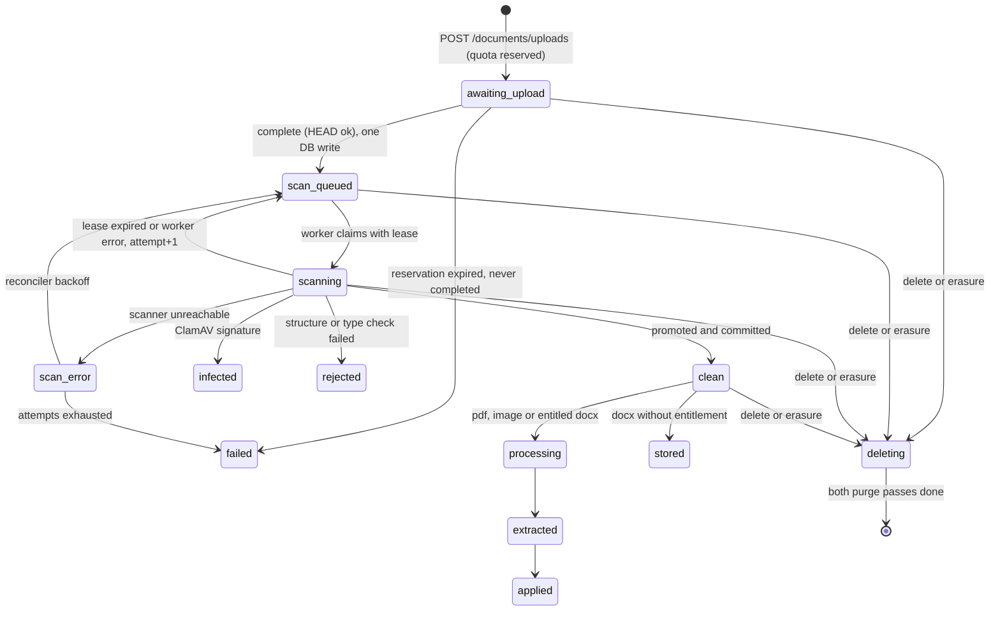

Every transition is a conditional update on `{ _id, status: <expected>, generation: <g> }`; a worker whose lease or generation no longer matches changes nothing.

| State | Owner | Durable marker | If the process dies here |
|-------|-------|----------------|--------------------------|
| `awaiting_upload` | Browser, then API | `reservation.expires_at` | Sweeper fails the row after 15 min, releases the reservation, deletes any quarantine object |
| `scan_queued` | Reconciler/worker | `scan_job.next_run_at`, `attempt` | A lost Redis wake-up is harmless: the reconciler (every 60 s) re-enqueues every `scan_queued` row due to run |
| `scanning` | Worker | `lease_owner`, `lease_until` (5 min, renewed while working) | Lease expires, reconciler returns the row to `scan_queued`; the next attempt starts from quarantine, which is still present |
| promote (inside `scanning`) | Worker | `source_sha256`, deterministic clean key | Order: (1) PUT clean key (idempotent overwrite of the same key), (2) conditional commit `scanning -> clean` on lease and generation, (3) delete quarantine, (4) set `ocr_pending: true`. Crash after (1): retry repeats (1). Crash after (2): row is `clean`, quarantine deletion and OCR are finished by the reconciler (below). If (2) fails because the row was deleted or the lease was lost, the worker deletes the clean key it just wrote |
| `scan_error` | Reconciler | `attempt`, `next_run_at` with backoff | Retried up to 5 times, then `failed` with an alert |
| `clean` with `quarantine_present` or `ocr_pending` | Reconciler | those two flags | Reconciler deletes the quarantine object (also covered by the 1-day lifecycle) and dispatches OCR through the existing `ocr/retry-failed.ts` sweep, which is updated to read `storage.key` as well as `file_id` |
| `deleting` | Erasure/delete code | `tombstone`, `purge_after` | Resumed by the reconciler (§7.7) |

Only `clean`, `stored`, `processing`, `extracted`, `applied` are downloadable or parseable. `mayParse()` stays the gate before OCR.

### 7.4 API contracts (authenticated)

All routes: session required, `tenant_id` from the JWT never the body, household-editor check as at `documents.ts` today.

`POST /documents/uploads`

```json
// request
{ "filename": "payslip-oct.pdf", "mime": "application/pdf", "size": 482113, "sha256": "<hex, optional>", "category": "income" }
// 201
{ "document_id": "...", "upload": { "method": "PUT", "url": "https://...r2.cloudflarestorage.com/...", "headers": { "Content-Type": "application/pdf" }, "expires_at": "..." } }
// errors: 422 unsupported_type, 413 too_large | storage_limit, 429 too_many_uploads | daily_limit
```

`POST /documents/:id/complete` does `HEAD` on the quarantine object, then **one conditional database write** (`awaiting_upload` to `scan_queued`, with `scan_job.next_run_at = now`), then a best-effort Redis wake-up, and returns `202 { status: "scan_queued" }`. The write is idempotent: a repeated call on a row already past `awaiting_upload` returns the current status. It returns 409 if the object is missing or its size differs from the declared size (the row is failed and the object deleted).

`GET /documents/:id` returns the row including `status` (the web polls every 2 s up to 60 s, then falls back to the existing feed event).

`GET /documents/:id/file?mode=url` returns `200 { url, expires_at }` (presigned GET, 60 s, `response-content-disposition=attachment; filename*=UTF-8''...`, forced `response-content-type`), or 409 `not_ready` while not clean. The response carries `Cache-Control: no-store`. This replaces streaming bytes through the API.

**Compatibility:** the route without `mode=url` keeps today's contract and returns the **bytes** (streamed from R2 through the API with `r2-serve`, or from GridFS for old rows). The web helper `fetchDocumentFileUrl` (`apps/web/src/lib/api.ts:1482`) expects a blob, and released mobile builds do too (`docs/mobile-release.md`), so the bytes mode must remain until old clients age out. The web app moves to `mode=url`; the bytes mode is removed only after the minimum supported client version is raised. The vault file route (`api.ts:1607`) stays bytes-only (§7.10).

`DELETE /documents/:id` runs the fenced deletion in §7.7 and writes the existing deletion receipt (`deletion/receipt.ts`).

The legacy `POST /documents/upload` (multipart through the API) stays for one release behind `DOCUMENTS_LEGACY_UPLOAD=true`, but it writes to the quarantine bucket and then follows the same scan job, so there is one pipeline, not two.

### 7.5 Sequence: upload, scan, promote

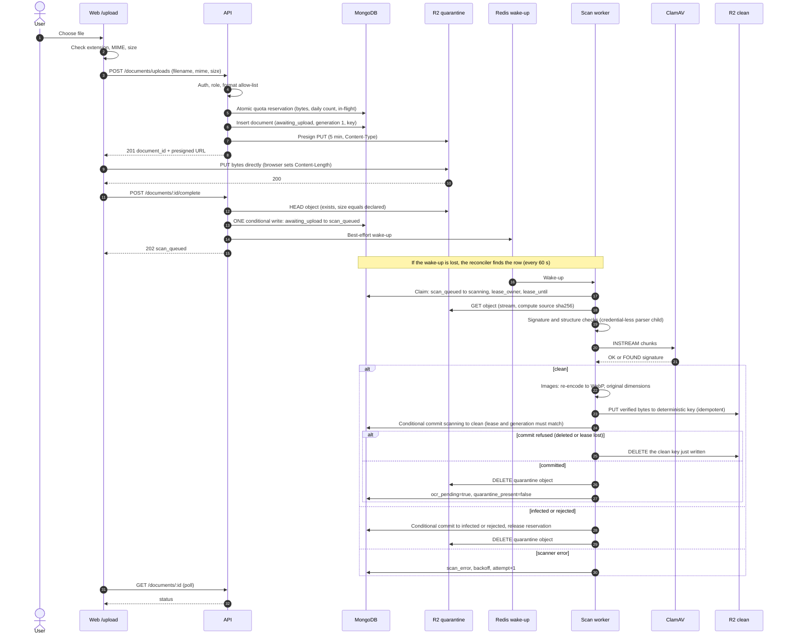

TOCTOU defence: the worker promotes bytes derived from what **it read and scanned**, recording the source hash. Overwriting the quarantine object afterwards cannot change the clean copy, and the commit refuses if the generation or lease changed. The 5-minute presign window bounds how late a client can overwrite before the scan reads it, and a second `HEAD` size and ETag comparison at claim time rejects an object replaced after `complete`.

### 7.6 Sequence: download

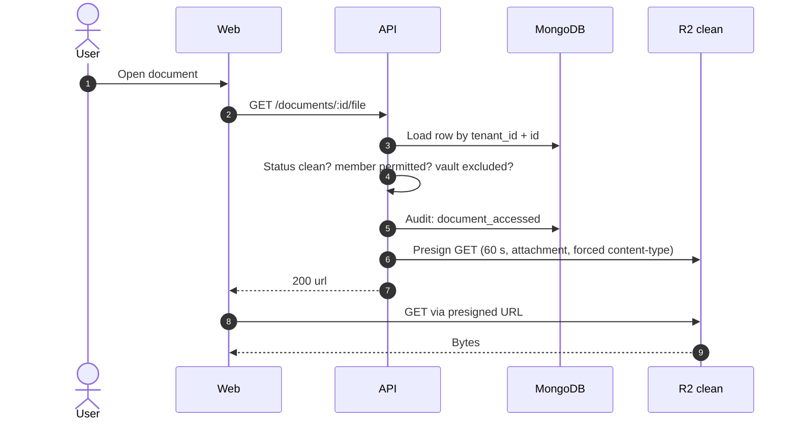

### 7.7 Sequence: delete and erasure (fenced)

Cloudflare presigned URLs are **reusable until they expire**, and a worker may be mid-promotion when a delete arrives. Deleting objects and rows is therefore not enough; the deletion has to fence both.

Fences:
- `generation` on the document row. Delete bumps it; every worker commit is conditional on the generation it claimed.
- `status: 'deleting'` plus a **tombstone** (`{ _id, tenant_id, deleted_at, purge_after }`) that outlives the row's content. `purge_after = deleted_at + presign TTL (5 min) + skew (5 min)`.
- Tenant-level erasure sets `tenants.status = 'deleting'` first. Upload init, `complete`, worker claim and worker commit all refuse for such a tenant.

```mermaid
sequenceDiagram
  autonumber
  participant A as API or erasure job
  participant DB as MongoDB
  participant W as Scan worker
  participant C as R2 clean
  participant Q as R2 quarantine
  participant R as Reconciler
  A->>DB: Open deletion receipt
  A->>DB: Conditional set status=deleting, generation+1, tombstone(purge_after)
  A->>C: DELETE tenant/doc key
  A->>Q: DELETE tenant/doc key
  A->>DB: Delete extracted candidates, release quota reservation
  Note over W,C: An in-flight worker may still write clean
  W->>DB: Conditional commit (generation must match)
  DB-->>W: Refused
  W->>C: DELETE the clean key it wrote
  Note over R,Q: After purge_after (URLs expired)
  R->>C: DELETE tenant/doc key again
  R->>Q: DELETE tenant/doc key again
  R->>DB: Remove row and tombstone
  R->>DB: Close receipt (counts of objects removed, final purge done)
```

`erasure.ts` and the tenant-deletion flow include the `{tenant_id}/` prefix in all three buckets. The receipt closes only after the second purge pass; closing it earlier would claim an erasure that an unexpired upload URL or a worker could still undo. The same reconciler pass deletes any object whose key has no live row (orphans).

### 7.8 Storage layout, CORS, lifecycle

Keys: `{tenant_id}/{document_id}`. Document row fields added: `storage: { bucket, key }` (replacing `file_id` for new rows), `scan: { result, engine, sha256, at }`, `declared: { filename, mime, size }`, `status`. Reads support both `file_id` (GridFS) and `storage.key` during migration.

Quarantine bucket CORS (browser PUT only):

```json
[{
  "AllowedOrigins": ["https://<app-domain>"],
  "AllowedMethods": ["PUT"],
  "AllowedHeaders": ["content-type"],
  "MaxAgeSeconds": 600
}]
```

Clean bucket CORS: `GET` from the app origin only (for in-page preview). Vault bucket: no CORS.

Lifecycle on quarantine: delete after 1 day; abort incomplete multipart after 1 day. A sweeper job also fails `awaiting_upload` rows older than 15 minutes.

CLI to create (wrangler): `wrangler r2 bucket create lifekeel-quarantine [--jurisdiction eu]`, then apply CORS and lifecycle rules via `wrangler r2 bucket cors set` and `wrangler r2 bucket lifecycle add` (or the dashboard). Document the exact commands in `docs/runbooks/` once a bucket exists.

### 7.9 Migration from GridFS, with a rollback floor

Rolling back by "flipping the read order" is only valid while no document exists that GridFS cannot serve. New R2-only documents have no GridFS copy, so the rollout is ordered to keep a floor under rollback:

1. **Phase 4a (no R2 writes yet).** Ship `apps/api/src/documents/storage.ts` (the single read/write seam used by every consumer in §7.13) and dual-read in all of them: `storage.key` first, else GridFS `file_id`. Deploy to every instance and the scan worker. Nothing writes R2 yet.
2. **Phase 4b.** Turn on `DOCUMENTS_STORAGE=r2` per tenant allow-list. Rollback = set the flag back: new uploads return to GridFS, and R2-written documents stay readable because **the dual-read code from 4a stays deployed**. The deployment must never be rolled back to a release older than 4a while R2-only documents exist; record that in the deploy runbook and enforce it by a startup check that refuses to boot a pre-4a build against a database containing `storage.key` rows (the DB carries a `schema_floor` marker).
3. **Phase 5 backfill.** For each GridFS document: stream it through the same validation and scan, write to `lifekeel-clean`, verify sha256 and size, write `storage`, set `migrated_at`. Failures are quarantined for review, not copied. GridFS blobs stay until retirement criteria are met.
4. **Retirement criteria for GridFS reads** (all required): the R2 object backup (§7.14) has run for at least one retention window and a restore drill has passed; the consistency report (metadata vs objects, both directions) is clean; the deletion journal has been replayed against R2; mobile and web clients no longer depend on bytes-mode behaviour that changed; and a backup of GridFS taken before retirement is retained for the agreed window.

Vault documents migrate separately and as ciphertext (§7.10).

### 7.10 Estate Vault: server-mediated, envelope-encrypted, adult-gated

The vault keeps its real contract (`routes/vault.ts`):

- **Two upload paths exist today.** Unsealed: the API validates the signature, then wraps the plaintext with `encryptBufferForTenant` (`vault.ts:159`). Sealed (`sealed=1`): the body is a client-encrypted envelope, and the server still wraps it in `encryptBufferForTenant`, so sealed files are double-encrypted. Reads unwrap the outer layer with `decryptBufferEnveloped` (`vault.ts:263`); a sealed file's client unseals the rest.
- **Adult access** (`requireAdult`, `isFamilyAdult`) is checked on every vault route and stays exactly as is.

Therefore the vault does **not** use presigned direct upload or presigned GET. The API receives the multipart upload, runs the existing validation (and, for unsealed files, the scan on the plaintext before encryption), encrypts with the tenant envelope key, and `PUT`s the **ciphertext** to `lifekeel-vault` with `r2-vault`. Downloads stream ciphertext from R2, decrypt in the API, and return bytes. R2's encryption at rest is an additional layer, not a replacement for the tenant envelope, and the envelope key lifecycle (`crypto/envelope.ts`, including key destruction on tenant erasure) is unchanged.

Because the stored bytes are ciphertext, the vault migration is **copy and checksum only**: stream the stored GridFS bytes to R2 unchanged, compare size and sha256, never decrypt or re-encrypt, never run the image/WebP step. The vault keeps its own `VAULT_ALLOWED_MIME_TYPES` (today's list, including its image types without WebP conversion). Vault documents count toward the same tenant quota (§7.12) but never appear in the general document routes.

### 7.11 Scan worker: deployment and resource model

Reliable consumption cannot run inside a request-scoped API instance, so this is a **new deployment**:

| Aspect | Decision |
|--------|----------|
| Service | `lifekeel-scan-worker`: a separate Cloud Run service (or worker pool if the project adopts one) built from the API image with a different entrypoint. It runs the Redis consumer, the reconciler loop, and the retention/purge sweeps for documents |
| Availability | `min-instances >= 1` and **CPU always allocated** (no CPU throttling between requests); a minimal HTTP `/health` endpoint satisfies Cloud Run. Reconciliation means a brief worker outage delays scans but loses none |
| Concurrency | 1 scan job per instance. Scale out on queue depth and oldest `scan_queued` age |
| Memory and CPU | 4 vCPU and 8 GiB as a starting point. A 100-megapixel image is about 400 MB as one RGBA buffer before decoder and encoder overhead, a 50 MB upload buffer sits beside it, and HEIC/HEVC decoding needs more. Keep the 100 MP cap, set `sharp` `limitInputPixels`, and load-test the largest allowed HEIC and PNG before raising concurrency |
| Parser isolation | Untrusted-format parsing (sharp/libvips/libheif, zip, PDF token scan) runs in a **child process** spawned with an empty environment (no R2, Mongo, Redis or ClamAV credentials), a hard timeout and memory limit (`--max-old-space-size`, `ulimit`), fed bytes over stdin and returning results over stdout. Node's permission model (`--permission` with no write grants) is enabled for the child where supported. A crash or timeout in the child fails the job as `rejected` or `scan_error`, never the worker |
| Network | The worker as a whole needs egress to R2, ClamAV, MongoDB and Redis, so "no network" is not claimed for the worker. It is claimed for the **parser child** (no credentials, no sockets opened by design), and enforced at the service level by restricting VPC egress to exactly those four destinations |
| ClamAV | Its own service (`clamd`), `MaxThreads` matched to total worker concurrency, freshclam definitions refreshed at least daily; definitions older than 48 h make scans return `error` |
| Identity | Distinct service account holding `r2-scan` credentials; the API service account does not hold them |

### 7.12 Quotas: shared atomic reservations

Today the storage and daily limits read `documents.files` (`documents.ts:119-145`) and the concurrency limit is a process-local `Map` (`documents.ts:127-130`). Both stop reflecting reality once bytes live in R2 and more than one instance runs. Replace them with one collection:

```ts
// tenant_quota { tenant_id, bytes_reserved, bytes_committed, inflight }   one document per tenant
// tenant_quota_days { _id: "<tenant>:<yyyymmdd>", uploads, expires_at }   one per day, TTL after 48 h
```

- **Reserve at upload init, atomically:** `updateOne({ tenant_id, $expr: { $lte: [ { $add: ['$bytes_reserved', '$bytes_committed', size] }, MAX_TENANT_STORAGE_BYTES ] }, inflight: { $lt: 3 } }, { $inc: { bytes_reserved: size, inflight: 1 } }, { upsert: true })` (duplicate-key means refusal), plus the conditional `$inc` on the day document with `uploads: { $lt: MAX_UPLOADS_PER_DAY }`. The reservation id is stored on the document row.
- **Commit** on `clean`: move `size` from `bytes_reserved` to `bytes_committed` (stored size, which for images is the WebP size), decrement `inflight`.
- **Release exactly once** (guarded by a `reservation_released` flag on the row) on `failed`, `rejected`, `infected`, expired reservation, and delete; decrement `inflight` when the job leaves `awaiting_upload`/`scan_queued`/`scanning`.
- Pending uploads, quarantine bytes, clean objects and failures are all counted until released, so abandoned uploads cannot be used to dodge the limit and cannot permanently consume it.
- **Reconcile nightly:** recompute `bytes_committed` from document rows and compare; alert on drift, correct it, and seed it from `documents.files` when a tenant first migrates so GridFS-era usage is not forgotten. Vault documents are included.

### 7.13 Producers and consumers that must move to `documents/storage.ts`

Six modules read or write GridFS today; each needs dual-read, and the writers need a decision.

| Module | Today | Change |
|--------|-------|--------|
| `routes/documents.ts` | Upload (write), file, reprocess, OCR input | New upload API; legacy upload writes quarantine then the same scan job; reads via the seam |
| `routes/vault.ts` | Writes and reads encrypted blobs in GridFS | Server-mediated R2 (§7.10); dual-read during migration |
| `jobs/email-scan.ts` | **Writes email attachments to GridFS** | Attachments from a connected mailbox are untrusted too: they must enter quarantine and the same scan job before extraction, not bypass it. Until that PR lands they keep writing GridFS (still covered by dual-read) and are listed as a known gap |
| `ocr/retry-failed.ts` | Selects documents with `file_id` and reads GridFS (`:30`, `:45`) | Select by `status`/`ocr_pending`, read through the seam; it also becomes the OCR dispatcher for `clean` rows |
| `erasure.ts`, `deletion/mailbox.ts` | Delete GridFS blobs | Delete R2 prefixes in all three buckets via the fenced flow (§7.7); mailbox deletion removes attachment objects |
| `apps/web/src/lib/api.ts` (`fetchDocumentFileUrl`, vault file helper) | Expects a blob from `/documents/:id/file` | Bytes mode stays default; web moves to `mode=url` (§7.4) |

An integration test lists every file importing `GridFSBucket` or touching `documents.files`; it fails if a new importer appears outside the seam, so the inventory cannot silently go stale.

### 7.14 Backup, recovery and consistency for R2

`scripts/ops/backup.sh` backs up with `mongodump` plus an erasure journal (`:54-63`). That captures R2 **metadata** only. Before any document can live only in R2:

- **Object backup.** A nightly job copies new and changed objects from `lifekeel-clean` and `lifekeel-vault` to an independent backup bucket in another account or provider within the EU (decision in §12; Cloud Storage in the existing GCP project is the default), with deletes **not** propagated for the backup retention window. Backups are encrypted (`age`, as `backup.sh` already supports); vault objects are already ciphertext.
- **Retention vs erasure.** Backup retention must not exceed what the privacy notice promises for deleted data; set the object-backup window in `docs/data-retention.md` and purge backups past it.
- **Paired restore.** A restore uses a `mongodump` and the object backup from the same run window. A reconcile job then compares every row's `storage.key`/`sha256` against the objects and reports missing objects and orphans in both directions.
- **Deletion journal replay.** After any restore, replay the erasure journal against R2 and the backup bucket so erased tenants do not come back. The journal also records per-document tombstones, not only tenant ids.
- **Drill.** A restore drill (database plus objects) must pass before Phase 4b opens to real tenants and again before GridFS retirement.

---

## 8. Security: OWASP mapping

OWASP API Security Top 10 (2023) and OWASP Top 10 (2021) web categories. If the team adopts a newer web edition, re-map; the controls below do not depend on the numbering.

### 8.1 API Security Top 10

| Risk | Where it bites here | Control |
|------|---------------------|---------|
| API1 Broken Object Level Authorization | `/documents/:id`, `/file`, `/complete`, `/delete`, OTP `chain_id` lookup | Every query includes `tenant_id` from the JWT (existing `getTenantCollection`); document ids are unguessable UUIDs but never rely on that; OTP `cid` must equal the pending token's `cid` and `user_id` |
| API2 Broken Authentication | Login, OTP, reset, tokens | Turnstile, existing throttle, HMAC-hashed OTP, **atomic** attempt claim and single-use consume (§6.3.1), account-wide atomic send budgets retained beyond the challenge TTL (§6.2.2), pending token signed with a separate key so it cannot be a session (§6.1), liveness recheck before the session, session revoke on password reset, generic errors, dummy scrypt for timing. Email OTP is mailbox verification, **not** phishing-resistant MFA (§6.1) |
| API3 Broken Object Property Level Authorization | Document and user responses; mass assignment | Explicit response projections (no `code_hash`, `storage.key`, `scan` internals to clients); upload init accepts only the fields in §7.4; strip unknown body keys |
| API4 Unrestricted Resource Consumption | Uploads, OTP email sends, siteverify calls, zip bombs, image bombs | Size cap (50 MB, signed Content-Length), per-tenant storage, daily and concurrency caps (existing), OTP send caps, per-route rate limits, zip entry/ratio limits, pixel cap, scan timeout, Turnstile before expensive work |
| API5 Broken Function Level Authorization | Vault vs general docs; operator routes | Role checks unchanged; `GET /documents/:id/file` refuses `estate_vault` category as today; scan worker credentials cannot be used by request handlers |
| API6 Unrestricted Access to Sensitive Business Flows | Signup abuse, email bombing via resend, lead spam, invite-code farming | Turnstile on every human flow, resend caps, invite code consumed only after OTP, `signups_enabled` kill switch |
| API7 Server-Side Request Forgery | `siteverify` and R2 calls | Both URLs are fixed constants, never built from request data; no user-supplied URLs fetched; presigned URLs are generated server-side only |
| API8 Security Misconfiguration | Public buckets, CORS, `/metrics`, `/documentation`, demo-token | Buckets private and `r2.dev` off; CORS pinned to app origin and PUT; Turnstile hostname allow-list; `/metrics` gated, boot guards for docs and demo tokens (§8.4); `@fastify/helmet` already present |
| API9 Improper Inventory Management | Public allow-list grows silently | §4.1 table is the inventory; add a test that fails when a new `open` prefix is added without a row classification (same tripwire idea as `trust-tier-gate.test.ts`) |
| API10 Unsafe Consumption of APIs | Cloudflare and SendGrid responses | Validate `siteverify` JSON shape with Zod; timeouts; treat any non-success as failure; never trust a client-reported `hostname`, only the one in Cloudflare's response |

### 8.2 Web Top 10

| Category | Control |
|----------|---------|
| A01 Broken Access Control | Tenant-scoped queries, role checks, short-lived presigned GET only after an authorization decision, nothing readable pre-scan, private buckets |
| A02 Cryptographic Failures | OTP stored as HMAC with a server pepper from Secret Manager; TLS everywhere; R2 encrypts at rest; vault ciphertext keeps tenant envelope encryption (`crypto/envelope.ts`) with optional client sealing; cookies `HttpOnly`, `Secure`; `OTP_PEPPER` rotation supported by a key id on the challenge (short TTL makes rotation trivial) |
| A03 Injection | Zod validation on all inputs; Mongo queries use typed filters (reject objects where strings are expected, e.g. `code`); filenames never reach a shell or path; `Content-Disposition` built server-side with RFC 5987 encoding; email templates `escapeHtml` every interpolated value |
| A04 Insecure Design | Threat model in §8.3; quarantine-then-promote; fail closed; abuse caps designed in, not bolted on |
| A05 Security Misconfiguration | CSP: add `https://challenges.cloudflare.com` to `script-src`, `frame-src`, `connect-src`; add the R2 S3 endpoint to `connect-src` (PUT) and the clean endpoint to `connect-src`/`img-src` (GET); `X-Content-Type-Options: nosniff` on every download; per-environment keys; test keys only in CI |
| A06 Vulnerable and Outdated Components | Pin `@aws-sdk/*`, `sharp` (and libvips/libheif if self-built; image decoders are a frequent CVE source, so parsing runs in the credential-less, resource-capped child process described in §7.11), a maintained zip library (`yauzl`); ClamAV definitions updated at least daily (freshclam) and alert when stale; Dependabot is already the update path |
| A07 Identification and Authentication Failures | Email OTP, TOTP, throttling, Turnstile, session cookie flags, session revocation (`session-revocation.ts`); no OTP in URL or logs |
| A08 Software and Data Integrity Failures | sha256 recorded at scan and verified at promote and on backfill; Turnstile script loaded only from the Cloudflare origin (CSP, no SRI because Cloudflare requires the live script); no unsigned deserialization |
| A09 Security Logging and Monitoring Failures | Audit events: `otp_issued`, `otp_failed`, `otp_locked`, `otp_succeeded`, `captcha_failed`, `document_uploaded`, `document_scan_result`, `document_accessed`, `document_deleted` via `getAuditLogger`; alerts on infected files, OTP lock spikes, siteverify failure rate, scanner staleness; never log codes, tokens, or file contents |
| A10 Server-Side Request Forgery | Same as API7; also `connectors` already own outbound OAuth, unchanged |

### 8.3 Threat table (abuse and malware)

| Threat | Mitigation |
|--------|-----------|
| Credential stuffing | Turnstile + email/IP throttle + OTP second step |
| OTP brute force (1,000,000 codes) | 5 attempts per code version claimed atomically (parallel guesses cannot exceed 5), resend replaces the code in the same chain and is limited by the atomic per-user budget (5 per hour, 10 per day, 60 s cooldown) that survives restarts of signup or login. At most 25 guesses per hour per user, about 25 in 1,000,000 |
| Email bombing a victim via resend | Turnstile on resend, 60 s cooldown, 5 per hour and 10 per day per user, per-IP rate limit |
| Concurrent abuse of OTP flows | Parallel verify, resend, re-signup and send requests are made safe by conditional atomic writes (§6.2, §6.3), proven by concurrency tests (§11.2) |
| Email enumeration | Login and reset return identical responses (existing); signup keeps its documented 409 (KEEL-025) behind Turnstile and a rate limit |
| OTP phishing / relay | **Not prevented.** The pending token is a transferable bearer credential, so a real-time phishing proxy can relay password, token and code. Mitigations are partial: Turnstile on entry points, the email copy warns never to share the code, 10-minute code and 30-minute chain lifetimes, login events and new-sign-in notifications. Phishing-resistant authentication (passkeys) is the real fix and is out of scope |
| Malware upload | Allow-list, three-way type agreement, structure checks, ClamAV, quarantine isolation, never served before clean, forced download |
| Polyglot / double-extension | Final-extension rule, signature check, WebP re-encode (drops trailing bytes and metadata), `nosniff` |
| Zip / decompression bomb (DOCX) | Entry count, uncompressed size, and ratio limits; bounded streaming read |
| Macro-enabled Office | `.docm`/`vbaProject.bin` rejected even inside a `.docx` |
| Stored XSS via filename | Filename only ever rendered through React escaping and `Content-Disposition` encoding |
| Path traversal | Keys are server-generated UUIDs |
| Delete racing a scan, or a reusable presigned URL after delete | Generation fence, tombstone, worker conditional commit with compensating delete, second purge pass after URL expiry (§7.7) |
| Quarantine overwrite after scan | Promote the scanned bytes, delete the source |
| Signed-URL leakage | 60 s GET, 5 min PUT, `no-store`, HTTPS only, bound to one key; PUT cannot overwrite an existing clean key (separate bucket) |
| Stale AV definitions | freshclam health check; if definitions older than 48 h, scan returns `error`, not `clean` |
| Crash between any two pipeline steps | Durable outbox on the document row, leases, deterministic idempotent keys, reconciler (§7.3, §7.5) |
| Scanner outage | `scan_error` keeps the file inert, retries with backoff, alerts; matches the existing "stored, not parsed" rule |

### 8.4 Exposed-route hardening (decided)

Findings from the code, and the change for each:

| Route | Finding | Change |
|-------|---------|--------|
| `GET /metrics` | In the `open` list and `routes/metrics.ts:510` has no auth check: anyone can read engine counters | **Keep `/metrics` in the `open` list** and have the route check the token. If it were removed from that list, the global hook would try to verify the opaque scrape token as a session JWT and return 401 before the handler runs. With it listed, the hook's opportunistic verify of a non-JWT token fails and is swallowed (`server.ts:1724`), and the route then requires `Authorization: Bearer ${METRICS_SCRAPE_TOKEN}` (`timingSafeEqual`), answering 401 otherwise. Outside dev, refuse to start if the token is unset. Update the scrape config. Test with a real authenticated scrape (valid token returns the exposition text, wrong or missing token returns 401, a session JWT returns 401) |
| `/documentation*` | Already registered only when `mode === 'dev'` or `ENABLE_API_DOCS=true` (`server.ts:1550`), but still listed as open | Boot guard: in any non-dev mode, `ENABLE_API_DOCS=true` aborts startup unless `AI_POLICY_EXCEPTION`-style exception text is set in `API_DOCS_EXCEPTION` and is logged. Drop the `/documentation*` entries from the `open` list when docs are off |
| `/auth/token`, `/auth/demo-token` | Return 403 outside dev/test unless `ALLOW_DEMO_TOKENS` is set (`server.ts:1904`, `:1937`); `/auth/token` mints a token for any named tenant when allowed | Same boot guard for `ALLOW_DEMO_TOKENS` in any non-dev mode. Add a test that boots with production-like env and asserts both routes return 403 and `/metrics` returns 401 without the token |

These are small and independent of Cloudflare, so ship them as their own PR before Phase 1.

---

## 9. Performance

### 9.1 Upload and download

- **Direct-to-R2 upload** keeps file bytes off Cloud Run: no 32 MiB request ceiling, no per-upload memory spike, lower instance count and egress cost. The API handles two tiny JSON calls per upload.
- Scan runs **off the request path** in a queue consumer. The user sees `scanning` and a poll or feed event; typical small PDFs complete in seconds. p95 targets (tune after measurement): init and complete under 150 ms server time; scan-to-clean under 10 s for files under 5 MB.
- The worker streams quarantine to ClamAV in 64 KB chunks (existing `CHUNK`), computing sha256 in the same pass, and buffers once for re-encode and promote. The size cap **stays at 50 MB** (decided; the direct R2 upload is not subject to Cloud Run's 32 MiB request limit). Size the scan worker for it: a 50 MB buffer plus a decoded image bitmap can reach several hundred MB, so give the worker at least 2 GiB, limit worker concurrency per instance (1 to 2 jobs), and keep the pixel cap (100 MP) as the real memory bound. Raise the multipart limit in `server.ts:1601` only for the legacy upload path, which stays at 50 MB.
- Concurrency: worker pool sized to clamd capacity (clamd runs one scan thread per connection; set `MaxThreads` accordingly). Per-tenant concurrency cap stays.
- **Downloads** are presigned GETs served by R2. R2 has no egress fees, so serving from R2 directly is both cheaper and faster than proxying through the API. For repeated image previews, the client can cache the URL until `expires_at`. Normalizing to WebP at original dimensions usually shrinks photos and scans (lossless WebP is typically smaller than PNG), which helps R2 storage and download size; the cost is worker CPU at upload (one decode and one encode per image, bounded by the pixel cap).
- Large pages: `Cache-Control: no-store` on the signed-URL response only; the bytes carry R2's own headers plus `private, max-age=60`.

### 9.2 Turnstile and OTP

- Widget script is loaded lazily on the five pages that need it, with `async defer`. Use `interaction-only` appearance on login so the common case shows nothing.
- `siteverify` is one HTTPS round trip (budget 3 s timeout, expected well under 200 ms); keep-alive via a shared `undici` Agent. Rate limiting runs first so floods never reach it.
- OTP verify is one indexed Mongo read plus one atomic update; the HMAC is microseconds. The email send is awaited on request (a user cannot proceed without it) but with a 5 s timeout; on timeout return 503 so the client can offer resend rather than hang.
- No polling for OTP; the screen is local timers.

### 9.3 Edge note: proxying the API through Cloudflare

Not part of this plan, but if the API domain is later proxied, three things change: set `trustedProxyHops` for the extra hop and read the client IP from `CF-Connecting-IP` (otherwise per-IP rate limits and Turnstile `remoteip` use Cloudflare's address); restrict Cloud Run ingress so only Cloudflare reaches it; and re-test cookie `SameSite=None` behaviour. Until then the Turnstile `remoteip` is whatever `trustProxy` resolves today (`server.ts:1453`).

---

## 10. Privacy and repo rules

- **Rule 1 (trust tiers):** all work here is Tier 0. Nothing executes an action for the family. `trust-tier-gate.test.ts` is unaffected.
- **Rule 2 (advice):** no detector or insight copy changes. OTP email and upload error copy are account and system messages only.
- **Rule 3 (family content is not training data):** R2 stores family documents, so Cloudflare becomes a **storage sub-processor** (acknowledged). Pre-production checklist, all required before Phase 4 goes live: (1) add Cloudflare to the processor register with the DPA, (2) update ARCHITECTURE.md §11 and the data-flow diagram, (3) update the privacy notice, and (4) the points below. Specifically: record the DPA terms, choose the R2 jurisdiction deliberately, confirm no Cloudflare feature that inspects or learns from object content is enabled (no AI, no content scanning add-ons), and add R2 to the data-flow in ARCHITECTURE.md §11. This is storage, not model processing, so the AI task gateway is not involved, and it must stay that way: do not point R2 event pipelines at any model.
- **Turnstile** sends visitor signals to Cloudflare for bot detection. Update the privacy notice and review the cookie banner copy (`apps/web/src/app/cookies`, `privacy`). Turnstile runs on pre-login pages only plus the OTP resend, so no family content is involved.
- **Retention and deletion:** infected and rejected rows keep metadata (no bytes) for the audit window in `docs/data-retention.md`; erasure covers all three buckets (§7.7).
- **Estate Vault:** same behaviour and key lifecycle (tenant envelope encryption, optional client sealing, adult-gated); only the byte store changes, and it stays server-mediated (§7.10).
- **Secrets:** all R2 keys, `TURNSTILE_SECRET_KEY`, `OTP_PEPPER` in Secret Manager; none in the repo or `.env` committed files.

---

## 11. Rollout and testing

### 11.1 Phases

Each phase is one PR (per the repo's one-concern rule), draft while iterating.

| Phase | PR | Flag | Exit check |
|-------|----|------|-----------|
| 0 | Exposed-route hardening (§8.4) | none | `/metrics` 401 without token; boot guards tested |
| 1 | Turnstile middleware + widget on signup, login, reset, resend, leads, join | `TURNSTILE_MODE=monitor` then `enforce` | Pass/fail metrics reviewed for a week; false-positive rate acceptable |
| 2 | Email OTP at signup (routes, model, email, `/verify-otp`, middleware pending check) | `AUTH_OTP_MODE=signup` | Delivery rate and time-to-code measured; no support spike |
| 3 | Email OTP at login | `AUTH_OTP_MODE=signup_login` | TOTP users unaffected |
| 4a | `documents/storage.ts` seam + dual-read in every consumer (§7.13), quota reservations (§7.12), scan-worker deployment and object backup running (§7.11, §7.14), restore drill passed. **No R2 writes** | none | Rollback floor in place; restore drill green |
| 4b | R2 writes for allow-listed tenants: quarantine, scan, promote, new upload API, format allow-list, fenced delete | `DOCUMENTS_STORAGE=r2` per tenant | EICAR blocked; crash-injection tests pass; real-R2 browser matrix passes |
| 4c | Vault to R2 as ciphertext (§7.10); email-attachment scan path (§7.13) | `VAULT_STORAGE=r2` | Checksum parity; adult gate and decrypt tests pass |
| 5 | Backfill GridFS to R2, switch default, retire GridFS reads only when the §7.9 criteria are all met | after verified backfill | Hash parity report; consistency report clean; deletion journal replayed |

Deploy remains manual (`workflow_dispatch`); no auto-deploy is introduced.

### 11.2 Tests

- Turnstile: unit tests with a mocked `fetch` for success, wrong hostname, wrong action, timeout then retry, 5xx, `monitor` vs `enforce`; Playwright uses Cloudflare's dummy keys.
- OTP: generation range and padding; hash compare is constant time; expiry; attempt cap; replay of a consumed code; resend replaces the code in the same chain; cooldown and hourly cap; signup 409 for verified and legacy unverified accounts; re-signup of a pending registration; invite consumed only at activation.
- Login: password-only user gets `otp_required`; TOTP user gets `mfa_required` and no OTP email is sent; `mfa_pending` token cannot be used on `/auth/otp/verify`.
- Pending token: signed with the session key is rejected by `/auth/otp/*`; a pending token used as Bearer and as the `lifekeel_session` cookie on a protected route (401), on an open route with opportunistic auth (no `authContext` set), and on `/auth/mfa/verify`; a session token and an `mfa_pending` token rejected by `/auth/otp/verify`; wrong purpose and wrong user rejected.
- OTP concurrency (real Mongo, parallel requests): 10 parallel guesses spend at most 5 attempts; two parallel correct submissions yield exactly one session; a resend racing a verify cannot be consumed with the old code; 20 parallel resends consume at most the budget; the budget survives chain expiry and restarting signup/login; a concurrent re-signup cannot activate the newer password through an older chain (`otp_superseded`); a user suspended, or sessions revoked after the chain began, gets no session.
- OTP delivery: provider 4xx/5xx returns 200 with `delivery: failed` and an immediate resend works; a timeout returns `unknown` and a resend leaves exactly one valid code; chain expiry returns `otp_expired`.
- Pending-registration sweep: deletes only `registration_status: pending` rows past 7 days with no login and no data; legacy unverified users, users with documents or household members, and verified users are untouched.
- Pipeline crash injection: kill the worker (a) before the claim, (b) after claim, (c) after the clean PUT, (d) after the commit, (e) after quarantine delete; every case ends in a correct terminal state with no stranded `scan_queued`/`scanning` row, no orphan, and exactly one OCR dispatch. Drop the Redis wake-up and confirm the reconciler picks the row up.
- Erasure races: delete during scan (clean key removed by the worker's compensating delete); PUT to an unexpired presigned URL after delete (removed by the second purge pass); tenant `deleting` blocks init, complete, claim and commit.
- Quotas: parallel inits cannot exceed the storage, daily or in-flight limits across two API instances; every failure path releases the reservation exactly once; the nightly reconcile detects drift.
- Compatibility: the bytes-mode `GET /documents/:id/file` still returns the blob for old clients; a repo test fails if a new file imports `GridFSBucket` or touches `documents.files` outside the seam.
- Real-R2 upload matrix (a dedicated R2 test bucket, not MinIO): presigned PUT with and without a signed `content-length`, from Chrome, Safari, Firefox, iOS and Android WebViews, including the CORS preflight.
- Metrics: authenticated scrape succeeds with the token; wrong, missing and session-JWT credentials get 401.
- Upload: allow-list matrix (each of the eight types accepted; `.exe`, `.docm`, `.svg`, `.html`, `.bmp`, `.tiff` rejected); every accepted image comes back as `image/webp` with identical width and height and no EXIF/GPS; animated GIF keeps its first frame; HEIC fixture decodes; image over the pixel cap rejected; extension/MIME/signature mismatch; double extension; oversize; zero byte; zip bomb fixture; macro docx fixture; PDF with `/JavaScript`; **EICAR** test string returns `infected` and never reaches the clean bucket; scanner down yields `scan_error` and file is unreadable; overwrite-after-scan race; cross-tenant `GET /documents/:id/file` returns 404.
- Public surface tripwire: a test that fails if the `open` prefix list changes without an updated classification (API9).
- CI: dummy Turnstile keys; R2 via a local S3-compatible stub (MinIO) so tests need no Cloudflare account; ClamAV container is already described in `docs/local-testing.md`.

### 11.3 Observability

Metrics: `otp_send_budget_denied_total`, `otp_chain_state_total{delivery}`, `doc_scan_queue_age_seconds`, `doc_reconciler_requeue_total`, `doc_stuck_total{status}`, `quota_drift_bytes`, `r2_backup_lag_seconds`, `turnstile_verify_total`, `otp_issued_total`, `otp_verify_total{result}`, `otp_email_latency_seconds`, `doc_scan_total{result}`, `doc_scan_duration_seconds`, `doc_state_total{status}`, `clamav_definitions_age_seconds`. Alerts: oldest `scan_queued` row older than 5 minutes, any row stuck in `scanning` past two leases, backup lag over 26 hours, quota drift, any `infected` result (info, for review), scanner error rate, definitions older than 48 h, OTP failure ratio spike, siteverify failure ratio.

---

## 12. Decisions log and open items

Decided:

| Topic | Decision |
|-------|----------|
| Image formats | HEIC, HEIF, WebP, GIF stay allowed. All images re-encoded to WebP at original dimensions (D6) |
| Resize | Re-encode only, no long-edge cap |
| HEIC decoder | Self-built `sharp` with libheif and libde265 (§7.2); WASM is the fallback |
| DOCX | Stored and scanned for everyone; text extraction only where `document_ai_extraction` is on (paid plans) |
| TOTP users | Skip email OTP at login (D8). No "remember this device" |
| Vault | Server-mediated, tenant-envelope encrypted, adult-gated; ciphertext in `lifekeel-vault`; keeps today's allowed types (§7.10) |
| R2 jurisdiction | `eu` for all tenants |
| Max upload size | 50 MB |
| Exposed routes | `/metrics` gated by scrape token, boot guards for docs and demo tokens (§8.4) |
| Sub-processor | Cloudflare checklist in §10 before Phase 4b |
| Pending token | Separate derived signing key, stable `chain_id`, 30-minute chain (D11, §6.1) |
| OTP guarantees | Mailbox verification only; not phishing-resistant (§6.1) |

Still open (defaults in brackets):

1. **"Keel Plus" plan:** not present in `entitlements.ts` (plans are `free`, `starter`, `growth`, `enterprise`). [Default: DOCX extraction follows `document_ai_extraction` as it stands.]
2. **HEVC patent exposure** for server-side HEIC decoding: legal confirmation. [Default: build now, confirm before Phase 4b goes live.]
3. **Object backup target (§7.14):** Cloud Storage in the existing GCP project, or a second R2 account/provider. [Default: Cloud Storage, EU region, `age`-encrypted.]
4. **Backup retention window** for objects, aligned with the privacy notice and `docs/data-retention.md`. [Default: 30 days.]
5. **Minimum supported client version** for retiring bytes-mode `GET /documents/:id/file` (§7.4). [Default: keep bytes mode until the mobile release policy says old builds are gone.]
6. **Scan-worker host:** Cloud Run service with CPU always allocated, or a Cloud Run worker pool / GKE if the team prefers (§7.11). [Default: Cloud Run service, `min-instances=1`.]
7. **Email attachments from connected mailboxes (`jobs/email-scan.ts`)** moving into the quarantine and scan path (§7.13): same release as 4b, or later as a known gap. [Default: known gap, tracked, with dual-read in place.]
8. **Passkeys (WebAuthn)** as the phishing-resistant option: out of scope here; revisit after Phase 3. [Default: not now.]

---

## 13. Review findings and resolution

A reviewer raised 19 findings. Each was checked against the code; all are accepted. Where the draft stated something the code contradicts, that is noted.

| # | Finding | Verified in code | Resolution |
|---|---------|------------------|-----------|
| 1 | Pending OTP token could verify as a session | `packages/platform/src/auth.ts:61` drops unknown claims | Separate derived signing key, `verifyOtpPending` in `auth/otp-token.ts`; tests on protected and open routes (§6.1, §11.2) |
| 2 | Resend breaks token binding and expiry | Draft returned no new token | Stable `chain_id`, resend keeps the same token, 30-minute absolute chain (§6.1-6.3) |
| 3 | Send limits not durable or atomic | Draft counted TTL'd challenge rows | `otp_send_windows` atomic conditional upserts, retained 24 h past each window, covers all issuance paths (§6.2.2) |
| 4 | Verify not concurrency-safe | Draft split check, increment, compare, consume | Three conditional operations plus liveness recheck (§6.3.1) |
| 5 | Re-signup could change credentials behind a challenge | Draft allowed blind overwrite | `registration_version`, atomic replace, conditional activation (§6.3.2) |
| 6 | Signed-link flow contradicts approval gate | `routes/insights.ts:1065-1090` | Split into read-only landings, existing one-click opt-outs, and authenticated POST approval (§4.1, §4.7) |
| 7 | Vault encryption contract not preserved | `routes/vault.ts:123-160, 263` | Server-mediated path, tenant envelope retained, ciphertext-only migration (§7.10) |
| 8 | Crash windows in upload processing | Draft set `scanning` before enqueue; deleted quarantine before commit | DB outbox, leases, idempotent promotion, reconciler, state/recovery table, crash-injection tests (§7.3, §7.5) |
| 9 | Erasure races workers and live URLs | Presigned URLs are reusable until expiry | Generation fence, tombstone, compensating delete, second purge pass, tenant fence (§7.7) |
| 10 | No backup or rollback for R2 | `scripts/ops/backup.sh:54` is `mongodump` only | Rollback floor via phase 4a, object backup, paired restore, journal replay, drill (§7.9, §7.14) |
| 11 | Quotas stop measuring migrated storage | `documents.ts:119-145` reads `documents.files`, process-local `Map` | Shared atomic reservations and nightly reconcile (§7.12) |
| 12 | Missing producers/consumers and frontend compatibility | GridFS used in six modules; web helper expects a blob | Inventory table, bytes-mode compatibility, seam test (§7.4, §7.13) |
| 13 | Worker permissions contradict promotion | Draft gave scanner read-only on quarantine | `r2-scan` has Object Read & Write on quarantine and clean; call-site tripwire test (§7.1) |
| 14 | Browser cannot set Content-Length | Forbidden header | Removed from client contract; size via HEAD, scanner and reservation; real-R2 browser matrix (§7.1, §11.2) |
| 15 | Worker deployment and resources unspecified | Draft claimed no new infrastructure | New always-on service, memory/CPU sizing, parser child isolation, egress allow-list (§7.11, D4) |
| 16 | No resend contract after send failure | Draft returned 503 with no token | Chain and token created before send; `delivery` outcomes; resend always reachable (§6.3, §6.8) |
| 17 | Metrics auth conflicts with global hook | `server.ts:1627-1725` | Keep `/metrics` in the open list so the hook does not 401; route checks scrape token; authenticated-scrape test (§8.4) |
| 18 | Seven-day cleanup does not exist | `jobs/retention-worker.ts:59-100` | New `sweepPendingRegistrations()` with legacy-account safeguards (§6.9) |
| 19 | Phishing resistance overstated | Pending token is a bearer credential | Claim removed and replaced with an accurate statement (§6.1, §8.3) |

---

## 14. Implementation status

What the code now does, where, and what is left for a person or a later change.

| Plan section | Shipped in | Notes |
|---|---|---|
| §8.4 exposed-route hardening | `security/boot-guards.ts`, `security/public-routes.ts`, `routes/metrics.ts` | `/metrics` needs `METRICS_SCRAPE_TOKEN`; boot guards for docs, demo tokens, scrape token; public-route inventory pinned by `public-routes.test.ts` (API9 tripwire) |
| §5 Turnstile | `security/turnstile.ts` (`config.turnstile` on routes, onRoute hook after the rate limiter), `apps/web/src/components/security/Turnstile.tsx`, `firebase.json` CSP | Skips callers that already hold a live session (dual-mode resend). Hostname allow-list defaults to `LIFEKEEL_APP_HOSTS` |
| §6 email OTP | `auth/otp.ts`, `auth/otp-token.ts`, `auth/liveness.ts`, `routes/auth-otp.ts`, `auth-email.ts` (`sendOtpEmail`), `jobs/pending-registrations.ts`, `apps/web/src/app/verify-otp` | A pending registration that signs in finishes its signup check there. `remember_me` rides on the chain. Pepper rotation via `OTP_PEPPER_PREVIOUS{,_ID}` |
| §7.1 R2 credentials | `documents/r2.ts`, `r2-clients.test.ts` | Per-credential bucket and write scopes enforced in code as well as in Cloudflare |
| §7.2 formats, normalization | `documents/formats.ts`, `documents/parser-child.ts`, `documents/parse-sandbox.ts` | Parser runs in a child with an empty env, heap cap, timeout and Node's permission model (compiled build) |
| §7.3–7.5 pipeline | `documents/pipeline.ts`, `documents/scan-job.ts`, `documents/reconciler.ts`, `scan-worker.ts`, `routes/documents-uploads.ts` | Crash-injection, delete races and quota tests in `documents/__tests__/pipeline.test.ts` |
| §7.4 compatibility | `routes/documents.ts` | `?mode=url` presigned GET; bytes mode unchanged for old clients; legacy multipart joins the same pipeline for R2 tenants |
| §7.7 fenced delete | `documents/deletion.ts`, `erasure.ts` | Receipt stays `in_progress` until the second purge |
| §7.9 rollback floor | `documents/storage.ts` (`platform_markers.documents_schema_floor`) | Effective for builds from this release on |
| §7.10 vault | `routes/vault.ts` via `documents/storage.ts` | `VAULT_STORAGE=r2` writes ciphertext to `lifekeel-vault` |
| §7.12 quotas | `documents/quota.ts` | Replaces the per-instance Map; nightly reconcile in the scan worker |
| §7.13 seam | `documents/storage.ts`, `documents-storage-seam.test.ts` | Mailbox attachments still write GridFS (known gap, §12 item 7) |
| DOCX text | `ocr/extract.ts` (`extractDocxText`, mammoth) | Gated by `document_ai_extraction` like PDFs and images |

Not in this change (needs infrastructure, a person, or a follow-up PR):

- Buckets, tokens, CORS, lifecycle rules, the scan-worker Cloud Run service, ClamAV, Secret
  Manager entries: runbook.
- Self-built `sharp` with libheif/libde265 in the image (HEIC decode). Until then HEIC uploads
  stay in `scan_error` and retry rather than being lost or served unscanned.
- Nightly object backup to an independent EU bucket and the restore drill (§7.14).
- GridFS → R2 backfill and GridFS read retirement (Phase 5); vault copy-and-checksum migration.
- Real-R2 browser matrix (Chrome, Safari, Firefox, iOS/Android WebViews).
- Privacy notice, cookie copy, DPA and processor register updates (§10); legal on HEVC.
- Playwright coverage with Cloudflare's dummy Turnstile keys.
