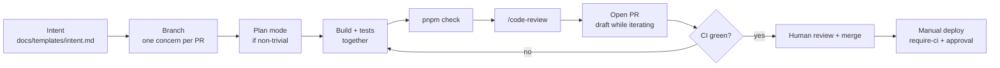

# Contributing to LifeKeel

This is the short path from "I have a change" to "it is in production". The reasons
behind it, and every check in detail, are in the
[AI-native SDLC playbook](docs/ai-native-sdlc-playbook.md). To change the process
itself, see [Extending the SDLC](docs/sdlc/extending.md).

## Licence and contributions

The source is public so it can be read, but it is **proprietary**: [LICENSE](LICENSE) grants no right to
copy, run, modify or host it. Contributing means changing code, so it needs the owner's written permission
first (hello@lifekeel.co.uk). New workspace packages must declare `UNLICENSED` and `private` (a test
checks), and new dependencies need their licence checked against [NOTICE](NOTICE).

## First 15 minutes

```bash
corepack enable                     # pins pnpm 8.15.5; needs Node 22.12 or newer
docker compose -f apps/api/docker-compose.yml up -d   # local MongoDB + Redis
pnpm install
cp .env.example .env && cp apps/web/.env.example apps/web/.env
pnpm check                          # typecheck + lint + test + build, from the repo root
```

`pnpm check` takes several minutes (it runs a full Next build); run it when you are done, not after
each edit. Two integration tests need the Mongo and Redis you just started. Dev servers:
`pnpm --filter @lifekeel/api dev` (port 3001) and `pnpm --filter @lifekeel/web dev` (port 3002).

## Which path is mine?

| Change | Path |
|---|---|
| Typo, copy tweak, docs-only | **Fast path:** branch, `pnpm check`, PR. No intent, no plan mode, no PRD. |
| Normal feature or fix | The full loop below. |
| Touches an LLM prompt, a model, or user-facing copy; or acts on a family's behalf; or touches more than about 3 files | Full loop **plus** a tripwire or eval (see [extending](docs/sdlc/extending.md)) and the PR evidence fields. |

You do not need Claude Code to follow this; the steps that mention it (plan mode, `/code-review`) have
a manual equivalent: write the plan in the PR description, and review your own diff before opening it.

## Two rules before anything else

1. **No autonomous irreversible action without a human approval gate.** Anything that
   calls an external provider, posts publicly, or moves money has a trust tier
   (0 to 3, defined in [ARCHITECTURE.md](ARCHITECTURE.md#9-act-and-escalate-trust-tiers) with a one-line
   summary in the [glossary](docs/README.md#glossary)). If you cannot name the tier, it is not ready.
2. **No regulated advice.** Copy and assistant output describe what is on file and
   point to "a licensed professional". Never "buy X", never a named provider, never a
   "switch to this" flow.

Both are in [CLAUDE.md](CLAUDE.md), and both have automated tripwires that catch the
obvious failure. A person still owns the judgement.

## The loop



1. **Write the intent.** Copy [docs/templates/intent.md](docs/templates/intent.md): the
   problem, what "done" looks like, the trust tier, and the advice check. A few
   sentences are enough. Bigger work becomes a PRD in [docs/prd](docs/prd/README.md).
2. **Branch.** One concern per PR. Stacking on an unmerged PR is fine; see
   [troubleshooting](docs/sdlc/troubleshooting.md#stacked-prs-conflict-after-a-squash-merge)
   for how to merge a stack.
3. **Plan.** Use plan mode for a new route, detector, schema change, or anything that
   touches more than 2 or 3 files. Get sign-off before code.
4. **Build with tests.** New backend logic needs a test that fails without it. A new
   or changed detector needs a golden dataset in `detector-evals/`. Recipes:
   [add-detector skill](.claude/skills/add-detector/SKILL.md).
5. **Check locally, once.** `pnpm check` runs typecheck, lint, test and build from the
   repo root. Run it when you are done, not after each edit; while iterating, run one
   package's tests. Details and the Mongo/Redis setup:
   [docs/local-testing.md](docs/local-testing.md).
6. **Self-review.** Run `/code-review` on the diff and fix what it finds.
7. **Open the PR as a draft** while you are still pushing: CI and security checks skip
   drafts, which saves minutes. Mark it ready when you want checks. Fill in the
   [PR template](.github/pull_request_template.md) honestly; an unticked box with a
   reason beats a ticked box without evidence.
8. **Review and merge.** A person reads the PR and merges it. The reviewer may run their own
   coding agent first (`/review-pr <number>` in Claude Code); there is no AI review in CI. See
   [reviewing a PR](docs/sdlc/reviewing.md).
9. **Deploy** is a manual workflow run, never a side effect of merging. It checks that
   CI passed on the exact commit. **There is no approval pause on our current GitHub plan**
   (see [what GitHub can enforce](docs/sdlc/status.md#what-github-can-and-cannot-enforce-here)),
   so the person dispatching the deploy is the gate. The API deploy is a canary rollout: the new
   revision is tested before it gets traffic, and the previous one is restored automatically if
   production is unhealthy afterwards. See [playbook 6.5](docs/ai-native-sdlc-playbook.md#65-deploy).

## What runs where

| When | What | Where |
|---|---|---|
| Editing detector or family playbook copy with Claude Code | Advice-rule test | Hook in [.claude/settings.json](.claude/settings.json) |
| Every ready PR | Typecheck, lint, test, build, boot smoke; dependency audit; gitleaks | `ci.yml`, `security.yml` |
| Weekly and on demand | CodeQL; container image builds | `security.yml`, `images.yml` |
| Reviewing a PR | A person, optionally with their own coding agent (`/review-pr`) | [reviewing.md](docs/sdlc/reviewing.md) |
| Deploy | CI-on-SHA check, then approval | `require-ci.yml`, the `deploy-*.yml` files |

## Working with Claude Code

- [CLAUDE.md](CLAUDE.md) is loaded every session: the rules, conventions, gotchas.
  Keep it short; detail belongs in the playbook.
- Skills in [.claude/skills](.claude/skills) hold multi-step recipes loaded on demand.
- Hooks run on every tool call that matches, with no reliance on anyone remembering.
- Other agents (Devin and similar) read [.devin/AGENTS.md](.devin/AGENTS.md) for the
  mechanical facts.
- Token and CI-minute habits are in `CLAUDE.md` under "Working economically".

## Need something that is not here

- A command is failing or a check is red: [troubleshooting](docs/sdlc/troubleshooting.md).
- You want to add a check, hook, skill, eval, or gate: [extending](docs/sdlc/extending.md).
- You want the whole map: [docs index](docs/README.md).
