# ISO_AUDITABLE — LifeKeel Integrated Management System (ISO 9001 · ISO/IEC 27001 · ISO/IEC 42001)

| Field | Value |
|---|---|
| Document ID | LK-IMS-000 |
| Version | 0.1 (draft for implementation) |
| Status | **Draft — not approved by top management.** Nothing in this file is a certification claim. |
| Prepared | 2026-11-12, from the repository at `main` `a2ce988d` |
| Prepared by roles | Lead Implementer (author), with input framed from Lead Auditor, Senior Product Manager, Principal Developer, Senior Solutions Architect |
| Owner (to be named) | IMS Manager / Information Security & AI Governance Lead |
| Review cycle | Every management review, and on any change to scope, standards, processors, or regulatory perimeter |
| Classification | Internal |

> **Read this first.** This document turns three ISO management-system standards into
> concrete work for LifeKeel. It reuses evidence the repository already produces
> (tests, CI gates, runbooks, registries) and names the gaps that would stop a
> certification audit. Every "Evidence" cell points at a real file. Every gap carries a
> severity, an owner role, and an exit criterion. Repository status was taken from
> documents dated 2026-10-22 to 2026-11-02; **re-verify every row against the deployed
> system before the Stage 1 audit** — "implemented in code" is not "operating effectively".

---

## Table of contents

1. [Executive summary and readiness scorecard](#1-executive-summary-and-readiness-scorecard)
2. [How to use this document (by role)](#2-how-to-use-this-document-by-role)
3. [Standards, versions and the global regulatory overlay](#3-standards-versions-and-the-global-regulatory-overlay)
4. [Severity model](#4-severity-model)
5. [Integrated Management System (IMS) design](#5-integrated-management-system-ims-design)
6. [Proposed certification scope](#6-proposed-certification-scope)
7. [Context of the organization (Clause 4)](#7-context-of-the-organization-clause-4)
8. [System description for auditors](#8-system-description-for-auditors)
9. [Clause-by-clause conformance matrix (Clauses 4–10)](#9-clause-by-clause-conformance-matrix-clauses-410)
10. [ISO/IEC 27001:2022 Statement of Applicability (93 Annex A controls)](#10-isoiec-270012022-statement-of-applicability-93-annex-a-controls)
11. [ISO/IEC 42001:2023 Statement of Applicability (38 Annex A controls)](#11-isoiec-420012023-statement-of-applicability-38-annex-a-controls)
12. [ISO 9001:2026 operational requirements (Clause 8) mapped to the SDLC](#12-iso-90012026-operational-requirements-clause-8-mapped-to-the-sdlc)
13. [Risk management methodology](#13-risk-management-methodology)
14. [AI system impact assessment (ISO/IEC 42001 6.1.4)](#14-ai-system-impact-assessment-isoiec-42001-614)
15. [Consolidated gap register with severity](#15-consolidated-gap-register-with-severity)
16. [Step-by-step implementation roadmap](#16-step-by-step-implementation-roadmap)
17. [Developer playbook: building auditable changes](#17-developer-playbook-building-auditable-changes)
18. [Global launch overlay (jurisdictions)](#18-global-launch-overlay-jurisdictions)
19. [Mandatory documented information checklist](#19-mandatory-documented-information-checklist)
20. [Monitoring, KPIs and objectives (Clause 6.2 / 9.1)](#20-monitoring-kpis-and-objectives-clause-62--91)
21. [Internal audit programme and management review](#21-internal-audit-programme-and-management-review)
22. [Certification audit: what to expect](#22-certification-audit-what-to-expect)
23. [Templates](#23-templates)
24. [Glossary](#24-glossary)
25. [References](#25-references)

---

## 1. Executive summary and readiness scorecard

LifeKeel is in an unusual position for an early-stage company: **its engineering controls
are ahead of its management system.** The repository already enforces policy as code — a
mandatory AI task gateway, a processor registry, trust-tier tripwire tests, an advice-rule
test, per-tenant envelope encryption, erasure with replay, digest-pinned AI artifacts, and
human-gated deploys. What it lacks is the *management* layer ISO auditors certify: signed
policies, a named scope, a risk register with owners and acceptance, a Statement of
Applicability, records of competence, an internal audit, and a management review.

**Bottom line from the Lead Auditor's perspective:** an audit today would raise
**major nonconformities on Clauses 4.3, 5.2, 6.1.2, 6.1.3, 6.1.4 (42001), 9.2 and 9.3** —
not because controls are missing, but because the documented information that proves the
system exists and is run by management is missing. These are fixable in weeks, not months.

### Readiness scorecard

| Area | ISO 9001 | ISO 27001 | ISO 42001 | Comment |
|---|:-:|:-:|:-:|---|
| Context, scope (Cl. 4) | 🔴 | 🔴 | 🔴 | Product intent is well documented (ARCHITECTURE.md); no formal scope, interested-party register or issues register |
| Leadership, policy, roles (Cl. 5) | 🔴 | 🔴 | 🔴 | Three product rules in CLAUDE.md are strong policy content but not management-approved policies; roles in runbooks are blank |
| Planning, risk (Cl. 6) | 🟠 | 🔴 | 🔴 | Gap register (ARCHITECTURE.md §16) and R-register exist, but no likelihood/impact, owner, treatment decision or risk acceptance |
| Support, competence, documents (Cl. 7) | 🟠 | 🟠 | 🟠 | Excellent technical documentation and version control; no competence records, awareness programme or document-control procedure |
| Operation (Cl. 8) | 🟢 | 🟡 | 🟡 | SDLC (PRD → plan → test → review → CI → human deploy) is strong; AI eval suites, supplier terms and threat models incomplete |
| Performance evaluation (Cl. 9) | 🔴 | 🔴 | 🔴 | Metrics exist; no SLOs approved, no internal audit, no management review |
| Improvement (Cl. 10) | 🟡 | 🟡 | 🟡 | Review findings are tracked and fixed with tests; no formal NC/corrective-action log with root cause |
| Annex A controls | n/a | 🟡 | 🟡 | Technological controls largely in place; organizational, people and supplier controls are the weakest |

Legend: 🟢 conforming with evidence · 🟡 partly, minor gaps · 🟠 significant gaps · 🔴 certification blocker.

### Top 10 actions (in order)

| # | Action | Closes | Severity | Owner role |
|---|---|---|---|---|
| 1 | Top management approves IMS scope, Quality/Information Security/AI policies (draft text in §23) | 4.3, 5.1, 5.2 (all three) | S1 | CEO / founder |
| 2 | Name people in every blank role: incident lead, privacy lead, DPO/counsel, IMS manager, AI governance lead | 5.3, A.5.2, A.3.2 (42001) | S1 | CEO |
| 3 | Convert the gap and R-registers into a scored risk register with owners, treatment and acceptance | 6.1.2, 6.1.3, 8.2, 8.3 | S1 | IMS manager |
| 4 | Approve the Statements of Applicability in §10 and §11 | 6.1.3 d) | S1 | IMS manager + CEO |
| 5 | Complete and sign the DPIA and an AI system impact assessment per AI task | 6.1.4 (42001), A.5.31/A.5.34 | S1 | Privacy lead + AI lead |
| 6 | Close processor review: sign DPAs, record no-training/retention terms; move xAI off the testing exception before launch | A.5.19–5.23, A.10.3 (42001) | S2 | AI lead + legal |
| 7 | Verify branch protection, environment reviewers, workload identity; remove JSON keys | A.8.4, A.8.32, A.8.2 | S2 | Principal dev |
| 8 | Run a breach tabletop and a recorded restore drill; configure managed PITR | A.5.24–5.30, A.8.13 | S2 | SRE / on-call lead |
| 9 | Run one full internal audit cycle and one management review, minimum 6–8 weeks before Stage 2 | 9.2, 9.3 | S1 | Internal auditor (independent) |
| 10 | People controls: screening, NDAs, onboarding/offboarding, annual training with records | A.6.1–6.8, 7.2, 7.3 | S2 | CEO / HR |

---

## 2. How to use this document (by role)

| Role | What you own | Start at |
|---|---|---|
| **Lead Implementer** | Designs and runs the IMS, keeps this document and the registers current, prepares the audit evidence pack | §5, §13, §15, §16, §19 |
| **Lead Auditor (internal / pre-assessment)** | Tests conformance independently; never audits own work | §9, §10, §11, §21, §22 |
| **Senior Product Manager** | Owns intended use, customer requirements, interested parties, product objectives, and keeping product copy inside rules 1–3 | §7, §12, §14, §18, §20 |
| **Principal Developer** | Owns secure SDLC evidence, CI gates, change management, code-level controls, and fixing technical gaps | §10 (A.8), §12, §17 |
| **Senior Solutions Architect** | Owns architecture, trust boundaries, threat models, resilience, data flows, supplier/processor architecture | §8, §10 (A.5.23, A.8.20–8.27), §14, §18 |
| **All engineers** | Follow the developer playbook; every change produces its own evidence | §17 |

### RACI for the IMS

R = responsible, A = accountable, C = consulted, I = informed.

| Activity | CEO / Top mgmt | IMS manager | AI governance lead | Privacy lead / DPO | Principal dev | Architect | Product manager | Internal auditor |
|---|---|---|---|---|---|---|---|---|
| Scope and policies | A | R | C | C | C | C | C | I |
| Risk assessment and treatment | A | R | R (AI) | R (privacy) | C | R (technical) | C | I |
| Statement of Applicability | A | R | R (42001) | C | C | C | I | I |
| AI system impact assessment | A | C | R | R | C | C | R | I |
| Supplier and processor review | A | R | R (AI processors) | R | C | C | I | I |
| Secure SDLC and change control | I | C | C | I | A/R | R | C | I |
| Incident and breach response | A | R | C | R | R | C | I | I |
| Internal audit | I | C | C | C | C | C | C | A/R |
| Management review | A/R | R | C | C | C | C | C | C |
| Corrective action | A | R | R | R | R | R | R | C (verifies) |

**Small-team note.** If one person holds several roles, record it in the roles matrix and
add compensating controls (dual control, external review, automated gates). The internal
auditor **must** be independent of the area audited — use an external contractor if the
team cannot supply one.

---

## 3. Standards, versions and the global regulatory overlay

### 3.1 Certifiable standards in scope

| Standard | Edition in force (2026-11-12) | Status and transition | Why LifeKeel needs it |
|---|---|---|---|
| **ISO 9001** — Quality management systems | **ISO 9001:2026** (6th edition, published 16 Sep 2026) | 3-year transition; ISO 9001:2015 certificates expire ~30 Sep 2029. **Certify directly to :2026** — certifying to :2015 now buys a transition audit within three years. | Consistent, customer-focused delivery of a product families rely on; partner and B2B2C due diligence |
| **ISO/IEC 27001** — Information security management systems | **ISO/IEC 27001:2022 + Amd 1:2024** (climate-change consideration in 4.1/4.2) | The 2013 transition closed 31 Oct 2025; only :2022 certificates are valid | Household financial data, documents, mailboxes, children's data — confidentiality is the product |
| **ISO/IEC 42001** — AI management systems | **ISO/IEC 42001:2023** | Certification bodies are accredited against ISO/IEC 42006:2025 | Ask Keel, extraction, classification, drafting, scoring; EU AI Act and global AI governance expectations |

### 3.2 Supporting standards (guidance, not certified unless chosen)

| Standard | Use at LifeKeel |
|---|---|
| ISO/IEC 27002:2022 | Implementation guidance for every Annex A control in §10 |
| **ISO/IEC 27701:2025** | Privacy information management. **Now a standalone certifiable standard** (no longer an extension of 27001). Strongly recommended as a fourth certificate for a global consumer launch — see §16 phase 5 |
| ISO/IEC 27017 / 27018 | Cloud security / PII in public cloud — LifeKeel is a cloud service provider to families |
| ISO/IEC 27005:2022 | Information security risk management method used in §13 |
| ISO/IEC 23894:2023 | AI risk management guidance (feeds 42001 6.1.2) |
| ISO/IEC 42005:2025 | AI system impact assessment guidance (feeds §14) |
| ISO/IEC 22301:2019 | Business continuity — feeds A.5.29/A.5.30 |
| ISO 31000:2018 | Enterprise risk principles |
| ISO 19011:2018 | Auditing management systems — used for §21 |
| ISO/IEC 5338:2023 | AI system life-cycle processes — feeds A.6 (42001) |
| NIST AI RMF 1.0 + GenAI profile | Crosswalk for US customers and partners |
| OWASP Top 10:2025, API Top 10:2023, LLM Top 10 | Technical test basis already used in `docs/reviews/SECURITY_AND_COMPLIANCE.md` |

### 3.3 Laws and regulations the IMS must track (Clause 4.2 / A.5.31)

ISO certification does not replace legal compliance; it requires you to *identify* legal
requirements and show you meet them. Summary here; detail per jurisdiction in §18.

| Instrument | Relevance | Status / date to verify with counsel |
|---|---|---|
| UK GDPR + Data Protection Act 2018 + Data (Use and Access) Act 2025 | Home market; controller obligations | In force; DUAA commencement is phased |
| EU GDPR | EU/EEA households; Slovenian-facing service already flagged in the compliance review | In force |
| **EU AI Act** (Reg. (EU) 2024/1689) as amended by the **Digital Omnibus on AI** (Reg. (EU) 2026/1744) | Prohibitions, AI literacy (Art. 4), GPAI and **Art. 50 transparency** apply on original dates; Annex III high-risk deferred to **2 Dec 2027**, Annex I to **2 Aug 2028** | LifeKeel is most likely *limited-risk* (chatbot transparency); confirm it does not fall under Annex III 5(b) creditworthiness or 5(c) life/health insurance pricing — see §14.4 |
| European Accessibility Act (Directive (EU) 2019/882) | Consumer banking-adjacent and e-commerce services in the EU | Applies since 28 Jun 2025 — assess applicability |
| PECR / ePrivacy | Cookies, marketing email | In force |
| UK FCA perimeter (FSMA, RAO, PSRs 2017, PERG 8) | Rule 2 — informational only; Open Banking AIS | Written assessment open (`docs/compliance/fca-perimeter.md`) |
| PCI DSS v4.0.1 | Stripe-hosted Checkout → SAQ A candidate | Acquirer/QSA confirmation open (`docs/compliance/pci-scope.md`) |
| Google API Services User Data Policy | Gmail restricted scope → CASA | Required before >100 Gmail users |
| US: COPPA (amended rule), state privacy laws (CCPA/CPRA and ADMT regs, others), FTC Act §5, possibly FTC Safeguards Rule | If launching in the US | Counsel to confirm applicability, especially whether a personal-finance app counts as a "financial institution" under GLBA/Safeguards |
| India DPDP Act 2023 + DPDP Rules 2025 | If launching in India; verifiable parental consent for under-18s | Phased commencement — verify dates |
| Others: Canada (PIPEDA, Québec Law 25), Australia Privacy Act, Brazil LGPD, Singapore PDPA, Japan APPI, UAE PDPL | Per launch market | See §18 |

---

## 4. Severity model

One scale is used for every gap in this document so product, engineering and audit talk
about the same thing. It maps to how a certification body grades findings.

| Severity | Name | Audit equivalent | Definition | Response time |
|---|---|---|---|---|
| **S1** | Critical | **Major nonconformity** / certification blocker | A required clause or mandatory documented information is absent, or a control failure exposes family data, children, money, or a regulatory perimeter breach | Before Stage 1 (documentation) or before Stage 2 (operation); for live security defects: immediately |
| **S2** | High | Major NC likely if not evidenced at Stage 2 | A control exists in part but is not operating, not evidenced, or depends on an unsigned decision; significant confidentiality, integrity, legal or launch risk | Before Stage 2 / before go-live in the affected market |
| **S3** | Medium | **Minor nonconformity** | An isolated lapse or incomplete evidence that does not break the system's ability to meet its objectives | Corrective action plan before Stage 2; closed within 90 days of the audit |
| **S4** | Low | **Opportunity for improvement (OFI)** / observation | Good practice or efficiency gain; no requirement unmet | Backlog; review at management review |

**Rules of the scale**

- A product-rule violation (rule 1 trust tiers, rule 2 regulated advice, rule 3 training on
  family data) or a cross-tenant disclosure is **always S1**, regardless of likelihood.
- A missing *record* for an operating control is S3 the first time, S2 if systemic.
- Severity is about **impact if unaddressed at audit or launch**, not engineering effort.
- Security findings from `docs/reviews/SECURITY_AND_COMPLIANCE.md` keep their original
  severity (Critical→S1, High→S2, Medium→S3, Low→S4).

---

## 5. Integrated Management System (IMS) design

All three standards share the ISO **Harmonized Structure** (Clauses 4–10, identical core
text). LifeKeel should run **one** management system with three sets of add-on requirements,
not three parallel systems. One scope document, one risk process (with security, quality and
AI lenses), one internal audit programme, one management review, one corrective-action log.

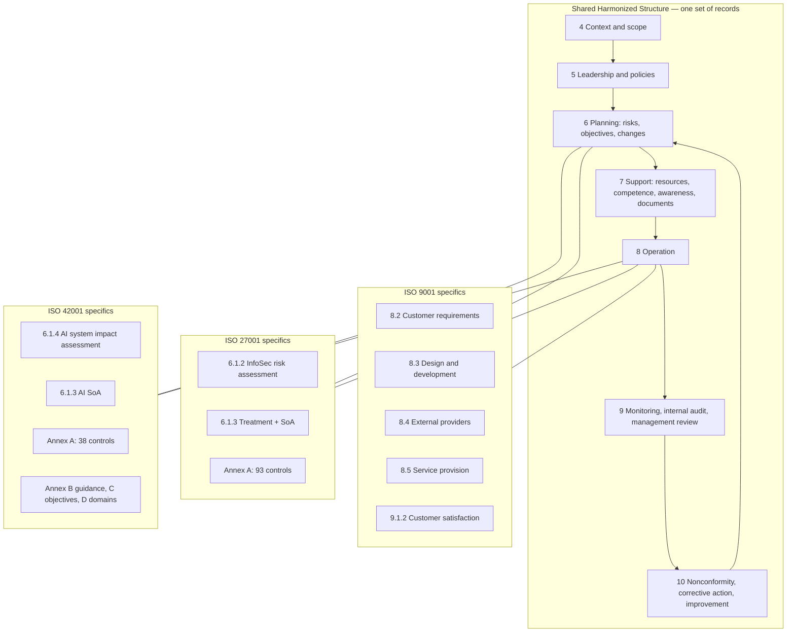

### 5.1 IMS document hierarchy

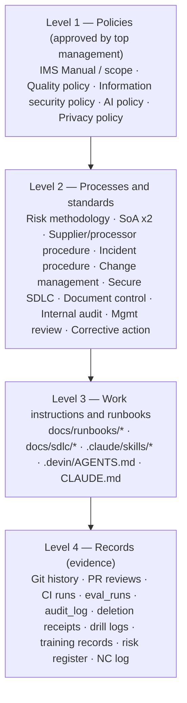

**Design principle — policy as code is the evidence.** LifeKeel's differentiator in an audit
is that many controls are executable. The IMS should *reference* these rather than restate
them, and the internal audit should sample them:

| Policy statement | Executable control | Evidence an auditor can sample |
|---|---|---|
| No autonomous irreversible action without human approval (rule 1) | `apps/api/src/__tests__/trust-tier-gate.test.ts` allow-lists `ActionExecutor` callers and requires `approvedBy` | CI run history; `action_receipts` with `approved_by` |
| No regulated advice (rule 2) | `packages/engine/src/__tests__/advice-rule.test.ts`, PostToolUse hook `scripts/hooks/advice-check.sh` | CI runs; PR template checkbox |
| Family content is not training data (rule 3) | `apps/api/src/ai/task-gateway.ts`, `definitions/ai-tasks.yaml`, `definitions/ai-processors.yaml`, `apps/api/src/__tests__/ai-task-gateway.test.ts` | Boot logs (`AI_POLICY_EXCEPTION`), `llm_usage`, processor registry history |
| AI artifacts are pinned and documented | `ai-bom.yaml`, `docs/models/*.md`, `architecture-claims.test.ts` | Git history of the BOM; CI |
| Adversarial AI testing | `red-team/guard-fixtures.yaml` run in CI | CI runs; `eval_runs` |
| Erasure is complete and survives restore | `apps/api/src/erasure.ts`, `erasure-replay` cron, `scripts/ops/restore-drill.ts` | Deletion receipts, drill logs |
| Production change is human-approved | `deploy-*.yml` (`workflow_dispatch`, `environment: production`), `require-ci.yml` | GitHub deployment history with approver |

---

## 6. Proposed certification scope

Clause 4.3 requires a documented scope with boundaries, interfaces and justification for
exclusions. Proposed text for top-management approval:

> **Scope statement (draft).** The integrated quality, information security and AI management
> system of LifeKeel covering the design, development, operation, support and continual
> improvement of the LifeKeel household-intelligence service — web application, mobile
> shell, API, background jobs, AI task gateway and the AI systems it governs — delivered as
> software-as-a-service to households, including the processing of household personal and
> financial information, from [registered office / remote team locations], in accordance
> with the Statement of Applicability version [x] dated [date].
>
> LifeKeel's role under ISO/IEC 42001: **AI provider and AI developer** of the AI features
> embedded in the service, and **AI user** of third-party foundation models.

### 6.1 Boundaries and interfaces

```mermaid
flowchart LR
  subgraph InScope[IN SCOPE — LifeKeel controls these]
    Web[apps/web — Next.js PWA]
    Mobile[apps/mobile — Capacitor shell]
    API[apps/api — Fastify API + jobs role]
    Gateway[AI task gateway + registries]
    Engine[packages/* — engine, platform, pipeline]
    Resources[detectors, definitions, evals]
    SDLC[GitHub repo, CI/CD, release process]
    Ops[Operations: on-call, backup, incident, operator console]
    People[Staff, contractors, AI coding agents]
  end

  subgraph Interfaces[INTERFACES — controlled by contract + monitoring]
    GCP[Google Cloud: Cloud Run, Secret Manager, Artifact Registry, Vertex AI]
    FB[Firebase Hosting]
    CF[Cloudflare: Turnstile, R2]
    DB[MongoDB + Redis hosting provider]
    LLM[Hosted LLM processors: Azure OpenAI, Vertex, Groq, xAI*]
    Msg[SendGrid, Twilio, Web Push]
    Pay[Stripe]
    OB[Open Banking provider]
    Mail[Gmail / IMAP providers]
    Stores[Apple App Store, Google Play]
  end

  InScope <--> Interfaces
```

\* xAI is approved only under the pre-launch testing exception recorded in CLAUDE.md; it must
leave scope or reach enterprise ZDR before production launch (gap G-SUP-02).

### 6.2 Exclusions and justifications (ISO 9001 4.3 / ISO 27001 SoA)

| Item | Excluded? | Justification |
|---|---|---|
| ISO 9001 7.1.5.2 Measurement traceability | Not applicable | No physical measuring equipment; software metrics are controlled under 7.1.5.1 |
| ISO 27001 physical controls A.7.1–A.7.14 for data centres | **Not excluded — inherited** | Controls are applicable but implemented by cloud suppliers; evidenced via supplier certificates (ISO 27001, SOC 2) under A.5.19–5.23. Office/home-working controls remain in scope |
| Health records domain | Out of product scope | Deliberately not implemented (ARCHITECTURE.md §11); incidental special-category data still in scope for controls (G-PRIV-04) |
| Payment card processing | Out of scope by design | Stripe-hosted Checkout; no card data touches LifeKeel (`docs/compliance/pci-scope.md`) |
| `kairos-ai` legacy monorepo | Out of scope | Separate system; trimmed surfaces documented in SECURITY.md |
| Dormant federated-learning code | **In scope** (as a risk) | Present in `packages/engine`; must remain gated/quarantined (G-AI-05) |

---

## 7. Context of the organization (Clause 4)

### 7.1 External and internal issues (4.1)

| # | Issue | Type | Effect on IMS | Linked risk |
|---|---|---|---|---|
| E1 | Global launch across jurisdictions with divergent privacy, AI and children's-data law | External / legal | Legal register per market; data residency decisions | R-LEG-01 |
| E2 | Rapid change in hosted-AI provider terms, models, retention and pricing | External / supplier | Processor review cadence; `review_due` blocks a lapsed processor | R-AI-03 |
| E3 | Regulatory perimeter (FCA/SEC-style) for financial "advice" | External / legal | Rule 2; perimeter assessment before live banking | R-LEG-02 |
| E4 | Threat landscape: account takeover, prompt injection via documents/email, supply chain | External / technical | Annex A 8.x; red-team CI | R-SEC-01..05 |
| E5 | Consumer trust in AI with household data | External / market | Transparency (A.8, 42001), rule 3 wording in SECURITY.md | R-AI-01 |
| E6 | **Climate change** (ISO Amd 1:2024 — must be *considered*) | External | Low direct relevance; record cloud region energy profile and supplier climate posture; scale-to-zero already reduces footprint | R-ORG-05 |
| I1 | Small team; one CODEOWNER; AI coding agents write much of the code | Internal | Segregation of duties, independent review, agent governance (§17.5) | R-ORG-01 |
| I2 | Modular monolith with pooled multi-tenancy | Internal / technical | Tenant isolation is the top confidentiality risk | R-SEC-02 |
| I3 | Strong policy-as-code culture | Internal / strength | Reuse as evidence | — |
| I4 | Pre-launch, single region, scale-to-zero | Internal | BC/DR, cold start, SLO definition | R-OPS-01 |

### 7.2 Interested parties and their requirements (4.2)

| Interested party | Requirements relevant to the IMS | Addressed by IMS? | Where |
|---|---|---|---|
| Household organizers (paying customers) | Accurate, sourced insights; availability; data confidentiality; export/delete; no hidden selling or advice | Yes | §12, §10, `docs/data-retention.md` |
| Other adult members (may not have signed up) | Notice, access rights, correct permissions | Yes | DPIA §3; G-PRIV-02 |
| Children / minors | Heightened protection, no marketing, age-out | Yes | `docs/privacy/childrens-data-posture.md` |
| Correspondents in connected mailboxes | Minimisation; finance-only retention | Yes | R38 controls |
| Regulators (ICO, EU DPAs, FCA, FTC, AI Act authorities) | Lawful processing, breach reporting, perimeter compliance, AI transparency | Yes | §18 |
| AI processors and cloud suppliers | Contract terms, acceptable use | Yes | A.5.19–5.23, A.10 (42001) |
| Google (API policy), Apple/Google stores | Limited Use, CASA, store privacy labels | Yes | `docs/mobile-store-listing.md` |
| Stripe / acquirer | PCI SAQ, webhook integrity | Yes | `docs/compliance/pci-scope.md` |
| Investors / board | Risk posture, certification | Yes | Management review |
| Employees, contractors, AI agents | Clear rules, tools, training | Yes | CLAUDE.md, §17 |
| Licensed professionals families are referred to | No steering to a provider | Yes | Rule 2 |
| Society | Non-discriminatory, explainable AI | Yes | §14 |

---

## 8. System description for auditors

### 8.1 Logical architecture and trust boundaries

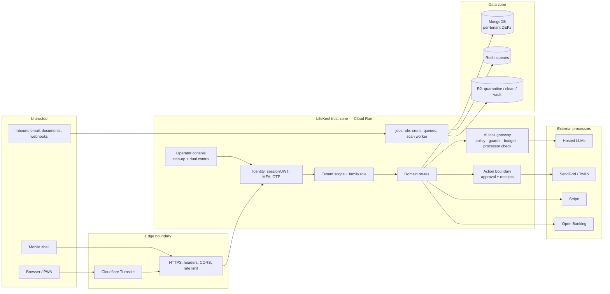

### 8.2 Information assets and classification (feeds A.5.9 / A.5.12)

| Class | Examples | Confidentiality | Integrity | Availability | Storage controls |
|---|---|---|---|---|---|
| **C4 Restricted** | Vault documents, connector credentials, MFA secrets, encryption keys, children's data | Highest | High | Medium | Envelope encryption, optional browser sealing, Secret Manager, crypto-shredding |
| **C3 Confidential** | Financial profile, roster, uploaded documents, inbox items, insights, assistant context | High | High | High | Tenant scope, per-tenant DEK for sensitive fields, R2 private buckets, 60 s presigned URLs |
| **C2 Internal** | Audit log, metrics, eval runs (redacted), operator notes, billing identifiers | Medium | **Highest (audit)** | Medium | Operator RBAC, 7-year TTL |
| **C1 Public** | Marketing site, blog, published model cards | Low | Medium | Medium | Change review |

**Gap:** the classification above is not yet enforced as a named server-side disclosure
classification parallel to trust tiers (ARCHITECTURE.md §16 P1) → G-SEC-06.

### 8.3 AI systems inventory (feeds 42001 A.4, A.6)

| AI system / task family | Purpose | Model / processor | Data seen | Human oversight | Risk tier (internal) |
|---|---|---|---|---|---|
| Ask Keel (assistant) | Answer household questions from records | Hosted small model via gateway (Azure/Vertex/Groq/xAI*) | Task-minimised profile context | Informational only; deterministic authority; guards | Medium |
| Youth answer (`assistant.youth_answer.v1`) | Youth-safe answers | `lifekeel_infra_required`, retention none | Quarter-size budget | Fails closed | High (children) |
| Document / policy extraction | Extract fields from uploads | Gateway task; local/hosted per policy | Document text | User review before profile apply | Medium |
| Email classification | Finance-relevant mail triage | Local (Qwen2.5-7B pinned) / gateway | Message summaries | Review in inbox | Medium |
| Intent embeddings | Tier-2 classification | bge-small-en-v1.5 in-process | Event/insight text | n/a | Low |
| GLiNER2.5-Decide | Entity extraction | Local, pinned revision | Text | Deterministic checks | Low |
| Per-tenant scorers | Rank insights | In-house, per tenant | Hashed features/outcomes | Deterministic detectors decide | Low–Medium |
| Drafting (PRD-103 outreach) | Draft notice to existing provider | Gateway | Minimal | **Tier 1 prepare-only; human sends** | Medium |
| Marketing content | Draft posts/emails | Gateway | No family data | Human approve route; `NEVER_AUTONOMOUS` | Low |
| Federated learning (dormant) | Cross-tenant model | Not instantiated | — | Gated off | **High if enabled** |

\* see §6.1 note.

---

## 9. Clause-by-clause conformance matrix (Clauses 4–10)

Legend for "Std": Q = ISO 9001:2026, S = ISO/IEC 27001:2022, A = ISO/IEC 42001:2023.
Status: ✅ conforming · ◐ partial · ❌ missing.

| Clause | Requirement | Std | Status | Existing evidence | Gap → action | Sev | Owner |
|---|---|---|:-:|---|---|:-:|---|
| 4.1 | External/internal issues incl. climate change | QSA | ◐ | ARCHITECTURE.md product intent, reviews in `docs/reviews/` | Issues register (§7.1) approved; climate statement | S2 | IMS mgr |
| 4.2 | Interested parties and requirements | QSA | ◐ | DPIA §3, compliance disposition table | Approve register (§7.2); legal register (§18) | S2 | IMS mgr / PM |
| 4.3 | Documented scope | QSA | ❌ | — | Approve §6 | **S1** | CEO |
| 4.4 | Establish the management system and processes | QSA | ◐ | SDLC playbook `docs/ai-native-sdlc-playbook.md` | Process map + interactions (§5) | S2 | IMS mgr |
| 5.1 | Leadership and commitment | QSA | ❌ | Owner decisions recorded ad hoc (CLAUDE.md dates) | Documented commitment; resources; mgmt review | **S1** | CEO |
| 5.1.2 | Customer focus | Q | ◐ | PRDs, friction budget PRD-230 | Customer satisfaction monitoring | S3 | PM |
| 5.2 | Policies (quality / infosec / AI) | QSA | ❌ | CLAUDE.md rules 1–3 (content strong, not approved as policy) | Approve policies (§23.1–23.3), communicate, make available | **S1** | CEO |
| 5.3 | Roles, responsibilities, authorities | QSA | ❌ | Operator roles in code (ARCHITECTURE.md §14.2); runbook role tables blank | Named roles matrix | **S1** | CEO |
| 6.1.1 | Actions to address risks and opportunities | QSA | ◐ | Gap register §16, R-register | Formal register (§13) | **S1** | IMS mgr |
| 6.1.2 | Information security risk assessment | S | ❌ | Risk content exists, no method | Methodology + assessment results | **S1** | IMS mgr |
| 6.1.2 | AI risk assessment | A | ❌ | Architecture §8.11, red-team | AI risk assessment using §13 | **S1** | AI lead |
| 6.1.3 | Risk treatment + **SoA** | SA | ❌ | — | Approve §10 and §11; treatment plan; owner acceptance of residual risk | **S1** | IMS mgr |
| 6.1.4 | **AI system impact assessment** | A | ❌ | DPIA draft (privacy only) | §14 per AI system | **S1** | AI lead + privacy |
| 6.2 | Objectives and planning to achieve them | QSA | ❌ | SLO proposal in ARCHITECTURE.md §15.4 | Approved measurable objectives (§20) | S2 | IMS mgr |
| 6.3 | Planning of changes | QSA | ◐ | PRD process, plan mode | Record of IMS changes (change log in this doc) | S3 | IMS mgr |
| 7.1 | Resources | QSA | ◐ | Infra docs, unit economics | Resource plan in mgmt review | S3 | CEO |
| 7.1.5 | Monitoring and measuring resources | Q | ◐ | Metrics, evals | Define validation of measurement (eval datasets, detector-evals) | S3 | Principal dev |
| 7.1.6 | Organizational knowledge | Q | ✅ | ARCHITECTURE.md, reviews, decision records | — | — | — |
| 7.2 | Competence | QSA | ❌ | — | Competence matrix + records (§23.7) | S2 | CEO |
| 7.3 | Awareness | QSA | ❌ | CLAUDE.md read by agents | Annual awareness training incl. AI policy; records | S2 | IMS mgr |
| 7.4 | Communication | QSA | ◐ | Runbooks name ICO path | Communication plan (who/what/when/how) | S3 | IMS mgr |
| 7.5 | Documented information control | QSA | ◐ | Git versioning, PR review | Document-control procedure: approval, classification, retention of records; mark doc owners | S3 | IMS mgr |
| 8.1 | Operational planning and control; outsourced processes | QSA | ◐ | SDLC, CI | Control of outsourced processes (cloud, LLM, messaging) | S2 | IMS mgr |
| 8.2–8.7 | ISO 9001 operation | Q | ◐ | See §12 | See §12 | S3 | PM / Principal dev |
| 8.2 | Perform risk assessment at planned intervals / on change | SA | ❌ | — | Quarterly + on change | S2 | IMS mgr |
| 8.3 | Implement risk treatment | SA | ◐ | Many controls implemented | Link each treatment to register | S2 | IMS mgr |
| 8.4 | Perform AI system impact assessments | A | ❌ | — | §14 on each new/changed AI task | S2 | AI lead |
| 9.1 | Monitoring, measurement, analysis, evaluation | QSA | ◐ | Prometheus metrics, unit economics, eval_runs | Defined what/how/when/who analyses; results retained | S2 | IMS mgr |
| 9.1.2 | Customer satisfaction | Q | ❌ | Growth events | Satisfaction measure (NPS/CSAT, complaints) | S3 | PM |
| 9.2 | Internal audit programme + audits | QSA | ❌ | Reviews exist but are not ISO internal audits | §21 programme; at least one full cycle | **S1** | Internal auditor |
| 9.3 | Management review | QSA | ❌ | — | §21.3 agenda; minutes with decisions | **S1** | CEO |
| 10.1 | Continual improvement | QSA | ◐ | Ship-loop ledger, critic passes | Link to objectives | S3 | IMS mgr |
| 10.2 | Nonconformity and corrective action | QSA | ◐ | R-register "Fixed" with tests | NC log with root cause and effectiveness check (§23.5) | S2 | IMS mgr |

---

## 10. ISO/IEC 27001:2022 Statement of Applicability (93 Annex A controls)

**How to read:** *Appl.* = applicable (Y/N). *Status*: ✅ implemented with evidence · ◐ partial
· ❌ not implemented · ⤴ inherited from supplier (needs supplier evidence). All 93 controls are
applicable to a SaaS processing household data; none is excluded. Justification for inclusion
is the risk register (§13) plus legal/contractual requirements (§18).

### 10.1 Organizational controls (A.5.1–A.5.37)

| Control | Title | Appl. | Status | Evidence in repo / implementation | Gap → action | Sev |
|---|---|:-:|:-:|---|---|:-:|
| 5.1 | Policies for information security | Y | ❌ | CLAUDE.md rules, SECURITY.md | Approved IS policy + topic policies (access, crypto, supplier, AI, acceptable use, secure dev) | S1 |
| 5.2 | IS roles and responsibilities | Y | ❌ | Operator roles in code | Named roles matrix | S1 |
| 5.3 | Segregation of duties | Y | ◐ | Operator dual control (`operator/dual-control.ts`); deploy needs environment approval | CODEOWNERS is one person; require a second reviewer for prod deploy and security-sensitive paths, or document compensating control | S2 |
| 5.4 | Management responsibilities | Y | ❌ | — | Management attests and enforces policies | S2 |
| 5.5 | Contact with authorities | Y | ◐ | Breach runbook names ICO | Authority contact list per market (DPAs, ICO, FCA, AI Act authority, CERTs) | S3 |
| 5.6 | Contact with special interest groups | Y | ❌ | — | Subscribe to NCSC, CISA KEV, OWASP, cloud advisories; record | S4 |
| 5.7 | Threat intelligence | Y | ◐ | Dependency audit, CodeQL, Trivy | Documented intake → triage → action (incl. AI threat feeds) | S3 |
| 5.8 | IS in project management | Y | ✅ | PRD template, PR template (tier + advice check), plan mode | Add security/privacy/AI-impact checkbox to `docs/templates/intent.md` | S4 |
| 5.9 | Inventory of information and assets | Y | ◐ | `erasure.ts` collection catalogue, `ai-bom.yaml`, `public-routes.ts` | Single asset register incl. SaaS accounts, devices, keys, owners | S2 |
| 5.10 | Acceptable use | Y | ❌ | — | AUP for staff, contractors and AI coding agents (§17.5) | S2 |
| 5.11 | Return of assets | Y | ❌ | — | Offboarding checklist | S3 |
| 5.12 | Classification of information | Y | ◐ | §8.2 draft | Approve scheme; server-side disclosure classification | S2 |
| 5.13 | Labelling of information | Y | ◐ | Document metadata header in this file | Label docs/exports by class | S4 |
| 5.14 | Information transfer | Y | ◐ | TLS, presigned URLs, export endpoint, tokens in URL fragment (R22) | Transfer rules incl. international transfers (SCCs/IDTA) | S2 |
| 5.15 | Access control | Y | ✅ | Tenant scope + family roles + operator RBAC; `isHouseholdEditor` | Access control policy document | S3 |
| 5.16 | Identity management | Y | ✅ | Users, operators, `PLATFORM_OPERATOR_BOOTSTRAP_UNTIL` expiry | Joiner/mover/leaver for staff accounts in GCP/GitHub/Stripe/etc. | S3 |
| 5.17 | Authentication information | Y | ✅ | scrypt hashing, hashed reset tokens (R39), encrypted MFA secrets (R40), per-purpose keys (R41) | Password/secret handling standard for staff | S4 |
| 5.18 | Access rights | Y | ◐ | Removal revokes access (R03) | Quarterly access review of staff/operator/cloud access with record | S2 |
| 5.19 | IS in supplier relationships | Y | ◐ | `definitions/ai-processors.yaml` | Supplier register covering all vendors (§23.6), risk-tiered | S2 |
| 5.20 | IS within supplier agreements | Y | ◐ | Processor terms partly recorded | Signed DPAs, security schedules, breach-notice SLA per supplier | S2 |
| 5.21 | ICT supply chain | Y | ◐ | Digest pins, SBOM/provenance (R31), actions pinned by SHA, `ai-bom.yaml` | npm dependency policy (allow-list, age, provenance) | S3 |
| 5.22 | Monitor/review supplier services | Y | ◐ | `review_due` blocks lapsed processor | Annual supplier review records for non-AI suppliers | S3 |
| 5.23 | IS for use of cloud services | Y | ◐ | GCP, Firebase, Cloudflare, Mongo/Redis provider | Cloud policy: shared-responsibility matrix, exit plan (ARCH §16 P2 vendor exit) | S2 |
| 5.24 | Incident management planning | Y | ◐ | `docs/runbooks/breach-response.md` | Name roles; severity model; on-call; covers security, privacy **and AI incidents** | S2 |
| 5.25 | Assessment and decision on IS events | Y | ◐ | Alerting on lost audit records (R33) | Triage criteria and event log | S3 |
| 5.26 | Response to IS incidents | Y | ◐ | Runbook first-hour steps, maintenance mode | Tabletop exercise record | S2 |
| 5.27 | Learning from incidents | Y | ◐ | "post-incident fixture process" proposed | Post-incident review template; link to NC log | S3 |
| 5.28 | Collection of evidence | Y | ◐ | Audit log, login_events, Cloud Run logs | Forensic preservation procedure; tamper-evident audit (G-SEC-03) | S2 |
| 5.29 | IS during disruption | Y | ◐ | Degraded modes, maintenance mode | BC plan maintaining security controls during outage | S2 |
| 5.30 | ICT readiness for business continuity | Y | ◐ | RPO/RTO in backup runbook; restore drill passed once | Managed PITR; scheduled drills; region-failure plan | S2 |
| 5.31 | Legal, statutory, regulatory, contractual | Y | ◐ | Compliance review; FCA/PCI/DPIA notes | Legal register per market (§18) with owner and review date | S1 |
| 5.32 | Intellectual property rights | Y | ◐ | LICENSE, NOTICE, model licences in `ai-bom.yaml` | Licence scanning in CI; AI-generated code IP policy | S3 |
| 5.33 | Protection of records | Y | ◐ | 7-year audit TTL, deletion receipts | Records retention schedule incl. IMS records | S3 |
| 5.34 | Privacy and protection of PII | Y | ◐ | DPIA draft, retention, erasure, export, rights runbook | Sign DPIA; RoPA; lawful bases; privacy notice legal review (R11, R12) | S1 |
| 5.35 | Independent review of IS | Y | ❌ | Reviews are self-assessments | External penetration test + independent internal audit | S2 |
| 5.36 | Compliance with policies and standards | Y | ◐ | CI tripwires | Periodic compliance check results reported to mgmt review | S3 |
| 5.37 | Documented operating procedures | Y | ✅ | `docs/runbooks/*`, `runbooks.yaml`, `docs/sdlc/*` | Owners and review dates on each runbook | S4 |

### 10.2 People controls (A.6.1–A.6.8)

| Control | Title | Appl. | Status | Evidence | Gap → action | Sev |
|---|---|:-:|:-:|---|---|:-:|
| 6.1 | Screening | Y | ❌ | — | Proportionate background checks (law-dependent) for anyone with production access | S2 |
| 6.2 | Terms and conditions of employment | Y | ❌ | — | Security and confidentiality clauses in contracts | S2 |
| 6.3 | Awareness, education and training | Y | ❌ | — | Annual IS + privacy + **AI literacy (EU AI Act Art. 4)** training; records | S2 |
| 6.4 | Disciplinary process | Y | ❌ | — | Documented process | S3 |
| 6.5 | Responsibilities after termination/change | Y | ❌ | — | Offboarding: revoke GitHub, GCP, Stripe, Cloudflare, Mongo, SendGrid, LLM consoles same day | S2 |
| 6.6 | Confidentiality / NDAs | Y | ❌ | — | NDAs for staff, contractors, auditors | S2 |
| 6.7 | Remote working | Y | ❌ | — | Remote-working policy (device, network, screen privacy) | S3 |
| 6.8 | IS event reporting | Y | ◐ | SECURITY.md reporting route | Internal reporting channel; external `security.txt` / vulnerability disclosure policy | S3 |

### 10.3 Physical controls (A.7.1–A.7.14)

Data-centre controls are **inherited** from Google Cloud, Firebase, Cloudflare and the
database provider. Keep their current ISO 27001 certificates / SOC 2 Type II reports on file
and review annually (A.5.22). Remaining in-scope physical risk is staff endpoints and home
offices.

| Control | Title | Status | Implementation / evidence | Sev if missing |
|---|---|:-:|---|:-:|
| 7.1 | Physical security perimeters | ⤴ | Supplier certificates | S3 |
| 7.2 | Physical entry | ⤴ | Supplier certificates | S3 |
| 7.3 | Securing offices, rooms, facilities | ◐ | Remote-working policy | S3 |
| 7.4 | Physical security monitoring | ⤴ | Supplier certificates | S4 |
| 7.5 | Physical and environmental threats | ⤴ | Supplier certificates | S4 |
| 7.6 | Working in secure areas | ⤴ | Supplier certificates | S4 |
| 7.7 | Clear desk and clear screen | ❌ | Policy + screen-lock MDM setting | S3 |
| 7.8 | Equipment siting and protection | ◐ | Remote-working policy | S4 |
| 7.9 | Security of assets off-premises | ❌ | Laptop encryption, MDM, lost-device procedure | S3 |
| 7.10 | Storage media | ❌ | No removable media for C3/C4 data; backups encrypted with `age` (R20) | S3 |
| 7.11 | Supporting utilities | ⤴ | Supplier certificates | S4 |
| 7.12 | Cabling security | ⤴ | Supplier certificates | S4 |
| 7.13 | Equipment maintenance | ◐ | Laptop OS update policy | S4 |
| 7.14 | Secure disposal or re-use of equipment | ❌ | Wipe procedure + certificate for laptops | S3 |

### 10.4 Technological controls (A.8.1–A.8.34)

| Control | Title | Appl. | Status | Evidence in repo | Gap → action | Sev |
|---|---|:-:|:-:|---|---|:-:|
| 8.1 | User endpoint devices | Y | ❌ | Mobile biometric gate (app side) | Staff device policy: FDE, MDM, EDR, auto-update | S2 |
| 8.2 | Privileged access rights | Y | ◐ | Operator step-up + dual control; break-glass expiry | GCP/GitHub/DB admin roles least-privilege; **workload identity, delete JSON keys (R31)**; quarterly review | S2 |
| 8.3 | Information access restriction | Y | ◐ | Tenant-scoped wrapper, cross-tenant tests, youth redaction | Raw-collection access inventory; deny-by-default resource authorization (ARCH §16 P1) | S2 |
| 8.4 | Access to source code | Y | ◐ | Private repo; CODEOWNERS | Verify branch protection, signed commits enforced, required reviews (R30 residual) | S2 |
| 8.5 | Secure authentication | Y | ✅ | MFA/TOTP, email OTP, Turnstile, session revocation, throttling | Passkeys/phishing-resistant MFA for **operators and staff** first | S3 |
| 8.6 | Capacity management | Y | ◐ | Unit economics, plan caps, budgets | Capacity model + load test baseline (ARCH §16 P2) | S3 |
| 8.7 | Protection against malware | Y | ✅ | ClamAV scan worker, quarantine bucket, parser child without credentials | Staff endpoint AV/EDR | S3 |
| 8.8 | Technical vulnerability management | Y | ◐ | `security.yml` dependency audit, CodeQL (weekly), Trivy | Patch SLAs (Critical 7d / High 30d / Medium 90d), tracked; annual pentest | S2 |
| 8.9 | Configuration management | Y | ◐ | Boot guards, env validation, digest pins, IaC partial | Baseline configs for Cloud Run/GCP/Cloudflare; drift detection | S3 |
| 8.10 | Information deletion | Y | ✅ | `erasure.ts`, replay cron, crypto-shredding, receipts | Provider-side deletion evidence (contract) | S3 |
| 8.11 | Data masking | Y | ◐ | Log scrubbing (R22), metadata-first telemetry, special-category stripping | Masking standard for non-prod and eval fixtures | S3 |
| 8.12 | Data leakage prevention | Y | ◐ | Output guards, prompt/completion telemetry off, no semantic cache for sensitive data | Egress allow-list (ARCH §15.5) | S2 |
| 8.13 | Information backup | Y | ◐ | Encrypted `backup.sh`, erasure journal, one drill | **Managed PITR**, scheduled backups, quarterly drill with records | S2 |
| 8.14 | Redundancy | Y | ◐ | Stateless replicas, 0–4 instances | Region/provider failure decision tied to RTO (ARCH §16 P2) | S3 |
| 8.15 | Logging | Y | ◐ | Structured logs, append-only audit convention, 7-year TTL | **Tamper-evident/WORM audit export**; mandatory audit for consequential actions (R33) | S2 |
| 8.16 | Monitoring activities | Y | ◐ | Prometheus, OTel, alert on lost audit | Security monitoring use-cases (auth anomalies, operator actions, mass export) with alert routing | S2 |
| 8.17 | Clock synchronization | Y | ⤴ | Cloud-provided NTP | Record reliance | S4 |
| 8.18 | Privileged utility programs | Y | ◐ | Ops scripts under `scripts/ops/` | Restrict and log use (e.g. raw `mongorestore` bypass of `restore.sh`) | S3 |
| 8.19 | Software installation on operational systems | Y | ✅ | Immutable images, deploy by digest | — | S4 |
| 8.20 | Networks security | Y | ◐ | HTTPS, CORS, `*.run.app` removed (R34), IMAP SSRF fix (R07) | Egress controls at infrastructure level | S3 |
| 8.21 | Security of network services | Y | ◐ | Cloudflare, Cloud Run ingress; jobs service internal ingress | Document network service security requirements | S3 |
| 8.22 | Segregation of networks | Y | ◐ | `lifekeel-jobs` internal ingress; separate R2 buckets | Network diagram with zones; VPC egress | S3 |
| 8.23 | Web filtering | Y | ◐ | Staff browsing only | Proportionate DNS filtering on staff devices | S4 |
| 8.24 | Use of cryptography | Y | ✅ | AES-256-GCM per-tenant DEKs, KEK versioning, key-rotation runbook, `age` backups | Cryptography policy document; KMS/HSM for KEK | S3 |
| 8.25 | Secure development life cycle | Y | ✅ | `docs/ai-native-sdlc-playbook.md`, PR template, CI gates, `/code-review` | Formalise as procedure; include threat modelling step | S3 |
| 8.26 | Application security requirements | Y | ◐ | OWASP mapping in compliance review | Security requirements in PRD template | S3 |
| 8.27 | Secure architecture and engineering principles | Y | ◐ | ARCHITECTURE.md §15.2, trust boundaries | **Threat models** for twin, vault, ingestion, AI, actions, operator, mobile | S2 |
| 8.28 | Secure coding | Y | ✅ | Strict TypeScript, lint, CodeQL, review | Secure coding standard doc | S4 |
| 8.29 | Security testing in development and acceptance | Y | ◐ | Unit/integration tests, red-team fixtures, boot smoke | DAST/pentest before launch; authz contract tests per ID-bearing route | S2 |
| 8.30 | Outsourced development | Y | ◐ | AI coding agents governed by CLAUDE.md, hooks | Contractor/agent development policy (§17.5) | S3 |
| 8.31 | Separation of dev, test, prod | Y | ✅ | Staging env (`deploy-staging.yml`), boot guards refuse demo tokens outside dev | Confirm no prod data in staging | S3 |
| 8.32 | Change management | Y | ✅ | PR → CI → `require-ci.yml` → human-approved `workflow_dispatch` | Emergency-change procedure; verify environment reviewers configured | S3 |
| 8.33 | Test information | Y | ◐ | Synthetic flow validation, detector-evals | Rule: no production family data in tests/evals without approval | S3 |
| 8.34 | Protection during audit testing | Y | ❌ | — | Rules of engagement for pentest/audit access | S4 |

---

## 11. ISO/IEC 42001:2023 Statement of Applicability (38 Annex A controls)

LifeKeel's role: **AI developer and provider** (Ask Keel, extraction, classification, scoring,
drafting) and **AI user/customer** of third-party foundation models.

| Control | Title | Appl. | Status | Evidence in repo | Gap → action | Sev |
|---|---|:-:|:-:|---|---|:-:|
| **A.2.2** | AI policy | Y | ❌ | CLAUDE.md rules 1–3, ARCH §8 | Approve AI policy (§23.3) | S1 |
| A.2.3 | Alignment with other policies | Y | ◐ | Rules cross-reference security/privacy | Cross-reference matrix in policy | S3 |
| A.2.4 | Review of the AI policy | Y | ❌ | — | Review at each management review | S3 |
| **A.3.2** | AI roles and responsibilities | Y | ❌ | `approvedBy` in actions; operator roles | Name AI governance lead, model owners per task | S1 |
| A.3.3 | Reporting of concerns | Y | ❌ | — | Channel for staff/users to report AI harm; non-retaliation | S2 |
| A.4.2 | Resource documentation | Y | ✅ | `ai-bom.yaml`, `definitions/ai-tasks.yaml` | — | S4 |
| A.4.3 | Data resources | Y | ◐ | Data boundary per model in BOM; detector-evals | Dataset register (source, licence, consent, PII status) | S2 |
| A.4.4 | Tooling resources | Y | ◐ | Gateway, guards, eval tooling in ARCH §8.14 | List AI tooling incl. coding agents | S3 |
| A.4.5 | System and computing resources | Y | ✅ | Model-serving split decision, infra docs | — | S4 |
| A.4.6 | Human resources | Y | ❌ | — | AI competence matrix | S2 |
| **A.5.2** | AI system impact assessment process | Y | ❌ | DPIA (privacy only) | Process in §14 | S1 |
| A.5.3 | Documentation of impact assessments | Y | ❌ | — | Records per task, retained | S2 |
| A.5.4 | Impact on individuals or groups | Y | ◐ | Children's posture, advice rule | Fairness/accessibility/language assessment per task | S2 |
| A.5.5 | Societal impacts | Y | ❌ | — | Short societal assessment (financial exclusion, over-reliance) | S3 |
| A.6.1.2 | Objectives for responsible development | Y | ◐ | Deterministic-first cascade, rules 1–3 | Measurable objectives (§20) | S2 |
| A.6.1.3 | Processes for responsible design and development | Y | ✅ | SDLC playbook, `add-detector` skill, plan mode | — | S4 |
| A.6.2.2 | Requirements and specification | Y | ✅ | PRDs, task policy YAML | — | S4 |
| A.6.2.3 | Design and development documentation | Y | ✅ | ARCH §8, model cards `docs/models/` | — | S4 |
| A.6.2.4 | Verification and validation | Y | ◐ | detector-evals, red-team CI, `eval_runs` lineage | **Task eval suites not yet wired** (ARCH §16); release criteria per task | S2 |
| A.6.2.5 | Deployment | Y | ✅ | Gateway enforcement, shadow mode, human deploy | Document deployment criteria | S4 |
| A.6.2.6 | Operation and monitoring | Y | ◐ | Breakers, budgets, usage ledger, guard events | Drift/quality monitoring; OTel GenAI traces (metadata-only) | S3 |
| A.6.2.7 | Technical documentation | Y | ✅ | Model cards, BOM, architecture | Per-system summary for users/regulators | S3 |
| A.6.2.8 | Recording of event logs | Y | ◐ | `llm_usage`, guard events, spans (metadata-first) | Retention for AI logs; tamper evidence | S3 |
| A.7.2 | Data for development and enhancement | Y | ◐ | Rule 3; per-tenant eval; `allowFederatedWarmStart` off | **Quarantine stale `federated_global_models` artifact** | S1 |
| A.7.3 | Acquisition of data | Y | ◐ | Gmail readonly scope (R38) | Record lawful basis/licence for each dataset | S3 |
| A.7.4 | Quality of data | Y | ◐ | Golden datasets, detector-evals | Data-quality criteria per dataset | S3 |
| A.7.5 | Data provenance | Y | ◐ | Dataset hash + code SHA in `eval_runs`; extraction provenance gates | Provenance on all training/eval data | S3 |
| A.7.6 | Data preparation | Y | ◐ | Special-category stripping, minimisation | Documented preparation steps | S3 |
| A.8.2 | Documentation and information for users | Y | ◐ | Rule-2 copy; "safe user-facing wording" in SECURITY.md | In-product AI disclosure (EU AI Act Art. 50); explain limits | S2 |
| A.8.3 | External reporting | Y | ❌ | — | Way for users/third parties to report adverse AI impacts | S3 |
| A.8.4 | Communication of incidents | Y | ◐ | Breach runbook | Include AI incidents (harmful output, advice escape, injection) | S2 |
| A.8.5 | Information for interested parties | Y | ◐ | Model cards | Public AI transparency page | S3 |
| A.9.2 | Processes for responsible use | Y | ✅ | Trust tiers, approval gates, guards | — | S4 |
| A.9.3 | Objectives for responsible use | Y | ◐ | SLO: 0 regulated-boundary escapes | Formal objectives (§20) | S3 |
| A.9.4 | Intended use | Y | ◐ | Product intent, rule 2 | Intended-use and foreseeable-misuse statement per system (§14) | S2 |
| A.10.2 | Allocating responsibilities | Y | ◐ | Processor registry | Shared-responsibility matrix with each AI processor | S3 |
| A.10.3 | Suppliers | Y | ◐ | Registry: Azure/Vertex/Groq approved; xAI exception; Anthropic/OpenAI unreviewed | Signed DPAs with no-training terms; **xAI exit or enterprise ZDR before launch** | S2 |
| A.10.4 | Customers | Y | ◐ | Terms, privacy notice (R11 partial) | Customer-facing AI terms and expectations | S2 |

---

## 12. ISO 9001:2026 operational requirements (Clause 8) mapped to the SDLC

LifeKeel's existing PRD → production flow (CLAUDE.md) already resembles a 9001 design and
development process. The table shows what each step must record.

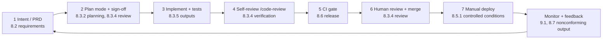

| 9001 clause | Requirement | LifeKeel implementation | Record kept | Gap | Sev |
|---|---|---|---|---|:-:|
| 8.1 | Operational planning | Roadmap, PRDs | `docs/prd/`, roadmap review | Link objectives to roadmap | S4 |
| 8.2.1 | Customer communication | In-app, email, support cases (operator console) | Support case records | Complaint handling procedure + SLA | S3 |
| 8.2.2–8.2.3 | Determine and review requirements | PRDs with "done" criteria; legal checks in PR template | PRD + PR | Add statutory/regulatory section to PRD template | S3 |
| 8.2.4 | Changes to requirements | PRD revisions in git | git history | — | — |
| 8.3.2 | D&D planning | Plan mode, sign-off before code | PR description / plan | Keep sign-off record in PR | S4 |
| 8.3.3 | D&D inputs | PRD, ARCHITECTURE.md, rules | PRD | — | — |
| 8.3.4 | D&D controls (review, verification, validation) | Tests, evals, code review, human review | CI runs, review comments | **Validation with real users** (usability, acceptance) recorded | S3 |
| 8.3.5 | D&D outputs | Code, YAML detectors, docs | git | — | — |
| 8.3.6 | D&D changes | PR process | git | — | — |
| 8.4 | External providers | Processor registry; cloud vendors | `ai-processors.yaml` | Supplier evaluation criteria and re-evaluation for all vendors | S2 |
| 8.5.1 | Controlled conditions | Immutable images, human deploy, boot guards | Deploy logs | Release notes per deploy | S3 |
| 8.5.2 | Identification and traceability | Commit SHA ↔ image digest ↔ deployment | Artifact Registry, provenance | — | — |
| 8.5.3 | Property of customers | Household data — treated as customer property | Erasure, export, receipts | Report loss/damage to customer (breach runbook) | — |
| 8.5.4 | Preservation | Backups, encryption | Backup logs | See A.8.13 | S2 |
| 8.5.5 | Post-delivery activities | Support, deletion | Receipts | — | — |
| 8.5.6 | Control of changes | Change management | PRs | Emergency change procedure | S3 |
| 8.6 | Release of products and services | CI gate + `require-ci.yml` + approval | GitHub environment approvals | Record approver identity per release | S3 |
| 8.7 | Control of nonconforming outputs | Insight retraction (PRD-107), rollback, maintenance mode | Retraction records | NC log (§23.5) | S3 |

---

## 13. Risk management methodology

One method serves ISO 27001 6.1.2, ISO 42001 6.1.2 and ISO 9001 6.1. It follows ISO/IEC 27005
and ISO 31000; AI risks also use ISO/IEC 23894 sources.

### 13.1 Process

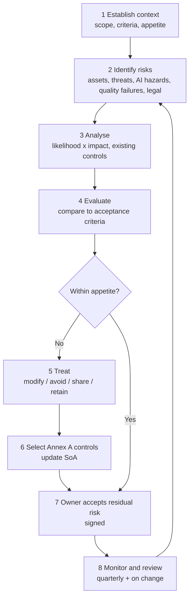

### 13.2 Scales

**Likelihood**

| Score | Label | Guide |
|:-:|---|---|
| 1 | Rare | Not expected in 5 years; requires several independent failures |
| 2 | Unlikely | Could occur in 2–5 years |
| 3 | Possible | Could occur within a year |
| 4 | Likely | Expected within a year; has happened in similar products |
| 5 | Almost certain | Expected within months or already observed |

**Impact** (take the highest dimension)

| Score | Families / people | Legal / regulatory | Financial | Operational / reputation |
|:-:|---|---|---|---|
| 1 | No noticeable effect | None | < £1k | Minutes of degradation |
| 2 | Minor inconvenience to one household | Minor breach, no report | £1k–£10k | Hours of degradation |
| 3 | Confidential data of one household exposed; wrong insight acted on | Reportable breach | £10k–£100k | Day outage; local press |
| 4 | Many households exposed; a child's data exposed; regulated advice given | Regulator investigation; perimeter breach | £100k–£1m | Multi-day outage; national press |
| 5 | Cross-tenant mass exposure; irreversible action without consent | Enforcement, licence-type breach | > £1m | Existential |

**Risk score = Likelihood × Impact** → Low (1–4), Medium (5–9), High (10–16), Critical (20–25).

**Risk appetite (proposed for approval):** Low accepted by risk owner; Medium accepted by IMS
manager with treatment plan; High requires CEO acceptance and treatment within 90 days;
Critical is never accepted — treat or avoid. **Any impact-5 event touching rules 1–3 or
children is treated regardless of likelihood.**

### 13.3 Seed risk register (first 20 risks, from repository evidence)

| ID | Risk | L | I | Score | Existing controls | Treatment | Annex A | Owner |
|---|---|:-:|:-:|:-:|---|---|---|---|
| R-SEC-01 | Account takeover via phishing of an organizer | 4 | 3 | 12 | MFA, OTP, throttling, session revocation | Passkeys; breached-password check | 8.5, 5.17 | Principal dev |
| R-SEC-02 | Cross-tenant data disclosure via missing tenant filter | 2 | 5 | 10 | Tenant wrapper, cross-tenant tests | Raw-access inventory; deny-by-default repo; route contract tests | 8.3, 8.27 | Architect |
| R-SEC-03 | Prompt injection through uploaded document or email causes data exfiltration or harmful output | 3 | 4 | 12 | Untrusted-input handling, guards, red-team CI | Expand fixtures; output allow-listing; no tool calls from ingested content | 8.26, A.6.2.4 | AI lead |
| R-SEC-04 | Compromised CI/CD or dependency (supply chain) | 2 | 5 | 10 | SHA-pinned actions, digest-pinned images, SBOM, Trivy, audit | Workload identity; delete JSON keys; dependency policy | 5.21, 8.4 | Principal dev |
| R-SEC-05 | Audit evidence altered or lost after an incident | 2 | 4 | 8 | Append convention, alert on lost record | WORM export / hash chain | 8.15, 5.28 | Architect |
| R-PRIV-01 | Processing without signed DPIA/lawful basis in a launch market | 4 | 4 | 16 | Draft DPIA | Sign DPIA; RoPA; per-market legal review | 5.31, 5.34 | Privacy lead |
| R-PRIV-02 | Children's data processed unlawfully (COPPA/AADC/DPDP) | 3 | 5 | 15 | Minor detection, marketing exclusion, youth task | Age assurance; parental consent design per market | 5.34 | Privacy lead |
| R-PRIV-03 | Special-category data via uploads | 4 | 3 | 12 | Health-term stripping for assistant | Upload classification; Art. 9 decision | 5.34, 5.12 | Privacy lead |
| R-AI-01 | Assistant output reads as personal financial/insurance recommendation | 3 | 5 | 15 | Advice-rule test, system prompt, guards | Output sampling review by counsel; eval suite for advice | A.9.4, 5.31 | AI lead + PM |
| R-AI-02 | Family content used to train a third-party model | 2 | 5 | 10 | Processor registry enforce mode, no-training basis recorded | Signed contractual terms; annual verification; xAI exit | A.10.3, 5.20 | AI lead |
| R-AI-03 | Stale federated artifact warm-starts scorers | 2 | 4 | 8 | Flag default off | Delete/quarantine artifact | A.7.2 | AI lead |
| R-AI-04 | Hallucinated figure presented as sourced | 3 | 3 | 9 | Deterministic authority; verified-answer tier | Grounding evals; provenance display | A.6.2.4 | AI lead |
| R-OPS-01 | Region or provider outage beyond RTO | 2 | 4 | 8 | Health probes, degraded modes | DR plan; PITR; tested recovery | 5.30, 8.14 | SRE |
| R-OPS-02 | Restore resurrects erased data | 2 | 4 | 8 | Tombstone replay, erasure journal, crypto-shredding | Scheduled drill; journal storage independence | 8.10, 8.13 | SRE |
| R-OPS-03 | SendGrid outage silently disables protective notifications | 3 | 3 | 9 | Ledger outcomes | Warm secondary provider | 5.29 | Architect |
| R-ORG-01 | Single maintainer; no segregation of duties; key-person loss | 4 | 4 | 16 | Dual control in operator console | Second reviewer; documented knowledge; access escrow | 5.3, 6.x | CEO |
| R-ORG-02 | AI coding agent introduces insecure or rule-breaking code | 3 | 4 | 12 | CLAUDE.md, hooks, tripwire tests, human review | Agent AUP (§17.5); review evidence | 8.25, 8.30 | Principal dev |
| R-LEG-01 | Launch in a market without local legal analysis | 3 | 4 | 12 | UK-focused reviews | Per-market launch gate (§18.2) | 5.31 | PM + counsel |
| R-LEG-02 | FCA perimeter breach via Open Banking or drafts | 2 | 5 | 10 | Flag-gated, read-only, rule 2 | Written perimeter assessment | 5.31 | CEO + counsel |
| R-SUP-01 | Google CASA not passed; Gmail connector blocked at scale | 4 | 3 | 12 | Read-only scope | Plan CASA assessment | 5.31, 5.19 | PM |

---

## 14. AI system impact assessment (ISO/IEC 42001 6.1.4)

Run for every AI system in §8.3 before release and on material change (new model, processor,
data class, audience or autonomy level). Record in the template in §23.4.

### 14.1 Assessment flow

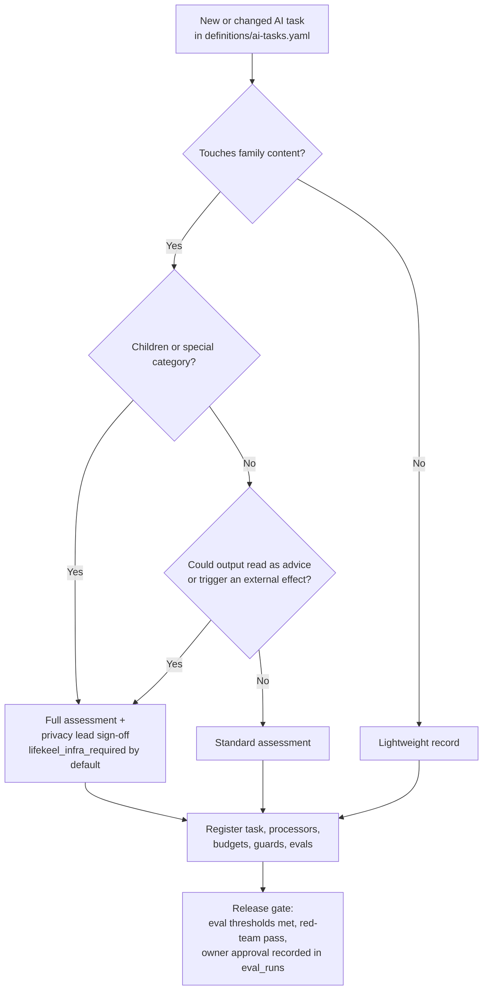

### 14.2 Dimensions to assess

| Dimension | Questions | LifeKeel default position |
|---|---|---|
| Intended use / misuse | What is it for? How could it be misused or over-relied on? | Informational only; never advice; never acts without approval |
| Affected people | Account holder, other adults, children, correspondents | Minimise; children only via youth task |
| Fairness and accessibility | Does quality vary by language, literacy, disability, household type? | Plain-language copy; test across household shapes |
| Transparency | Does the user know it is AI? Can they see sources? | Disclose AI; show "on file" sources |
| Privacy | What data, which processor, retention, training? | Rule 3; registry-enforced |
| Safety / security | Injection, data leakage, harmful output | Guards symmetric for cloud/local; red-team CI |
| Accountability | Who owns the model and its outcomes? | Named model owner per task |
| Reversibility | Can effects be undone? | Trust tiers; claim-before-dispatch receipts |
| Societal | Financial exclusion, dependence, misinformation | Point to licensed professionals |

### 14.3 Pre-filled outcome for Ask Keel (example)

| Field | Value |
|---|---|
| System | Ask Keel — interactive assistant |
| Intended use | Explain a household's records and estimated gaps in plain language |
| Out of scope / prohibited | Recommending products/providers, switching, investment transactions, payment initiation, medical/legal advice |
| Users / affected | Organizer and adult members; not minors (youth use the youth task) |
| Data | Task-minimised profile context; no vault plaintext |
| Processors | Approved hosted processors via gateway; enforcement `enforce` outside dev |
| Key risks | R-AI-01 advice escape (15), R-SEC-03 injection (12), R-AI-04 hallucination (9) |
| Controls | Advice-rule test, system prompt, symmetric guards, deterministic authority, budgets/deadlines, metadata-only telemetry |
| Residual risk | Medium — pending task eval suite and counsel sampling of real outputs |
| Decision | Release behind gateway; re-assess when eval suite lands |
| Sign-off | AI lead ___ · Privacy lead ___ · Date ___ |

### 14.4 EU AI Act classification (to confirm with counsel)

| Question | Working answer | Consequence |
|---|---|---|
| Prohibited practice (Art. 5)? | No | — |
| Annex III 5(b): creditworthiness / credit scoring of natural persons? | No — LifeKeel does not score credit or decide on credit | Keep it that way; any lender-facing feature reopens this |
| Annex III 5(c): risk assessment and pricing for life/health insurance? | No — LifeKeel estimates a household's own protection gap, does not price insurance | Rule 2 keeps this boundary; document reasoning |
| Art. 50 transparency (interacting with AI, generated content)? | **Yes** | Disclose AI interaction; label AI-generated drafts |
| Art. 4 AI literacy? | **Yes** (deployer/provider staff) | Training records (A.6.3) |
| GPAI provider? | No — LifeKeel uses, does not place GPAI models on the market | Obtain upstream documentation from providers |

---

## 15. Consolidated gap register with severity

IDs are stable; link them in PRs (`Closes G-SEC-03`). Source column cites the repository
document where the gap was first recorded. Status reflects repository documents dated up to
2026-11-02 and must be re-verified.

### 15.1 S1 — Critical (certification blockers / launch blockers)

| ID | Gap | Clause / control | Source | Exit criterion | Owner |
|---|---|---|---|---|---|
| G-MGT-01 | No approved IMS scope | 4.3 (Q/S/A) | — | Signed scope statement (§6) | CEO |
| G-MGT-02 | No approved quality, information security and AI policies | 5.2, A.5.1, A.2.2 | — | Signed policies, published internally, acknowledged by staff | CEO |
| G-MGT-03 | Roles unnamed (incident lead, privacy, DPO, IMS, AI governance) | 5.3, A.5.2, A.3.2 | breach-response.md, rights-requests.md, dpia.md | Roles matrix with names and deputies | CEO |
| G-MGT-04 | No risk methodology, scored register, treatment plan or risk acceptance | 6.1.2, 6.1.3, 8.2, 8.3 | ARCH §16 (unscored) | §13 approved; register ≥ 40 risks; owners sign acceptance | IMS mgr |
| G-MGT-05 | No Statement(s) of Applicability | 6.1.3 d) (S/A) | — | §10/§11 approved with versions | IMS mgr |
| G-MGT-06 | No AI system impact assessments | 6.1.4, 8.4, A.5.2 | — | §14 completed for every task in `ai-tasks.yaml` | AI lead |
| G-MGT-07 | No internal audit or management review performed | 9.2, 9.3 | — | One complete cycle with records | Internal auditor / CEO |
| G-PRIV-01 | DPIA unsigned; lawful bases undecided | A.5.31, A.5.34 | R12 | Signed DPIA; RoPA | Privacy lead |
| G-AI-05 | Stale `federated_global_models` artifact not quarantined (rule 3) | A.7.2, A.5.34 | ARCH §16 P0 | Artifact deleted/quarantined; test asserts absence or gate | AI lead |

### 15.2 S2 — High

| ID | Gap | Clause / control | Source | Exit criterion | Owner |
|---|---|---|---|---|---|
| G-SUP-01 | DPAs and no-training/retention terms not signed or verified for all processors | A.5.19–5.22, A.10.3 | R14, ai-processors.yaml | Signed DPAs on file; registry links contract refs; review dates | AI lead + legal |
| G-SUP-02 | xAI serving under testing exception without ZDR | A.10.3, rule 3 | CLAUDE.md | Moved to unconditional processor or enterprise ZDR before launch | AI lead |
| G-SUP-03 | No supplier register for non-AI vendors (GCP, Firebase, Cloudflare, Mongo, Redis, SendGrid, Twilio, Stripe, Open Banking) | A.5.19, A.5.23, 9001 8.4 | — | Register with certificates and review dates | IMS mgr |
| G-SEC-01 | Branch protection, environment reviewers, signed-commit enforcement unverified | A.8.4, A.8.32 | R30 residual | Screenshot/API export of settings in evidence pack | Principal dev |
| G-SEC-02 | Workload identity not configured; JSON service-account keys exist | A.8.2, A.8.5 | R31 residual | WIF configured; keys deleted; record | Principal dev |
| G-SEC-03 | Audit log not tamper-evident; some writes best-effort | A.8.15, A.5.28 | R33, ARCH P1 | WORM export or hash chain; mandatory audit for consequential actions | Architect |
| G-SEC-04 | No threat models | A.8.27 | ARCH §15.5 | Threat models for 7 domains, reviewed on change | Architect |
| G-SEC-05 | No independent penetration test | A.5.35, A.8.29 | compliance review scope | External pentest; findings tracked | CEO |
| G-SEC-06 | Disclosure/sensitivity classification not enforced | A.5.12, A.8.3 | ARCH §16 P1 | Server-side classification with tests | Architect |
| G-SEC-07 | Tenant isolation relies on dispersed filters | A.8.3 | ARCH §16 P1 | Raw-access inventory + repository policy + route tests | Architect |
| G-SEC-08 | Vulnerability SLAs not defined | A.8.8 | — | SLA policy; tracked metrics | Principal dev |
| G-OPS-01 | Managed PITR not configured; drills manual | A.8.13, A.5.30 | ARCH §16 P0 residual | PITR on; scheduled quarterly drill with records | SRE |
| G-OPS-02 | Incident roles unnamed; no tabletop; AI incidents not covered | A.5.24–5.27, A.8.4 (42001) | R32 | Named roles, tabletop record, AI incident playbook | IMS mgr |
| G-OPS-03 | No approved SLOs / error budgets | 6.2, 9.1, A.8.6 | ARCH §15.4 | Approved SLOs and dashboards | SRE |
| G-PEO-01 | No screening, NDAs, contracts clauses, training, offboarding | A.6.1–6.6, 7.2, 7.3 | — | HR procedures and records | CEO |
| G-PEO-02 | No endpoint device controls for staff | A.8.1, A.7.9 | — | MDM, FDE, EDR evidence | IMS mgr |
| G-PRIV-02 | Children: counsel-led DPIA, age attestation, auth-time age gating open | A.5.34 | childrens-data-posture.md | Decisions per market (§18) implemented | Privacy lead |
| G-PRIV-03 | Privacy notice not legally reviewed; deployment variables unset | A.5.34 | R11 | Counsel-approved notice per market | Privacy lead |
| G-PRIV-04 | Special-category intake via documents/email | A.5.34, A.5.12 | R13 | Art. 9 decision; extraction-path controls | Privacy lead |
| G-LEG-01 | FCA perimeter assessment not written | A.5.31 | R17 | Written opinion on file | CEO + counsel |
| G-LEG-02 | PCI SAQ not confirmed | A.5.31 | R16 | SAQ A completed; acquirer confirmation | CEO |
| G-LEG-03 | Google restricted-scope verification / CASA | A.5.31 | R38 | CASA letter of assessment | PM |
| G-AI-01 | Task eval suites not wired | A.6.2.4 | ARCH §16 | Per-task thresholds gate release | AI lead |
| G-AI-02 | No in-product AI disclosure aligned to Art. 50 | A.8.2, A.8.5 | — | Disclosure UI + transparency page | PM |
| G-AI-03 | No AI concern-reporting channel | A.3.3, A.8.3 | — | Channel live; triage procedure | AI lead |

### 15.3 S3 — Medium (selected; full list in §10/§11 rows marked S3)

| ID | Gap | Control | Source |
|---|---|---|---|
| G-DOC-01 | No document-control procedure (approval, owner, review date) | 7.5 | — |
| G-DOC-02 | No NC/corrective-action log with root cause and effectiveness check | 10.2 | — |
| G-OPS-04 | Retention gaps: inactive households, AI eval captures, queues | A.5.33, A.8.10 | R23 |
| G-OPS-05 | Single region; DR decision not tied to RTO | A.8.14 | ARCH P2 |
| G-OPS-06 | Transactional email has no warm fallback | A.5.29 | ARCH P1 |
| G-OPS-07 | No capacity model / load tests | A.8.6 | ARCH P2 |
| G-SEC-09 | No egress allow-list | A.8.12, A.8.20 | ARCH §15.5 |
| G-SEC-10 | Cookie-blocked browsers and native shell keep bearer token fallback | A.8.5 | R21 |
| G-SUP-04 | Vendor exit/portability table missing | A.5.23 | ARCH P2 |
| G-QMS-01 | No customer satisfaction measurement or complaints procedure | 9001 9.1.2, 8.2.1 | — |
| G-GLB-01 | Timezone and currency semantics absent for global households | 9001 8.2.2 | ARCH P2 |
| G-GLB-02 | Accessibility (WCAG 2.2 AA / EAA) not verified | 9001 8.2.2, legal | compliance review |

### 15.4 S4 — Low / opportunities

| ID | Item | Control |
|---|---|---|
| G-OFI-01 | Signup returns 409 for registered email (enumeration) | A.8.5 (R42 residual) |
| G-OFI-02 | Swagger describes former SMB platform | A.5.9 |
| G-OFI-03 | Subscribe to threat-intel and special-interest groups | A.5.6 |
| G-OFI-04 | User-visible operator access history | A.8.15 / trust |
| G-OFI-05 | Publish `security.txt` and a vulnerability disclosure policy | A.6.8 |

---

## 16. Step-by-step implementation roadmap

Durations assume a small team with a part-time IMS manager and external support for internal
audit and pentest. Certification bodies typically want **≈3 months of operating records**
before Stage 2.

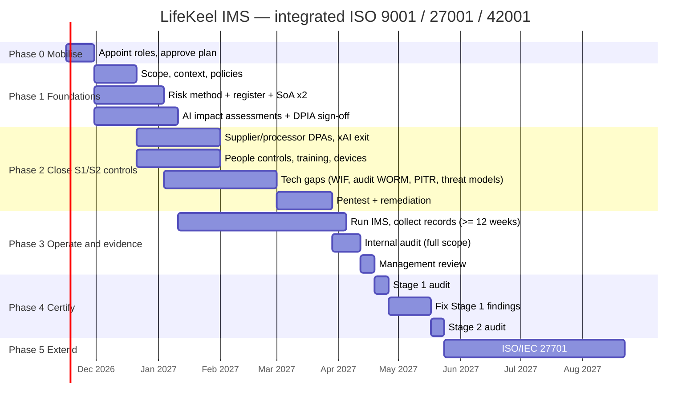

### Phase 0 — Mobilise (weeks 1–2)

1. CEO appoints the IMS manager, AI governance lead, privacy lead (or external DPO), incident
   lead and an **independent** internal auditor (contractor if needed).
2. Approve this document as the implementation plan; create a tracker with every G-ID in §15.
3. Choose a certification body accredited for all three standards (for 42001, accredited
   against ISO/IEC 42006). Ask for an **integrated audit** to reduce audit days.
4. Decide markets for the first launch wave (§18) — this sets the legal register.

### Phase 1 — Foundations (weeks 2–8)

5. Approve the scope (§6) and the context registers (§7).
6. Approve the quality, information security and AI policies (§23.1–23.3) and topic-specific
   policies: access control, cryptography, supplier, acceptable use, secure development,
   remote working, classification, backup, logging, incident, AI acceptable use.
7. Approve the risk method (§13); expand the register from 20 to every asset/AI system;
   score; assign owners.
8. Produce SoA v1.0 for ISO 27001 (§10) and ISO 42001 (§11); mark each control's
   implementation evidence.
9. Complete an AI system impact assessment for each task in `definitions/ai-tasks.yaml`.
10. Sign the DPIA; build the Record of Processing Activities from `docs/compliance/dpia.md`
    and `docs/data-retention.md`.
11. Write the document-control procedure; add owner/review-date headers to runbooks.

### Phase 2 — Close S1/S2 controls (weeks 6–16)

12. Supplier programme: register, risk-tier, collect certificates, sign DPAs, record transfer
    mechanisms; move xAI off the exception.
13. People: contracts, NDAs, screening, onboarding/offboarding checklists, annual training
    (security, privacy, AI literacy), training records.
14. Endpoints: MDM, full-disk encryption, EDR, screen-lock, patching for every staff device.
15. Technical: workload identity and key deletion; branch protection evidence; WORM audit
    export; managed PITR; scheduled restore drill; egress allow-list; threat models;
    vulnerability SLAs; task eval suites; federated artifact quarantine.
16. External penetration test of web, API, mobile shell and AI surfaces; fix and retest.
17. Run the breach and AI-incident tabletop; record it.

### Phase 3 — Operate and evidence (≥ 12 weeks, overlapping Phase 2)

18. Operate: monthly KPI review (§20), quarterly access review, supplier reviews, risk
    review on every material change.
19. Log nonconformities and corrective actions (§23.5) — including findings from CI, reviews
    and incidents.
20. Internal audit against all clauses and all applicable controls (§21).
21. Management review covering every required input (§21.3); minutes with decisions.

### Phase 4 — Certify

22. **Stage 1** (documentation and readiness): scope, policies, SoA, risk and impact
    assessments, internal audit and management review records.
23. Close Stage 1 findings.
24. **Stage 2** (operational effectiveness): auditors sample records, interview staff,
    observe controls.
25. Close any minor NCs within the agreed period (typically 90 days); majors must be closed
    and verified before certification.

### Phase 5 — Maintain and extend

26. Annual surveillance audits (years 1 and 2), recertification in year 3.
27. Add ISO/IEC 27701:2025 (privacy) — the strongest signal for a global consumer launch.
28. Consider ISO 22301 if partners demand continuity assurance.

---

## 17. Developer playbook: building auditable changes

The goal: **every change produces its own evidence**, so audits sample git and CI instead of
asking people to reconstruct history.

### 17.1 Change lifecycle with evidence points

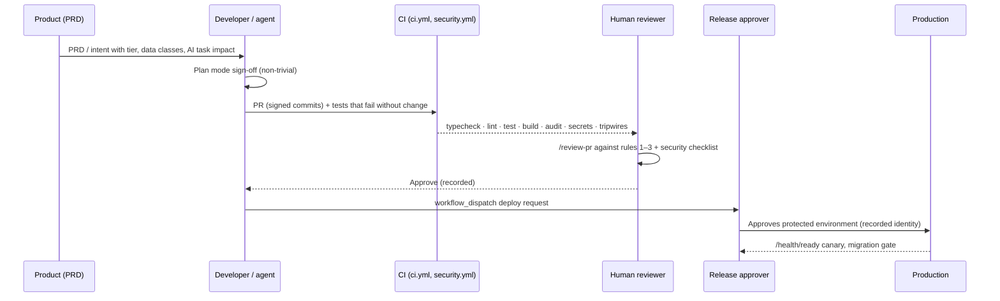

### 17.2 Definition of Done — auditable change

| # | Check | Evidence produced | Control |
|---|---|---|---|
| 1 | Linked PRD/intent with trust tier and data classes touched | PR description | A.5.8, 9001 8.3 |
| 2 | Security/privacy/AI-impact questions answered (below) | PR description | A.8.26, 42001 6.1.4 |
| 3 | Test that fails without the change | CI | A.8.29 |
| 4 | Detector change runs against `detector-evals/` | CI | A.6.2.4 |
| 5 | New AI call goes through `taskLlm/taskDecide/taskVision` with a registered task | `ai-task-gateway.test.ts` | rule 3, A.10.3 |
| 6 | New external effect added to trust-tier allow-list with `approvedBy` | `trust-tier-gate.test.ts` | rule 1 |
| 7 | User-facing copy passes advice rule | `advice-rule.test.ts` | rule 2 |
| 8 | New tenant-bearing collection classified for erasure | erasure fitness test | A.8.10 |
| 9 | New public route added to `security/public-routes.ts` snapshot | snapshot test | A.8.20 |
| 10 | New model/artifact pinned in `ai-bom.yaml` with a card | `architecture-claims.test.ts` | A.4.2, 5.21 |
| 11 | Signed commits; second reviewer for security-sensitive paths | git, PR | A.8.4, A.5.3 |
| 12 | Release approved in protected environment | GitHub deployment record | A.8.32 |

### 17.3 Questions to answer in every PR touching data or AI

1. Which data classes (§8.2) does this read, write, log or send out?
2. Does any new data leave LifeKeel? To which processor? Is it in `ai-processors.yaml`?
3. Could this expose one member's data to another, or one household's to another?
4. Does it create, change or remove an external side effect? Which tier?
5. Could any output read as a recommendation of a product, provider or switch?
6. Are children affected?
7. What is logged? Could logs contain tokens, PII or prompt text?
8. How is it deleted on account erasure and after a restore?
9. Does it change an AI task's model, processor, prompt, budget or audience? (→ re-run §14.)

### 17.4 Severity SLAs for engineering findings

| Severity | Examples | Fix SLA | Can ship with it open? |
|---|---|---|---|
| S1 | Auth bypass, cross-tenant read, injection, rule 1–3 violation, child data exposure | Stop; fix before next deploy; incident if live | No |
| S2 | Missing authz on a route within a tenant, secret in logs, unapproved processor path | 30 days, before launch in affected market | Only with CEO risk acceptance |
| S3 | Hardening, missing record, incomplete retention | 90 days | Yes, tracked |
| S4 | Hygiene | Backlog | Yes |

### 17.5 AI coding agents (A.8.30, A.5.10, 42001 A.4.4)

Much of LifeKeel's code is written with AI agents. Auditors will ask how that is controlled.

- **Instructions are controls:** `CLAUDE.md`, `.devin/AGENTS.md`, `.claude/settings.json` hooks
  and skills are versioned, reviewed policy artefacts. Changes go through PR review.
- **Agents never hold production credentials.** No production secrets in agent sessions;
  no deploy permissions.
- **Human accountability:** a named human approves every merge and deploy; the agent is never
  the approver.
- **Family data never in prompts to coding agents.** Use synthetic fixtures only (A.8.33).
- **Agent tooling is a supplier.** Record the coding-agent vendor in the supplier register
  with its data-use terms.

---

## 18. Global launch overlay (jurisdictions)

> This is an engineering and implementation checklist, **not legal advice**. Each row needs
> written confirmation from qualified local counsel before launch in that market. Dates are as
> understood on 2026-11-12.

### 18.1 Jurisdiction matrix

| Market | Privacy law | Children | AI-specific | Financial perimeter | Key engineering implications |
|---|---|---|---|---|---|
| **UK** | UK GDPR, DPA 2018, DUAA 2025, PECR | Age Appropriate Design Code | Pro-innovation, regulator-led | FCA (PSRs AIS, PERG 8, RAO art. 25) | Current baseline; IDTA/Addendum for transfers out |
| **EU/EEA** | GDPR + ePrivacy | Art. 8 consent age 13–16 by member state | **AI Act**: Art. 50 transparency, Art. 4 literacy now; high-risk Annex III from 2 Dec 2027 | PSD2/PSD3 AIS licensing; MiFID/IDD advice | EU representative (Art. 27) if no EU establishment; SCCs; consider EU data region; EAA accessibility |
| **US** | State laws (CCPA/CPRA + ADMT regs, VA, CO, CT, TX, others); FTC Act §5 | **COPPA** (amended rule); state minors' laws | State AI laws (e.g. Colorado AI Act — verify effective date and amendments) | GLBA/FTC Safeguards Rule possibly applicable; state money-transmission not applicable if no payments | "Do not sell/share" and opt-out signals (GPC); ADMT notices; COPPA verifiable parental consent if any under-13 user |
| **India** | DPDP Act 2023 + DPDP Rules 2025 (phased) | Verifiable parental consent for **under-18** | Advisory | RBI Account Aggregator framework for bank data | Consent manager integration; data-fiduciary duties; breach reporting to the Board |
| **Canada** | PIPEDA; Québec Law 25 | Québec: under-14 parental consent | AIDA lapsed — monitor | — | Privacy officer named; PIAs for transfers out of Québec |
| **Australia** | Privacy Act 1988 (as amended 2024) | Children's Online Privacy Code (in development) | Voluntary guardrails | CDR for bank data | Notifiable data breaches scheme |
| **Brazil** | LGPD | Best-interest of child | AI bill pending | Open Finance Brasil | DPO (encarregado) mandatory |
| **Singapore / Japan / UAE** | PDPA / APPI / PDPL | Varies | Model governance frameworks | Varies | Cross-border transfer conditions |
| **China** | PIPL | Under-14 sensitive | Generative AI measures | — | **Recommend exclude** — localisation and security assessment burden |

### 18.2 Per-market launch gate (all must be ✅)

```mermaid
flowchart LR
  A[Counsel opinion\nprivacy, children, AI, financial perimeter] --> B[Privacy notice + terms\nlocalised and approved]
  B --> C[Lawful basis + RoPA +\nDPIA/PIA updated]
  C --> D[Transfer mechanism\nSCCs / IDTA / DPF / local]
  D --> E[Processor region and\nterms approved in registry]
  E --> F[Children's flow\nage gating + consent per law]
  F --> G[Breach contacts\nauthority + timelines in runbook]
  G --> H[Accessibility + language\nWCAG 2.2 AA, localisation]
  H --> I[Go / no-go recorded\nin management review]
```

### 18.3 Breach-notification clocks (put in the breach runbook)

| Regime | Authority deadline | Individuals |
|---|---|---|
| UK GDPR / EU GDPR | 72 h from awareness | Without undue delay if high risk |
| India DPDP | Per Rules — verify (Board + individuals) | Required |
| US states | Varies (often 30–60 days); some require AG notice | Required per state |
| Canada PIPEDA | "As soon as feasible" to OPC if real risk of significant harm | Required |
| Australia NDB | "As soon as practicable" after assessment (≤ 30 days) | Required |
| Brazil LGPD | ANPD regulation — 3 working days | Required |
| Contracts (Stripe, Google, processors) | Per agreement | — |

---

## 19. Mandatory documented information checklist

✅ = exists and approved · ◐ = draft/partial · ❌ = missing. Location column proposes where it
lives (suggested `docs/ims/`).

| Documented information | 9001 | 27001 | 42001 | Status | Location |
|---|:-:|:-:|:-:|:-:|---|
| Scope of the management system | 4.3 | 4.3 | 4.3 | ❌ | `docs/ims/scope.md` |
| Quality policy | 5.2 | | | ❌ | `docs/ims/policies/quality.md` |
| Information security policy | | 5.2 | | ❌ | `docs/ims/policies/information-security.md` |
| AI policy | | | 5.2 | ❌ | `docs/ims/policies/ai.md` |
| Risk assessment process | | 6.1.2 | 6.1.2 | ❌ | `docs/ims/risk-methodology.md` (from §13) |
| Risk treatment process | | 6.1.3 | 6.1.3 | ❌ | same |
| Statement of Applicability | | 6.1.3 d) | 6.1.3 | ◐ | `docs/ims/soa-27001.md`, `docs/ims/soa-42001.md` (from §10–11) |
| Risk treatment plan | | 6.1.3 e) | 6.1.3 | ❌ | risk register |
| AI system impact assessment process | | | 6.1.4 | ◐ | §14 |
| Objectives | 6.2 | 6.2 | 6.2 | ❌ | `docs/ims/objectives.md` (from §20) |
| Planning of changes | 6.3 | 6.3 | 6.3 | ◐ | IMS change log |
| Evidence of competence | 7.2 | 7.2 | 7.2 | ❌ | HR records |
| Monitoring/measuring resources fitness | 7.1.5 | | | ◐ | eval datasets |
| Documented information required by the IMS | 7.5 | 7.5 | 7.5 | ◐ | — |
| Operational planning and control | 8.1 | 8.1 | 8.1 | ◐ | SDLC playbook |
| Customer requirements review | 8.2.3 | | | ◐ | PRDs |
| D&D records (inputs, controls, outputs, changes) | 8.3 | | | ✅ | PRDs, PRs, CI |
| External provider evaluation | 8.4 | | | ◐ | supplier register |
| Traceability | 8.5.2 | | | ✅ | SHA ↔ digest |
| Release authorisation | 8.6 | | | ✅ | GitHub environments |
| Nonconforming outputs | 8.7 | | | ◐ | NC log |
| Risk assessment results | | 8.2 | 8.2 | ❌ | risk register |
| Risk treatment results | | 8.3 | 8.3 | ❌ | risk register |
| AI impact assessment results | | | 8.4 | ❌ | per-task records |
| Monitoring and measurement results | 9.1 | 9.1 | 9.1 | ◐ | KPI pack |
| Internal audit programme and results | 9.2 | 9.2 | 9.2 | ❌ | `docs/ims/audits/` |
| Management review results | 9.3 | 9.3 | 9.3 | ❌ | `docs/ims/management-reviews/` |
| Nonconformities and corrective actions | 10.2 | 10.2 | 10.2 | ◐ | NC log |
| Annex A documented procedures (incident, ops, etc.) | | A.5.37 | | ✅ | `docs/runbooks/` |

**Where evidence lives:** keep policy and procedure text in git (version control satisfies 7.5
when approvals are recorded). Keep **records containing personal data** (HR, screening,
incident details) **outside** the repository in an access-controlled system.

---

## 20. Monitoring, KPIs and objectives (Clause 6.2 / 9.1)

Objectives must be measurable, monitored, communicated and updated. Proposed starting set —
targets to be validated with real traffic.

| # | Objective | Metric | Target | Source | Std |
|---|---|---|---|---|---|
| O1 | Deterministic API availability | non-5xx ratio, 28 d | ≥ 99.9% | Prometheus | Q/S |
| O2 | Interactive latency | p95 / p99 | < 500 ms / < 2 s | Prometheus | Q |
| O3 | Ask Keel answer or honest fallback within deadline | ratio | ≥ 99.5% | `llm_usage` | Q/A |
| O4 | Cross-tenant or unauthorised-member disclosure | count | **0** | incidents | S |
| O5 | Regulated-advice escapes | count of confirmed escapes | **0** | sampling + guards | A |
| O6 | Unintended duplicate external actions | count | **0** | receipts | Q/A |
| O7 | Critical/High vulns past SLA | count | 0 | security.yml, tracker | S |
| O8 | Restore drill success with recorded time | quarterly | 4/4, within RTO | drill log | S |
| O9 | Staff trained (security, privacy, AI literacy) | % | 100% annually | training records | S/A |
| O10 | Access reviews completed on time | % | 100% quarterly | review records | S |
| O11 | Processors with current review | % | 100% (lapsed = blocked) | `ai-processors.yaml` | A |
| O12 | AI tasks with current impact assessment and passing evals | % | 100% | `eval_runs` | A |
| O13 | Rights requests answered within 1 month | % | 100% | rights log | S |
| O14 | Customer satisfaction | CSAT / NPS | baseline then +x | survey | Q |
| O15 | Corrective actions closed on time | % | ≥ 90% | NC log | Q/S/A |

---

## 21. Internal audit programme and management review

### 21.1 Programme (ISO 19011)

| Audit | Scope | Frequency | Auditor | Method |
|---|---|---|---|---|
| IA-1 | Clauses 4–10 (all three standards) | Annually | Independent | Interviews, records sampling |
| IA-2 | ISO 27001 Annex A organizational + people | Annually (split over 2 audits) | Independent | Records, interviews |
| IA-3 | ISO 27001 Annex A technological | Annually | Independent with technical skill | Config review, CI evidence, sample PRs |
| IA-4 | ISO 42001 Annex A + AI impact assessments | Annually | Independent with AI skill | Registry, evals, sampling outputs |
| IA-5 | ISO 9001 Clause 8 (SDLC, suppliers, release) | Annually | Independent | Sample 10 PRs end-to-end |
| Ad hoc | After major incident or scope change | As needed | Independent | Targeted |

**Sampling guide for auditors (what to ask for)**

- 10 merged PRs → PRD link, tests, review approval, CI pass, deployment approval.
- 3 AI tasks → registry entry, processor approval, impact assessment, eval_runs, guard events.
- 2 deletion receipts → erasure completeness, replay.
- 1 restore drill log; 1 tabletop record; last access review.
- 3 suppliers → certificate, DPA, review date.
- 2 leavers/joiners → onboarding/offboarding checklist.

### 21.2 Audit cycle

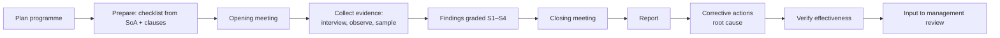

### 21.3 Management review — required inputs (Harmonized Structure 9.3 + standard-specific)

1. Status of actions from previous reviews.
2. Changes in external and internal issues (incl. climate, legal, AI processor terms).
3. Changes in interested parties' needs.
4. Performance: objectives (§20), nonconformities and corrective actions, monitoring results,
   audit results, fulfilment of security and AI objectives.
5. **9001:** customer satisfaction and feedback, process performance and conformity of
   products, performance of external providers, adequacy of resources.
6. **27001:** feedback from interested parties, risk assessment results and treatment plan
   status.
7. **42001:** AI system impact assessment results, AI incidents and concerns reported.
8. Opportunities for continual improvement.

Outputs: decisions on improvement, changes to the IMS, resource needs — **minuted and
signed**.

---

## 22. Certification audit: what to expect

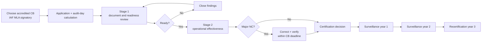

**What auditors look for at LifeKeel specifically**

- Evidence that **top management** — not only engineering — owns the system (signatures,
  management review minutes, resource decisions).
- Consistency between documents: CLAUDE.md, ARCHITECTURE.md, SECURITY.md, privacy notice and
  this document must not contradict each other. Contradictions are a common source of
  findings (R35 was one).
- That "mitigated in code" is **operating in production**: config exports, logs, dashboards.
- That gaps are **owned and risk-accepted**, not just listed.
- Independence of internal audit.
- For 42001: impact assessments, intended-use statements, supplier responsibilities, AI
  incident handling, and evidence that the AI policy constrains real decisions (the processor
  registry and trust-tier gate are excellent examples — show them).

**Audit-day note:** audit duration is set by the certification body from headcount,
complexity and number of standards (IAF MD 5 / MD 11 for integrated audits). A small team
with an integrated audit should expect materially fewer days than three separate audits —
ask for a quote on that basis.

**Evidence pack structure (suggested)**

```
docs/ims/
  scope.md
  policies/{quality,information-security,ai,access-control,cryptography,supplier,acceptable-use,secure-development,incident}.md
  risk-methodology.md
  soa-27001.md
  soa-42001.md
  ai-impact-assessments/<task_id>.md
  objectives.md
  supplier-register.md
  legal-register.md
  audits/<yyyy>-<n>.md
  management-reviews/<yyyy-mm>.md
  nc-log.md
  change-log.md
(personal-data records — HR, screening, incident detail — kept outside git)
```

---

## 23. Templates

### 23.1 Quality policy (draft for CEO approval)

> LifeKeel exists to give every household a clear, sourced and trustworthy view of its
> resilience. We commit to: meeting the requirements of the families we serve and of
> applicable law; describing what is on file accurately and never presenting estimates as
> facts; measuring friction and value rather than assuming them; acting on a family's behalf
> only with their explicit approval; and continually improving our quality management system
> against measurable objectives reviewed by management.
> Signed ____ (CEO) Date ____

### 23.2 Information security policy (draft)

> LifeKeel protects the confidentiality, integrity and availability of household information
> as the core of its product. We commit to: assessing and treating information security risks
> against approved criteria; isolating every household's data and every member's permissions
> server-side; encrypting sensitive data and keys; giving external processors only the minimum
> data under approved terms; meeting legal, regulatory and contractual requirements in every
> market we serve; reporting and learning from incidents; and continually improving the
> information security management system. Topic-specific policies support this policy and are
> mandatory for all staff, contractors and AI agents working on LifeKeel.
> Signed ____ (CEO) Date ____

### 23.3 AI policy (draft)

> LifeKeel uses AI to help families understand their records, never to replace their
> decisions. We commit that:
> 1. **No irreversible financial, legal, medical or similarly consequential action happens
>    without explicit human approval**, however confident a model is.
> 2. **LifeKeel stays informational.** Our AI describes what is on file and estimates gaps; it
>    never recommends products, providers, switching, investments or payment initiation.
> 3. **Family content is not training data** for shared or third-party foundation models.
>    Hosted AI is processing under approved terms, with task-minimised context; local and
>    on-device processing is preferred for sensitive tasks.
> 4. Every AI system has an owner, an intended-use statement, an impact assessment, evaluations
>    and monitoring before and after release.
> 5. People are told when they interact with AI, and can report concerns.
> 6. We keep these commitments in executable controls wherever possible and review this policy
>    at every management review.
> Signed ____ (CEO) Date ____

### 23.4 AI system impact assessment record

```
Task id / system:           Version:          Owner:
Intended use:               Prohibited / foreseeable misuse:
Affected people:            Children? (Y/N)   Special category? (Y/N)
Data in / out:              Processors (registry ids):        Retention class:
Autonomy / trust tier:      Human oversight point:
Risks (IDs + scores):
Fairness / accessibility notes:
Transparency to users:
Evaluations + thresholds:   eval_runs id:
Residual risk + decision:   Re-assessment trigger:
Sign-off: AI lead ___  Privacy lead ___  Date ___
```

### 23.5 Nonconformity / corrective action record

```
NC id:        Date raised:      Raised by (audit / incident / CI / review):
Clause / control:               Severity (S1–S4):
Description (fact, requirement, evidence):
Correction (immediate fix):
Root cause (5-whys / fishbone):
Corrective action (prevent recurrence):         Owner:      Due:
Effectiveness check (how, when, result):        Closed by:  Date:
Linked: G-ID / R-ID / PR / incident
```

### 23.6 Supplier register row

```
Supplier | Service | Data classes | Region | Certifications (ISO 27001 / SOC 2, expiry) |
DPA signed (date) | Transfer mechanism | Sub-processors | Breach notice SLA |
Exit plan | Risk tier | Last review | Next review | Owner
```

### 23.7 Competence matrix row

```
Person | Role(s) | Required competence (security, privacy, AI, domain) |
Evidence (training, certification, experience) | Gap | Action | Date
```

### 23.8 IMS change log

| Date | Change | Reason | Approved by |
|---|---|---|---|
| 2026-11-12 | ISO_AUDITABLE.md v0.1 drafted | Prepare integrated certification | — (pending) |

---

## 24. Glossary

| Term | Meaning |
|---|---|
| AIMS | AI management system (ISO/IEC 42001) |
| CB | Certification body |
| CASA | Cloud Application Security Assessment (Google restricted scopes) |
| DEK / KEK | Data-encryption key / key-encryption key |
| DPIA / PIA | Data protection / privacy impact assessment |
| HS | Harmonized Structure — common clause structure of ISO management system standards |
| IMS | Integrated management system |
| ISMS | Information security management system (ISO/IEC 27001) |
| NC | Nonconformity (major / minor) |
| OFI | Opportunity for improvement |
| PIMS | Privacy information management system (ISO/IEC 27701) |
| PITR | Point-in-time recovery |
| QMS | Quality management system (ISO 9001) |
| RoPA | Record of processing activities |
| RPO / RTO | Recovery point / time objective |
| SoA | Statement of Applicability |
| WIF | Workload identity federation |
| WORM | Write once, read many storage |
| ZDR | Zero data retention |

---

## 25. References

**Repository sources used (read these alongside this document)**

- [CLAUDE.md](CLAUDE.md) — the three product rules and how they are enforced
- [ARCHITECTURE.md](ARCHITECTURE.md) — §8 AI, §11 security, §12 deployment, §15 quality attributes, §16 gap register
- [SECURITY.md](SECURITY.md) — AI data-use boundary, removed surfaces
- [docs/reviews/SECURITY_AND_COMPLIANCE.md](docs/reviews/SECURITY_AND_COMPLIANCE.md) — R01–R44 findings, OWASP mapping, compliance disposition
- [docs/compliance/dpia.md](docs/compliance/dpia.md), [fca-perimeter.md](docs/compliance/fca-perimeter.md), [pci-scope.md](docs/compliance/pci-scope.md)
- [docs/privacy/childrens-data-posture.md](docs/privacy/childrens-data-posture.md)
- [docs/data-retention.md](docs/data-retention.md)
- [docs/runbooks/](docs/runbooks/) — breach response, backup/restore, key rotation, rights requests
- [docs/ai-native-sdlc-playbook.md](docs/ai-native-sdlc-playbook.md)
- [definitions/ai-processors.yaml](definitions/ai-processors.yaml), [definitions/ai-tasks.yaml](definitions/ai-tasks.yaml), [ai-bom.yaml](ai-bom.yaml)
- [.github/workflows/](.github/workflows/) and [.github/pull_request_template.md](.github/pull_request_template.md)

**External sources (standards status, verified 2026-11-12)**

- [ISO 9001:2026 — ISO catalogue](https://www.iso.org/standard/9001)
- [NSF — ISO 9001:2026 published on September 16, 2026](https://www.nsf.org/knowledge-library/iso-90012026-published-on-september-16-2026-what-quality-leaders-need-to-know)
- [DNV — ISO 9001:2026 revision and transition](https://www.dnv.us/assurance/Management-Systems/new-iso/transition/iso-9001-revision/)
- [BSI — ISO 9001:2026 key changes](https://www.bsigroup.com/en-US/products-and-services/standards-services/iso-9001-2026-key-changes-and-guidance/)
- [DNV — Revision of ISO/IEC 27701](https://www.dnv.com/assurance/Management-Systems/new-iso/transition/revision-of-iso-iec-27701/)
- [ISMS.online — ISO 27701:2025 standalone certification](https://www.isms.online/iso-27701/iso-27701-2025-standalone-certification/)
- [PECB — ISO/IEC 27701:2025: what you need to know](https://pecb.com/en/article/iso-iec-277012025-what-you-need-to-know)
- [Gibson Dunn — EU AI Act Omnibus agreement: postponed high-risk deadlines](https://www.gibsondunn.com/eu-ai-act-omnibus-agreement-postponed-high-risk-deadlines-and-other-key-changes/)
- [FPF — AI Act implementation timeline under the AI Omnibus](https://fpf.org/blog/the-ai-act-implementation-timeline-what-changes-under-the-ai-omnibus/)
- [European Commission — Navigating the AI Act](https://digital-strategy.ec.europa.eu/en/faqs/navigating-ai-act)
- [OWASP Top 10:2025](https://top10.owasp.org/2025/) · [OWASP API Security Top 10:2023](https://api-security.owasp.org/editions/2023/en/0x11-t10/)

**Standards (purchase from ISO or national bodies):** ISO 9001:2026; ISO/IEC 27001:2022 +
Amd 1:2024; ISO/IEC 27002:2022; ISO/IEC 27005:2022; ISO/IEC 27701:2025; ISO/IEC 27017; ISO/IEC
27018; ISO/IEC 42001:2023; ISO/IEC 42005:2025; ISO/IEC 42006:2025; ISO/IEC 23894:2023; ISO/IEC
5338:2023; ISO 22301:2019; ISO 31000:2018; ISO 19011:2018; IAF MD 5, IAF MD 11.
