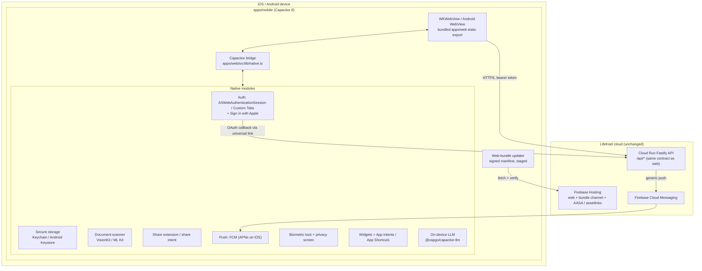
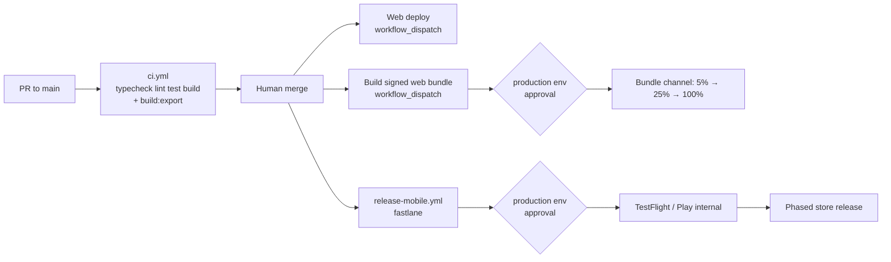

# LifeKeel iOS and Android apps: architecture and delivery plan

Status: proposal, 2026-11-21. Owner: product + engineering. Trust tier of the
work itself: 0 (no new autonomous action). Read with
[ARCHITECTURE.md](ARCHITECTURE.md) §1, §8.4a, §9, §11 and
[apps/mobile/README.md](apps/mobile/README.md).

---

## 1. Summary

LifeKeel already has a native shell: `apps/mobile` is a Capacitor 8 project
whose `server.url` loads `https://app.lifekeel.co.uk` at runtime and adds
push, camera and biometric unlock through `apps/web/src/lib/native.ts`. It has
a release pipeline (`release-mobile.yml`, fastlane) but has not shipped to
either store and push has never been tested on a device.

**Recommendation:** keep one product codebase (`apps/web`), but change the
shell from a *remote-URL wrapper* to a **bundled hybrid app**: ship the static
export (`FIREBASE_STATIC_EXPORT=1 next build`, already supported) inside the
binary, update it through a signed, human-approved web-bundle channel, and
build the handful of surfaces where the platform matters as **native
modules** (sign-in, secure storage, document scanning, share-in, widgets,
deep links, push).

Do not rewrite in React Native or Swift/Kotlin now. Revisit only if the
measured gates in §11 fail.

| | Remote-URL shell (today) | **Bundled hybrid (proposed)** | React Native / full native |
|---|---|---|---|
| Code reuse with web | 100% | ~95% | ~20-40% (API client, types) |
| App Store 4.2 "minimum functionality" risk | High: a website in a frame | Low: offline start, native scanner, widgets, share sheet | None |
| Google sign-in | Blocked in embedded WebViews | System browser + PKCE | Native SDK |
| Cold start offline | Blank or SW-cached shell | Instant, bundled | Instant |
| Ship a fix | Web deploy (instant) | Web-bundle channel (minutes) or store | Store review (or OTA for RN) |
| Team cost | Lowest | Low-medium | High: two UIs to keep in sync with 60+ routes |
| Fit with "PWA is source of truth" | Yes | Yes | No |

---

## 2. Constraints that shape every decision

The three repo rules in [CLAUDE.md](CLAUDE.md) apply unchanged on mobile. The
mobile-specific consequences:

1. **Trust tiers (rule 1).** A notification, widget, Siri/App Intent or
   share-sheet action can never approve a Tier 2+ action. Approving anything
   from the `ActionExecutor` path requires opening the app, a fresh biometric
   (or passcode) check, and the same exact-effect preview the web shows. The
   `approvedBy` requirement in `trust-tier-gate.test.ts` stays the server-side
   guarantee; the client gate is additional, not a substitute.
2. **No regulated advice (rule 2).** Store listings, push copy, widgets and
   App Intents' spoken responses use the same informational phrasing as
   `detectors/family/*.yaml`. Store screenshots are reviewed against
   `advice-rule.test.ts` wording by hand (the test does not see images).
   Category: Finance is fine; never claim "financial advice".
3. **Family content is not training data (rule 3).** No third-party analytics,
   attribution or crash SDKs that receive screen content, view hierarchies or
   free text. Only allowed: Sentry with the existing scrubbing (no breadcrumbs
   containing document text, no session replay), Firebase Cloud Messaging for
   transport only. On-device models (`@capgo/capacitor-llm`: Apple
   Intelligence / Gemini Nano) are preferred for sensitive drafting and go
   through the same `taskLlm` gateway policy as the web.
4. **Lock-screen privacy.** Push and widgets show no amounts, names, providers
   or document titles by default (already the rule in `apps/mobile/README.md`).
5. **Regions.** Accounts are per TLD (`.co.uk`, `.si`). A bundled app must pick
   its API host at runtime, not at build time.
6. **Human-gated release.** Store submissions and web-bundle promotions go
   through the protected `production` environment, same as web and API.
   Nothing auto-publishes on green CI.

---

## 3. Target architecture

### 3.1 What stays the same

- `apps/web` is the single UI codebase. Every screen the app shows is a
  Next.js route that also works in a browser.
- The API contract is the one the PWA uses. No mobile-only BFF; add endpoints
  only for genuinely native needs (§5).
- `native.ts` stays the one place that knows about Capacitor. Plugins are
  imported dynamically so the web bundle does not grow.
- `apps/mobile` stays outside the Turbo graph, with its own commands.

### 3.2 What changes

| Area | Today | Target |
|---|---|---|
| Web content | Loaded from `server.url` | Bundled `out/` export in the binary; `server.url` removed from release builds (kept for a `dev` flavour only) |
| Updates | Every launch fetches live site | Signed web bundles on a channel; app checks on resume, applies on next cold start; rollback to the bundled version on boot failure |
| Region | Redirect from `.co.uk` host by `NativeRegionGate` | Runtime config: region in native Preferences → API base URL map. No cross-origin redirect needed |
| Session | JWT in WebView `localStorage` (`lifekeel_token`) | Token in Keychain / Keystore via a secure-storage plugin; WebView memory only; purged on sign-out and on biometric-lock timeout |
| Google sign-in | OAuth in WebView (`allowNavigation` keeps it inside) | System browser (ASWebAuthenticationSession / Custom Tabs) + PKCE + universal-link callback |
| Apple sign-in | None | Required by App Review 4.8 when Google sign-in is offered on iOS |
| Camera | Single photo via `@capacitor/camera` | Multi-page edge-detected scanning, PDF assembled on device |
| Deep links | Not configured | Universal Links / App Links for `/b/*` (brief links), `/invite/*`, `/verify-email`, `/reset-password`, `/inbox` |

---

## 4. Native capability plan

Each item states why it must be native and what the web fallback is.

| # | Capability | Why native | Implementation | Web fallback |
|---|---|---|---|---|
| N1 | **Bundled app + web-bundle updater** | Offline cold start; avoids 4.2 rejection | Static export copied into `www/` at build; updater (Capgo self-hosted or a small custom plugin) verifies an Ed25519-signed manifest from Firebase Hosting; staged % rollout; auto-rollback if the app fails a boot health check twice | n/a |
| N2 | **Secure session storage** | WebView storage is evictable and readable by injected script | Keychain (`kSecAttrAccessibleAfterFirstUnlockThisDeviceOnly`) / EncryptedSharedPreferences; bridge exposes `getToken/setToken/clear` only | HttpOnly cookie (current) |
| N3 | **Sign-in** | Google blocks OAuth in embedded WebViews; Apple requires SIWA | Google: system browser + PKCE + universal link back to app. Apple: native SIWA → API verifies identity token. Email OTP stays in-WebView | Existing web OAuth |
| N4 | **Biometric lock + privacy screen** | OS-level | Existing `@aparajita/capacitor-biometric-auth`; add blur overlay on app switcher (`applicationWillResignActive` / `FLAG_SECURE` on sensitive routes) | None (optional passcode later) |
| N5 | **Push** | iOS web push needs an installed PWA and is unreliable | Existing FCM path (`fcm-sender.ts`, `subscribeNativePush`). Finish the device setup in `apps/mobile/README.md`. Notification categories: `brief_opened`, `renewal_due`, `partner_joined`, `heartbeat` | Web push |
| N6 | **Document scanner** | Edge detection, perspective correction, multi-page | iOS `VNDocumentCameraViewController`; Android ML Kit Document Scanner. Output: one PDF + page images, handed to the existing upload + on-device screening (`on-device-doc-screen.ts`) | `<input capture>` |
| N7 | **Share-in** | Families receive policy PDFs in Mail/WhatsApp | iOS Share Extension writing to an App Group container; Android `ACTION_SEND` intent filter. App opens on `/upload?shared=1` with the file pre-attached. Extension never uploads by itself | Drag-and-drop / file picker |
| N8 | **Universal Links / App Links** | Brief links (`/b/*`) and invites must open the app | `apple-app-site-association` and `assetlinks.json` served from Firebase Hosting on both TLDs | Browser opens PWA |
| N9 | **Widgets** | Glanceable "next date" without opening the app | WidgetKit / Jetpack Glance. Default content: "2 dates this month" style counts only; detail behind a per-widget opt-in. Data via a small `/family/widget-summary` read endpoint, cached in App Group | n/a |
| N10 | **App Shortcuts / quick actions** | Emergency Mode in one press | Long-press icon: "Emergency Mode", "Scan a document", "Ask Keel". App Intents for Siri later (read-only) | PWA `shortcuts` in manifest |
| N11 | **On-device LLM** | Privacy and cost | Already bundled (`@capgo/capacitor-llm`); verify on physical devices; keep readiness-gated | Hosted processor via gateway |
| N12 | **Haptics, status bar, safe areas, keyboard** | Feel | `@capacitor/haptics`, `status-bar`, `keyboard`; respect `env(safe-area-inset-*)` already used by PWA | CSS only |

Not planned: background location, contacts import, health data, payments
in-app (Stripe stays on web per store rules for a non-digital-goods service;
re-check App Store 3.1.1 before selling Plus inside the app), and any
action that moves money.

---

## 5. Backend changes

Small and additive. All land in `apps/api` with tests.

1. **Native OAuth callback.** `/auth/google/login?client=native&code_challenge=…`
   returns to `https://app.lifekeel.co.uk/auth/native-callback` (universal
   link) with a one-time code; the app exchanges code + verifier for a session
   token. No token ever appears in a URL.
2. **Sign in with Apple.** `/auth/apple/native` verifies the identity token
   against Apple's JWKS, links by verified email, handles "Hide My Email"
   relay addresses.
3. **Token lifetime.** Check the current JWT TTL. If it is long-lived, add a
   rotating refresh token for `client=native` (short access token, refresh
   bound to device id, revocable from Settings → Devices).
4. **Device registry.** Extend the existing push token record into a device
   record (`platform`, `app_version`, `bundle_version`, `last_seen`,
   `push_token`) so a user can see and revoke devices and support can see
   which web bundle a user runs.
5. **Minimum version endpoint.** `GET /app/config` → `{ minNativeVersion,
   minBundleVersion, regionHosts, features }`. Lets a broken build be fenced
   off without a store release.
6. **Widget summary.** `GET /family/widget-summary` returns counts and dates
   only, never amounts or names unless the user opted in for that device.
7. **Account deletion in-app.** Already exists on web; App Review 5.1.1(v)
   requires it reachable inside the app. Confirm the route works in the shell.

---

## 6. Web-app changes to support the shell

- `lib/env.ts`: resolve API base from native region config when
  `isNativeShell()`; keep build-time env for web.
- `lib/session-token.ts`: delegate to N2 inside the shell.
- `NativeRegionGate`: becomes a no-op once region is runtime config; delete
  after the bundled build ships.
- Static-export audit: every dynamic route already uses
  `generateStaticParams` + client param resolution; add a CI check that
  `build:export` succeeds (it is the mobile artifact now, not only hosting).
- Service worker: disabled inside the shell (the bundle is the cache);
  unchanged for the PWA.
- External links (`mailto:`, help articles, Stripe checkout) open in the
  system browser / in-app browser tab, never navigate the WebView.
- Mobile UI work in [UI_RE_DESIGN.md](UI_RE_DESIGN.md) §7 applies to the app.

---

## 7. Security and privacy controls

| Threat | Control |
|---|---|
| Token theft from WebView storage | N2 Keychain/Keystore; WebView holds token in memory only |
| Tampered web bundle | Ed25519 signature check before apply; public key pinned in binary; HTTPS only |
| Shoulder-surfing / app switcher | N4 privacy overlay; `FLAG_SECURE` on vault, briefs, finances |
| Lost device | Biometric lock with timeout; remote device revocation (§5.4) |
| Sensitive data in push / widgets | Generic copy; opt-in per device for detail |
| Malicious deep link | Allow-list of link paths; links only navigate, never act |
| Navigation hijack | `allowNavigation` limited to app + API hosts (already per R34); everything else opens externally |
| Debug builds in the wild | `dev` flavour with `server.url` is never signed for store distribution |
| Jailbroken/rooted devices | Not blocked (families use old phones); Keystore-backed keys still protect at rest |

App Store privacy label and Play Data Safety are drafted in
`docs/mobile-store-listing.md`; re-verify against what the bundled build and
any added plugins actually collect before submission.

---

## 8. Release engineering

- **Two release trains.** Native binary (monthly, or when a plugin or native
  module changes) and web bundle (as often as web deploys). The bundle records
  the minimum native version it needs; the updater refuses incompatible
  bundles.
- **Store rules on code updates.** Bundle updates may change UI and fix bugs.
  They must not change the app's primary purpose or add features that would
  need review. New native capability always goes through the store.
- **Versioning.** `native = YYYY.M.patch`, `bundle = git sha`. Both reported in
  Settings → About and on every API request header (`x-lk-app`, `x-lk-bundle`).
- **Signing.** iOS via fastlane match (existing Appfile); Android upload key
  in Play App Signing. Bundle-signing private key in Secret Manager, used only
  by the approved workflow.

---

## 9. Testing strategy

| Layer | Tool | Scope |
|---|---|---|
| Web logic | Vitest (existing) | `native.ts` with fake plugins (pattern already used for LLM adapter) |
| Web E2E | Playwright (existing) | Mobile viewports, standalone display mode, safe-area emulation |
| Native flows | Maestro | Sign-in (Google/Apple/OTP), biometric lock, scan → upload, share-in, deep link open, push tap → route |
| Devices | Physical matrix | iPhone SE (small), current iPhone, iPad; Pixel (recent), mid-range Samsung, Android 10 low-end |
| Updater | Integration test | Corrupt signature rejected; failed boot rolls back; incompatible bundle refused |
| Accessibility | axe (web) + VoiceOver/TalkBack manual pass | Every release candidate |
| Store review prep | Checklist | 4.2, 4.8, 5.1.1(v), privacy label, demo account for reviewers |

---

## 10. Delivery plan

Sizes assume one full-stack engineer plus part-time design. Each phase is its
own PR set with an intent doc from `docs/templates/intent.md`.

| Phase | Weeks | Outcome | Exit criteria |
|---|---|---|---|
| **0. Prove the current shell** | 1 | Run today's shell on real devices; finish FCM/APNs setup | Push received on a physical iPhone and Android; known issues list |
| **1. Bundled build + runtime region + secure token** | 2-3 | N1 (without OTA), N2, §6 env/region changes, `/app/config` | App starts offline; no `server.url` in release build; token not in `localStorage` |
| **2. Sign-in** | 2 | N3, §5.1-5.3 | Google and Apple sign-in work on both platforms; OTP unchanged |
| **3. Capture** | 2 | N6 scanner, N7 share-in | Multi-page PDF from scanner and from Mail/WhatsApp lands in upload review |
| **4. Links, lock, polish** | 1-2 | N4 privacy screen, N8 universal links, N10 shortcuts, N12, UI_RE_DESIGN §7 app shell | Brief link opens app; app-switcher shows overlay |
| **5. Store beta** | 2 | TestFlight + Play closed testing with 20-50 households | Crash-free sessions ≥ 99.5%; no P1 bugs open; reviewer notes drafted |
| **6. Launch** | 1 | Phased release (7-day iOS phased, Play 10% → 100%) | Store approval; rollback rehearsed |
| **7. Web-bundle channel** | 2 | Signed OTA updates with staged rollout | Rollback drill passes |
| **8. Widgets + intents** | 2-3 | N9, App Intents (read-only) | Opt-in detail; no data on lock screen by default |

Total to store launch: roughly 11-14 weeks. Phases 7-8 follow launch.

---

## 11. Decision gates (when to revisit going fully native)

Move a specific surface (not the whole app) to native SwiftUI/Compose, or
consider React Native, only if one of these holds after launch:

- Interaction latency p75 > 100 ms on mid-range Android for Home or Inbox
  scrolling after web-side optimisation.
- Crash-free sessions < 99.0% attributable to WebView.
- A required feature has no viable Capacitor path (e.g. CarPlay, rich
  Live Activities).
- App Store rejects on 4.2 after phases 1-4 are in.

---

## 12. Risks

| Risk | Likelihood | Impact | Mitigation |
|---|---|---|---|
| App Review rejects as a web wrapper | Medium (today high) | High | Phases 1-4 before first submission; reviewer notes listing native features |
| Google OAuth blocked in WebView | Certain if unchanged | High | Phase 2 before any external tester |
| Bundle update breaks app for everyone | Low | High | Signed + staged + auto-rollback + `/app/config` fence |
| Two TLDs complicate universal links | Medium | Medium | AASA on both hosts; test `.si` by hand (noted gap in README) |
| On-device LLM unverified on hardware | Medium | Low | Readiness-gated; hosted gateway fallback for non-opted-in users |
| Plus subscription purchase inside app | Medium | Medium | Do not sell in-app at launch; account management links follow current store rules for the user's region |

---

## 13. Open questions for the owner

1. Is the Apple developer account in the company's name (needed for Finance
   category and SIWA)?
2. Launch both regions together, or `.co.uk` first?
3. Self-hosted bundle channel (more control, more code) or Capgo cloud
   (faster, another processor to review under rule 3)? Recommendation:
   self-hosted on Firebase Hosting, since bundles contain no family data but
   the processor review overhead is still real.
4. Should Plus be purchasable in the app at all in year one?
