# LifeKeel implementation and onboarding guide

Repository snapshot: `a4d9d03` on `main` (through PR #202), reviewed on 23 October 2026.
This guide describes the checked-out implementation. It does not certify a live
deployment. **Railway and AWS sections are proposed runbooks; their resources,
workflows, and routing changes have not been provisioned by this document.**
The existing local setup instructions and launcher guidance are retained below.

## Reading paths and contents

| Reader | Start here | Then |
| --- | --- | --- |
| New to development | Local setup, glossary, product walkthrough | HLD, flow F01, then one small UI change |
| Frontend developer | Product/page map and frontend LLD | API/auth contract, F03–F10, validation |
| Backend developer | Repository map, API LLD, ER diagrams | Numbered flows, AI gateway, security |
| Platform/on-call | Configuration and background jobs | Railway/AWS plans, release/rollback, recovery |
| Product/QA | Capability and plan matrices | Flows, degraded behavior, first-day checklist |

1. [Local setup](#local-setup) — prerequisites, launcher, email, troubleshooting.
2. [Product and capability map](#product-and-capability-map) — implemented scope and Free versus Plus.
3. [HLD and repository map](#hld-and-repository-map) — system context, dependencies, deployment units.
4. [LLD and data model](#lld-and-data-model) — API, UI, deterministic math, ER diagrams, consistency.
5. [Numbered end-to-end flows](#numbered-end-to-end-flows) — F01–F18; every sequence numbers its messages.
6. [LLM and model integration](#llm-and-model-integration) — task routing, models, controls, failure paths.
7. [Configuration and background operation](#configuration-and-background-operation).
8. [Railway deployment plan](#railway-deployment-plan).
9. [AWS deployment plan](#aws-deployment-plan).
10. [Release, recovery, and working practices](#release-recovery-and-working-practices).
11. [Glossary and source index](#glossary-and-source-index).

**Evidence convention:** “implemented” means a code path exists, “conditional”
means configuration/permissions/provider access are also needed, and “proposed”
means work remains. PRDs and older source comments can describe past or future
behavior; executable handlers and registries take precedence. Source references
use `file:line`; line numbers are navigation hints at this snapshot.

## Local setup

The fastest path from a fresh clone to the app running at <http://localhost:3002>.
MongoDB and Redis run in Podman; the API and web app run natively with pnpm so
hot reload and debuggers work. For CI-mirror checks see
[docs/local-testing.md](docs/local-testing.md); for debugging and seeded data see
[docs/local-debugging.md](docs/local-debugging.md).

| Service | URL | Runs in |
|---|---|---|
| Web (Next.js) | http://localhost:3002 | pnpm |
| API (Fastify) | http://localhost:3001 | pnpm |
| MongoDB 7 | 127.0.0.1:27017 | Podman |
| Redis 7 | 127.0.0.1:6379 | Podman |
| Mailpit (email inbox) | http://localhost:8025 | Podman |

### 1. Prerequisites

- Node 22.12+ (`node -v`)
- pnpm 8.15.5: `corepack enable && corepack prepare pnpm@8.15.5 --activate`
- Podman 5+ with Compose support (`podman compose` uses `podman-compose` or
  `docker-compose` under the hood):

```bash
brew install podman podman-compose
podman machine init        # first time only
podman machine start
```

### 2. Environment files

Both are gitignored by the `.env*` rule in `.gitignore`. Never commit them.

```bash
cp .env.example .env
cp apps/web/.env.example apps/web/.env
```

Then edit the root `.env`:

```bash
JWT_SECRET=<openssl rand -hex 32>               # required, 32+ chars
SETTINGS_ENCRYPTION_KEY=<openssl rand -hex 32>  # 32-byte hex
MONGODB_URL=mongodb://127.0.0.1:27017
MONGODB_DB=lifekeel
REDIS_URL=redis://127.0.0.1:6379
CORS_ORIGIN=http://localhost:3002

# Email to Mailpit (see "Testing email" below)
MAILPIT_URL=http://localhost:8025
SENDGRID_API_KEY=SG.local-mailpit-placeholder
SENDGRID_FROM_EMAIL=accounts@lifekeel.test
EMAIL_VERIFICATION_ENABLED=true
```

Provider credentials (LLM, Google OAuth, Stripe test keys, VAPID) are optional
for basic local record-keeping; dependent features can be unavailable or return
a disclosed fallback until configured. LLM data-boundary policy still applies. See the comments in
`.env.example`.

### Start everything with one command

After creating both environment files, run from the repository root:

```bash
./start.sh
```

The launcher starts Podman (or uses a running Docker daemon), starts MongoDB,
Redis and Mailpit with Compose, builds the API workspace dependencies, and runs
the API on port 3001 and web on port 3002. Existing listeners on those two app
ports are stopped first. Firefox, Chrome and other browser processes are left
running; the launcher refuses to stop a browser if it owns an app port.
Infrastructure ports are managed through Compose, so an unrelated service on
27017, 6379, 8025 or 1025 must be stopped separately.

It prints the temporary log directory and waits for both apps to respond.
Ctrl+C stops the API and web started by the launcher and keeps the containers
and their data running. The manual steps below remain available.

### 3. Start the backing services

```bash
podman compose -f compose.local.yml up -d
podman compose -f compose.local.yml ps      # mongodb, redis, mailpit "Up"
```

`compose.local.yml` uses fully qualified image names (`docker.io/library/...`)
because Podman does not default to Docker Hub, and binds ports to 127.0.0.1
only. It also works with `docker compose`.

### 4. Install, build, run

```bash
pnpm install --frozen-lockfile
pnpm turbo run build --filter=@lifekeel/api...   # builds packages/* the API imports

pnpm --filter @lifekeel/api dev:watch   # terminal 1, http://localhost:3001
pnpm --filter @lifekeel/web dev         # terminal 2, http://localhost:3002
```

`pnpm debug` runs both with the Node inspector open (ports 9229/9230).

### 5. Check it works

```bash
curl -s localhost:3001/health         # inspect detector and connector counts
curl -s localhost:3001/health/ready   # mongodb + redis "connected"
```

Open <http://localhost:3002> and sign up with any address (use a `.test`
domain, e.g. `you@lifekeel.test`). For seeded demo data without signing up,
use the demo token described in
[docs/local-debugging.md](docs/local-debugging.md#see-the-app-with-data).

### Testing email

With `MAILPIT_URL` set, every email the API sends (verification, password
reset, family invites, reminders, lifecycle mail) is delivered to Mailpit
instead of SendGrid. Open <http://localhost:8025> to read it and click its
links.

- The API logs `Mailpit dev transport enabled` at boot when it is active.
  Restart the API after changing `.env`; it is read only at startup.
- `SENDGRID_API_KEY` must be set (any placeholder) or senders skip before
  sending. With `MAILPIT_URL` set, nothing reaches SendGrid.
- The API refuses to boot if `MAILPIT_URL` is set with `NODE_ENV=production`
  or points at anything other than localhost/127.0.0.1/[::1]
  (`apps/api/src/dev/mailpit.ts`).
- Quick checks: sign up (verification email), then use "Forgot password" on
  the sign-in page (reset email). `curl -s localhost:8025/api/v1/messages`
  lists the inbox; `curl -X DELETE localhost:8025/api/v1/messages` clears it.
- Without Mailpit, unset `MAILPIT_URL`, `SENDGRID_API_KEY` and
  `EMAIL_VERIFICATION_ENABLED`: accounts are then auto-verified and email is
  skipped with a log warning.

#### Email templates

Every email uses one branded layout, `apps/api/src/email/layout.ts`
(`renderEmail`): sky hero with the logo, a white body card, a brass button,
and a footer with Support, Privacy, Terms and, when relevant, Manage
notifications and Unsubscribe. Colours come from the website's light theme
(`apps/web/src/components/landing/landing.css`); fonts name the site's faces
first with system fallbacks, and nothing is loaded from a font server.

To see all of them at once, with sample data:

```bash
pnpm --filter @lifekeel/api email:preview   # sends sample templates to Mailpit
```

The logo is loaded from `${LIFEKEEL_URL}/icon-192.png`, so keep the web app
running while previewing. In `bodyHtml`, pass any user-supplied value through
`escapeHtml`; the layout escapes everything else. Links must be absolute HTTP(S)
URLs without embedded credentials.

The sender name is LifeKeel. The footer uses the owner-supplied correspondence
location, `Milton Keynes, MK4 4NW, UK`; set `EMAIL_POSTAL_ADDRESS` to override it.
Verify that this is a deliverable business address for the markets you email;
rendering an address does not establish marketing-law compliance.

### Stop and reset

```bash
podman compose -f compose.local.yml down       # stop, keep data
podman compose -f compose.local.yml down -v    # stop and wipe MongoDB data
podman exec -it lifekeel-local-mongodb-1 mongosh lifekeel   # inspect data
```

### Gotchas

- **Port already in use.** Another project's Redis/Mongo/Mailpit on
  6379/27017/8025/1025 will block startup. `lsof -nP -iTCP:6379 -sTCP:LISTEN` finds it.
- **Don't run `pnpm typecheck`/`pnpm build` while `next dev` is running.** It
  overwrites `apps/web/.next`; the page then renders unstyled. Stop the dev
  server, `rm -rf apps/web/.next`, restart.
- **"1 Issue" hydration warning in the Next.js overlay** mentioning a
  `chrome-extension://` script is caused by a browser extension editing the
  page before React loads, not by the app. An incognito window without
  extensions does not show it.
- **`/health/ready` reports `"mode": "cloud"`.** That is the storage adapter
  label (MongoDB rather than SQLite), not the deployment mode. The API still
  runs in `dev` deployment mode unless `LIFEKEEL_DEPLOYMENT_MODE` is set.
- **"cannot find module '@lifekeel/x'"** when running tests inside one
  package means a sibling's `dist/` is missing. Run from the repo root via
  turbo (see CLAUDE.md).

## Product and capability map

LifeKeel helps a household understand the financial and estate information it
has recorded, notice gaps, rehearse changes, and prepare approved next steps.
The “Family Twin” is the combination of roster, financial profile, policies,
documents, assets, legacy records, and derived views. “Keel HQ” describes the
household orchestration experience; member “agents” assemble scoped views and
nudges. These names do not imply an unrestricted autonomous agent fleet.

A useful first journey is: sign up → create family → add members → enter
finances → inspect readiness/insights → upload a policy → review extracted
fields → apply confirmed facts → ask a question → rehearse an income change.
Estate records, continuity contacts, and notification preferences deepen that
foundation. A scenario is hypothetical; reporting a life event is a real record.

### Pages, behavior, and implementation ownership

Page paths below exist under `apps/web/src/app`; some pages compose several
features. Route visibility in the browser is not the authorization boundary.

| Area / pages | What a user can do | Backend ownership / important limit |
| --- | --- | --- |
| `/`, `/readiness`, `/guides`, `/blog`, `/trust`, `/ai-processing` | Learn the proposition, public readiness journey, read guidance and processing disclosures | `routes/leads.ts`, `blog.ts`, `trust.ts`, `ai-disclosure.ts`; public claims must match code and evidence |
| `/signup`, `/login`, `/verify-email`, `/reset-password`, `/auth/callback` | Account registration, verification, recovery, social sign-in, MFA where enabled | `routes/auth-users.ts`, `auth-social.ts`, `auth/totp.ts`; provider credentials required for social login |
| `/welcome`, `/family-setup`, `/family`, `/invite/[code]` | Create household, maintain roster, invite or request membership | `routes/family-group.ts`, `family-join.ts`; a roster member is not automatically a login |
| `/financial-profile`, `/finances` | Enter household/member earnings, savings, pensions, education funds and policies | `routes/family-financial-profile.ts`; money in integer minor units; household edits require authorized editor |
| `/health`, `/health/[domain]` | Read deterministic readiness and component explanations | `routes/family-readiness.ts`, `readiness/score.ts`; “health” here is readiness, not medical records |
| `/member/[id]`, `/map` | Read member twins, attributed insights, nudges, family relationships | `routes/member-twin.ts`, `member-nudges.ts`; youth view is redacted and role-aware |
| `/inbox`, `/insights`, `/insights/[id]` | Review evidence, snooze/dismiss, preview actions, approve, inspect held items | `routes/family-inbox.ts`, `insights.ts`, `delivery/`; approval is distinct from execution success |
| `/verify-otp` | Enter the emailed one-time code after signup or password login | `routes/auth-otp.ts`, `auth/otp.ts`, `apps/web/src/app/verify-otp` |
| `/operator/mission` | Ranked operator decision queue, shadow-mode review | `routes/operator.ts`, `operator/mission-control.ts` |
| `/upload`, `/documents`, `/documents/[id]` | Upload/capture documents, inspect processing, confirm/edit/reject extraction candidates, apply to profile | `routes/documents.ts`, `ocr/`, `extraction/`; Free storage differs from Plus extraction |
| `/assistant` | Ask about household/member records and simulate changes | `routes/assistant.ts`, `assistant/verified-answer.ts`, `scenarios/`; deterministic answers precede generation |
| `/events`, `/events/[eventId]`, `/life-events`, `/life-events/[eventId]` | Work through event-related information, playbooks, checklists and reminders | `routes/life-events.ts`, `life-events/`, `playbooks/`; no autonomous legal/medical/insurance action |
| `/cashflow` | Record recurring income/expenses and see monthly run-rate/runway | `routes/family-cashflow.ts`; one-off entries do not enter recurring burn |
| `/assets`, `/asset/[id]` | Maintain declared assets and ownership/context links | `routes/family-assets.ts`; user-declared records are not verified legal title |
| `/vault`, `/legacy` | Store protected estate files and map documents, contacts, roles and knowledge | `routes/vault.ts`, `family-legacy.ts`; vault adult-only; legacy visibility can narrow further |
| `/connect`, `/connect/email`, `/connect/open-banking` | Connect mailboxes or account-information sources and inspect status | `routes/family-connectors.ts`, `email/`, `open-banking/`; production banking consent is partner-dependent |
| `/settings`, `/settings/automation`, `/upgrade` | Preferences, continuity, AI/billing settings, bounded automation, Plus checkout/portal | `routes/family-continuity.ts`, `automation-settings.ts`, `billing.ts` |
| `/receipts`, `/audit-log`, `/support`, `/account-deleted` | Inspect outcomes/history, request support, export/delete account | `routes/family-receipts.ts`, `audit-log.ts`, `support.ts`, `account.ts` |
| `/operator/*`, `/marketing` | Operate tenants/users, AI quality/cost, support, campaigns, social content, promotions, queues and configuration | `routes/operator.ts`, `operator/`, `marketing/`; separate platform roles, recent-auth and selected dual-control gates |
| `/privacy`, `/terms`, `/security`, `/cookies`, `/legal/*` | Public policy and security information | Keep copy consistent with processing, retention, and deployed controls |

### Free versus Keel Plus: product promises and actual gates

The public product has **Free** and **Keel Plus (£7.99/month in current UI)**.
The stored paid plan is `starter`. `growth` and `enterprise` remain in internal
billing types but checkout explicitly rejects them. Product copy is not proof
that an account-specific live Stripe price is configured correctly.

Sources: `apps/web/src/components/landing/Pricing.tsx:15`,
`apps/api/src/entitlements.ts:43`,
`apps/api/src/routes/billing.ts:155`,
`apps/api/src/billing/billing-constants.ts:51`.

| Capability | Free after trial | Keel Plus (`starter`) | Practical meaning |
| --- | --- | --- | --- |
| Manual profile, policy entry, deterministic detector/readiness features | Core path available | Same core path | Entering facts manually remains useful without AI extraction |
| Family/member, scenarios, cashflow, assets, legacy, vault and continuity surfaces | No blanket Plus gate in these domain routes | Same domain features | Role/age/access checks still apply; generic inherited quota tables are not a guarantee of household limits |
| Upload/store financial documents | Available within upload budget | Available within upload budget | Free stores a file; it does not automatically read its fields |
| AI document field extraction | `document_ai_extraction=false` | `document_ai_extraction=true` | Plus proposes provider, policy identifiers, amounts and dates; scan/model availability and review still required |
| Connect mailbox | Available, subject to configuration | Available | Saving a connection is free; it does not activate the AI inbox scan |
| Scan/classify connected financial mail | Scan is a no-op after trial; cursor is preserved | Scan/classification enabled with working dependencies | Current worker gates the whole scan on `email_ai_summary`, not only the final summary |
| AI email summary | `email_ai_summary=false` | `email_ai_summary=true` | Paid adds generated plain-language inbox summaries; it does not grant model-policy exceptions |
| Ask Keel and deterministic verified answers | No Plus pre-handler on `/assistant/ask` | Same route | Rate/budget/model/data-boundary controls govern availability; do not describe it as paid-only |
| Notifications / external communication | Preference, permission and provider controlled | Same controls | A subscription is not approval to send arbitrary messages |
| AI processor/data privacy boundaries | Enforced by task and environment | Same boundaries | Buying Plus never authorizes sensitive data to an unapproved processor |

**Implementation caveat:** `scanTenantInbox()` returns zero scan/item/document
counts before fetching messages for a tenant without `email_ai_summary`. It
leaves the cursor unchanged so a later upgrade can backfill mail. Describing
Free as having a working classified-email inbox would overstate the current
implementation. Source: `apps/api/src/jobs/email-scan.ts:179`.

**Trial:** signup billing grants a 30-day trial and 10 trial credits.
`effectivePlan()` gives an unexpired Free trial `starter` boolean feature gates
unless `trial_expired` is set. It does **not** raise quotas or credit balances.
An expired trial falls back to the stored plan. Therefore a Free tenant can have
Plus extraction during trial without being a paid subscriber.

**Internal quota defaults, not a published household pricing contract:**

| Backend quota | Free | `starter` |
| --- | ---: | ---: |
| Events/month | 10,000 | 100,000 |
| Workflow runs/month | 3 | 20 |
| Detectors max | 10 | 50 |
| Connectors max | 1 | 5 |
| Users max | 1 | 5 |
| LLM tokens/month | 100,000 | 1,000,000 |
| Plan cycle credits (`PLAN_CREDITS`) | 10 | 50 |

`checkQuota()` only enforces a resource where a caller invokes it; it is not a
universal database trigger. Do not infer, for example, that Free supports only
one roster record from `users_max=1`. Verify the relevant handler. Free's
post-trial monthly refill is separately **5 credits**, not the 10-credit plan
constant. Upgrade/renewal code preserves a larger existing balance using a floor
rather than blindly wiping it to the plan allowance.

Credit packs, outcome pricing defaults, and multi-tier commercial structures
are inherited scaffolding. Pack routes and outcome-credit code still exist;
treat them as technical surfaces requiring review, not advertised Plus benefits
or authority to introduce extra billing. `BILLING_V2_ENABLED` gates ledger,
reconciliation and related v2 behavior. See F15 before changing billing.

### Deliberate boundaries and conditional capabilities

- Implemented: deterministic checks, reviewed extraction, saved scenarios,
  playbooks, nudges, protected vault, continuity notifications, receipts,
  export/erasure, operator tooling and commercial plumbing.
- Conditional: hosted/local inference, mail scanning, push/SMS/WhatsApp, social
  publishing, native camera/biometrics and real account-information reads need
  credentials, infrastructure, permissions, and sometimes partner approval.
- Not a shipped promise: automatic bank transaction categorization across all
  providers, unrestricted agent tools, production-ready native store distribution,
  self-executing insurance claims, purchases or legal filings.
- Out of scope by design: money movement, personalized regulated product
  recommendations/switching, autonomous emergency vault release, and training
  shared foundation models on personal family content.

## HLD and repository map

### System context

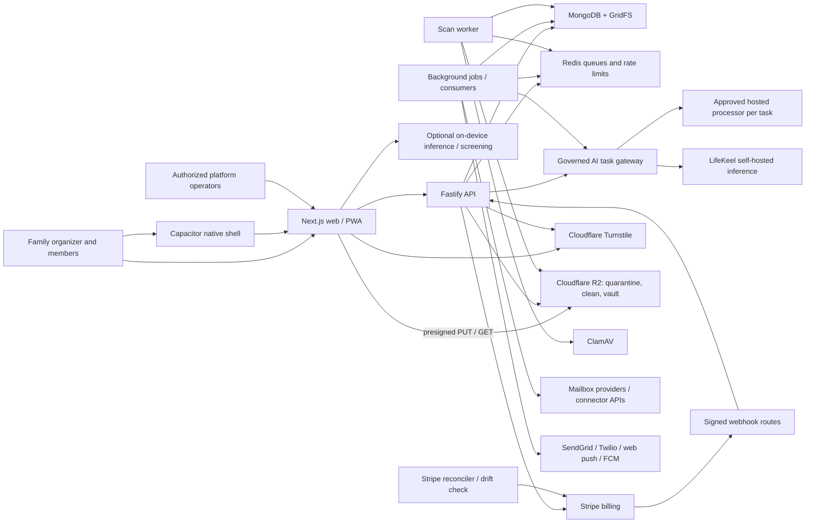

The Cloudflare, Turnstile, email OTP and R2 pieces are flag-gated (see
[CLOUDFLARE_INTEGRATION.md](CLOUDFLARE_INTEGRATION.md) and
`docs/runbooks/cloudflare-integration.md`): with the dev defaults the system
behaves as before (GridFS storage, no Turnstile, no OTP). Cloudflare is a
storage and edge-protection sub-processor only; no Cloudflare AI or content
inspection feature is enabled on the buckets.

API and jobs use the same image and shared modules. The scan worker is a third
deployment of that image (`node dist/scan-worker.js`), not a `SERVICE_ROLE`.
With the default
`SERVICE_ROLE=all`, both run inside the API process. With `api`, background work
is disabled. With `jobs`, background work runs **and HTTP routes still exist**;
keep that service private. `SERVICE_ROLE` is not a complete HTTP access-control
mechanism. See `apps/api/src/server.ts:298`.

### Layers and dependency direction

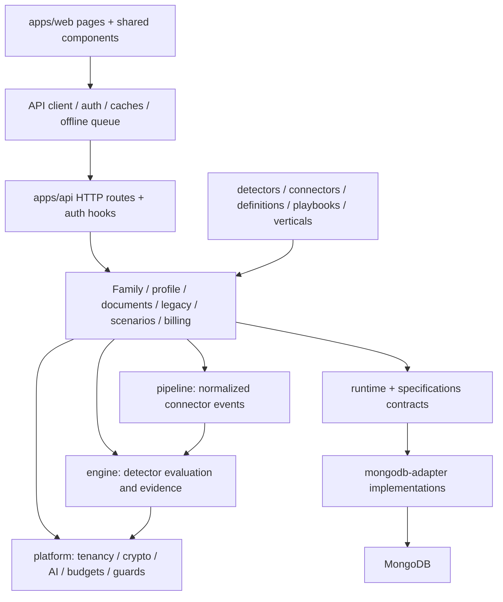

This is a modular monolith, not a requirement to create microservices. Current
API handlers sometimes coordinate several collections directly. The contracts
in `runtime` and `specifications` express extension seams; their presence does
not mean every route already uses repository interfaces.

| Directory/package | Responsibility | Change here when… |
| --- | --- | --- |
| `apps/web` | Next.js 15, React 18, TypeScript, Tailwind, Zustand, Framer Motion, PWA | Pages, forms, shared UX, API adapters or browser integrations change |
| `apps/api` | Fastify 5 on Node 22; routes, boot, jobs, application orchestration | Auth, domain mutations, extraction, delivery or billing changes |
| `apps/mobile` | Capacitor shell loading web product; native bridges | Camera, push, biometric or native model behavior changes; root scripts do not cover native release |
| `packages/engine` | YAML rules, scoring cascade, evidence, insight evaluation, model/calibration helpers | A rule, confidence path, detector eval or scorer changes |
| `packages/platform` | Auth, tenant collection wrapper, encryption helpers, LLM router, task policies, guards, budgets, telemetry | Shared cross-cutting policy changes |
| `packages/pipeline` | Connector loading, polling/webhook ingestion, normalized events and refresh scheduling | Provider data becomes an engine signal |
| `packages/workflows` | OAuth/credential plumbing, connector action executor, schema registry | Connector credentials or approved connector execution changes; name is not proof of the old workflow engine |
| `packages/runtime` | Ports for repositories, execution, policy, capabilities, telemetry and memory | A runtime contract needs to change |
| `packages/specifications` | Shared domain specifications/contracts | Shared runtime/domain types change |
| `packages/mongodb-adapter` | Mongo-backed implementations for shared contracts | A repository adapter changes |
| `detectors/family`, `detector-evals` | Executable rules and evaluation fixtures | A new family signal/check ships |
| `connectors`, `definitions`, `playbooks`, `verticals`, `category-table.yaml` | Load-bearing YAML/configuration resources | Runtime behavior or task/processor policy changes |
| `infra/local-judge`, `infra/encoder-service` | Optional self-hosted inference/classification services | Model serving changes |
| `docs/prd`, `docs/intents`, `docs/reviews`, `docs/runbooks` | Requirements, design evidence, reviews, operations | Understand intent and debt; verify implementation separately |

### Boot and request lifecycle

`apps/api/src/server.ts` composes environment, deployment mode, Mongo access,
engine/resources, AI gateway, delivery, background work, Fastify plugins and
routes. Mongo migrations run before listening; failed migrations stop production
boot. Production also refuses an image with zero loaded detectors/connectors.

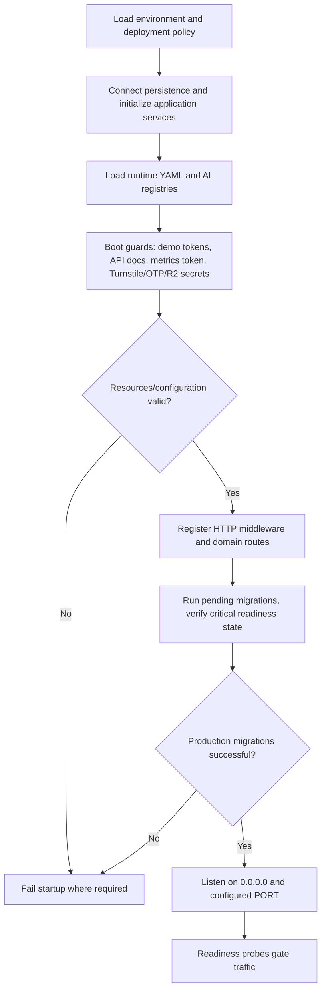

Outside `dev`, `security/boot-guards.ts` refuses to start with demo tokens, API
docs enabled without a recorded exception, `/metrics` without a scrape token, or
Turnstile, OTP or R2 enabled without their secrets. `security/public-routes.ts`
inventories every session-less route prefix with its protection group, and a
snapshot test pins it, so adding a public route forces a review.

This is a logical dependency view, not a claim that all initialization is
transactional or that timers only start after the final listen. Keep jobs stopped
or in a controlled environment during migration rehearsal.

## LLD and data model

### Frontend LLD

The App Router maps URLs to `page.tsx`; shared components and `src/lib` own
cross-page behavior. `apps/web/src/lib/api.ts:1` adapts API shapes, including
engine confidence fields and resolved insight states. `auth-context.tsx` owns
session/user integration; `store.ts` contains client state. Mongo records are the
authority; browser caches and offline queues are convenience state.

`apps/web/src/lib/env.ts:9` resolves the base in this order:
`NEXT_PUBLIC_API_BASE_PATH` → same-origin `/api` flag → `NEXT_PUBLIC_API_URL` →
localhost fallback. Missing production config logs an error but still falls
back, so deployment must verify the compiled value. `NEXT_PUBLIC_*` values are
public build inputs; never put secrets in them.

`apps/web/src/lib/session-token.ts:1` prefers the HttpOnly session cookie. After
sign-in, it probes `/auth/me` without bearer auth and removes the persisted
bearer when cookies work. Cross-site-cookie-blocked browsers and native clients
can retain a bearer fallback. Do not claim JavaScript-readable tokens are
universally absent. Same-origin routing is the preferred deployment shape.

Some API reads intentionally return empty/null on failure. A blank UI alone is
not evidence that a family has no data: inspect HTTP status, server logs, cache
and the caller's failure callback. Logout/account deletion must clear relevant
local state, caches, queued mutations and credentials; verify all stores when
adding a new one.

Normal `build` supports a Next server; `build:export` sets
`FIREBASE_STATIC_EXPORT=1` and produces static output. Dynamic URLs need hosting
rules mirroring `apps/web/firebase.json`; uploading `out/` to another host alone
does not implement those routes or an API proxy.

### API, authorization and contract LLD

Fastify adds CORS, cookie parsing, Helmet, compression, rate limiting, multipart
limits, validation and auth hooks. JSON parsing retains a raw buffer for signed
webhook verification. Requests receive `X-Request-Id`; URL logging redacts token
segments and query strings. Proxy-hop trust is configurable rather than trusting
arbitrary forwarded IPs. Sources: `apps/api/src/server.ts:1448`, `:1609`.

1. Public routes bypass session authentication only where explicitly allowed.
2. Protected requests resolve JWT/session, tenant and current account status;
   revoked/deleted/removed users cannot gain access merely by presenting a JWT.
3. Cookie-authenticated mutations check an Origin allowlist. Cloud cookies use
   HttpOnly, Secure, `SameSite=None`; dev uses Lax without Secure.
4. Domain handlers apply organizer/adult/editor/member checks. Tenant isolation
   alone does not establish member-level permission.
5. `getTenantCollection()` injects `tenant_id` and rejects conflicting scope.
   Raw collections remain for global jobs and pre-auth token lookups: each needs
   an explicit authorization/filter rationale.
6. Validate request data at runtime (Zod or handler checks), then mutate and
   emit the relevant derived/audit/feed updates.

Sources: `apps/api/src/auth/session-cookie.ts:20`,
`packages/platform/src/tenant-scoped-collection.ts:1`,
`apps/api/src/family/family-permissions.ts:1`.

| HTTP result | Interpretation / caller action |
| --- | --- |
| 400 | Invalid shape, unsupported plan/operation or failed validation; correct input |
| 401 | Session missing/invalid; sign in again |
| 403 | Permission, feature gate, recent-auth or policy denial; inspect structured reason |
| 404 | Resource unavailable in caller scope; do not leak another tenant's existence |
| 409 | Conflicting state, duplicate creation or operation in progress, depending on route |
| 429 | Rate limit or quota; distinguish by response body |
| 501/503 | Unconfigured capability / temporarily unavailable dependency, route-dependent |
| 500 | Unexpected server failure; correlate request ID and logs |

These are conventions across handlers, not a uniform error envelope. During
local development inspect OpenAPI at `/documentation` when enabled; do not assume
every manually validated route has a complete generated schema. Inspect
`apps/api/src/api-versioning.ts:1` before changing versioned URL compatibility.

### Domain computation LLD

**Profile and signals.** `FinancialProfileSchema` validates household/member
income and protection, emergency savings, retirement assumptions, education
funds and policies. Persisting a profile creates normalized family signals,
evaluates the nine family detector families, persists/deduplicates insights,
and retracts old conditions that no longer reproduce. Time-based reevaluation
handles stale inputs and upcoming dates. See
`apps/api/src/routes/family-financial-profile.ts:65` and
`apps/api/src/insights-persist.ts:1`.

**Nine detector families:** protection gap, emergency fund adequacy, retirement
gap, education shortfall, estate readiness, education pacing, emergency
trajectory, debt health, and policy review. Each YAML may contain several rules;
“nine” counts family detector definitions, not all rules or all runtime detectors.

**Readiness** is deterministic, not an LLM confidence score. Household weights
are protection 30, emergency fund 25, retirement 20, education 15, estate 10.
The composite is `round(sum(score × weight) / sum(scored weights))`. Components
that are not scorable return null and are excluded; no scorable components means
a null composite. A high score over two components is not evidence of full
assessment. Show component detail, applicability, missing inputs and freshness.
Emergency savings uses a six-month target; other components apply their own
conditions. Member weights and applicable components differ from household
weights. Source: `apps/api/src/readiness/score.ts:56`, `:384`, `:404`.

**Scenarios** use integer-minor-unit profile data and explicit changes. They can
apply a delayed change or up to 12 ordered regime steps, and can scope to a
member while retaining joint expenses/savings. Saved records store inputs and
recompute against the live profile on read. Missing projectable data gives
`result:null`; an unknown member is invalid, not a household fallback. Generated
narration explains supplied results; it does not calculate them. Sources:
`apps/api/src/scenarios/calculate.ts:1`, `project.ts:10`,
`apps/api/src/routes/family-scenarios.ts:34`.

**Cashflow** normalizes weekly to `round(amount × 52 / 12)`, yearly to
`round(amount / 12)`, monthly unchanged, once to zero recurring run-rate. Runway
uses savings divided by net monthly burn; a surplus returns null runway rather
than infinity. It is a declared ledger, not a general live transaction feed.
Source: `apps/api/src/routes/family-cashflow.ts:49`.

**Member twins** combine the roster, linked income/protection/pension slice,
policies, education funds, attributed insights and readiness on read. Nudges are
persisted separately so dismissals survive refresh and the daily loop reconciles
resolved conditions. Roster identity (`member.id`) and account identity
(`member.user_id`) can differ; use the permission helpers, not direct equality
assumptions. Youth output is a restricted view, not household financial access.

### ER diagram A: household authority and read models

MongoDB stores documents, embedded arrays and references, not SQL foreign keys.
The following is a **logical** ER view. `MEMBERS`, `POLICIES` and `EARNERS` are
embedded structures; `MEMBER_TWIN` is computed, not a collection. Cardinalities
show intended application relationships; migrations/handlers enforce the actual
constraints.

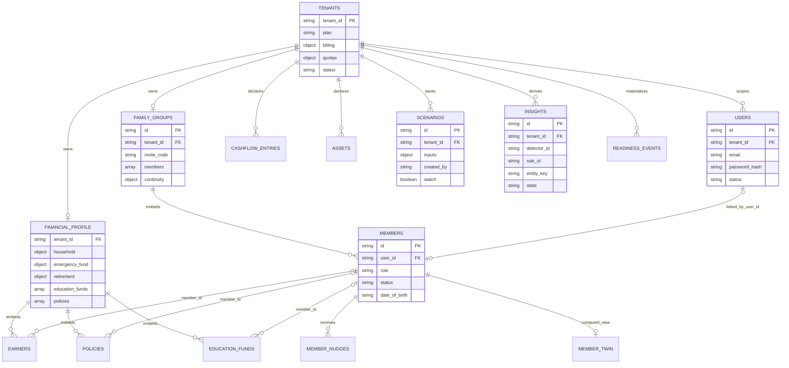

### ER diagram B: documents, estate, actions and platform state

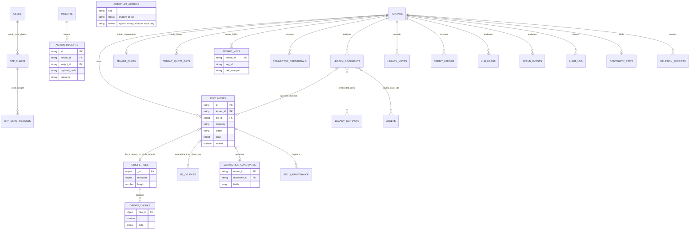

`FIELD_PROVENANCE` and other uppercase labels summarize logical records; use the
source inventory below for physical collection names and exact field schemas.
GridFS files/chunks are shared storage for regular documents and vault blobs;
category and authorization determine access, not a separate vault database.
An optional reference may be absent; do not treat diagrams as schema validators.

| Physical state | Authority / lifecycle | Source |
| --- | --- | --- |
| `tenants`, `users`, `family_groups` | Account/plan/status, login identity, embedded roster and continuity config | `apps/api/src/db.ts:156`, `routes/auth-users.ts:181`, `routes/family-group.ts:58` |
| `family_join_requests`, `family_member_invites` | Pre-membership requests and expiring single-use invite tokens | `apps/api/src/routes/family-join.ts:1` |
| `family_financial_profile` | Confirmed/declared profile with embedded policies/member slices | `apps/api/src/routes/family-financial-profile.ts:65` |
| `family_cashflow_entries`, `family_assets`, `family_scenarios` | Declared ledger, assets, saved hypothetical inputs | `apps/api/src/routes/family-cashflow.ts:26`, `family-assets.ts:77`, `family-scenarios.ts:68` |
| `documents`, `documents.files`, `documents.chunks` | Metadata and binary file storage; general files differ from encrypted vault files | `apps/api/src/routes/documents.ts:158`, `vault.ts:83` |
| `extraction_candidates`, `profile_provenance` | Proposed fields, grounding, review decisions and source links | `apps/api/src/extraction/pipeline.ts:1`, `provenance.ts:1` |
| `legacy_documents`, `legacy_contacts`, `legacy_notes` | Estate declarations, named roles and knowledge, with visibility controls | `apps/api/src/routes/family-legacy.ts:225` |
| `events`, `insights`, `readiness_events`, `member_nudges` | Signal history, insight lifecycle, activity feed and persisted nudges | `apps/api/src/signals.ts:1`, `insights-persist.ts:1`, `feed/emit.ts:74`, `member-nudges.ts:1` |
| `connector_credentials`, `external_accounts` | Encrypted provider grants/cursors and account-information read models | `apps/api/src/jobs/email-scan.ts:55`, `open-banking/sync.ts:1` |
| `tenant_keys`, `revoked_sessions`, `login_events` | Envelope keys, revoked JWT hashes and bounded security telemetry | `apps/api/src/crypto/envelope.ts:1`, `auth/session-revocation.ts:1`, `db.ts:57` |
| `action_receipts`, `audit_log`, `credit_ledger`, `llm_usage`, `spend_events` | Action outcomes, audit, credits and attributed processing/service costs | `apps/api/src/actions/action-executor.ts:1`, `billing/credit-ledger.ts:1`, `spend-ledger.ts:1` |
| `family_continuity_state`, `cron_locks`, `job_runs` | Idempotent continuity phase and background-job coordination/evidence | `apps/api/src/db.ts:213`, `jobs/cron-lock.ts:1`, `jobs/job-runs.ts:1` |
| Migration ledger, deletion receipts and tenant tombstones | Schema progress and erasure/recovery evidence | `apps/api/src/migrate.ts:1`, `deletion/receipt.ts:1`, `erasure.ts:1` |

### Data correctness and consistency rules

- Money fields ending `_minor` use integer minor units. Convert only at UI or
  provider boundaries; do not multiply an already-minor value by 100.
- Unknown/not applicable is distinct from zero. Account balances, readiness
  components and projections can be null for a reason.
- Evidence categories matter: user-declared, document-linked, family understanding
  and unverified are not equivalent to legal verification.
- Profile changes are authoritative; insights/feed/readiness/nudges are derived.
  Some derived updates and audit calls are best effort, so one successful write
  is not proof every projection or notification succeeded.
- Candidate review validates decisions before application; this is not proof of
  an atomic Mongo transaction spanning files, profile, provenance and feed.
- Action receipts and webhook claims provide deduplication. They do not make
  remote systems exactly-once or eliminate a lost-response ambiguity.
- Critical indexes and migrations are readiness concerns. Additional best-effort
  index helpers exist; do not assume every intended index is fail-fast.
- General financial uploads are not all application-layer encrypted like vault
  bytes. Platform disk encryption and vault envelope encryption are different
  controls. Avoid describing the entire database as end-to-end encrypted.

## Numbered end-to-end flows

F01–F18 are stable flow identifiers. Sequence messages use Mermaid `autonumber`;
read each arrow in order. They show application-level calls and significant
branches, not every helper invocation or a distributed transaction. Deployment
promotion is separately numbered in the release section.

| Flow | Trigger / outcome | Main implementation |
| --- | --- | --- |
| F01 | Signup/login → authenticated account/session | `apps/api/src/routes/auth-users.ts:1` |
| F02 | Reset/verify/MFA/social authentication | `apps/api/src/routes/auth-users.ts:1`, `auth-social.ts:1` |
| F02b | Email one-time code after signup/password login | `apps/api/src/routes/auth-otp.ts:1`, `auth/otp.ts:1` |
| F03 | Create family / invite / approve membership | `apps/api/src/routes/family-join.ts:1` |
| F04 | Save profile → signals → evaluated insights/readiness | `apps/api/src/routes/family-financial-profile.ts:1` |
| F05 | Upload → scan → proposed extraction | `apps/api/src/routes/documents.ts:405` |
| F05b | R2 presigned upload → scan worker → clean bucket (flag-gated) | `apps/api/src/routes/documents-uploads.ts:1`, `documents/scan-job.ts:1`, `scan-worker.ts:1` |
| F06 | Review candidates → apply confirmed profile facts | `apps/api/src/extraction/pipeline.ts:142` |
| F07 | Connect mailbox → classify → inbox/attachments | `apps/api/src/jobs/email-scan.ts:1` |
| F08 | Account-info grant → sync → read model | `apps/api/src/open-banking/providers.ts:1` |
| F09 | Ask Keel → deterministic or governed generated answer | `apps/api/src/routes/assistant.ts:545` |
| F10 | Scenario preview/save/read/watch | `apps/api/src/routes/family-scenarios.ts:1` |
| F11 | Life event → playbook/checklist/reminders | `apps/api/src/routes/life-events.ts:89` |
| F12 | Vault/legacy → authorized encrypted file/estate map | `apps/api/src/routes/vault.ts:83`, `family-legacy.ts:225` |
| F13 | Insight delivery → explicit approval → action receipts | `apps/api/src/routes/insights.ts:1075` |
| F14 | Member nudges, heartbeat, continuity and freshness jobs | `apps/api/src/jobs/member-agent-loop.ts:1`, `continuity-check.ts:1` |
| F15 | Plus checkout → verified webhook → plan state | `apps/api/src/routes/billing.ts:155` |
| F16 | Export/delete → erasure receipt → restore reconciliation | `apps/api/src/routes/account.ts:151`, `erasure.ts:213` |
| F17 | Operator/campaign/social change → authorized effect | `apps/api/src/operator/operator-auth.ts:1`, `marketing/social-publisher.ts:1` |
| F18 | Cashflow/asset record → computed view / estate references | `apps/api/src/routes/family-cashflow.ts:59`, `family-assets.ts:70` |

### F01 — registration, login and session lifecycle

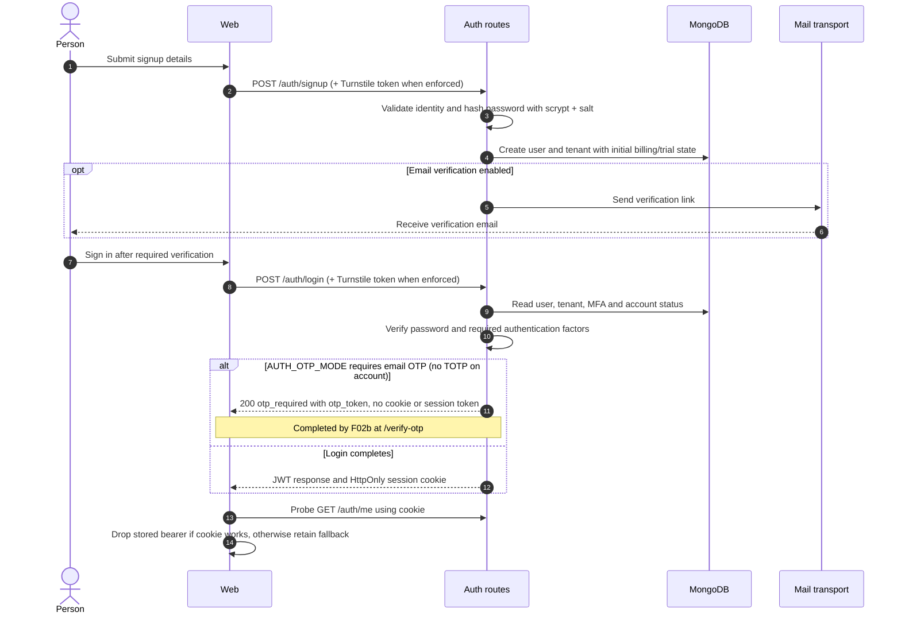

Turnstile runs after the rate limiter on every human-initiated public mutation
(`TURNSTILE_MODE` `off`, `monitor`, `enforce`). A caller that already holds a live
session (dual-mode resend) skips it. Mutations authenticated only by the session
cookie are refused unless they carry a trusted `Origin`; this also applies to
dual-mode public routes (`auth/session-cookie.ts`).

A family is created separately; signup alone is not a completed household.
Logins and protected requests must respect revocation and account status.
Logout clears the cookie/client session and uses the session-revocation path;
check `auth/session-revocation.ts` when changing token lifetime or logout.

### F02 — verification, recovery, MFA and social sign-in

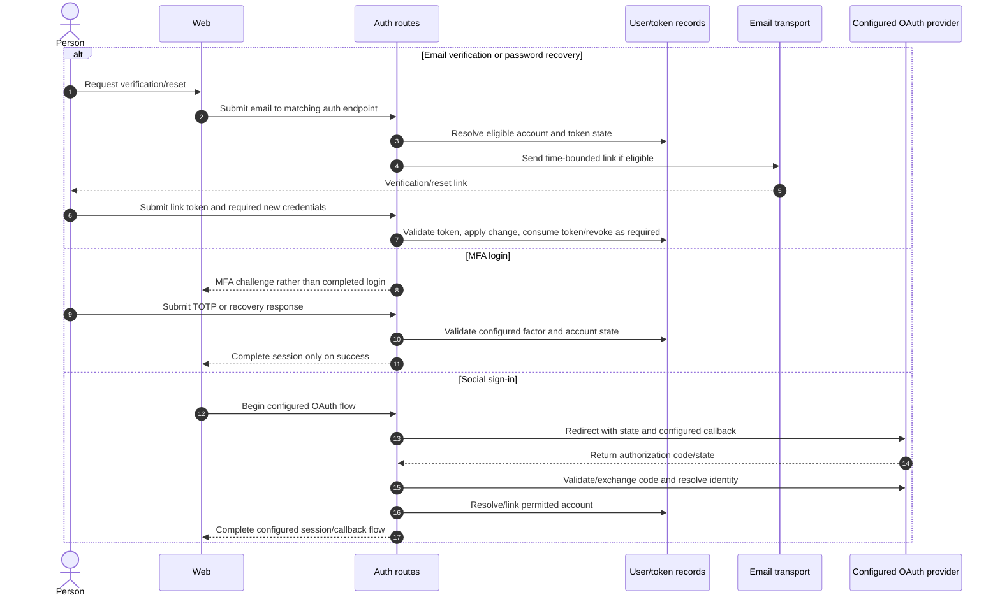

OAuth callbacks and allowed origins must be updated per environment. Do not log
codes, reset/invite tokens, or full callback query strings. Local Mailpit lets a
new developer exercise link flows without sending real email.

### F02b — email one-time code (OTP) after signup and password login

`AUTH_OTP_MODE` is `off` (dev default), `signup`, or `signup_login` (default
outside dev). Accounts with TOTP use their authenticator instead. This is
mailbox verification and a second step against password-only attacks, not
phishing-resistant MFA: the pending token is a bearer credential.

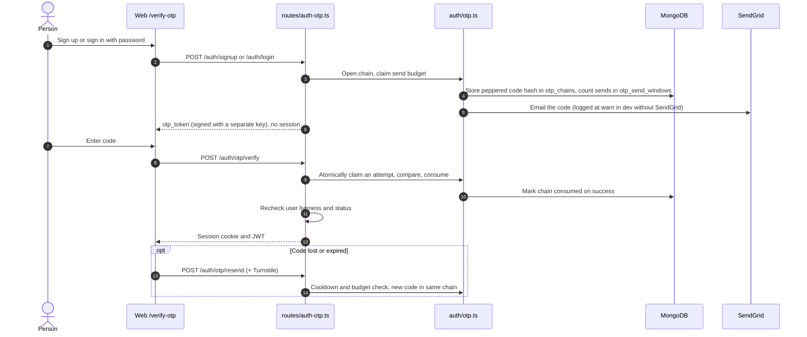

Limits in `auth/otp.ts`: code valid 10 minutes, chain valid 30 minutes, 5
attempts per code, 60 second resend cooldown, 5 sends per hour and 10 per day.
Codes are stored only as peppered hashes (`OTP_PEPPER`, rotation via
`OTP_PEPPER_PREVIOUS`). An unverified signup that never finishes is removed after
7 days by `jobs/pending-registrations.ts`. Web state lives in
`apps/web/src/lib/otp-pending.ts`; `remember_me` rides on the chain.

### F03 — household and membership

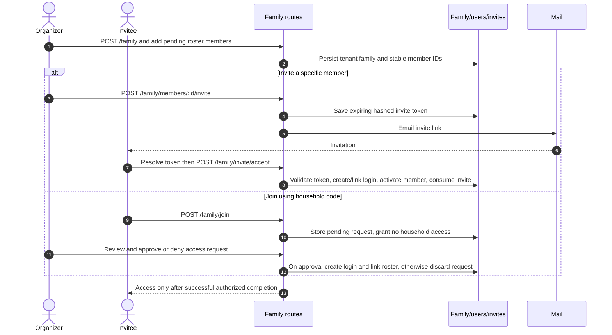

Per-member invite TTL is seven days at this snapshot. Removing a member also
invalidates associated access/invites. A `child` roster entry does not by itself
establish a permitted independent youth account or parent-consent flow.

### F04 — profile, detectors and readiness

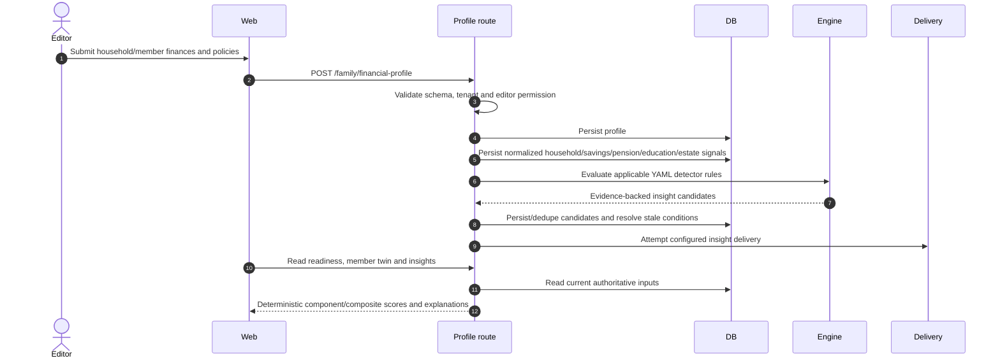

A correction can resolve an old insight without a manual dismiss. “No insight”
is not equivalent to “all finances verified”; eligibility and missing inputs
matter. Do not replace deterministic readiness with a generated assessment.

### F05 — financial document intake and extraction

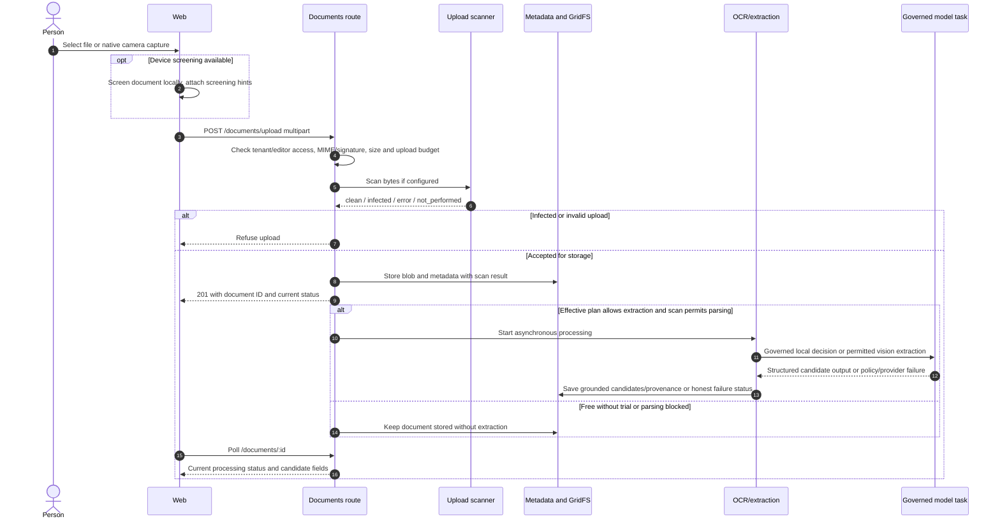

At this snapshot initial upload extraction is an in-process asynchronous task,
not universally a durable queue job. A process termination can interrupt it;
retry/reprocessing paths are separate. `MALWARE_SCAN_REQUIRED` defaults true in
production. An absent/unavailable scanner must not be reported as clean or
silently handed to a parser. A Plus plan alone cannot make extraction ready.

### F05b — R2 upload, scan and promotion (flag-gated)

Used when `DOCUMENTS_STORAGE=r2` and the tenant is in `DOCUMENTS_R2_TENANTS`
(or `*`). Otherwise F05 above applies. Every read and write goes through
`documents/storage.ts`, which dual-reads GridFS and R2, so old documents keep
working. Legacy multipart upload for R2 tenants joins the same pipeline.

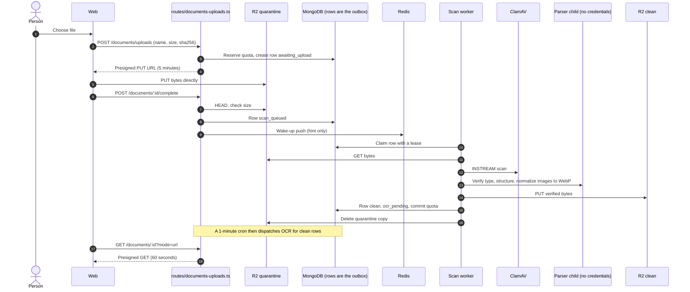

Row states: `awaiting_upload`, `scan_queued`, `scanning`, `clean`, `infected`,
`rejected`, `scan_error` (retried), `failed`, `deleting`. Redis is only a
wake-up: if it is down, the reconciler tick alone still drains the queue. The
reconciler (every 60 seconds in the scan worker) expires uploads past their
reservation, requeues expired leases, retries `scan_error`, cleans leftover
quarantine objects, commits held reservations and finishes second-pass purges;
nightly it also sweeps orphan objects and reconciles quota. Delete is fenced:
the erasure receipt stays `in_progress` until the second purge confirms no
residual data. HEIC uploads stay in `scan_error` and retry until the image
carries libheif.

Formats and structure checks are in `documents/formats.ts` and
`documents/parser-child.ts`; DOCX text extraction sits behind
`document_ai_extraction` like PDFs and images (`ocr/extract.ts`). The vault uses
the same seam: with `VAULT_STORAGE=r2` only ciphertext reaches the private
`lifekeel-vault` bucket. Quotas are shared reservations in `documents/quota.ts`,
replacing the old per-instance map. Five R2 credential pairs (presign, serve,
delete, vault, scan) are scoped per job; only the scan worker holds `R2_SCAN_*`.
`platform_markers.documents_schema_floor` blocks rolling back to a build that
cannot read the new rows.

### F06 — review and apply extraction

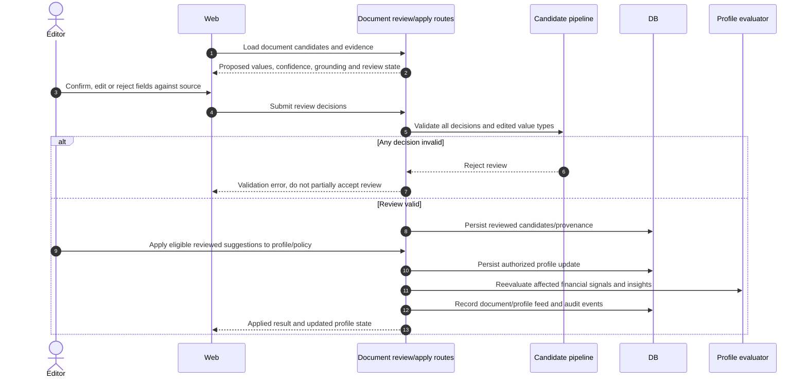

Extraction proposes; it must not silently overwrite confirmed facts. Low
confidence remains visible for review. Schema and grounding checks do not prove
that a policy is genuine, current, legally valid, or adequate.

### F07 — mailbox connection, scan and inbox

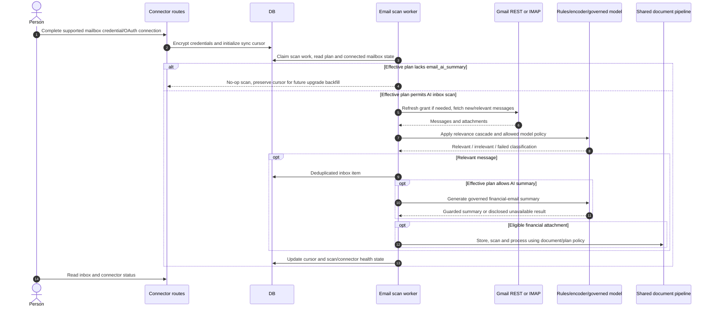

The optional encoder has off/shadow/gate modes; shadow measures without owning
the decision. Classification is not proof of a policy obligation. Gmail data
has provider-use constraints; do not feed mailbox content into shared training
or cross-tenant learning. Disconnect/revocation and optional data deletion must
be exercised before claiming provider deletion is complete.

### F08 — read-only account information

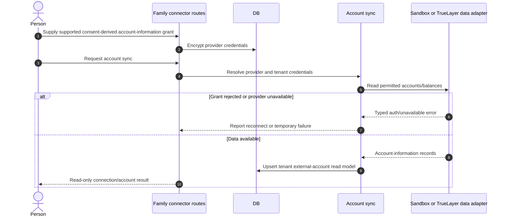

Production OAuth consent acquisition is not a complete self-service partnership
in this repository. Sandbox is allowed by default only outside production;
production needs explicit `OPEN_BANKING_SANDBOX=1`. Real token-based connections
are separately gated by `OPEN_BANKING_TOKENS=1` until the partner path is ready.
Null balance means unknown,
not zero. There is no payment-initiation path in this adapter.

### F09 — Ask Keel and verified answers

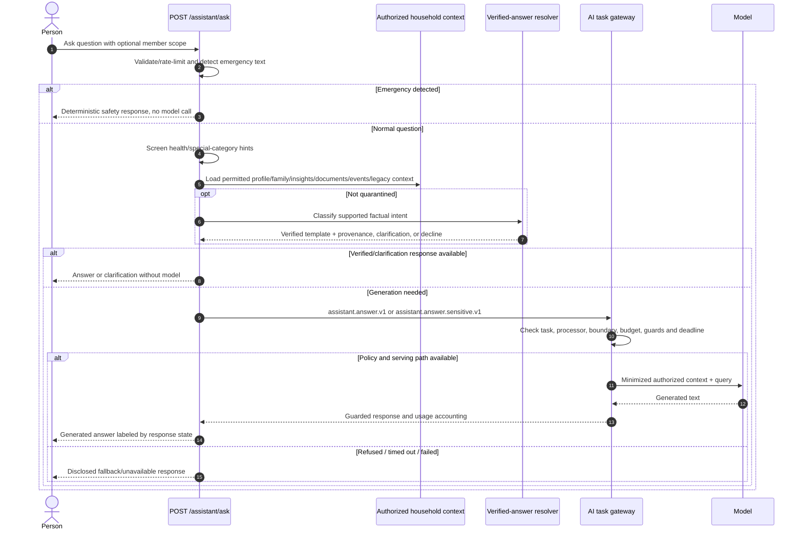

The server performs its own sensitive-content screen; a client hint can narrow
routing, not authorize a broader processor. Registered youth tasks are a policy
boundary for youth-capable paths, not evidence that unrestricted youth chat is
shipped. Verified answers use read operations/templates, not a vector database
or autonomous tool selection. See the AI integration caveat below for current
production fallback restrictions.

### F10 — scenarios and watchlist

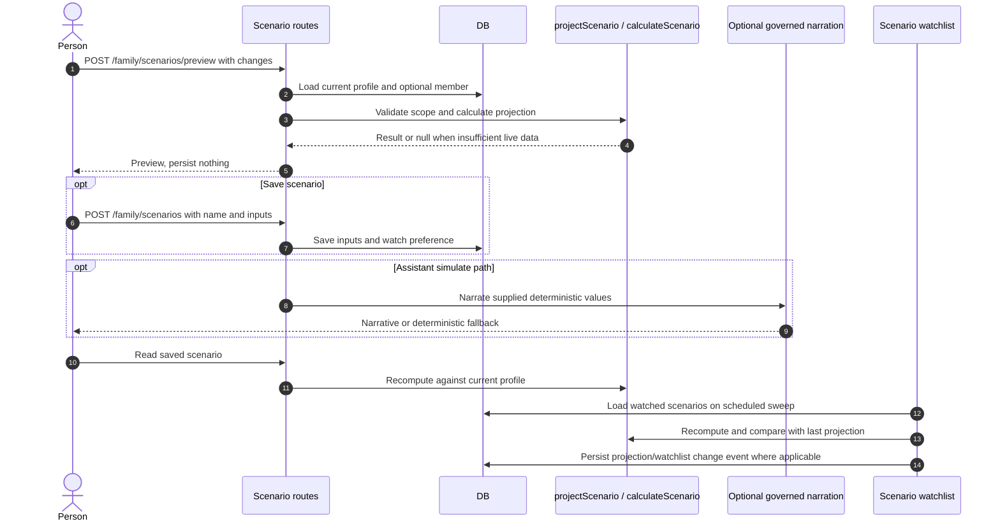

A change in income inside a scenario does not alter the real financial profile.
A saved scenario is not an immutable financial forecast or investment advice.

### F11 — life event, checklist and preparation

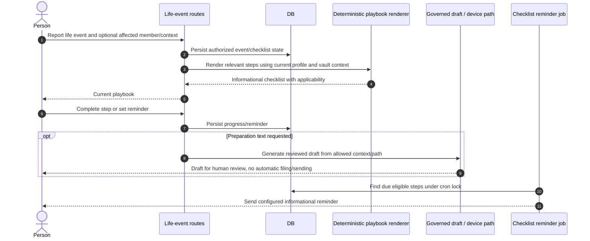

The playbook may adapt on read as profile data changes. Reporting bereavement,
job loss or another event does not unlock vault documents or authorize a claim,
provider switch, purchase, legal filing or medical action.

### F12 — vault, sealing and legacy map

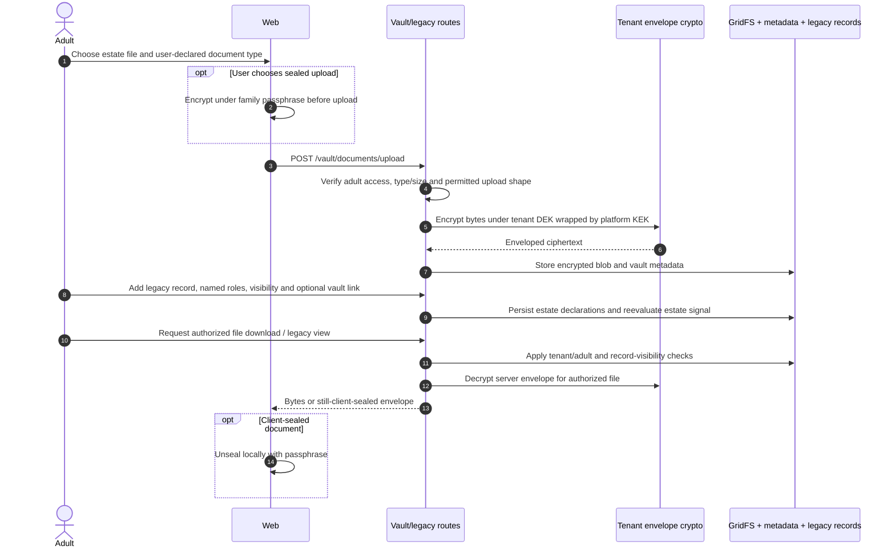

Vault uploads are not OCR-extracted. Estate type tags are user declarations.
Server-encrypted files can be read by a system with keys and authorization;
client-sealed files require the user's passphrase as well. Do not promise
passphrase recovery. Legacy metadata and filenames are not made invisible by
sealing file bytes. A continuity alert grants no additional file permission.

### F13 — delivery, review, approval and execution receipt

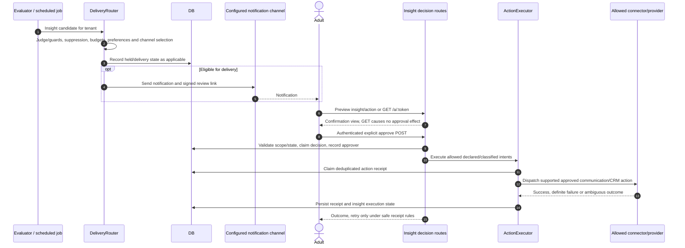

Supported executor types are `send_email`, `send_whatsapp`, `crm_tag`, and
`log_only`. Unsupported advisory actions are recorded, not magically executed.
Financial actions/public posting were removed from this family executor.
Receipt outcomes distinguish failed from ambiguous; a timeout may have produced
an external effect. Narrow Tier-3 trusted jobs exist, but cannot be generalized
into autonomous irreversible action. Signed approval links require authenticated
continuation for approval; possession of a link is not household membership.

### F14 — proactive member, heartbeat, continuity and freshness work

```mermaid
sequenceDiagram
  autonumber
  participant Scheduler as Jobs-role scheduler
  participant Lock as Mongo cron lock
  participant DB
  participant Compute as Deterministic evaluators
  participant Delivery
  actor Family
  Scheduler->>Lock: Claim named due job
  alt Another replica holds lock
    Lock-->>Scheduler: Skip this run
  else Claimed
    Scheduler->>DB: Read eligible tenants and current authoritative inputs
    alt Member-agent loop / freshness / heartbeat
      Scheduler->>Compute: Reconcile nudges, stale conditions or readiness summary
      Compute-->>Scheduler: Current derived changes
      Scheduler->>DB: Persist nudges/feed/history and send state
      Scheduler->>Delivery: Apply preferences/caps for eligible notices
    else Continuity check
      Scheduler->>DB: Read organizer activity and continuity phase/settings
      Scheduler->>Delivery: Send check-in after inactivity threshold
      opt Further silence beyond grace
        Scheduler->>DB: Recheck designated adults are still active and eligible
        Scheduler->>Delivery: Notify those adults without releasing documents
      end
    end
    Delivery-->>Family: Configured informational notice
    Scheduler->>Lock: Release/complete lock according to job path
  end
```

Do not infer per-family timezone scheduling: current cron expressions follow the
server's scheduling configuration. An always-running jobs process is necessary;
request-triggered scale-to-zero hosting does not guarantee timer execution.

### F15 — Plus subscription and billing lifecycle

```mermaid
sequenceDiagram
  autonumber
  actor Person
  participant API as Billing routes
  participant DB
  participant Stripe
  participant Webhook as POST /billing/webhook
  participant Cron as Billing maintenance
  Person->>API: POST /billing/checkout with plan=starter
  API->>DB: Read tenant/currency and existing subscription
  API->>Stripe: Validate existing subscription, create eligible Checkout Session
  API-->>Person: Hosted checkout URL
  Person->>Stripe: Complete payment
  Stripe->>Webhook: Signed checkout/subscription/invoice event
  Webhook->>Webhook: Verify raw-body signature and claim event processing
  Webhook->>DB: Apply subscription/plan/quota/billing changes idempotently
  opt Billing v2 enabled
    Webhook->>DB: Append relevant credit ledger/audit records
  end
  Webhook-->>Stripe: Acknowledge processed/duplicate event
  Person->>API: Read current billing state or open portal
  API->>Stripe: Create portal session when configured
  Cron->>DB: Expire trial / apply free refill / inspect payment grace state
  Stripe->>Webhook: Renewal, failure or cancellation event
  Webhook->>DB: Apply corresponding lifecycle state and balances
```

The success redirect is not evidence of entitlement; the signed webhook and
persisted billing state are authoritative. The current price table includes a
test-mode price; production needs a deliberate live-price mapping change and
live webhook verification. Use `LIFEKEEL_STRIPE_WEBHOOK_SECRET`; the handler also
accepts legacy `STRIPE_WEBHOOK_SECRET`. Payment grace/suspension constants are
7/14 days. Read the actual event handler and cron before changing lifecycle
semantics; credit balance, included allowance and ledger are different concepts.

The webhook also handles `charge.refunded` and `charge.dispute.created/closed`.
These record an audit entry and an operator alert; LifeKeel never initiates a
charge, refund or payout.

**Stripe setup as code.** The product, price, webhook endpoint and Customer
Portal are declared in `definitions/stripe-config.yaml` and applied by an
idempotent reconciler (`billing/stripe-reconcile.ts`). Prices are found by
`lookup_key`, never a hard-coded `price_…` id (`STRIPE_PRICE_STARTER` can pin one
during a rollout).

```mermaid
flowchart LR
  YAML["definitions/stripe-config.yaml"] --> Rec["billing/stripe-reconcile.ts"]
  CLI["pnpm --filter @lifekeel/api stripe:reconcile (dry run; --apply)"] --> Rec
  Infra["scripts/provision-infra.sh stripe"] --> Rec
  Console["Operator console: Billing, Billing setup"] --> OpAPI["POST /operator/billing/stripe/reconcile"]
  OpAPI --> Rec
  Rec -->|"restricted key"| Stripe["Stripe: product, price, webhook, portal"]
  Drift["stripe-drift.yml, Mondays 07:30 UTC, read-only"] --> Rec
```

Dry run exits 2 when drift is found. Use a restricted key
(`STRIPE_RECONCILE_KEY`, falling back to `STRIPE_SECRET_KEY`) with write on
products, prices, webhook endpoints, portal, Checkout, customers and
subscriptions, and read-only on charges and refunds. `STRIPE_API_ORIGIN` is
where Stripe reaches `/billing/webhook`. Details: `docs/runbooks/stripe-setup.md`.

### F16 — export, erasure and backup reconciliation

```mermaid
sequenceDiagram
  autonumber
  actor Organizer
  participant API as Account routes
  participant DB
  participant Erase as Erasure service
  participant Journal as Independent deletion journal
  participant Restore as Restore runbook
  Organizer->>API: GET /account/export
  API->>DB: Apply authorized export scope
  API-->>Organizer: Stream permitted account/family export data
  Organizer->>API: POST /account/delete with required confirmation
  API->>DB: Mark deletion state and open receipt/tombstone path
  API->>Erase: Run scoped erasure, blob/key cleanup and external cleanup paths
  Erase->>DB: Delete mapped data, retain required tombstones/accounting evidence
  Erase-->>API: Counts, residual failures and receipt result
  API-->>Organizer: Deletion result, client clears local session/state
  DB->>Journal: Preserve deletion state independently during backup operation
  Restore->>DB: Restore encrypted archive in maintenance mode
  Restore->>Journal: Load newest deletion journal and preserved tombstones
  Restore->>Erase: Replay erasures before reopening traffic
```

Export is not a raw database dump or a guarantee of every binary blob being
included. Deletion is not deletion of legally retained billing/audit records or
all historical backups instantly. Per-tenant key shredding does not revoke DEKs
already contained in old backups; journal replay and retention still matter.
Authoritative procedures: `docs/runbooks/rights-requests.md`,
`docs/runbooks/backup-restore.md`, `docs/data-retention.md`.

### F17 — operator and marketing control plane

```mermaid
sequenceDiagram
  autonumber
  actor Operator
  actor Reviewer as Second operator where required
  participant API as Operator / marketing routes
  participant Authz as Operator permissions + recent auth
  participant DB
  participant Gateway as AI/provider gateway
  participant External as Messaging/social provider
  Operator->>API: Request configuration, support, campaign or content operation
  API->>Authz: Resolve active platform role and required permission
  Authz->>DB: Read database-backed operator status/roles
  opt Elevated mutation
    Authz->>Authz: Require sufficiently recent authentication
  end
  opt Operation covered by dual control
    API->>DB: Persist pending exact operation approval
    Reviewer->>API: Confirm with independent permitted operator identity
  end
  opt Draft generation requested
    API->>Gateway: Registered support/marketing task with allowed context
    Gateway-->>API: Guarded candidate draft
  end
  Operator->>API: Review and explicitly authorize permitted operation
  API->>DB: Persist configuration/state or claimed send/publication
  opt External effect authorized
    API->>Gateway: Bounded provider call / approved campaign dispatch
    Gateway->>External: Send or publish through configured adapter
    External-->>API: Result or ambiguity/failure
  end
  API->>DB: Record operator audit and operation outcome
```

**Mission Control and shadow mode.** `GET /operator/mission-control`
(`operator/mission-control.ts`, page `/operator/mission`) returns one ranked list
of decisions the caller may act on: autopilot proposals, open alerts, support
cases past SLA, drafts awaiting approval, pending four-eyes approvals and failed
publishes. Batch approve/reject (`POST /operator/mission-control/batch`) exists
only for autopilot proposals and alert acknowledgements, and each item still
passes its own permission, step-up, atomic claim and audit. Posts, campaigns,
erasure and four-eyes items are never batched.

```mermaid
flowchart LR
  Sweep["Autopilot sweep (hourly)"] --> Kill{"Platform kill switch paused?"}
  Kill -- Yes --> Halt["No rule runs; only a human resumes"]
  Kill -- No --> Mode{"Rule mode"}
  Mode -- shadow --> Ledger["Ledger row status=shadow with would_do; no act, alert, proposal or external call"]
  Mode -- live --> Act["Proposal or alert, existing human approval gate"]
  Ledger --> Review["Operator marks each row right or wrong"]
  Review --> Gate{"At least 20 reviewed and 90% right?"}
  Gate -- No --> Refuse["shadow_not_promotable"]
  Gate -- Yes --> Promote["Rule may switch to live"]
```

Shadow rows use a separate dedup namespace and expire after 30 days. Mission
Control items carry ids, counts, subjects and ages only, with no message bodies,
financial profile or model call. The intent is in
`docs/intents/12-mission-control-and-shadow-mode.md`. Autopilot also has a
cooldown, and a four-eyes release on a failed send, as of PR #199.

Platform roles are `support`, `marketing_operator`, `finance_operator`,
`operations`, `platform_admin`, `super_admin`. They are separate from household
roles. Bootstrap user IDs are a time-bounded break-glass path, not normal role
management. Dual control applies to selected operations, not every mutation.
Lifecycle email respects consent/suppression; social scheduling and existing
automation paths need their own publish-policy review. Family action approval
does not authorize platform-wide campaigns or public posts.

### F18 — manual cashflow, assets and linked estate views

```mermaid
sequenceDiagram
  autonumber
  actor Adult
  participant API as Cashflow / asset routes
  participant DB
  participant Math as Summary/read-model computation
  Adult->>API: Add income/expense entry or declared asset
  API->>API: Validate fields, tenant and route-specific permission
  API->>DB: Save tenant-scoped record
  Adult->>API: Read cashflow summary or asset details
  API->>DB: Load entries/assets and required profile context
  API->>Math: Normalize recurrence / compute summary and runway
  Math-->>API: Current values with nulls for non-applicable results
  API-->>Adult: Entries, summary or declared asset context
  opt Legacy record references asset
    Adult->>API: Save asset IDs covered by legacy declaration
    API->>DB: Validate and persist supported references
    Adult->>API: Read legacy graph
    API-->>Adult: Declared relationships with verification labels
  end
```

Asset records and estate references do not establish ownership, inheritance or
legal validity. Changes here should not silently overwrite unrelated profile
fields or simulate a bank synchronization that did not happen.

## LLM and model integration

### What needs a model, and what does not

Readiness, financial projections, recurring-cashflow arithmetic, approved factual
answer templates, permission decisions, and receipt deduplication are code/rule
responsibilities. Models classify, propose structured fields, judge bounded
choices, narrate supplied results, and draft language. A model response is not
an authoritative financial fact or permission to execute an external action.

This application primarily assembles authorized Mongo records into task context.
It is not a generic “upload everything into a hosted vector store” RAG design.
Embedding/cache/scorer modules exist, but a module's existence does not mean
Ask Keel depends on it. Follow each live call site before changing retrieval.

### Model inventory and execution locations

| Path | Implementation | Purpose / constraints |
| --- | --- | --- |
| Deterministic verified answer | `apps/api/src/assistant/verified-answer.ts:1` | Approved intent/read operation and reviewed template; no model call |
| Hosted generation/router | `packages/platform/src/llm.ts:1` | Provider adapters and fast/balanced/powerful tiers; gateway task/processor rules decide whether a call may run |
| Self-hosted judge/classifier/OCR/text | `apps/api/src/local-model.ts:20`, `infra/local-judge/Dockerfile` | Default local model `qwen2.5:7b`; separate purpose models can be configured; bounded concurrency/queue |
| Email relevance encoder | `infra/encoder-service/server.py` | `fastino/GLiNER2.5-Decide`; relevance classification, not a general text generator; off/shadow/gate |
| Local embeddings | `packages/platform/src/memory/LocalEmbeddingProvider.ts:1` | BGE small English model; embedding similarity is not financial correctness |
| Browser document screening / entity extraction | `apps/web/src/lib/on-device-doc-screen.ts:1`, `on-device-ner.ts:1` | Device preprocessing/hints; server performs its own checks |
| Optional device drafts | `docs/prd/113-on-device-inference-crisis-drafts.md`, registered device task | WebLLM/native capability depends on actual runtime/device/model availability; validate the feature's execution path before promising offline generation |

Use `ai-bom.yaml` and `docs/models/` for artifact pins, model cards and licenses.
Model tiers are logical handles, not permanent concrete model names. Read the
current `DEFAULT_TIER_MODELS` and settings override path in `llm.ts` when debugging
a model selection. No new provider/model should be enabled from an old document's
example alone.

**Generation split:** the architecture decision favors hosted interactive text
and local models for batch/quarantined tasks. CPU-local interactive generation
has documented latency problems. However, the actual `baseFor()` routing and
registry restrictions described next take precedence over that architectural
intent; the current configuration is not automatically hosted-ready for every
interactive task.

### Task gateway LLD and exact routing caveat

Every server-side call should obtain a governed function through `taskLlm`,
`taskDecide` or `taskVision`. Boot loads `definitions/ai-tasks.yaml` and
`definitions/ai-processors.yaml`. Source:
`apps/api/src/ai/task-gateway.ts:184`,
`packages/platform/src/task-gateway.ts:1`.

```mermaid
flowchart TD
  A["Feature + tenant + registered task ID"] --> B{"Task registered?"}
  B -- "No, outside dev" --> Refuse["Refuse, disclose unavailable/fallback"]
  B -- Yes --> C{"Data boundary and execution path"}
  C -- device_only --> Device["Execute on device, server rejects task"]
  C -- lifekeel_infra_required --> Local["Require configured self-hosted text path"]
  C -- lifekeel_infra --> Family["Local family path, hosted fallback needs explicit allowance"]
  C -- approved_hosted_provider --> Hosted["Configured hosted router"]
  Local --> Policy
  Family --> Policy
  Hosted --> Policy
  Policy["Check task processor allowlist, approval, retention and review date"] --> Allowed{"Allowed?"}
  Allowed -- No --> Refuse
  Allowed -- Yes --> Budget["Model allowlist, token ceiling, spend/budget checks"]
  Budget --> Input["Input guards and minimized task context"]
  Input --> Call["Deadline + per-task breaker + model call"]
  Call --> Output["Output guards / structured validation"]
  Output --> Usage["Record usage/cost/guard metadata"]
  Usage --> Result["Return candidate, bounded decision or language"]
```

Read the arrows as controls, not a guaranteed exact internal call order for all
three wrappers. The important routing distinction at this snapshot is:

- `device_only`: a server call is refused.
- `lifekeel_infra_required`: `LOCAL_JUDGE_BASE_URL` plus
  `LOCAL_TEXT_ENABLED=true` is required; no hosted fallback.
- `lifekeel_infra`: absent configured local text, hosted fallback is denied
  outside dev unless `AI_HOSTED_FALLBACK=allow` **and** a recorded
  `AI_POLICY_EXCEPTION` exist. Even with that allowance, processor/task/retention
  checks still apply.
- `approved_hosted_provider`: uses the cloud router, still subject to the same
  registry/model/budget controls.

`preferred_execution` documents intended placement; it is not a substitute for
`baseFor()` and the real caller choosing the correct wrapper. In particular,
`assistant.answer.v1` is currently `lifekeel_infra` although its preferred
execution says hosted. Simply setting Azure/Vertex credentials does not make
that production route pass the fallback gate. Resolve the policy/configuration
deliberately, with review and eval evidence, before claiming hosted Ask Keel is
live. Do not turn on a global local-text flag for all interactive traffic just
to bypass this mismatch. Source: `apps/api/src/ai/task-gateway.ts:337`.

### Task-by-task behavior

All rows refer to `definitions/ai-tasks.yaml`; processor status can further
restrict a listed allowance. Ceilings are policy limits, not a promise to fill
the context or meet a measured latency SLO.

| Registered task(s) | Authority / current permitted processing | Deadline; input/output token caps |
| --- | --- | --- |
| `assistant.answer_verified.v1` | Deterministic approved read/template; registration is for policy/metrics, no model | 2s; 8,000/1,500 |
| `assistant.answer.v1` | Language only; `lifekeel_infra`, listed Ollama/Anthropic/OpenAI/Azure/Vertex, subject to fallback caveat | 30s; 8,000/1,500 |
| `assistant.answer.sensitive.v1` | Special-category quarantine; self-hosted required | 30s; 8,000/1,500 |
| `assistant.youth_answer.v1` | Restricted youth context; self-hosted required; registration does not expose general youth chat | 20s; 2,000/600 |
| `assistant.scenario_narration.v1` | Narrate deterministic result; currently Ollama-only | 30s; 8,000/1,500 |
| `document.classify.v1` | Candidate classification; currently Ollama-only | 120s; 4,000/200 |
| `document.extract.v1`, `document.profile_candidate.v1` | Candidate structured fields for review; currently Ollama-only | 120s; 8,000/2,000 |
| `email.policy_relevance.v1` | Candidate financial-email relevance; currently Ollama-only | 120s; 4,000/300 |
| `email.policy_summary.v1` | User-visible language, plan-gated summary; currently Ollama-only | 120s; 4,000/600 |
| `insight.score_enrichment.v1` | Candidate confidence enrichment; hosted task with Anthropic/OpenAI/Azure/Vertex list | 30s; 6,000/300 |
| `insight.delivery_judge.v1` | Bounded deliver/hold judgment; currently Ollama-only | 120s; 4,000/300 |
| `draft.outreach.v1` | Candidate draft; device-preferred with authorized server escalation | 30s; 6,000/1,200 |
| `draft.crisis_on_device.v1` | Candidate draft; device-only, no server processor | 60s; 4,000/1,200 |
| `support.reply_draft.v1` | Candidate support reply; currently Ollama-only | 30s; 6,000/1,500 |
| `marketing.social_draft.v1` | Candidate public-content draft; hosted task, human/publish policy separate | 30s; 4,000/800 |

A vision adapter existing in code does not authorize cloud document processing.
`document.extract.v1` currently only allows Ollama; an OpenAI/Azure/Vertex vision
path must still pass that registry. This matters when migrating hosting: paying
for a vision API is not enough to activate Plus extraction under production
policy.

### Provider selection and approval

The general router resolves an explicit recognizable model name first, then
runtime operator override, environment provider override, then configured
credentials. Credential detection order is Anthropic → OpenAI → Azure → Vertex →
Groq → xAI → Ollama (newest providers last, so a new key cannot silently flip a
live deployment). The runtime operator override is global: it also wins for
`tier:*` governed calls and over model-name detection, and a model that does not
exist on the picked provider fails there rather than rerouting. An explicit unavailable/unapproved selection should fail rather
than quietly disclose family data to another provider.
Sources: `packages/platform/src/llm.ts:334`,
`apps/api/src/operator/platform-config.ts:1`.

At this repository snapshot Azure, Vertex, Groq and xAI are marked approved in the
registry; Anthropic and OpenAI remain unreviewed. Groq (approved 2026-10-23) has
no default inference retention; enable ZDR in Console, Data Controls, and keep it
at `limited_abuse_log` until then. It is chat/completions only. xAI (2026-10-23)
is approved **conditional on ZDR**: its DPA requires personal data to use the
ZDR-enabled API only, so the Console team toggle must be on before any task
routes there (check the `x-zero-data-retention: true` response header). Azure and Vertex record
`limited_abuse_log` conservatively; do not claim zero retention. Task allowlists,
retention tolerance and review expiry can still refuse an approved provider.
Outside dev enforcement defaults to `enforce`; dev defaults to `warn`.
A non-dev enforcement downgrade needs an `AI_POLICY_EXCEPTION` reference.

Vertex uses enterprise OAuth authentication: GCP service-account identity on
GCP, or configured `VERTEX_SERVICE_ACCOUNT_JSON` off-GCP. A free Gemini/consumer
API key is not an interchangeable authentication path. Azure needs the actual
endpoint, deployment, API key and supported API version configured by the owner.
Do not copy private credentials into frontend settings or this guide.
`scripts/smoke-groq.mjs` and `scripts/smoke-xai.mjs` give a quick credential
check.

**Exact-match answer cache.** A task in `definitions/ai-tasks.yaml` can declare
`cache_ttl_seconds`; the governed path then caches by tenant, task, system
prompt, prompt and model hash (`packages/platform/src/llm-response-cache.ts`). It
is for repeatable batch or classification tasks only. Conversational,
`lifekeel_infra_required` and `device_only` tasks never cache. A hit records an
`ai_task_calls` row with `outcome: 'cache_hit'` and zero usage.

### Grounding, evaluation, privacy and costs

- Context must be tenant-authorized and task-minimized; unreviewed documents,
  event notes and declared estate relationships need their provenance labels.
- Inputs are untrusted. Documents/emails can contain prompt injection. Guards,
  structured validation and review reduce risk; none proves all attacks blocked.
- LLM caches must be tenant-keyed and bounded. Do not turn near-similarity into
  authority for financial values or share family answers across tenants.
- Models cannot override numeric calculations or decision rights. Generated
  provider recommendations and regulated advice remain prohibited.
- Usage/cost accounting uses `llm_usage` and service spend uses `spend_events`.
  Plan all-service spend caps can deny batch work; interactive platform-cost
  treatment differs. Token-budget checks still apply. Ledger writes are not
  proof of atomic reservation against concurrent requests.
- Red-team/guard tests, detector evals, `eval_runs` lineage, and task-specific eval
  runners exist. Passing static tests is not live model-quality evidence. Run
  relevant task goldens and adversarial cases after prompt/model/policy changes.
- Dormant federated/scorer code is not permission to train shared models on
  family content. Cross-tenant learning, processor terms, retention/deletion
  behavior and Gmail use require separate governance and evidence.
- Record fallback rate, policy refusal reason, local queue saturation, cold-start
  latency, input/output tokens, spend and guard outcomes using metadata; avoid
  raw prompts/completions, medical text or document filenames in broad telemetry.

## Configuration and background operation

### Configuration matrix

Read example files, then the actual consuming code. This guide never requires
reading or publishing an existing private `.env`.

| Variable/group | Runtime | Meaning / deployment action |
| --- | --- | --- |
| `NODE_ENV`, `LIFEKEEL_DEPLOYMENT_MODE` | API/jobs | Production uses `NODE_ENV=production`, `LIFEKEEL_DEPLOYMENT_MODE=cloud` for both proposed clouds |
| `PORT` | API/jobs | Server binds `0.0.0.0`; default 3001; health-check port must match |
| `SERVICE_ROLE` | API/jobs | Explicitly set `api` or `jobs`; unset defaults to combined `all`; jobs service must remain private |
| `MONGODB_URL`, `MONGODB_DB` | API/jobs | Real MongoDB with isolated environment database and backup plan; required production URL |
| `REDIS_URL`, `QUEUE_MODE` | API/jobs | Durable Redis; explicitly `QUEUE_MODE=required` in cloud; use authenticated/TLS endpoint as provided |
| `JWT_SECRET` | API/jobs | Required, at least 32 characters; generate strong independent environment secret |
| `SETTINGS_ENCRYPTION_KEY`, versioned encryption keys | API/jobs | Platform KEK and rotation material; use valid key format expected by crypto code; back up securely independently of ciphertext |
| `CORS_ORIGIN`, `LIFEKEEL_URL`, `API_BASE_URL`, legacy `STUDIO_URL` | API/jobs | Exact deployed origins/URLs; also affect links, cookie Origin checks and some inherited billing redirects |
| `LIFEKEEL_APP_HOSTS`, `TRUST_PROXY_HOPS` | API | Review actual host validation and proxy topology; count trusted hops deliberately |
| `NEXT_PUBLIC_API_URL`, `NEXT_PUBLIC_API_BASE_PATH`, `NEXT_PUBLIC_SAME_ORIGIN_API` | Web build | Compile correct public API or `/api` routing; same-origin flag requires a functioning proxy |
| `SENDGRID_API_KEY`, `SENDGRID_FROM_EMAIL`, `EMAIL_VERIFICATION_ENABLED`, `EMAIL_POSTAL_ADDRESS` | API/jobs | Real verified email transport and desired verification posture; no Mailpit in production |
| `MAILPIT_URL` | Local only | Local capture transport; refuses production use |
| `GOOGLE_CLIENT_ID`, `GOOGLE_CLIENT_SECRET` | API/jobs | Sign-in/Gmail OAuth; separate environment callback and grants |
| `STRIPE_SECRET_KEY`, `LIFEKEEL_STRIPE_WEBHOOK_SECRET`, `BILLING_V2_ENABLED` | API/jobs | Separate test/live values, configured price table, signed webhook and ledger rollout |
| `LIFEKEEL_LLM_PROVIDER`, provider-specific credentials | API/jobs | Explicit provider selection plus task/processor approval; optional features fail honestly when absent |
| `LOCAL_JUDGE_BASE_URL`, `LOCAL_JUDGE_AUTH`, purpose model variables | API/jobs | Private self-hosted inference; `cloudrun-iam` is GCP-specific, not an AWS authentication setting |
| `LOCAL_TEXT_ENABLED`, `LOCAL_TEXT_MODEL`, concurrency/queue controls | API/jobs | Local text routing; assess latency and policy impact before enabling |
| `AI_PROCESSOR_ENFORCEMENT`, `AI_HOSTED_FALLBACK`, `AI_POLICY_EXCEPTION` | API/jobs | Keep enforced non-dev defaults; exceptions are recorded policy decisions |
| `EMAIL_ENCODER_URL`, `EMAIL_ENCODER_MODE`, `EMAIL_SCAN_FANOUT`, `EMAIL_SCAN_CONCURRENCY` | Jobs | Optional relevance gate/shadow and bounded mailbox parallelism |
| `CLAMD_HOST`, `CLAMD_PORT`, `MALWARE_SCAN_REQUIRED` | API/jobs/scan worker | Scanner on private network; clean scan required before production parsing by default. The scan worker refuses to start without `CLAMD_HOST` outside dev |
| `GROQ_API_KEY`, `XAI_API_KEY` | API/jobs | Optional hosted providers; enable ZDR in each vendor console first (see Provider selection) |
| `TURNSTILE_MODE`, `TURNSTILE_SECRET_KEY`, `TURNSTILE_ALLOWED_HOSTNAMES`, web `NEXT_PUBLIC_TURNSTILE_SITE_KEY` | API / web build | `off` (dev default), `monitor`, `enforce` (default outside dev). Hostnames default to `LIFEKEEL_APP_HOSTS`. Cloudflare's always-pass test keys are for local/CI only |
| `AUTH_OTP_MODE`, `OTP_PEPPER`, `OTP_PEPPER_PREVIOUS{,_ID}` | API | `off`, `signup`, `signup_login` (default outside dev); pepper 32+ characters outside dev |
| `METRICS_SCRAPE_TOKEN` | API | Required outside dev (24+ characters); `/metrics` is refused without it |
| `DOCUMENTS_STORAGE`, `DOCUMENTS_R2_TENANTS`, `VAULT_STORAGE` | API | `gridfs` (default) or `r2` with a tenant allow-list; vault storage is switched separately |
| `R2_ACCOUNT_ID`, `R2_JURISDICTION`, `R2_ENDPOINT`, `R2_FORCE_PATH_STYLE`, `R2_{PRESIGN,SERVE,DELETE,VAULT,SCAN}_ACCESS_KEY_ID` / `_SECRET_ACCESS_KEY` | API / scan worker | One key pair per job, each scoped in Cloudflare to its buckets. `R2_SCAN_*` belongs to the scan worker only. `R2_ENDPOINT` points at MinIO locally and is unset for R2 |
| `STRIPE_RECONCILE_KEY`, `STRIPE_API_ORIGIN`, `STRIPE_PRICE_STARTER` | Reconciler | Restricted key for setup as code, public origin for the webhook, optional price pin |
| VAPID, FCM, Twilio and channel credentials | API/jobs | Enable only intended channels; confirm preference and delivery failure paths |
| `PLATFORM_OPERATOR_USER_IDS`, `PLATFORM_OPERATOR_BOOTSTRAP_UNTIL` | API | Short-lived bootstrap; migrate to database-backed operator roles |
| `OPERATOR_STEP_UP_WINDOW_SEC` | API | Recent-auth window for elevated operator changes |
| Sentry / metrics / analytics settings | Respective service/build | Metadata-first telemetry, controlled access, explicit tracker/consent behavior |

`env.ts` and `config/deployment.ts` currently disagree on some non-cloud mode
enum values (`on-prem` versus `airgap/accountant`). Use the verified `cloud` mode
for these runbooks; reconcile the schemas before documenting another mode as a
supported turnkey deployment. Also note `.env.example` uses the legacy Stripe
webhook variable while validated config names the LifeKeel-prefixed one.
The Cloudflare defaults above are off in dev and strict outside it; a downgrade
outside dev is logged at boot, and a missing secret refuses boot.

### Queue and job LLD

`apps/api/src/queue/QueueManager.ts:1` implements Redis lists with processing
lists, delayed sorted sets, dead letters and lease-aware recovery. It uses a
standalone `ioredis` client, not a Redis Cluster client.

```mermaid
flowchart LR
  Publish["Publish"] --> Ready["queue list"]
  Publish --> Delayed["queue:delayed sorted set"]
  Delayed --> Ready
  Ready --> Processing["queue:processing + renewable lease"]
  Processing --> Success["Handler succeeds: remove entry"]
  Processing --> Failure{"Failure / expired lease"}
  Failure -- "below attempt cap" --> Ready
  Failure -- "attempt cap reached" --> Dead["queue:dead"]
  Dead --> Review["Operator inspects and explicitly requeues safe job"]
  Review --> Ready
```

Attempt cap is three; lease TTL is 60 seconds and renewal is every 20 seconds;
recovery sweeps every 30 seconds. These are implementation settings, not an
exactly-once guarantee. Redis must support the actual blocking/list/zset commands.
Do not substitute an HTTP-only cache endpoint. Dev inline fallback is volatile;
cloud required mode refuses durable publishes when unavailable unless a job is
explicitly marked inline-safe. Multi-step Redis transitions can still have crash
windows; persist authoritative business state and reconcile important outcomes.

The jobs role owns consumers and cron timers. Mongo `cron_locks` prevent normal
replica races for named cron runs; verify lock lifetime/renewal for long work.
Do not run an extra external scheduler over the same job without designing the
ownership and idempotency contract.

| Scheduled work | Current cadence / control | Why it exists |
| --- | --- | --- |
| Connector polling and health | Every 15 minutes | Incremental data and expired/broken credential notices |
| Token refresh scheduler | Every 10 minutes | Renew grants approaching expiry |
| Email scan | Every 15 minutes; optional queue fan-out | New financial email and attachments |
| Pending OCR dispatch | Every minute, `cron_locks` name `document-ocr-dispatch` | Start extraction for scanned-clean documents; free plans go to `stored` |
| Pending registration sweep | Runs inside the retention worker (`jobs/retention-worker.ts`) | Remove signups that never finished OTP after 7 days |
| Scan worker reconcile / nightly sweep | Every 60 seconds / nightly, in the scan worker | Recover stuck scans, orphan objects, quota drift |
| Stripe drift check | `stripe-drift.yml`, Mondays 07:30 UTC (GitHub Actions) | Read-only report that Stripe differs from `stripe-config.yaml` |
| Failed OCR retry | Every 10 minutes when wired/configured | Retry eligible extraction failures |
| Marketing publish / draft generation | Every minute / daily 08:23 | Scheduled publication and candidate generation |
| Metrics / AI health / autopilot | Hourly / every 10 minutes / hourly | Cost/health evidence and explicitly enabled operator rules; autopilot honours the kill switch and per-rule `shadow`/`live` mode |
| Lifecycle email / weekly digest | Hourly / Monday 08:30 | Consent-aware lifecycle and operator summaries |
| Policy renewal reminders | Hourly when email configured | Upcoming recorded obligations |
| Member-agent loop | Daily 07:15 | Persist and reconcile member nudges |
| Continuity check | Daily 07:45 | Inactivity check-in and designated-adult notices |
| Checklist reminders | Daily 08:10 | Due event steps |
| Heartbeat / digest | Configuration-dependent heartbeat / daily 08:00 digest | Readiness summary and bounded communication |
| Calibration drift / fit | Daily 02:00 / 03:00 | Scoring feedback health; no foundation-model training |
| Billing maintenance | Daily 04:00 | Trials, refills, grace-state maintenance |
| Erasure replay | Daily 04:30 | Finish incomplete tenant erasures |
| Stale profile / freshness / scenario watchlist | Daily 06:30 / 06:45 / 05:30 | Reevaluate facts that change relevance over time |
| Retention / insight SLA / feature-hash eval | Daily / every 15 minutes / Monday 07:00 | Retention, overdue action/escalation and scorer evidence |

Cadences come from `apps/api/src/server.ts:367` onward and can be gated by
configuration. They are not user-local timezone promises. See the specific job
module for eligibility, deduplication and send behavior.

### Health, monitoring and degraded behavior

| Probe/signal | What it proves | What it does not prove |
| --- | --- | --- |
| `/health`, `/health/live` | HTTP process liveness; `/health` includes loaded resource counts | Mongo/Redis readiness, working email, good model output or current jobs |
| `/health/ready` | Mongo ping, Redis queue availability, migration head/pending state and critical-index checks | All external providers, scanner, model quality, scheduled-run freshness or all domain permissions |
| `/metrics` | Instrumented aggregate metrics when configured/access allowed | Alert delivery or a measured production SLO |
| `job_runs`, connector state, queue inspection | Recorded run/outcome/depth evidence | A healthy process necessarily executing each expected job on time |
| Operator AI/unit-economics surfaces | Available spend/model/guard/task evidence | Billed provider reconciliation or complete gross-margin accounting |

Readiness's `mode:cloud` is a Mongo storage label, not proof of cloud hosting.
External probes need restricted detail and metrics access; inspect the route's
auth configuration before exposing telemetry publicly.

Operational alerts should cover failed readiness, elevated 5xx, stale job runs,
queue oldest age/dead letters, Mongo disk/backup health, Redis memory/evictions,
mailbox grant failures, scanner outage, AI policy refusals/timeouts/fallbacks,
subscription webhook failures, and service spend. Choose measured journey SLOs
and capacity limits; this guide does not invent production latency, RPO or RTO.

## Railway deployment plan

**Status: proposed; no Railway manifests, service provisioning, DNS changes or
live deployment are delivered by this documentation update.** Existing deployment
workflows target Cloud Run/Firebase. Do not run `scripts/provision-infra.sh`
expecting Railway resources: it provisions the GCP topology (it now also has a
`stripe` step that applies `definitions/stripe-config.yaml`).

The proposed shape keeps the modular monolith and separates runtime roles.
Start with one jobs replica and scale from observed queue/run evidence. Keep
production and staging databases, credentials, processors and billing modes
isolated. Use owner-confirmed domains or platform-assigned domains; this guide
does not invent external application URLs.

### Target topology and service settings

```mermaid
flowchart TB
  Browser["Browser / native web view"] --> Edge["Public HTTPS web + same-origin API proxy"]
  Edge --> Web["Next server or static files"]
  Edge --> API["API service: SERVICE_ROLE=api"]
  API --> Redis["Private persistent Redis"]
  API --> Mongo["Private authenticated MongoDB"]
  Jobs["Always-on jobs: SERVICE_ROLE=jobs"] --> Redis
  Jobs --> Mongo
  API --> Scanner["Private ClamAV"]
  Jobs --> Scanner
  ScanW["Scan worker (optional, R2 only)"] --> Scanner
  ScanW --> Mongo
  ScanW --> Redis
  ScanW --> R2["Cloudflare R2 buckets"]
  API --> R2
  API --> Local["Optional private model service"]
  Jobs --> Local
  API --> Hosted["Explicitly approved hosted AI / Stripe / OAuth"]
  Jobs --> Notify["Configured email / push / messaging"]
```

| Service | Source/build | Runtime / exposure |
| --- | --- | --- |
| API | Repository root build context; `apps/api/Dockerfile` | Existing CMD `node apps/api/dist/server.js`; `SERVICE_ROLE=api`; public only through intended API/proxy ingress |
| Jobs | Same image/digest as API | Same CMD, `SERVICE_ROLE=jobs`; private, always running; no browser traffic |
| Web, initial approach | Root workspace install; `pnpm --filter @lifekeel/web build` | `pnpm --filter @lifekeel/web start`, listens on 3002 because script hardcodes it; set Railway service target/PORT consistently |
| Web, alternative | `pnpm --filter @lifekeel/web build:export` | Static hosting/proxy image still needs to be added; implement existing dynamic-route rules and `/api` proxy |
| MongoDB | Actual supported MongoDB image/service | Auth, private access, durable data volume, off-service backups; production replica/HA design remains an explicit operational choice |
| Redis | Compatible persistent Redis service | Private URL, authentication, persistence/recovery and no-eviction strategy; all queue keys on supported standalone endpoint |
| Scan worker | Same image, `node dist/scan-worker.js` | Only when `DOCUMENTS_STORAGE=r2`; always on, one scan per instance, holds `R2_SCAN_*` (the API must not), egress limited to R2, ClamAV, MongoDB and Redis |
| Scanner | ClamAV service added for deployment | Private TCP, memory/signature-update budget; unavailable scan blocks parsing |
| Model/encoder | Existing infra Dockerfiles, separately sized | Private only, artifact pins, startup health, resource measurements and policy-compatible endpoint authentication |

Railway supports an explicit Dockerfile path. Keep build context at the monorepo
root and select `apps/api/Dockerfile` using the service setting or
`RAILWAY_DOCKERFILE_PATH`; changing root to `apps/api` would hide workspace and
runtime-resource inputs from this Dockerfile. See
[Railway Dockerfile configuration](https://docs.railway.com/builds/dockerfiles).

Service-to-service URLs belong on private networking. The browser cannot call
private internal domains directly; it must use a public API or same-origin edge.
See [Railway private domains](https://docs.railway.com/networking/domains/working-with-domains).

### Numbered deployment procedure

1. **Prepare a release artifact.** Select a reviewed commit, run repository checks
   in a controlled validation environment, and build the API image from root.
   Preserve `detectors/`, `connectors/`, `definitions/`, `playbooks/`,
   `detector-evals/`, `verticals/` and `category-table.yaml`. Do not upload `.env`.
   For manual build verification: `docker build -f apps/api/Dockerfile -t lifekeel-api:local .`.
2. **Create isolated staging services.** Configure Mongo/Redis private access,
   authentication, persistence and backup/restore procedures before app traffic.
   Local Compose has a Mongo volume but no durable Redis volume; it is a local
   convenience stack, not the production deployment template.
3. **Configure runtime secrets.** Inject production-required values through the
   platform secret/variable mechanism. API/jobs share the same tenant crypto
   material and database but differ in `SERVICE_ROLE`. Set `NODE_ENV=production`,
   `LIFEKEEL_DEPLOYMENT_MODE=cloud`, `QUEUE_MODE=required`. Never use local
   placeholder keys, Mailpit or production demo-token overrides.
4. **Configure external integrations deliberately.** Wire the scanner and each
   model task's permitted serving path. For off-GCP Vertex credentials use the
   supported service-account configuration, not metadata-server assumptions.
   Do not set `LOCAL_JUDGE_AUTH=cloudrun-iam` for a Railway-local model. Keep
   inference endpoints private because their existing transport is not a general
   public authenticated model gateway.
5. **Boot staging API/jobs with migrations.** Verify schema/index readiness and
   at least one jobs run. Existing startup runs migrations automatically; do not
   let incompatible old/new code mutate production concurrently. If a separate
   migration step is introduced, execute the compiled migration with the same
   image/env and preserve startup's verification gate.
6. **Build/configure web.** Use the actual staged API URL as a build input. For
   same-origin mode compile `NEXT_PUBLIC_API_BASE_PATH=/api` only after the proxy
   is defined. Existing Next rewrites can route to an API origin; using a private
   API address in `NEXT_PUBLIC_API_URL` can expose that address in the bundle,
   so prefer a reviewed runtime-only proxy target in a future deployment change.
   Test routes with IDs, deep links, refresh, OAuth callback and service worker.
7. **Gate activation with `/health/ready`.** Configure the service target port
   to the actual listening port, not an unrelated platform default. The existing
   image Docker HEALTHCHECK hardcodes 3001; if API `PORT` changes, update/override
   that check too. Railway's deployment check waits for 2xx but does not monitor
   the service continuously afterwards; add ongoing probes separately. See
   [Railway healthchecks](https://docs.railway.com/deployments/healthchecks).
8. **Run staging acceptance.** Exercise F01, F03–F07, F09–F16 with synthetic
   records, separate Stripe test-mode configuration and a test mailbox. Include
   blocked-cookie behavior, wrong-tenant IDs, denied youth/adult access, scanner
   outage, AI refusal, dead-letter recovery and interrupted extraction.
9. **Promote manually.** Disable automatic production deployment from pushes
   until a reviewed CI-on-SHA/manual promotion path exists. Record image digest,
   web build inputs, migrations, secrets versions, backup ID and last known-good
   deployment. Use overlap/draining settings appropriate to in-flight uploads
   and jobs; do not enable app sleep for the jobs service.
10. **Observe and roll back if needed.** Verify ongoing HTTP and job freshness,
    queue processing, webhook delivery and model policy behavior. Redeploy the
    prior compatible image/web artifact on failed acceptance; pause jobs for
    ambiguous effects and investigate receipts before replaying them.

Railway exposes deployment overlap and termination-drain settings; choose and
validate them rather than assuming container replacement safely drains all work.
See [Railway deployment variables](https://docs.railway.com/variables/reference).
A volume or platform snapshot alone is not a tested database backup. Use the
repository's encrypted backup and deletion-journal reconciliation procedure and
record a restore drill before production use.

### Repository changes still required for a repeatable Railway release

- Reviewed service definitions/config-as-code and a web hosting/proxy artifact.
- Reproduction of dynamic-route and public landing/app behavior outside Firebase.
- Manual CI-on-SHA deployment workflow with immutable image/artifact promotion,
  explicit API/jobs configuration, acceptance evidence and rollback.
- Persistent datastore topology, backups, scanner/model health, alert delivery
  and secret rotation procedures validated in the chosen region.
- Review same-origin cookie behavior, exact CORS/Origin allowlists, proxy-hop
  counts, absolute email/Stripe/OAuth links and all build-time frontend values.

## AWS deployment plan

**Status: proposed; no ECS task definitions, CloudFormation/Terraform, AWS
resources or deployment workflow are created by this guide.** The plan reuses
the API image and the current Mongo/Redis contracts. A hosting migration must
not silently become a database or AI processor migration.

### Target HLD

```mermaid
flowchart TB
  User["Browser / native shell"] --> CDN["CloudFront + TLS, reviewed WAF policy"]
  CDN --> Static["Private S3 web export via OAC"]
  CDN --> ALB["HTTPS API origin / ALB, API caching disabled"]
  ALB --> API["ECS Fargate API tasks in private subnets"]
  Jobs["Always-on ECS jobs service in private subnets"] --> Mongo["Actual MongoDB deployment in chosen network/region"]
  API --> Mongo
  API --> Redis["ElastiCache node-based standalone-protocol endpoint"]
  Jobs --> Redis
  API --> Private["Private scanner and optional model/encoder"]
  Jobs --> Private
  ScanW["ECS scan worker (only with R2 documents)"] --> Private
  ScanW --> Mongo
  ScanW --> Redis
  ScanW -->|"egress"| R2["Cloudflare R2 (storage sub-processor)"]
  API -->|"presign, serve"| R2
  Secrets["Secrets Manager + KMS + scoped IAM"] --> API
  Secrets --> Jobs
  API --> External["Approved hosted AI / Stripe / OAuth"]
  Jobs --> External
  API --> Logs["CloudWatch logs/metrics and operational alerts"]
  Jobs --> Logs
```

S3/CloudFront static hosting is one option. An alternative is a Next server on
ECS behind the ingress, using the ordinary build and verified rewrite behavior.
Choose one explicitly; do not mix a static export with assumptions about a
running Next rewrite server.

### AWS component LLD and compatibility constraints

| Component | Proposed configuration | Compatibility / operational reason |
| --- | --- | --- |
| ECR | API image tagged with release SHA and deployed by digest | API/jobs use identical immutable build |
| ECS/Fargate API | `SERVICE_ROLE=api`, private tasks, ALB target type compatible with task networking | Independent HTTP scaling without duplicate timers; establish measured memory/CPU budget |
| ECS/Fargate jobs | `SERVICE_ROLE=jobs`, private, at least one running task | Timers/consumers need continuous CPU; no public route exposure; same image/env compatibility as API |
| ALB | TLS listener, `/health/ready` target health, measured startup grace | Dependency/schema checks gate routing; control probe detail and forwarding policy |
| CloudFront + S3 | Private regular S3 origin with OAC; versioned web artifacts; immutable assets, short HTML cache | Static web distribution without public bucket; explicit URI/dynamic route handling |
| MongoDB | Actual MongoDB on a reviewed managed or operated deployment | Preserve MongoDB 7-era behavior/GridFS/index semantics used locally; verify driver and production version compatibility |
| Redis | Node-based cluster-mode-disabled primary endpoint, TLS/auth, failover/persistence policy as required | Current `ioredis` constructor and multi-key queue moves are not cluster-aware; avoid treating ElastiCache Serverless as a drop-in |
| Secrets Manager + KMS | Scoped execution permissions and secret references; no embedded task-definition plaintext | Environment-injected rotated secrets require replacement tasks to take effect |
| ECS/Fargate scan worker | Same image, command `node dist/scan-worker.js`, one scan per task, own task role | Only when `DOCUMENTS_STORAGE=r2`. Holds `R2_SCAN_*`; the API task role must not. Egress limited to R2, scanner, MongoDB, Redis. R2 stays on Cloudflare; moving documents to S3 is a separate storage-seam change |
| S3 backup store | Encrypted archives/journals, restricted access, versioning/lifecycle and tested restores | Separate durable recovery copy; not an immediate replacement for application GridFS |
| Private scanner/model | Separate services with private discovery, sized from measurements | Scanner/model initialization and CPU/memory differ from API; IAM/OIDC or network boundary must be deliberately supported |
| CloudWatch / alerting | Structured redacted logs, controlled retention, job/queue/provider alerts | A running task is not proof of successful family journeys |
| Networking | Separate environments, restricted SGs, private DB/cache, deliberate outbound egress | Jobs/models still need intended provider/model/signature-update access; budget NAT and transfer costs |

Fargate services support ALB HTTP routing; see
[AWS ECS load balancing](https://docs.aws.amazon.com/AmazonECS/latest/developerguide/service-load-balancing.html).
The current queue requires standalone-protocol compatibility; cluster mode needs
a cluster-aware client and a multi-key/hash-slot redesign before adoption. See
[AWS cluster client requirements](https://docs.aws.amazon.com/AmazonElastiCache/latest/dg/BestPractices.Clients.Redis.Discovery.html)
and [ElastiCache operating modes](https://docs.aws.amazon.com/AmazonElastiCache/latest/dg/WorkingWithRedis.html).

Do not replace MongoDB with DocumentDB, DynamoDB or PostgreSQL during this
hosting plan without a separately tested migration. The app depends on real
Mongo queries, unique/TTL indexes, GridFS and migration behavior; a compatibility
label does not establish equivalence. Moving document bytes from GridFS to S3
also requires application changes, authorization, cleanup/export/erasure and
backup tests; the S3 web bucket does not do that automatically.

### Static routing and API proxy contract

For the S3 option, build with `pnpm --filter @lifekeel/web build:export` and
publish `apps/web/out`. Implement the route-specific behavior already described
by `apps/web/firebase.json`, including dynamic member/document/asset/event pages.
A blanket “all 404s return `/index.html`” is insufficient for this multi-page
Next export and can turn API errors into HTML success responses.

CloudFront must distinguish static web paths from API paths. With `/api` as the
browser base, strip the `/api` prefix before forwarding to the existing Fastify
routes, or deliberately add a matching API mount in a later implementation.
Reproduce the versioning/proxy contract explicitly; do not assume the ALB or
CloudFront strips paths automatically. Forward cookies, Authorization, Origin,
query strings, allowed methods and webhook bodies where required. Disable
shared caching for authenticated API responses and preserve `Set-Cookie`.

Use an S3 REST origin with OAC, not an S3 website endpoint, for this private
bucket design. AWS documents that website endpoints cannot use OAC. See
[Restrict access to S3 with CloudFront](https://docs.aws.amazon.com/AmazonCloudFront/latest/DeveloperGuide/private-content-restricting-access-to-s3.html).
Compare every existing Firebase security header, cache rule, redirect and route
rewrite before switching traffic.

### Numbered AWS implementation and promotion plan

1. **Approve environment/region and ownership.** Record data residency, domain
   ownership, billing separation, operator access, measured SLO targets and
   recovery objectives. Use separate staging and production secrets/resources.
2. **Create reviewed infrastructure-as-code.** Define network/subnets/routes,
   SGs, IAM roles, ECR, ECS, ALB, secrets, logs, CDN/storage and datastore
   connectivity. CI should use short-lived workload identity rather than
   committing cloud keys. There is no AWS IaC implementation in this update.
3. **Establish datastores and recovery first.** Validate TLS/auth, indexes,
   backups, deletion-journal storage and realistic restore times. Confirm the
   Redis endpoint supports blocking list operations and cross-key queue moves.
4. **Build and scan the release image.** Use root context and existing API
   Dockerfile; push an immutable release artifact to ECR. Verify runtime YAML
   survives packaging. Add the chosen web artifact build and routing configuration.
5. **Inject secrets and non-secret settings.** API/jobs use the shared
   configuration matrix with distinct roles. Grant minimal secret access; keep
   the app's envelope-key format intact. KMS protecting a Secrets Manager value
   is not the same as replacing application envelope crypto with KMS API calls.
6. **Rehearse migrations with background work controlled.** Existing startup
   migrations can run when an API/jobs task boots. Confirm concurrent-safe
   startup on a restored staging copy; for incompatible migrations use a
   maintenance window and controlled migration task before overlapping versions.
   Readiness must report the expected migration head and critical indexes.
7. **Deploy API canary and private jobs.** Use the same digest. Prove ALB health,
   role separation, Mongo/Redis reconnection, delayed-job movement, lease recovery,
   cron-run freshness, scanner and model behavior. Keep the jobs HTTP port away
   from public ingress.
8. **Publish web and verify edge routing.** Compile correct public values,
   upload versioned artifacts, validate OAC permissions, deep links, `/api`
   prefix handling, first-party cookies, CSRF/Origin checks and OAuth redirects.
   Apply short HTML caching and immutable fingerprinted assets; retain prior
   artifacts for rollback.
9. **Run staging flows and failure drills.** Use the same acceptance coverage as
   Railway. Include two simultaneous approvals, failed webhook retry, process
   termination during a queue handler/upload, Redis outage/recovery and a backup
   restored from before a tenant deletion. Verify alert delivery, not just logs.
10. **Promote manually after CI-on-SHA and review.** Shift API traffic using a
    chosen canary/blue-green mechanism, publish matching web routing/assets and
    record exact deployment versions. ECS/ALB presence alone does not implement
    automatic safe rollback; configure its thresholds and prove them in staging.
11. **Monitor and retire the old origin deliberately.** Keep old resources
    available through the rollback window; stop their jobs before starting new
    ownership of the same production schedules. Avoid two stacks independently
    scanning mail/sending reminders against one tenant dataset.
12. **Exercise day-two recovery.** Rotate secrets and force replacement tasks,
    verify job continuity, restore to an isolated environment, replay deletions,
    and record evidence against realistic volume and recovery objectives.

Environment-injected ECS secrets are read at task startup; changing a secret
requires fresh tasks to pick it up. See
[AWS ECS Secrets Manager integration](https://docs.aws.amazon.com/AmazonECS/latest/developerguide/secrets-envvar-secrets-manager.html).

### Hosting decision and cost model

| Concern | Railway plan | AWS plan |
| --- | --- | --- |
| Initial operational surface | Fewer service/network primitives to configure | More explicit networking/IAM/ingress/IaC work |
| Existing repo reuse | API Dockerfile, Next build, role flags | Same image/contracts plus AWS task/network/CDN definitions |
| Hard parts shared by both | Persistent Mongo/Redis, routing, policy-compatible AI, scanner, recovery and approval semantics | Same |
| Scaling first step | Separate API/jobs and measure | Separate ECS services and measure |
| Cost drivers to estimate | Always-on jobs/datastores, volumes/backups, model CPU/RAM, network transfer | Compute, ALB/CDN, datastore/Redis, NAT/egress, backups, logs and model CPU/GPU |
| Adoption evidence | Staging acceptance, actual bills and restore drills | Same plus IAM/network and failover evidence |

These are project-specific deployment options, not current provider pricing or
a claim that either platform is cheaper. Estimate against measured active
families, documents/day, scan volume, model tokens/latency, retained bytes,
notification channels and operational ownership before committing to capacity.

## Release, recovery, and working practices

### Current delivery versus proposed delivery

The current repository has manually dispatched Cloud Run API and Firebase web
workflows, with exact-SHA CI checks. API deployment creates a canary revision,
checks readiness/migrations, promotes traffic, and attempts rollback if post-
promotion checks fail. This is workflow implementation evidence, not proof of
current production health. See `.github/workflows/deploy-api.yml:228` and
`.github/workflows/deploy-web.yml:53`.

Human review is required operationally; GitHub environment protection depends
on the actual repository plan/settings. Do not claim a required-reviewer pause
is enforced merely because a workflow names an environment. The Railway/AWS
workflows must recreate the intended manual release gate explicitly.

### Numbered common release flow

```mermaid
sequenceDiagram
  autonumber
  actor Developer
  participant CI
  actor Reviewer
  participant Deploy as Manual deployment workflow
  participant Stage as Canary / staging target
  participant Live as Production traffic
  Developer->>CI: Submit reviewed candidate commit
  CI->>CI: Typecheck, lint, tests, build and required security/eval gates
  CI-->>Reviewer: Exact commit result and artifacts
  Reviewer->>Deploy: Authorize release of exact passing SHA
  Deploy->>Stage: Start immutable compatible artifact with migrations/readiness
  Stage-->>Deploy: Readiness and acceptance evidence
  alt Evidence passes
    Deploy->>Live: Promote API/jobs/web in controlled order
    Live-->>Deploy: Post-promotion HTTP, queue and journey signals
    opt Production acceptance fails
      Deploy->>Live: Restore prior compatible traffic/artifacts, control jobs
    end
  else Evidence fails
    Deploy-->>Reviewer: Keep current production and report failed gate
  end
```

### Rollback and disaster recovery

**Application rollback:** save last known-good API/jobs digest, web artifact,
configuration and routing versions before release. Roll back both sides when
contracts change. Pause affected consumers/automation before replaying ambiguous
external effects. Never blindly retry an action whose receipt indicates unknown
provider outcome.

**Database rollback:** a previous image may not understand a new schema.
Prefer backward-compatible expand/migrate/contract changes. A snapshot restore
is a disaster-recovery operation with potential data loss, not a routine
application rollback. Preserve deletion journals and maintenance controls.

**Backup/restore:** use `scripts/ops/backup.sh`, `restore.sh` and
`docs/runbooks/backup-restore.md`. The baseline pipes a compressed Mongo archive
into `age` and saves a separate erasure journal. Keep encryption identity away
from archives. Restore in isolation/maintenance, preserve newest tombstones,
replay erasures, verify migrations/indexes and one live tenant journey before
reopening. The recorded small scratch restore drill is not a production-volume
RTO measurement. Test current volume quarterly and after material changes.

**Key compromise/rotation:** follow `docs/runbooks/key-rotation.md`. Per-tenant
DEKs are wrapped by a platform KEK; new and legacy ciphertext formats coexist
for lazy migration. Rotation must retain keys needed to read older data until
rewrap/re-encryption is complete. Old backups may still contain old keys/data.
Do not rotate encryption values by randomly replacing them in a deployment UI.

### First working day: practical acceptance checklist

1. Read this guide's product boundaries, then `CLAUDE.md`, `CONTRIBUTING.md`,
   `SECURITY.md` and the relevant PRD/intent. Confirm branch and dirty state.
2. Install pinned Node/pnpm prerequisites, create local environment files and
   start backing services. Use `./start.sh` only if the launcher is present and
   you accept its documented local-port behavior; manual startup remains valid.
3. Confirm `/health` has nonzero expected resources and `/health/ready` reports
   Mongo/Redis plus current migration/index state. Verify Mailpit capture.
4. Sign up using a synthetic local email, verify it and create a household. Add
   one other adult and a child roster record; check membership/auth linkage.
5. Enter synthetic income, expenses, emergency savings, pension and education
   data. Compare readiness components and one insight with its source rule.
6. Upload a synthetic financial document. Observe Free stored-only behavior or
   trial/Plus extraction when configured; review/edit candidates before applying.
7. Ask one supported factual question, then one open-ended question. Inspect
   verified/generated/fallback status; do not assume all answers call a model.
8. Preview/save a hypothetical income change; confirm the real profile is
   unchanged. Read a member twin and compare it with linked source records.
9. Exercise vault/legacy permissions and continuity configuration. Confirm a
   child cannot read adult estate files and that no alert grants file access.
10. Make a small scoped change, run appropriate checks and inspect the diff.
    Follow the requested delivery scope; this documentation task creates no PR.

### Safe ways to extend the project

| Change | Minimum implementation path | Meaningful validation |
| --- | --- | --- |
| Add a financial input/detector | Profile schema/form → signal fields → YAML rule → insight/readiness explanation as applicable | Golden positive/negative/missing-data cases; applicability, stale resolution, tenant/member isolation and advice-rule check |
| Add a page | Shared layout/components → typed API adapter → explicit loading/empty/error state → responsive/accessibility behavior | Keyboard/focus and narrow/wide layouts; distinguish dependency failure from empty data |
| Add an endpoint | Runtime input validation → tenant scope → role check → domain write → derived/audit integration | Wrong-tenant/wrong-role, invalid input, correct mutation and duplicate/conflicting request cases |
| Add an AI task | Registry policy + approved processors → governed factory → minimized context → guards/structured output → disclosed fallback | Task-specific quality/grounding/adversarial evals, policy refusal, timeout, budget and usage recording |
| Add a connector | Credential custody/consent/revoke design → loader/adapter → normalized event → dedupe → health/reconnect | Synthetic adapter plus sandbox, expired/revoked grant, repeated sync, deletion propagation and private-network failure |
| Add an external action | Name exact effect/trust tier → human preview/approval → deduped receipt → allowed executor/provider | Concurrency, replay, timeout ambiguity, approver scope, receipt visibility; irreversible actions remain human-gated |
| Add tenant data collection | Typed model/helper → indexes/migration → authorization → export/retention/erasure mapping | Tenant isolation, retention, export scope and pre-deletion-backup restore reconciliation |
| Change billing | Constants/entitlement/event handler/cron/UI together as needed; keep live/test separation | Signed duplicate/out-of-order webhook, cancellation, renewal, preserved balance, failed payment and trial expiration |

### Checks and evidence levels

```bash
# Full repository checks after code changes; stop Next dev first.
pnpm check

# Targeted iteration still goes through Turbo so sibling builds exist.
pnpm exec turbo run test --filter=@lifekeel/api
pnpm exec turbo run test --filter=@lifekeel/engine

# Formatting only for this guide.
pnpm exec prettier --check STARTER.md
```

Tests that use Mongo/Redis need those dependencies. Browser tests, live provider
checks, image builds, model evals and hosted CI are separate evidence levels.
A successful local test does not prove production delivery, Stripe live billing,
OAuth consent, mobile distribution or actual cloud recovery. Run relevant evals
when changing a prompt/model/rule; native releases follow `docs/mobile-release.md`.
Do not write tests that merely assert every sentence in this guide.

### Troubleshooting decision table

| Symptom | First useful check | Next action |
| --- | --- | --- |
| API refuses to boot | Required env validation, Mongo connection, migration/resource-load error | Correct the specific failing prerequisite; do not disable production policy to get green health |
| `/health` works but readiness is 503 | `dependencies` pending migrations/indexes/Mongo/Redis | Repair reported dependency/schema problem before traffic |
| Plus document stays stored | Effective plan/trial, scan result, `mayParse`, model task policy | Storage success is separate from scanning/extraction; resolve the observed gate |
| Ask Keel fallback despite a valid provider key | Task boundary/fallback gate, processor status and selected provider | Use policy-compatible configuration; record any reviewed exception |
| Profile exists but score lacks areas | Scorable component conditions and input presence | Enter relevant missing inputs; never fill unknowns with synthetic zeros |
| No nudges or mail arrive | `SERVICE_ROLE`, job run freshness, preferences/caps, credentials and send result | Confirm work actually ran and channel accepted delivery; no UI-only inference |
| UI appears empty after transient outage | Network response, caller fallback and cache invalidation | Distinguish a failed fetch from true empty state |
| Cookies fail in browser | Exact origin, Secure/TLS, proxy `Set-Cookie`, credentialed fetch and site relationship | Validate same-origin `/api` and auth flow; inspect bearer fallback behavior |
| Styles/chunks break during local work | Concurrent Turbo/Next build against running dev server | Stop dev, remove only generated `apps/web/.next`, restart |
| Queue duplicates or uncertain send | Receipt state, lease and provider response/timeout | Reconcile external outcome before safe replay; avoid claiming exactly-once |
| Deep link fails only after deployment | Exported file layout and route-specific rewrite rules | Port `apps/web/firebase.json` behavior to the chosen host |

If the first diagnostic does not establish the cause, capture the exact error,
request/job ID and configuration names involved and ask the owner for the missing
context. Do not expose secret values or keep guessing at deployment state.

### Known work and ownership to establish

This document does not close the review backlog. Consult
`ARCHITECTURE.md` sections 16–18 and `docs/reviews/SECURITY_AND_COMPLIANCE.md`, then
verify each claim against current code. Particularly relevant follow-up areas:
AI execution preference versus enforced boundary consistency; full task eval
coverage; cross-collection accounting atomicity; audit durability/tamper evidence;
provider deletion/retention evidence; realistic restore/capacity/SLO measurements;
member-level confidentiality and youth-account posture; browser-cache clearing;
and measured model/scanner startup and cost. From the Cloudflare work, still open:
buckets, tokens, CORS and lifecycle rules, the scan-worker service and ClamAV;
HEIC decoding in the image; nightly object backup and restore drill; the
GridFS-to-R2 backfill; mailbox attachments still write GridFS; the real-R2
browser matrix; and privacy notice, DPA and processor register updates.

Assign domain owners and reviewers before production rollout: family/auth,
financial rules, ingestion/AI, vault/privacy, billing, operator/growth and
platform/recovery. No named on-call roster is established by this repository
guide; establish one with monitored escalation and tested access.

## Glossary and source index

| Term | Meaning in this repository |
| --- | --- |
| Tenant | Household/account isolation boundary identified by server-resolved `tenant_id` |
| Organizer | Household authority for membership and organizer-only settings; not automatically a platform operator |
| Member | Roster identity; may have an independent login linked by `user_id` |
| Twin | Current household/member representation assembled from records; not a separately trained personal model |
| Signal | Normalized event/input consumed by detector evaluation |
| Detector / rule | YAML-defined family check; a detector can contain multiple rules |
| Insight | Persisted evidence-backed condition with lifecycle and possible reviewed actions |
| Readiness | Deterministic weighted component result; depends on recorded coverage/applicability |
| Candidate | Extracted/model-proposed field awaiting review; not an authoritative profile value |
| Provenance | Source, extraction/review path and evidence supporting a value or answer |
| Verified answer | Approved deterministic read/template with provenance; not a model's claim of correctness |
| Keel Plus / `starter` | Public paid product / internal plan key |
| Credit | Internal billing/outcome accounting unit; separate from tokens, money and plan flags |
| Task gateway | Mandatory per-task AI policy, processor, guard, budget and usage boundary |
| Processor | Approved/configured party receiving content for inference; provider support differs from approval |
| DEK / KEK | Tenant data-encryption key / key wrapping those tenant keys |
| Sealed file | Client-encrypted file additionally wrapped by server envelope encryption |
| Tier 0 / 1 / 2 / 3 | Inform / prepare / approved execution / narrowly bounded trusted execution; higher consequence still needs explicit approval |
| Receipt | Durable action or deletion outcome evidence; not an assertion of success when outcome is ambiguous |
| Turnstile | Cloudflare bot challenge on public mutations; `off`, `monitor` or `enforce` |
| OTP chain | One emailed-code sequence: code hash, attempts, resend budget, 30-minute lifetime |
| Quarantine / clean bucket | R2 buckets for unscanned and verified document bytes; only the scan worker promotes between them |
| Shadow mode | Autopilot rule logs `would_do` rows without acting; promotion to live needs reviewed precision |
| Mission Control | Operator page ranking every pending decision in one list |
| DLQ / dead letters | Jobs that exhausted attempts and require inspection before replay |
| RPO / RTO | Maximum accepted data-loss interval / recovery time target; must be agreed and measured |
| HLD / LLD / ER | High-level design / low-level design / entity-relationship view |

### Source index for deeper work

| Need | Start at |
| --- | --- |
| Product intent, decisions, architectural gaps | `ARCHITECTURE.md:11`, `:912`, `:3123`, `:3271` |
| Repository safety/contribution rules | `CLAUDE.md:1`, `CONTRIBUTING.md:1`, `SECURITY.md:1` |
| Boot, role split, auth, readiness, migrations | `apps/api/src/server.ts:298`, `:1628`, `:2092`, `:2223` |
| Frontend API/session/proxy configuration | `apps/web/src/lib/api.ts:1`, `session-token.ts:1`, `env.ts:9`, `apps/web/next.config.js:1` |
| Tenant/member authorization | `packages/platform/src/tenant-scoped-collection.ts:1`, `apps/api/src/family/family-permissions.ts:1` |
| Profile/readiness/scenarios | `apps/api/src/routes/family-financial-profile.ts:65`, `readiness/score.ts:56`, `scenarios/project.ts:10` |
| Reviewed extraction and provenance | `apps/api/src/routes/documents.ts:405`, `extraction/pipeline.ts:142`, `extraction/provenance.ts:1` |
| General uploads versus protected estate bytes | `apps/api/src/routes/documents.ts:158`, `vault.ts:83`, `crypto/envelope.ts:1` |
| Edge protection, OTP, R2 pipeline | `CLOUDFLARE_INTEGRATION.md`, `docs/runbooks/cloudflare-integration.md`, `apps/api/src/security/`, `auth/otp.ts`, `documents/pipeline.ts`, `scan-worker.ts` |
| Stripe setup as code | `definitions/stripe-config.yaml`, `billing/stripe-reconcile.ts`, `docs/runbooks/stripe-setup.md` |
| Operator Mission Control and shadow mode | `operator/mission-control.ts`, `operator/autopilot.ts`, `docs/intents/12-mission-control-and-shadow-mode.md` |
| AI policy and real serving path | `definitions/ai-tasks.yaml:1`, `definitions/ai-processors.yaml:1`, `apps/api/src/ai/task-gateway.ts:337` |
| Billing and entitlements | `apps/api/src/entitlements.ts:43`, `billing/billing-constants.ts:51`, `routes/billing.ts:155` |
| Action review/receipts and bounded executor | `apps/api/src/routes/insights.ts:1075`, `actions/action-executor.ts:1` |
| Queue processing and scheduled ownership | `apps/api/src/queue/QueueManager.ts:1`, `jobs/cron-lock.ts:1`, `server.ts:367` |
| Export/erasure/recovery | `apps/api/src/routes/account.ts:151`, `erasure.ts:213`, `docs/runbooks/backup-restore.md:1` |
| Current deployment and routing | `.github/workflows/deploy-api.yml:228`, `.github/workflows/deploy-web.yml:53`, `apps/web/firebase.json:1` |
| Operational and model documentation | `docs/README.md:1`, `docs/models/`, `docs/local-testing.md:1`, `docs/local-debugging.md:1` |

Provider links in deployment sections were checked against official Railway/AWS
documentation while writing this guide. Recheck provider settings when executing
a deployment; service behavior and account capabilities can change independently
of the repository.
