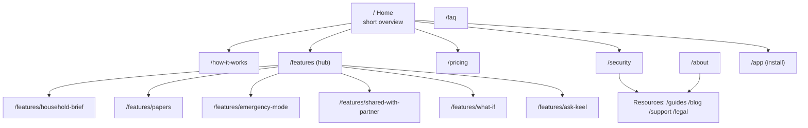

# LifeKeel UI redesign: public site, web app and PWA

Status: proposal, 2026-11-21. Scope: `apps/web` public pages (desktop and
mobile browser), the signed-in app, and the installed PWA / Capacitor shell.

Reference: the structure and pacing of consumer finance sites such as
emma-app.com — one message per section, short home page, a page per feature,
device mockups, a pricing comparison page. We borrow **patterns**, not their
look, copy, colours or claims. LifeKeel's rules still decide the content:
informational only, no product recommendations, no invented numbers.

---

## 1. The problem with today's home page

`/` renders `MarketingLanding` → `HomeExperience`, which stacks **16
sections** in one scroll:

| # | Section (component) | What it says |
|---|---|---|
| 1 | `VividHero` | "Know where to look." + 60-word lede |
| 2 | `CostSection` | Most families run on one person's memory |
| 3 | `FamilyStory` | "Marcia's Tuesday" narrative |
| 4 | `AcrossTheYear` | Four moments in the year |
| 5 | `MomentCards` | Three ordinary moments |
| 6 | `Trust` | Six things Keel does not do |
| 7 | `Features` | The things your family says out loud |
| 8 | `BadDay` | Emergency Mode, papers, insurer draft, if you go quiet |
| 9 | `ThreeProblems` | One problem, one evening, one number |
| 10 | `HowItWorks` | Three steps, one evening |
| 11 | `PlusBand` | Keep the household record current |
| 12 | `StatStrip` | Stats |
| 13 | `Plans` | Free + one paid plan |
| 14 | `Questions` | FAQ |
| 15 | `FinalCta` | Make your account |
| 16 | `SiteFooter` | Links |

Problems:

- **Three sections tell the same story** (2, 4, 5 are all "it lives in one
  head"), and two more (9, 10) both explain the method.
- **The core product is found late.** The household brief (the Stage 1
  product per ARCHITECTURE.md §2) appears at section 9.
- **Header links are anchors** (`#features`, `#pricing`, `#security`), so
  there is no page to share, rank or measure per topic.
- **Mobile length.** Roughly 25-30 screen heights on a phone. Most visitors
  will see sections 1-3 only.
- **Two visual identities.** The public site uses the blue/indigo "vivid"
  palette (`vivid-theme.css`); the PWA manifest and app use dark harbour green
  (`#17231f`) and violet `family-*` tokens. Install → open feels like a
  different product.

---

## 2. Goals and measures

| Goal | Measure (existing `growth-track` events) | Target |
|---|---|---|
| Visitors understand the product in one screen | Hero → first CTA click rate | +30% vs current |
| Shorter home | Home scroll height on 390×844 | ≤ 7 screens |
| More signups | `landing_view` → signup start | +20% |
| Topic pages earn search traffic | Organic sessions to `/features/*`, `/pricing`, `/security` | Baseline then grow |
| One product feel | Same tokens on site, app, PWA splash | 100% of surfaces |
| Fast | LCP p75 mobile | < 2.0 s |
| Accessible | axe serious/critical | 0 |

---

## 3. New public information architecture



### 3.1 Page list and where today's content goes

| Route | Purpose | Built from | Length (mobile) |
|---|---|---|---|
| `/` | Hook, three pillars, one proof, one CTA | New hero; trimmed `Features`; `HowItWorks` (compact); `Trust` teaser; `Plans` teaser | ≤ 7 screens |
| `/how-it-works` | The method end to end | `ThreeProblems`, `HowItWorks`, `FamilyStory`, `AcrossTheYear` | 6-8 screens |
| `/features` | Hub: one card per feature | New grid | 2-3 screens |
| `/features/household-brief` | The Stage 1 product: runway months, send link, both adults see it | `ThreeProblems` detail, brief mockup | 4-5 screens |
| `/features/papers` | What is on file, who can open it | `MomentCards`, `BadDay` "Papers the adults can open" | 4 screens |
| `/features/emergency-mode` | What happens on a bad day | `BadDay`, `CrisisSteps` | 4 screens |
| `/features/shared-with-partner` | The other adult knows | `CostSection`, partner invite | 3-4 screens |
| `/features/what-if` | Scenarios: earn less, stop earning | `/events` product shots | 3-4 screens |
| `/features/ask-keel` | Sourced answers from your own record, AI disclosure | Assistant shots + `/ai-processing` link | 3 screens |
| `/pricing` | Free vs Plus comparison matrix + pricing FAQ | `Plans`, `PlusBand`, pricing items from `faq-data.ts` | 3-4 screens |
| `/security` | Exists; absorbs `Trust` ("six things Keel does not do") | `Trust`, existing page | as today |
| `/about` | Why LifeKeel exists | `CostSection`, `FamilyStory` intro | 3 screens |
| `/faq` | Full FAQ, grouped | `Questions`, `faq-data.ts` | grouped accordion |
| `/app` | Install the PWA now; store badges when live; QR on desktop | `InstallHint` logic | 1-2 screens |

`/marketing` and the empty `/trust` route: fold into the above or redirect.
`/guides`, `/blog`, `/support`, `/legal/*` stay as they are and move under a
**Resources** menu.

### 3.2 Old anchors

Static export cannot redirect hashes server-side. A tiny client script on `/`
maps `#features` → `/features`, `#pricing` → `/pricing`, `#security` →
`/security`, `#how-it-works` → `/how-it-works`, `#faq` → `/faq`
(`location.replace`, no history entry). Update `SiteHeader`/`SiteFooter`
links, `sitemap.ts`, `llms.txt`, blog/guide internal links and any lifecycle
email templates that use the anchors.

---

## 4. Home page, section by section

Desktop width 1200 px content, 12-column grid. Mobile 390 px, single column,
16 px gutters.

```
┌──────────────────────────────────────────────────────────────┐
│ Header: logo · Features▾ · How it works · Pricing · Security │
│         · Resources▾                      Sign in [Start free]│
├──────────────────────────────────────────────────────────────┤
│ 1 HERO                                                       │
│  Eyebrow: For households with two adults                     │
│  H1 (≤ 8 words)            │  Phone mockup: the brief        │
│  Sub (≤ 25 words)          │  (runway months, both adults    │
│  [Start free] See how →    │   "seen" ticks)                 │
│  Free first brief · No bank connection needed                │
├──────────────────────────────────────────────────────────────┤
│ 2 TRUST STRIP (only claims /security already backs):         │
│   No product sales · No ads · Your content never trains      │
│   shared AI models · Delete your account anytime             │
├──────────────────────────────────────────────────────────────┤
│ 3 THREE PILLARS (alternating image / text, 1 screen each)    │
│  a. Know your runway     → /features/household-brief         │
│  b. Papers in one place  → /features/papers                  │
│  c. Ready for a bad day  → /features/emergency-mode          │
├──────────────────────────────────────────────────────────────┤
│ 4 HOW IT WORKS: 3 steps in a row (choose, enter, send)       │
│   → Full walkthrough                                         │
├──────────────────────────────────────────────────────────────┤
│ 5 WHAT KEEL WILL NOT DO: 3 of the 6 promises → /security     │
├──────────────────────────────────────────────────────────────┤
│ 6 PRICING TEASER: Free | Plus (price) → Compare plans        │
├──────────────────────────────────────────────────────────────┤
│ 7 CLOSING BAND: H2 + [Start free] + install / QR             │
├──────────────────────────────────────────────────────────────┤
│ Footer                                                       │
└──────────────────────────────────────────────────────────────┘
```

Rules for every public page:

- One idea per section, one H2, body ≤ 40 words, one CTA or one "Learn more".
- Every claim is something the product does today. No download counts,
  ratings or testimonials until they are real and verifiable; the slot for
  social proof stays empty rather than invented.
- Copy passes the same advice wording as detector copy: describe what is on
  file and estimate a gap; point to "a licensed professional". Run new copy
  past `packages/engine/src/__tests__/advice-rule.test.ts` wording by hand, or
  extend that test to cover `apps/web/src/components/landing/*` and
  `site-copy.ts` (recommended: one small PR).
- "Start free" is the primary CTA. "Download the app" appears only after the
  store listings are live; until then `/app`
  offers PWA install.

### Feature page template

Same template for all six `/features/*` pages so they are cheap to build:

1. Hero: eyebrow (feature name), H1, one-line sub, mockup, CTA.
2. Three "what it does" blocks (icon, H3, 2 lines).
3. One worked example with sample figures, labelled as an illustration.
4. "What it does not do" box (from the six promises, relevant ones only).
5. Related features (2 cards) + closing CTA.

### Pricing page

- Two columns, Free and Plus; monthly/annual toggle if annual exists.
- Comparison matrix (feature rows with tick / dash / value; each row has an
  info popover). Built from one typed data file shared with the in-app
  `/upgrade` page, so price and features cannot drift.
- Pricing FAQ (5 questions) and a "no product sales, no commissions" note.

---

## 5. Design system

One token set for public site, app and PWA. It replaces `vivid-theme.css`
variables and the `family-*`/`surface-*` Tailwind tokens with a single source
in `globals.css`, exposed to Tailwind as CSS variables (the pattern
`tailwind.config.js` already uses).

### 5.1 Colour

Direction: calm, trustworthy, warmer than a bank. Keep the harbour/keel
identity (deep sea green) as the brand anchor so the PWA icon, splash and
site match; use one bright accent for actions.

| Token | Light | Dark | Use |
|---|---|---|---|
| `--bg` | `#F7F8F6` | `#0E1513` | Page |
| `--surface-1` | `#FFFFFF` | `#16201D` | Cards |
| `--surface-2` | `#EEF2EF` | `#1E2A26` | Raised / inputs |
| `--ink-1` | `#0F1A17` | `#EEF3F0` | Headings, body |
| `--ink-2` | `#44524D` | `#B4C1BC` | Secondary text |
| `--line` | `#DCE3DF` | `#2A3833` | Borders |
| `--brand` | `#17675A` | `#4FC1A8` | Brand, links |
| `--brand-ink` | `#FFFFFF` | `#0E1513` | Text on brand |
| `--accent` | `#2F6BFF` | `#7FA4FF` | Primary buttons, focus ring |
| `--good` | `#1F8A4C` | `#5BD08C` | On file / confirmed |
| `--watch` | `#B26B00` | `#F2B54A` | Coming up / estimate |
| `--gap` | `#B3261E` | `#FF8A80` | Looks light |

All text pairs ≥ 4.5:1 (verify with the `dataviz`-style validator or axe in
CI). Status colours always pair with an icon and a word, never colour alone.
Values are a starting point for the designer, not final brand.

### 5.2 Type

- One family: Inter (already the fallback in `--vv-font`), self-hosted,
  `font-display: swap`, subset Latin + Latin Extended (Slovenian).
- Fluid scale: display `clamp(2.25rem, 5vw, 3.75rem)`, H2 `clamp(1.75rem,
  3.2vw, 2.5rem)`, H3 1.25rem, body 1.0625rem / 1.6, small 0.875rem.
- Sentence case. Headlines ≤ 8 words.
- Tabular numbers (`font-variant-numeric: tabular-nums`) for any figure.

### 5.3 Space, shape, depth, motion

- 4 px base; section padding `clamp(64px, 10vw, 128px)` desktop, 56 px mobile.
- Radii: 12 (inputs), 20 (cards), 28 (feature panels), full (pills).
- Two shadows only: `sm` for cards, `lg` for floating mockups and sheets.
- Motion: 150 ms (press), 250 ms (enter), ease-out. Scroll reveal is a single
  fade-up, once. Everything off under `prefers-reduced-motion`. Public pages
  use CSS transitions; Framer Motion stays in the app only (keeps public JS
  small).

### 5.4 Components to build or consolidate

| Component | Replaces / reuses |
|---|---|
| `Button` (primary, secondary, quiet; sm/md/lg) | `lk-btn`, `vv-btn`, `GlassButton` |
| `Section` (eyebrow, title, intro, children) | `Heading` in `VividSections.tsx` |
| `FeatureBlock` (image left/right, Learn more) | `Features` items |
| `DeviceMockup` (phone / laptop frame, light+dark screenshot pair) | new |
| `TrustStrip` | new, from `Promises` / `Trust` |
| `PlanCard`, `PlanMatrix` | `Pricing.tsx`, `Plans` |
| `Accordion` | `Faq.tsx` |
| `MegaMenu` (desktop) / `Sheet` (mobile) | `SiteHeader` menu |
| `InstallCard` (PWA prompt, iOS steps, QR on desktop, badges later) | `InstallHint` |
| `Card`, `StatTile`, `StatusPill`, `ListRow` | `GlassCard`, ad-hoc pills (app) |

Screenshots for mockups come from the real app with a seeded demo household,
captured by a Playwright script in light and dark, so they never drift from
the product and never show real family data.

---

## 6. Responsive behaviour (public site)

| Breakpoint | Layout |
|---|---|
| < 640 | Single column; hero mockup below copy and cropped to the top half of the phone; sticky bottom CTA bar after the hero scrolls out (existing `StickyCta`, restyled); header collapses to logo + menu button + "Start" |
| 640-1023 | Two-column feature blocks; mega menu becomes a sheet |
| ≥ 1024 | 12-column grid, alternating feature blocks, mega menu on hover/focus, QR code next to install CTA |

Tap targets ≥ 44 px. No horizontal scroll at 320 px. Images: AVIF/WebP with
explicit width/height; hero mockup preloaded; everything else lazy.

---

## 7. Signed-in app, PWA and native shell

The app already has a bottom tab bar (`AppNav`: Home, What If, Ask Keel,
Family, Settings) and a desktop rail (`NavRail`: Home, Inbox, Family,
Finances, Briefs, What If, Settings). Proposed changes:

### 7.1 Navigation

| Mobile tab bar (5) | Desktop rail |
|---|---|
| Home | Home |
| Briefs | Inbox |
| **Ask Keel** (centre, raised) | Briefs |
| Family | Family |
| More (sheet: Inbox, Finances, What If, Papers, Settings) | Finances |
| | What If |
| | Papers |
| | Settings (bottom) |

Rationale: Briefs is the Stage 1 product and earns a tab; What If moves into
More on mobile until usage data says otherwise. Inbox shows a badge on More.

### 7.2 Home dashboard

```
┌───────────────────────────────┐
│ Good evening, Sam      [avatar]│
│ ┌───────────────────────────┐ │
│ │ RUNWAY                    │ │
│ │ 4.5 months  (estimate)    │ │
│ │ Both adults have seen it ✓│ │
│ │ [Open brief]              │ │
│ └───────────────────────────┘ │
│ Today                         │
│  • Car insurance renews 3 Dec │
│  • Partner hasn't opened brief│
│ Your record  (scrolls →)      │
│ [Protection][Papers][Dates]…  │
│ Recent activity               │
└───────────────────────────────┘
```

- One summary card at the top (from `TodayCard`/`PerceivedProtectionCard`),
  then a short Today list, then horizontally scrolling category cards, then
  activity. `src/app/page.tsx` (1,226 lines) splits into these four blocks.
- "Estimate" and "on file" labels are always visible next to numbers.
- Amounts can be hidden with an eye toggle (remembered per device), which the
  widget and app-switcher privacy screen reuse.

### 7.3 PWA and shell specifics

- One theme: manifest `theme_color`/`background_color` follow `--bg` for the
  light and dark variants (`media` theme-color meta), splash matches.
- Safe areas: header and tab bar use `env(safe-area-inset-*)`; check the
  auth logo under the status bar (fixed in the current branch) across all
  auth screens.
- Standalone mode hides marketing chrome; external links open in the system
  browser.
- Offline: a slim banner ("Offline: showing what was last loaded") instead of
  error pages; writes are disabled, not queued (ARCHITECTURE.md notes the
  offline command queue is deliberately not built).
- Install: `/app` page plus the existing contextual `InstallHint`; iOS gets
  the Share → Add to Home Screen steps with a short looping video.
- Native shell: bottom sheets, haptics on confirm, native scanner entry on
  the Papers tab.

---

## 8. Performance and quality budgets

| Budget | Public pages | App |
|---|---|---|
| JS (gz) per route | ≤ 90 KB | ≤ 250 KB initial |
| LCP p75 mobile | < 2.0 s | < 2.5 s |
| CLS | < 0.05 | < 0.1 |
| INP p75 | < 200 ms | < 200 ms |
| Lighthouse (perf/a11y/SEO/best practice) | ≥ 95 | ≥ 90 |
| axe serious/critical | 0 | 0 |

Public pages must not import `framer-motion`, `mermaid`, `reactflow`,
`@huggingface/transformers` or `@mlc-ai/web-llm`; add an ESLint
`no-restricted-imports` rule scoped to `components/landing/**` and the public
routes.

SEO: per-page `metadata` (title ≤ 60, description ≤ 155), OG image per
feature page, `FAQPage` structured data on `/faq`, `SoftwareApplication` on
`/app`, canonical per TLD with `hreflang` for `.co.uk`/`.si`.

---

## 9. Delivery plan

Each phase is one or two PRs, with Playwright screenshots attached.

| Phase | Work | Risk | Size |
|---|---|---|---|
| **1. Split pages, current look** | Create routes in §3.1 by moving existing section components; new short home; header/footer links; hash redirects; sitemap | Low: content reused | 3-4 days |
| **2. Tokens and primitives** | §5 tokens in `globals.css`; `Button`, `Section`, `Card`, `Accordion`, `PlanMatrix`; migrate public pages | Medium: visual regressions | 1 week |
| **3. Visual refresh, public** | Hero mockups (seeded screenshots), feature template, pricing matrix, `/app` page, mega menu | Low | 1-1.5 weeks |
| **4. App shell** | Nav change (§7.1), Home split (§7.2), status pills, amount-hide toggle | Medium: touches the main app route | 1.5 weeks |
| **5. PWA polish** | Theme-color per scheme, splash, offline banner, install video | Low | 2-3 days |
| **6. Measure and trim** | Compare §2 targets after 4 weeks; cut sections that do not earn clicks | — | ongoing |

Phase 1 alone fixes the "too long" problem and can ship this sprint; the rest
can follow without blocking it.

---

## 10. Open decisions

1. Brand colour: keep harbour green as the anchor (recommended, matches the
   icon) or move the whole product to the site's current blue?
2. Is "Briefs" the right tab name for families, or "Our plan" / "Runway"?
   Test with five households before Phase 4.
3. Which illustration style for feature pages: product screenshots only
   (recommended, honest and cheap) or commissioned illustrations?
4. Extend `advice-rule.test.ts` to public-page copy now (recommended) or keep
   it detector-only?
