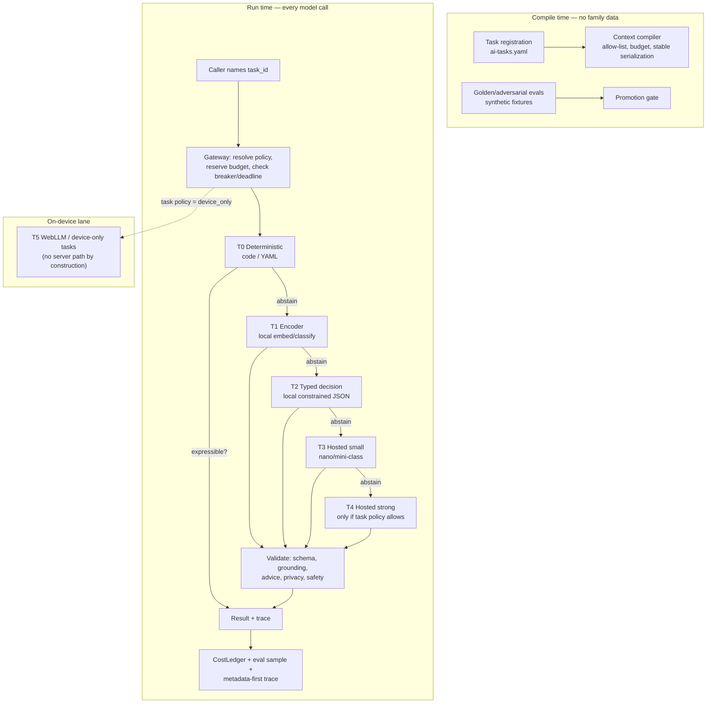

# Cascade: LifeKeel's governed-inference framework

Proposal date: 20 October 2026. Status: **framework proposal for review**.

This document packages the LLM-usage discipline from
[llm-usage-patterns-low-cost-and-private-2026-10.md](llm-usage-patterns-low-cost-and-private-2026-10.md)
and the governance machinery already in `apps/api/src/ai/task-gateway.ts` /
`definitions/ai-tasks.yaml` into a **named, reusable framework**: a repeatable
way to route every language/vision/decision workload through the cheapest
sufficient executor under enforceable cost, privacy, and safety contracts.

The goal: "how to use LLMs effectively at least cost" becomes a *thing LifeKeel
implements and can demonstrate*, not a slide. Internally it is the contract all
code follows; externally, selected parts can be published as a reference
architecture once the IP boundary below is honored.

> **Naming:** *Cascade* — because the framework's core rule is that work
> descends an authority/cost ladder, escalating only when a cheaper tier
> abstains. The name is a working title; check trademark/namespace collisions
> before any external use.

---

## 1. The framework in one diagram

Five load-bearing rules:

1. **No call without a registered task policy** — the registry is the contract
   (already enforced; unknown task_ids fail closed outside dev).
2. **Escalation is earned by abstention, never by prompt length** — each tier
   must explicitly decline before the next is paid for.
3. **Deterministic tiers own truth; models own language** — narration renders
   computed results; it never derives them.
4. **Privacy is a property of the executor class, not of the prompt** — sealed
   and device-only data classes cannot reach a hosted provider by construction.
5. **Cost is measured per correct accepted result**, not per token.

## 2. The five framework contracts

Everything reusable about Cascade lives in five artifacts. Each is independent
of LifeKeel's domain — which is what makes the framework exportable.

### C1. Task Policy (`ai-tasks.yaml` schema)

The declarative contract every workload registers: task id, version, authority
class (narrate/decide/extract/vision), `allowed_models`, input/output ceilings,
deadline, retry class, data boundary (`open / minimized / sealed /
device_only / lifekeel_infra_required`), processor-terms ref, retention class,
eval suite ref. This is the framework's "IR" — language-agnostic YAML that any
runtime can enforce.

### C2. Context Compiler

A typed builder that renders prompts from allow-listed fields only:
deterministic projection (dates, currency, ages computed by code), token budget
enforced at compile time, stable prefix serialization for provider caching, and
a content hash used as the exact-cache key and eval join key. The compiler —
not the prompt author — is the privacy boundary.

### C3. Escalation Ladder

The tiered executor table with explicit abstention semantics:

| Tier | Executor | Pays | Contract |
|---|---|---|---|
| T0 | Code/YAML rules | nothing | If expressible exactly, model never runs |
| T1 | Local encoder (bge, GLiNER-class) | ~nothing | Stable bounded labels, routing, dedup |
| T2 | Local constrained decision model | near-nothing | Bounded multi-way choice, schema-validated |
| T3 | Hosted small model | $ | Structured extraction, short drafts |
| T4 | Hosted strong model | $$ | Only tasks whose policy names it |
| T5 | On-device (WebLLM) | user's device | Sealed drafting; no server path exists |

A tier must return `abstain` (typed, not silent failure) to pass work upward.
The **escalation rate** per task is a first-class metric — a silent climb is a
cost incident.

### C4. Validation Gates

Guard stack applied symmetrically to every executor (cloud, local, vision,
device): schema validation, grounding/ungrounded-number checks, advice-rule
screen, privacy screen, safety checks. Output contract: `accept / reject /
abstain / escalate`. Constrained-narration tasks additionally require that
numbers in output be *copied from* the sanctioned input — presence-required,
not just absence-forbidden.

### C5. Promotion & Economics Loop

Eval-gated lifecycle shared by models, prompts, and task policies:
`candidate → shadow → A/B → production → retired`, with `eval_runs` lineage
(kind, dataset hash, code SHA, metrics, verdict, approver). The optimization
variable is `cost_per_correct = (tokens + retries + fallback + human review
minutes × rate) ÷ accepted-correct results`. Self-hosting a tier is approved
only when privacy/latency demands it or projected hosted spend exceeds fully
loaded self-hosting by a deliberate margin (today: 1.3× for 2 consecutive
months).

## 3. What's already built vs. what the framework adds

| Framework piece | Status | Gap to close |
|---|---|---|
| Task registry + fail-closed gateway | **Implemented** (§8.15) | Atomic budget reservation; processor-terms expiry blocking |
| Symmetric guards incl. local/vision | **Implemented** | Constrained-narration presence-requirement (P3) |
| Local encoder tier, Ollama decision tier, WebLLM lane | **Implemented/bounded** | Escalation-rate instrumentation |
| Cost ledger + per-tenant budget | **Implemented** | Join to eval outcomes → cost_per_correct metric |
| Exact response cache, tenant-scoped | **Implemented** | Cache-hit-rate alerting per task |
| Context compiler as a shared typed API | **Missing** | Today: per-callsite string assembly; build one compiler |
| Synthetic-first eval/distillation pipeline | **Partial** (golden detector evals exist) | Task-level synthetic suites; n-gram overlap screen vs. tenant data |
| Eval-suite wiring to promotion | **Debt** (§8.15 item 3) | Gate prompt/model/policy changes on task evals |
| Batch task classes | **Design only** | Separate task ids with batch retention class |

## 4. Internal reuse

The framework is reusable inside LifeKeel in three ways immediately:

1. **New features get AI for near-free**: adding an AI capability = register a
   task policy + write a context compiler + add golden evals. No new plumbing.
   This is the "add-detector skill" pattern applied to AI tasks — worth a
   `add-ai-task` skill mirroring `.claude/skills/add-detector`.
2. **Marketing/ops surfaces reuse the same discipline**: operator autopilot
   and campaign drafts are batch-class tasks (C5) with their own retention
   class — the framework governs them identically, including the
   `NEVER_AUTONOMOUS` publish gate.
3. **Eval methodology is shared**: the golden-dataset pattern already proven
   on detectors generalizes to narration diffs (P3), triage accuracy, and
   guard fixtures.

## 5. External story: what to publish vs. what stays private

From the foundations research, split the framework into **shareable hygiene**
(publishing strengthens the brand and harms no IP position) and **protected
composition** (the family-domain mechanisms pending counsel review).

### Publishable — "how we run LLMs cheaply and safely"

- The five-contract architecture (C1–C5) as a reference design.
- Escalation-rate instrumentation and cost-per-correct-result accounting.
- The tier table and abstention contract ("models earn their tier").
- Synthetic-first eval methodology and the non-training construction controls
  (allow-lists, extraction-not-documents, sealed/device-only classes).
- The task-policy YAML schema itself (minus provider-specific pricing).
- Honest failure data: where local models rejected more, where abstention won.

Framed externally as: *"Cascade: a governed-inference reference architecture —
deterministic-first, tier-escalating, cost-per-correct-result AI for products
where a wrong answer has consequences."* This is genuinely publishable IP-safe
material: it's the hygiene layer every serious product will need as the
agentic-AI trough hits, and being first to name it is a credibility asset.

### Stays in-repo until counsel reviews

- LifeGraph internals (derivation-closure invalidation, M1)
- Disclosure Lattice label algebra and dynamic-principal composition (M2)
- Earned-Scope classified-effect equality + forfeit-by-construction (M5)
- The M1+M2+M5 system-level composition claim
- Proof-of-Handover freshness-bound certificates (M3)
- Per-tenant conformal alerting specifics (M4)

Reason (from mechanism-foundations-research): the *family-domain compositions*
are the only plausible patent claims; publishing mechanism internals before a
filing decision could start novelty clocks or tip the composition to fast
followers.

## 6. Extraction path (if the framework ever becomes a package)

Not now — but the seam should exist so it *could*:

- `packages/platform/src/task-gateway.ts` already concentrates enforcement;
  C1 (registry schema) and C4 (guard interfaces) are the portable parts.
- Keep LifeKeel-domain content (detectors, advice rules, family schemas) out of
  the framework layer: the framework is task-agnostic; domain lives in YAML and
  fixtures. That separation is already mostly true — preserve it.
- If demand ever justifies it, a `@lifekeel/cascade`-style package = registry
  schema + context compiler + ladder executors + guard interfaces + ledger/
  eval contracts. LifeKeel ships policies and evals on top.

## 7. Roadmap hooks

| Order | Item | Depends on |
|---|---|---|
| 1 | Context compiler as shared typed API (C2) | — |
| 2 | Escalation-rate + cache-hit telemetry per task | 1 |
| 3 | Constrained-narration guard upgrade (presence-required) | — |
| 4 | `add-ai-task` skill + task eval suite wiring (C5) | eval-runs lineage |
| 5 | Synthetic-first pipeline for local tiers (P5) | overlap screen |
| 6 | Batch task classes with separate retention | — |
| 7 | External "Cascade" reference-architecture writeup | IP boundary sign-off |

This framework is the operational complement to the proprietary mechanisms:
M1–M7 are *what's unique about what Keel knows and may do*; Cascade is *how
every model invocation is priced, bounded, and proven*. Together they make the
"we use LLMs differently" claim demonstrable rather than rhetorical.
