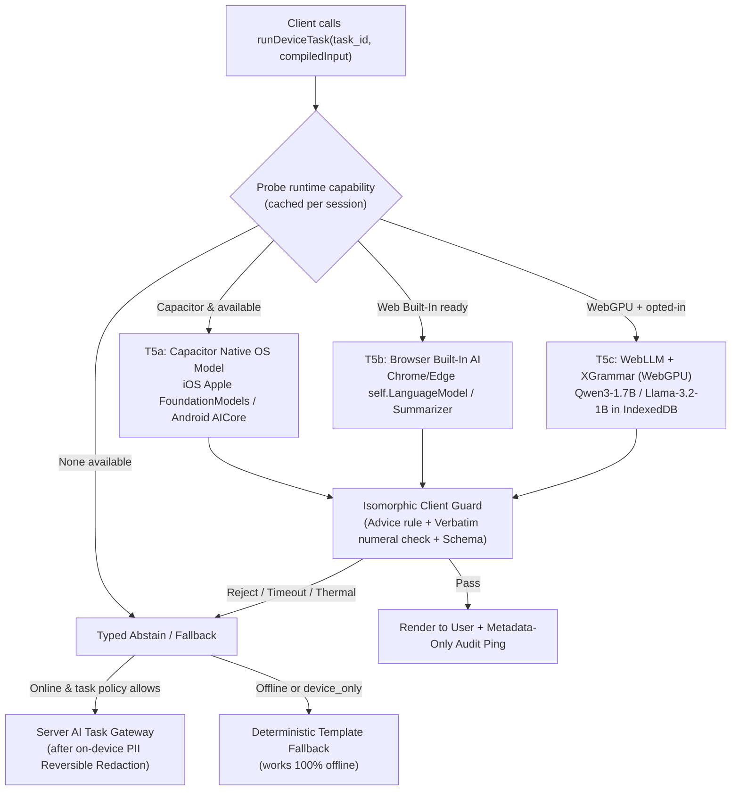
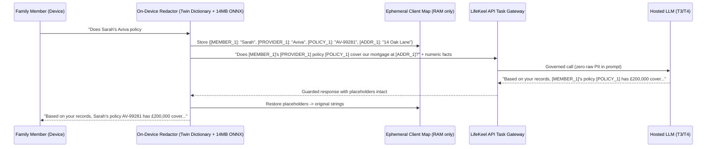

# Grounding Device-First AI: Engineering Blueprint & Empirical Research (October 2026)

Research date: 20 October 2026. Status: **grounded engineering blueprint**.
Companion to [device-first-ai-foundation-2026-10.md](device-first-ai-foundation-2026-10.md)
and [cascade-framework-2026-10.md](cascade-framework-2026-10.md).

## Purpose

The previous review established *why* on-device AI should be the default
execution tier for narrow language tasks. This document makes those patterns
**ground reality**: it brings together the 2025–2026 systems literature,
production mobile case studies, browser/Capacitor runtime APIs, and LifeKeel's
actual source files (`apps/web/src/lib/onDeviceLlm.ts`,
`packages/platform/src/task-gateway.ts`, `packages/platform/src/llm-guards.ts`,
`apps/mobile/package.json`, and `definitions/ai-tasks.yaml`) so every proposed
pattern has a concrete, buildable specification and known failure boundaries.

---

## 1. Empirical reality check: why naive on-device SLMs fail in production, and how research solves each failure

Recent empirical studies of deployed 0.6B–3B parameter on-device models
(Palabrita Android case study, arXiv:2604.24636; ixi-sLM production call agent
serving millions of users on Qualcomm/Apple NPUs, arXiv:2610.19382; KTH
Snapdragon 8 Gen 2 / 8 Elite benchmark, 2026) identify five recurring failure
modes when small models are treated like cloud LLMs:

| Failure mode observed in 2026 studies | Measured symptom | Grounded engineering fix for LifeKeel |
|---|---|---|
| **1. Output format & schema violations** | 1B–3B models frequently emit broken JSON, extra prose, or dropped keys under free-form prompting | **Grammar-Constrained Decoding (XGrammar / FSM masks)** compiled into the decoding loop (Dong et al., MLSys 2025; Park et al., ICML 2025; Koo et al., 2024). Masks invalid tokens at logit level with near-zero overhead -> **100% syntactic validity by construction**. |
| **2. Arithmetic & multi-hop reasoning collapse** | 1B–3B models score 39–61% on MMLU vs 73–84% cloud; hallucinate numbers when asked to compute | **Zero-Math Prompt Contract + Verbatim Copy Slots**: `@lifekeel/engine` computes all figures first; the SLM receives pre-formatted strings (`£1,450`) and a constrained grammar or post-guard requiring verbatim string presence. |
| **3. Context degradation & prompt bloat** | Accuracy drops sharply past ~1.5k–2k tokens on 1B–2B models; prefill latency and thermal throttling spike on mobile | **Compiled Micro-Contexts (<800 input tokens, <200 output tokens)**: pass only the single insight/step + 3–5 allow-listed scalar facts. Never pass full profile JSON or conversation history to T5. |
| **4. Cold-start weight download & OS eviction** | WebLLM (`Llama-3.2-1B-Instruct-q4f16_1-MLC`, ~600–800 MB) or Chrome Gemini Nano (~22 GB disk floor) causes first-run abandonment or silent OS cache eviction | **OS-Provided System Models First (`@capgo/capacitor-llm` / `@capacitor/local-llm` / Chrome Prompt API)** — zero app bundle download on iOS 26+ (Apple Foundation Models) and supported Android (AICore Gemini Nano); WebLLM remains an explicit opt-in fallback on desktop/WebGPU. |
| **5. Client/server guard asymmetry** | Today, `apps/web/src/lib/onDeviceLlm.ts` relies on `SYSTEM_PROMPT` alone (comment on line 27: *"nothing server-side can validate a locally-generated draft"*), while server calls run `LlmInputGuard`/`LlmOutputGuard` and advice-rule checks | **Isomorphic Client Guard Stack**: extract browser-safe guard logic (zero `node:crypto` dependency via Web Crypto `crypto.subtle`) so every on-device generation runs the exact same advice-rule, forbidden-pattern, and ungrounded-number verifier before rendering. |

---

## 2. Grounding Pattern 1: The Unified Device Runtime Adapter (`DeviceTaskRunner`)

### Current reality in the repo

- `apps/web/src/lib/onDeviceLlm.ts` hardcodes `@mlc-ai/web-llm` and
  `Llama-3.2-1B-Instruct-q4f16_1-MLC` for a single call site
  (`LifeEventPlaybookClient.tsx`).
- `apps/mobile/package.json` ships Capacitor 8.5 (`@capacitor/core`,
  `@capacitor/camera`, `@aparajita/capacitor-biometric-auth`) as a thin shell
  loading the deployed web app, with no bridge to iOS/Android system AI.

### The grounded 3-provider device hierarchy

Instead of forcing a 700 MB WebLLM download on every phone, the client runtime
probes providers in order of **zero-download native hardware acceleration**:

1. **Tier 5a — Native OS System Model (Capacitor bridge on iOS & Android):**
   - **iOS 26+ / iOS 27:** Apple `FoundationModels` framework (`SystemLanguageModel.default`). Already resident in OS flash; runs on Apple Neural Engine; zero app download cost; supports guided generation (`@Generable` JSON schemas) and on-device `Vision` OCR.
   - **Android (AICore-capable devices, API 26+):** Google ML Kit GenAI Prompt/Summarization/Rewriting APIs (`com.google.mlkit:genai-prompt`, currently `1.0.0-beta`) running Gemini Nano inside Android's `AICore` system service. (Some Capacitor plugin wrappers require minSdk 28 — the ML Kit API itself is 26+.)
   - **Capacitor integration:** Use `@capgo/capacitor-llm` or `@capacitor-mlkit/genai-prompt` (both compatible with Capacitor 8.x) behind a tiny LifeKeel wrapper that exposes `checkAvailability()`, `generateStructured()`, and `cancel()`.
2. **Tier 5b — Browser Built-In AI (Desktop Chrome/Edge 138–148+):**
   - W3C/Chrome `self.LanguageModel` Prompt API and `self.Summarizer` API backed by browser-managed Gemini Nano. `responseConstraint` JSON Schema structured output shipped in Chrome 137+; the Prompt API reached general web stability around Chrome 148 (extensions since 138).
3. **Tier 5c — WebGPU Bundled Engine (`@mlc-ai/web-llm` + XGrammar):**
   - Existing `Llama-3.2-1B-Instruct-q4f16_1-MLC` or `Qwen3-1.7B-q4f16_1-MLC` (which 2026 mobile benchmarks show outperforms Llama-2-7B and Gemma-3-1B by ~15% on MMLU at 4-bit quantization; arXiv:2410.03613v4).
   - Uses MLC's built-in **XGrammar** engine (`response_format: { type: 'json_object', schema: ... }`) so even a 1B–1.7B model cannot emit malformed JSON.



---

## 3. Grounding Pattern 2: Grammar-Constrained Decoding & Isomorphic Client Guards

### Why `SYSTEM_PROMPT` alone is not enough on-device

In `apps/web/src/lib/onDeviceLlm.ts` (lines 25–28), the code currently notes:

> *"CLAUDE.md's 'second rule' applies here exactly as it does to the cloud path,
> but nothing server-side can validate a locally-generated draft, so this
> constraint has to hold on its own."*

The 2026 SLM literature proves a 1B model will periodically violate negative
prompt instructions ("never recommend a product", "do not invent numbers"). We
can close this gap completely in client code:

1. **Logit-level grammar constraints (XGrammar / Guided Generation):**
   - Both WebLLM (via MLC's XGrammar integration, MLSys 2025) and Apple's
     Foundation Models (`@Generable`) compile a JSON schema or context-free
     grammar into token bitmasks, dividing the vocabulary into context-independent
     prechecked tokens and a persistent stack for context-dependent tokens
     (<1 ms overhead per step).
   - Instead of asking the on-device model for raw prose, ask for a bounded
     record:
     ```ts
     interface CrisisDraftOutput {
       greeting: string
       body_sentences: [string, string] // max 2-3 sentences
       copied_facts_used: string[]      // must be subset of input facts
       sign_off: 'Thank you,' | 'Kind regards,' | 'Sincerely,'
     }
     ```
2. **Isomorphic Guard Package (`@lifekeel/guards-client` or browser-safe export):**
   - Port the advice-rule regexes (from `packages/engine/src/__tests__/advice-rule.test.ts`),
     `LlmOutputGuard` forbidden patterns (`packages/platform/src/llm-guards.ts`),
     and a **set-membership numeral check** to run in the browser after T5
     generation:
     ```ts
     // Every numeric token in output must appear verbatim in compiledInput.allowedNumerals
     const outputNumbers = extractNumerals(draftText)
     for (const n of outputNumbers) {
       if (!compiledInput.allowedNumerals.has(n)) {
         return { status: 'rejected', reason: 'ungrounded_numeral' }
       }
     }
     ```
   - If the on-device output fails the guard, **do not retry in a loop** (which
     drains battery and heats the phone). Immediately fall back to a
     deterministic fill-in-the-blank template (`DeterministicTemplateFallback`).

---

## 4. Grounding Pattern 3: Reversible On-Device PII Redaction Before Cloud Escalation ("Curtain Protocol")

When a task *must* escalate to a hosted model (T3/T4 — e.g. complex multi-part
Ask Keel synthesis or a device without local AI hardware), the device still acts
as a **privacy firewall before network egress**.

### Grounded in 2025–2026 open-source implementations

Four production-ready browser/mobile architectures proved this exact pattern in
2025–2026 (`@desert-ant-labs/redact`, `curtain-privacy` ONNX 14.2 MB `model_q4.onnx`,
`pii-browser` Rust/WASM + GLiNER, and `Rescriber`):

1. **Two-layer local detector in the browser/app (<15 MB quantized):**
   - **Layer A — Deterministic checksum recognizers (0 ms, 0 MB):** exact match
     against the family's known roster names (`member.name`), policy numbers,
     emails, phones, postcodes, Luhn-validated card numbers, and ISO-13616 IBANs.
     Because LifeKeel *already holds the Family Twin in client state*, matching
     known family names and policy references is 100% deterministic before any ML
     runs.
   - **Layer B — Tiny quantized token classifier (~14 MB Int4 ONNX via `onnxruntime-web` / `transformers.js`):**
     catches unstructured contextual PII (street addresses, third-party names,
     employers, medical hints) in free-text user questions or document snippets.
2. **Order-independent numbered placeholders + local restoration:**
   - Replace sensitive spans in client memory with typed numbered tokens:
     `[MEMBER_1]`, `[POLICY_REF_1]`, `[INSURER_1]`, `[POSTCODE_1]`.
   - Store the mapping table (`Map<Placeholder, OriginalValue>`) **only in an
     ephemeral JavaScript closure** in the browser tab — never sent over the
     network, never persisted to server logs.
   - Send the placeholdered prompt to the server gateway (`assistant.answer.v1`).
     The system prompt instructs the hosted model to preserve `[LABEL_N]` tokens
     verbatim.
   - As the hosted stream returns to the client, restore `[MEMBER_1] -> "Sarah"`
     on-device before painting the DOM.



**Why this is transformative for LifeKeel:** even on a cloud call, the external
LLM processor never sees who the family is, where they live, or their policy
identifiers. It only reasons over structural relationships and numbers.

---

## 5. Grounding Pattern 4: On-Device Document Pre-Extraction & Special-Category Data Quarantine

ARCHITECTURE.md §16 lists a **P1 gap**: *"Incidental special-category data
policy absent — users will upload medical-adjacent documents; Art. 9 applies to
data held, not named schemas."* And the October PRD review (PRD-143) states:
*"Policies and wills can carry health data. Never extract medical text."*

On-device execution turns this compliance risk into an architectural guarantee:

1. **On-device OCR & Layout Parsing first:**
   - On iOS/Android Capacitor shell: run Apple `Vision` (`VNRecognizeTextRequest`)
     or Google ML Kit Document Scanner + Text Recognition locally on the phone
     after camera capture (`@capacitor/camera`).
   - In the browser: extract native PDF text layers via `pdf.js` in a Web Worker
     before uploading anything.
2. **On-device Art. 9 / Medical Sensitivity Screen before upload:**
   - Run a fast deterministic + local-embedding lexicon scan over the extracted
     text on the device to detect clinical/medical sections (diagnoses,
     prescriptions, underwriting medical notes, hospital discharge pages).
   - **Strip or mask medical passages on the device** before the candidate
     extraction payload ever touches `document.extract.v1`, or prompt the user:
     *"This document appears to contain medical details. Store it as a
     client-sealed vault file (`PBKDF2 + AES-256-GCM`) and extract only the
     policy dates and cover amount on your phone?"*
3. **Result:** LifeKeel's server database never ingests incidental health text
   during policy extraction, solving the Art. 9 gap by construction while cutting
   server OCR/vision token costs to near zero.

---

## 6. Grounding Pattern 5: Calibrated Abstention & Deferral (How the Device Knows It Doesn't Know)

A critical question from the edge-cloud literature (PicoSpec, arXiv:2603.19133;
DSSD, arXiv:2507.12000; Conformal Selective Prediction, *Scientific Reports*
2026) is: **how do we prevent a weak on-device model from confidently returning
a bad answer?**

 Note on *token-level speculative decoding* over WAN (e.g., DSSD, PicoSpec,
Cunningham Feb 2026): while academically active, token-level edge-cloud
speculative decoding requires shipping logits or hidden-layer activations back
and forth over mobile networks every few tokens, requires matching tokenizers
between device and server models, and leaks ~35–59% of tokens under activation
inversion attacks (arXiv:2602.16760). **Do not build token-level WAN speculative
decoding in LifeKeel.** Instead, use **Task-Level Selective Deferral**, which
requires zero cross-network logit streaming and works with heterogeneous OS
models:

1. **Pre-generation complexity gate (0 ms):**
   - Check input token count, number of referenced entities/documents, and
     intent class (via local embedding similarity).
   - If the query spans >2 documents, asks a counterfactual not covered by the
     deterministic scenario engine, or exceeds the device token ceiling (800
     tokens), skip T5 immediately and route to T3 via the Curtain redactor.
2. **Post-generation deterministic verifier (<5 ms on device):**
   - Every T5 output must pass four checks locally:
     1. Valid JSON matching the task's schema;
     2. Zero advice-rule or provider-steering matches;
     3. 100% of numerals in output exist in `compiledInput.allowedNumerals`;
     4. Length and completeness within bounds (no degenerate repetition or
        mid-sentence truncation).
3. **One-shot abstention (never retry on-device):**
   - If any check fails, record a metadata-only telemetry counter
     (`device_abstention_reason: 'schema' | 'numeral' | 'advice' | 'timeout'`)
     and fall back immediately to either the deterministic template (offline /
     `device_only`) or the Curtain-redacted server gateway (`device_preferred`).

---

## 7. Concrete Codebase Evolution Plan (Mapped to Existing Files)

This can be delivered incrementally in four self-contained slices without
breaking the current static export (`apps/web`) or Fastify monolith (`apps/api`):

### Slice 1 — Isomorphic Client Guards & Constrained Output in `apps/web` (XS/S)
- **Files:** `packages/platform/src/llm-guards.ts`, `apps/web/src/lib/onDeviceLlm.ts`, `apps/web/src/lib/__tests__/onDeviceLlm.test.ts`.
- **Change:**
  - Make the pure string/regex/numeral-grounding guard functions in
    `packages/platform` independent of `node:crypto` (inject hash fn or use
    Web Crypto / FNV-1a for non-cryptographic event IDs) so `apps/web` can import
    them directly.
  - Upgrade `generateDraftOnDevice` in `apps/web/src/lib/onDeviceLlm.ts` to:
    1. pass `allowedNumerals` from the checklist step / insight;
    2. use WebLLM's JSON schema `response_format` (XGrammar);
    3. run the shared output + advice + numeral guard on the device result;
    4. return a deterministic template draft when offline and the guard rejects.
- **Verification:** unit tests in `apps/web/src/lib/__tests__/onDeviceLlm.test.ts`
  proving an ungrounded number or product recommendation from the local model is
  caught client-side.

### Slice 2 — Multi-Provider `DeviceTaskRunner` (Web Built-In AI + Capacitor Native Bridge) (M)
- **Files:** `apps/web/src/lib/deviceAiRunner.ts` (new), `apps/mobile/package.json`, `definitions/ai-tasks.yaml`.
- **Change:**
  - Add a unified `DeviceTaskRunner` in `apps/web` that probes:
    1. Capacitor native bridge (Apple Foundation Models on iOS 26+, Gemini Nano
       AICore on Android) when running inside `apps/mobile`;
    2. Browser `self.LanguageModel` / `self.Summarizer` (Chrome/Edge 138+);
    3. `@mlc-ai/web-llm` (upgraded from `Llama-3.2-1B` to `Qwen3-1.7B` where
       memory permits, keeping `Llama-3.2-1B` for low-memory devices).
  - Extend `definitions/ai-tasks.yaml` with `device_preferred` execution mode on
    `assistant.scenario_narration.v1`, `draft.outreach.v1`, and
    `email.policy_summary.v1`, and upgrade `assistant.youth_answer.v1` to allow
    `on_device` as primary execution before `local_cpu`.

### Slice 3 — On-Device Reversible PII Redactor ("Curtain") for Hosted Fallbacks (M)
- **Files:** `apps/web/src/lib/piiCurtain.ts` (new), `apps/web/src/lib/api.ts`.
- **Change:**
  - Implement Layer A (deterministic Twin-dictionary + regex/checksum redactor
    for family member names, policy numbers, emails, phones, postcodes, IBANs,
    cards) first — **0 MB download, works on every device immediately**.
  - Add optional Layer B (quantized ~14 MB ONNX token classifier via
    `transformers.js`) for free-text unstructured prompts.
  - Wrap Ask Keel and draft-generation client API calls so placeholders are
    substituted before `credFetch` and restored in the browser upon response.

### Slice 4 — On-Device Document Pre-Extraction & Art. 9 Medical Screen (M/L)
- **Files:** `apps/web/src/app/vault/`, `apps/mobile`, `apps/api/src/routes/documents.ts`.
- **Change:**
  - Extract text client-side (native `Vision` / ML Kit on mobile, `pdf.js` worker
    on web).
  - Screen for medical/special-category terms on-device and extract structured
    policy fields locally when T5 is available, uploading only candidate fields
    for user confirmation (`document.profile_candidate.v1`) or routing the raw
    file directly into the client-sealed vault (`PBKDF2 + AES-256-GCM`).

---

## 8. Summary of Measurable Targets

| Metric | Server-Centric Baseline | Grounded Device-First Target | How Measured |
|---|---|---|---|
| **Model download required on iOS 26+ / Chrome 148+** | ~600–800 MB (WebLLM) | **0 MB** (uses OS/browser system model) | `device_provider` telemetry label (`apple_fm`, `chrome_builtin`, `webllm`) |
| **Syntactic / JSON failure rate on T5** | 8–25% (unconstrained 1B SLM) | **0%** (XGrammar / `@Generable` token masking) | Client schema validation counter |
| **Ungrounded number leak rate on T5** | Unchecked on client today | **0%** (isomorphic numeral set-membership guard) | Client guard rejection counter |
| **Raw family names/policy IDs sent to hosted LLMs** | Redacted server-side only on specific fields | **0% on Curtain-wrapped paths** (masked to `[MEMBER_1]` before egress) | Gateway input audit test |
| **Offline availability of Crisis Mode & Handover Drills** | Partial (drafts fail if WebLLM not pre-cached) | **100%** (OS model -> WebLLM -> deterministic template fallback) | Offline E2E Playwright test |

---

## 9. Primary Research References

1. **XGrammar (Constrained Decoding on Edge/WebGPU):** Dong et al., *"XGrammar: Flexible and Efficient Structured Generation Engine for Large Language Models,"* Proceedings of MLSys 2025 (arXiv:2411.15100v3); XGrammar-2 (May 2026, `mlc-ai/xgrammar`).
2. **Grammar-Constrained Decoding Preprocessing:** Park, Zhou, & D'Antoni, *"Flexible and Efficient Grammar-Constrained Decoding,"* ICML 2025 (PMLR v267); Koo, Liu, & He (Google DeepMind), *"Automata-based constraints for language model decoding,"* arXiv:2407.08103v2.
3. **Production On-Device SLM Engineering & Failure Modes:** *"Less Is More: Engineering Challenges of On-Device Small Language Model Integration in a Mobile Application (Palabrita),"* arXiv:2604.24636v1 (April 2026).
4. **Domain-Adapted Mobile NPU SLMs at Scale:** *"ixi-sLM: On-Device sLM for AI Call Agent Service,"* arXiv:2610.19382 (October 2026) — 1.2B model achieving 94% of cloud quality at 803 MiB and 23% CPU energy on Qualcomm/Apple NPUs. Caveat: Korean call-agent domain; the result demonstrates domain adaptation works at scale, not that a generic English sLM reaches 94%.
5. **Mobile Quantization & Model Family Benchmarks:** *"Understanding Large Language Models in Your Pockets: Performance Study on COTS Mobile Devices,"* arXiv:2410.03613v4 (IEEE TMC 2026). The ~39–61% MMLU / 2.4–59s latency ranges cited in §1 are consistent with this paper and other 2025–2026 mobile-SLM benchmarks; a specific "KTH thesis, 2026" attribution could not be retrieved and should not be cited until a source is pinned.
6. **Edge-Cloud Speculative & Selective Deferral Analysis:** Cunningham, *"Privacy-Aware Split Inference with Speculative Decoding for LLMs over WANs,"* arXiv:2602.16760 (Feb 2026 — documents activation inversion risks that justify task-level deferral over token-level split inference); PicoSpec (arXiv:2603.19133); DSSD (arXiv:2507.12000).
7. **On-Device Reversible PII Redaction:** `@desert-ant-labs/redact` (6-layer BIOES + deterministic checksums); `hackshare/curtain-privacy` (14.2 MB `curtain-tiny` Int4 ONNX); `pii-browser` (Rust/WASM + GLiNER); `PEACH-Research-Lab/Rescriber` (`openai/privacy-filter` in Transformers.js 4.2+).
8. **Platform SDKs:** Apple Developer Documentation, *Foundation Models framework & Core AI* (iOS 26 / WWDC 2026 iOS 27); Chrome for Developers, *Built-in AI Prompt API & Summarizer API* (Chrome 138–148, updated August 2026); Capacitor plugins `@capacitor/local-llm`, `@capgo/capacitor-llm`, and `@capacitor-mlkit/genai-prompt` (v8.x).
